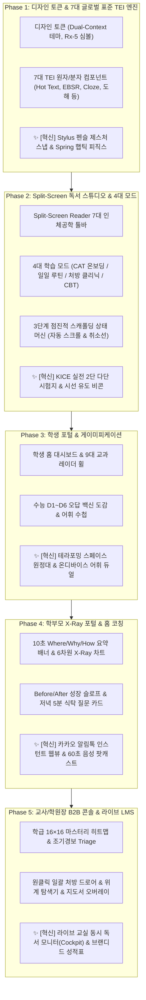
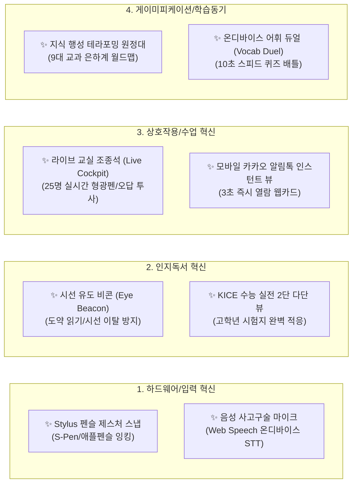

# 🎨 [ReadX-Ray Pro] 단계별 UI/UX 컴포넌트 개발 상세 명세서 & 차세대 혁신 제안 (Component Spec & Advanced Features)

> **문서 식별자**: `UIUX-COMPONENTS-SPEC-2026-V1.0`  
> **기반 문서**: [DEVELOPMENT_PLAN_READX.md](file:///c:/Users/user/Desktop/antigravity/문해력%20교과서/courseware/DEVELOPMENT_PLAN_READX.md), [PRD_2022개정_교과개념_설명문_문해력_코스웨어.md](file:///c:/Users/user/Desktop/antigravity/문해력%20교과서/courseware/PRD_2022개정_교과개념_설명문_문해력_코스웨어.md), [Google_Stitch_UIUX_Design_Prompt_Guide.md](file:///c:/Users/user/Desktop/antigravity/문해력%20교과서/courseware/Google_Stitch_UIUX_Design_Prompt_Guide.md)  
> **적용 시스템**: **ReadX-Ray Pro (리드엑스레이 프로)**  
> **아키텍처 원칙**: Atomic Design System (Atoms ➔ Molecules ➔ Organisms ➔ Templates ➔ Pages)

---

## 1. 단계별 UI/UX 컴포넌트 상세 개발 로드맵



---

## 2. Phase 1: 디자인 토큰 & 7대 TEI 인터랙티브 엔진 컴포넌트

### 2.1 디자인 토큰 & 베이스 아톰 (Base Atoms)
* `RxSymbolIcon`: 공식 CI `Rx-5` (Squircle Gem `℞`) 벡터 SVG 심볼 (크기: 16px/24px/32px/48px 지원).
* `DualThemeWrapper`: 
  - `Analytics Mode` (Slate 50 `#F8FAFC`, Dark Navy `#0F172A`)
  - `Reading Studio Mode` (Warm Paper `#FCFBF7`, KoPubBatang 명조 / Pretendard 고딕 토글).
* `Badge`: 상태별 배지 (`Mastered 🟢`, `Fragile 🟡`, `Critical 🔴`, `Trap 🚨`, `Seed 🌱`).
* `TabularNumber`: KReaD 지수, SmartScore, 백분율 표기용 고정폭(`tabular-nums`) 숫자 레이블.

### 2.2 7대 TEI(Technology-Enhanced Items) 엔진 컴포넌트

| TEI 번호 | 컴포넌트 명칭 | 원자/분자 구조 (Atomic Breakdown) | 인터랙션 및 상태 전이 |
| :--- | :--- | :--- | :--- |
| **TEI-1** | `HotTextPassage` | • `HotTextToken` (`<span>` 단위)<br>• `ClueCounterBadge` (`2/3 포착`)<br>• `SpotlightRing` (펄스 효과) | • 단서 클릭/탭 시 앰버 하이라이트 활성화.<br>• 모든 단서 수집 시 폭죽 Lottie 애니메이션 및 우측 Step 2 자동 해금. |
| **TEI-2** | `EBSRQuestionCard` | • `PartACard` (주장/추론 선지)<br>• `PartBCard` (본문 근거 문장 매칭)<br>• `LinkedBadge` (연동 점수 표시) | • Part A 선택 완료 전까지 Part B 비활성화.<br>• 둘 다 일치해야 완전 통과(2pt), 불일치 시 근거 재탐색 가이드. |
| **TEI-3** | `InlineClozeBuilder` | • `ClozeBlankSlot` (`{b1}`, `{b2}`)<br>• `WordChipDock` (하단 단어 칩)<br>• `ShakeEffect` (오답 튕김) | • 단어 칩 터치 시 첫 번째 빈칸으로 부드럽게 흡수.<br>• 오답 슬롯 투입 시 붉은 진동(Shake) 후 원래 자리로 튕겨 복귀. |
| **TEI-4** | `GraphicOrganizerBuilder` | • `StructureSvgCanvas` (6대 템플릿)<br>• `DraggableNode` (이동 블록)<br>• `SnapTargetZone` (슬롯 자석 감지) | • Meyer 6대 구조(분석, 분류, 순서, 비교, 인과, 문제해결).<br>• 데스크톱 Drag & Drop + 태블릿 Tap-to-Place 듀얼 지원. |
| **TEI-5** | `MultiSourceTabViewer` | • `SourceTabBar` (본문/도표/통합)<br>• `InteractiveChartSvg` (막대/꺾은선)<br>• `SyncHoverHighlight` (문장 연동) | • 도표의 특정 데이터 막대 호버/터치 시 본문 내 원리 설명 문장이 옐로우 스포트라이트로 동시 반응. |
| **TEI-6** | `WritingWorkbench` | • `TopicFunnel` (대➔중➔소주제)<br>• `TrashDropZone` (부적합 자료 휴지통)<br>• `OutlineBlockList` (개요 순서 재배열) | • W1~W4 작문 과정 지원.<br>• 작문 조건 3가지 충족 여부를 판단하는 실시간 신호등(`TrafficLightChecker`) 탑재. |
| **TEI-7** | `RedPenProofreader` | • `UnderlineSection` (`㉠~㉤` 문맥)<br>• `ProofreadPalette` (5종 교정부호)<br>• `MarkupRenderer` (빨간펜 잉크 표기) | • 밑줄 클릭 시 삭제/삽입/대체/자리바꿈/줄바꿈 팝오버 노출.<br>• 적용 시 원문에 빨간 교정부호와 취소선이 렌더링되며 수정문 반영. |

---

## 3. Phase 2: Split-Screen 독서 스튜디오 & 4대 적응형 학습 모드

### 3.1 Split-Screen 독서 스튜디오 구성

```
┌────────────────────────────────────────────────────────────────────────────────────────┐
│ [헤더 바] 💎 ReadX-Ray Pro │ 초5-1 과학 [기압과 바람의 발생] │ ⏱️ 12:45 │ SmartScore: 82   │
├──────────────────────────────────────────┬─────────────────────────────────────────────┤
│ 📖 [좌측: 독서 리더 패널 (52%)]          │ 🧠 [우측: 인터랙티브 워크스페이스 (48%)]    │
│ ┌──────────────────────────────────────┐ │ ┌─────────────────────────────────────────┐ │
│ │ 🛠️ [ReadingPaneToolbar 7대 도구]     │ │ │ 📌 [나의 단서 보드 (Clue Board Sticky)]  │ │
│ │ 🖍️형광펜 🔍스포트라이트 📖사전 🔢문단  │ │ │ • 포착된 핵심어: [기압차], [바람]       │ │
│ │ 📏포커스 🔊TTS 🔤테마/크기            │ │ │ • 사고구술 요약: 고기압 ➔ 저기압 이동   │ │
│ ├──────────────────────────────────────┤ │ ├─────────────────────────────────────────┤ │
│ │ 📄 [지문 텍스트 (65ch, 1.9 행간)]    │ │ │ 🎯 [현재 스텝: Step 3 실전 KICE 문항]   │ │
│ │ [1문단] 공기는 따뜻해지면 위로       │ │ │ Q. 윗글을 바탕으로 추론한 것으로 알맞은│ │
│ │ 올라가고, 식으면 아래로 내려옵니다...│ │ │    것을 고르시오. (5지선다)             │ │
│ │                                      │ │ │ ① 공기는 저기압에서 고기압으로 이동한다│ │
│ │ 🚨 [오답 시 지문 자동 스크롤 &      │ │ │    🚨 [함정 경보: D1 인과 역전 함정!]   │ │
│ │    노란색 펄스 스포트라이트 점등]    │ │ │ ② 지표면 온도가 높은 곳은 고기압이다.  │ │
│ │                                      │ │ │ ̶③̶ ̶지̶구̶ ̶자̶전̶은̶ ̶바̶람̶의̶ ̶방̶향̶에̶... (소거) │ │
│ └──────────────────────────────────────┘ │ └─────────────────────────────────────────┘ │
└──────────────────────────────────────────┴─────────────────────────────────────────────┘
```

### 3.2 7대 독서 인체공학 도구 바 (`ReadingPaneToolbar`)
1. `HighlighterPalette`: 3색(`중심문장 🟡`, `핵심단서 🟢`, `주의/한정어 🩷`) + 지우개 팝오버.
2. `ClueSpotlightToggle`: Step 1 단서 위치 하이라이트 ON/OFF.
3. `VocabTooltipPopover`: 지문 내 점선 어휘 클릭 시 [발음, 뜻, 예문, `+ 어휘장 저장`] 카드.
4. `ParaNumberToggle`: 문단 번호(`[1문단]`) 및 문장 번호(`①, ②`) 표시 스위치.
5. `FocusReaderMask`: 현재 읽는 문단만 100% 명도 유지, 나머지 문단 30% 반투명 마스킹.
6. `SlashChunkGuide`: 의미 마디 단위 연한 슬래시(`/`) 끊어읽기 가이드 오버레이.
7. `SyncTtsPlayer`: Web Speech API 연동 재생/일시정지/배속(0.8x~1.2x) 플로팅 컨트롤러.

### 3.3 4대 학습 모드 템플릿 컴포넌트
1. `OnboardingCatModeView`:
   - 3개 문항 연속 적응형 테스트. 풀이 속도 및 오답 패턴에 따라 KReaD 시작 레벨(초1~초6) 판정.
2. `DailyRoutineStudioView`:
   - `Phase 0 어휘 워밍업 (2분)` ➔ `Step 1 단서 포착 (4분)` ➔ `Step 2 도해 조립 (4분)` ➔ `Step 3 실전 문항 (5분)` 일일 15분 마이크로 루프.
3. `AdaptiveClinicStudioView`:
   - `Step 0 선행 결손 징검다리 카드` ➔ `Step 1+2 인지 병목 조립 드릴` ➔ `Step 3 D1~D6 백신 O/X 퀴즈`.
4. `CbtMockExamStudioView`:
   - 스캐폴딩 완전 소거(클린 뷰), 상단 카운트다운 타이머, 우측 OMR 답안지 및 마킹 별표(`🚩`). 전 선지 D1~D6 해설지 일괄 렌더링.

---

## 4. Phase 3: 학생 포털 & 게이미피케이션 & 어휘 수첩

### 4.1 핵심 컴포넌트
* `StudentHeroMissionCard`: 오늘 해결해야 할 긴급 클리닉 및 일일 지문 1-Click 실행 배너.
* `KreadGaugeMeter`: 현재 KReaD 지수(800~1390) 및 학년 표준선 대비 내 위치 바늘 게이지.
* `CrossCurricularRadarChart`: 9대 교과(과학, 사회, 수학, 도덕, 실과, 음악, 미술, 체육, 국어) 성취도 9각 스파이더 차트.
* `TrapVaccineCardDeck`: 6대 수능 함정(`D1~D6`) 몬스터 일러스트, 보유 백신 카드, 방어율 백분율.
* `VocabFlipCardGrid`: 저장된 교과 개념어 플립 카드(앞면: 단어 / 뒷면: 눈높이 뜻풀이 및 교과 예문).

---

## 5. Phase 4: 학부모 X-Ray 포털 & 홈 코칭 리포트

### 5.1 핵심 컴포넌트
* `Parent10SecSummaryBanner`: 
  - `어디가 (Where)`: 초등 5학년 V2-3 복합 도표 추론 결손.
  - `왜 (Why)`: Step 1 단서는 찾으나 Step 2 인과 연결에서 정답률 38%로 급락 (D1 인과 역전 취약).
  - `어떻게 (How)`: 1:1 처방 클리닉 배정 및 백신 드릴 완료 (38점 ➔ 92점 회복).
* `CognitiveXRayBoard`: 6차원 X-Ray 진단(16하위기능, 어휘/통사, 6대 텍스트 구조, Dick & Carey 퍼널, D1~D6 레이더, 선수 결손 역추적 트리).
* `GrowthSlopeWidget`: Before ➔ After 성취도 점수 및 KReaD 지수 변화 꺾은선 슬로프.
* `DinnerTableScriptCard`: 오늘 저녁 식탁에서 학부모가 아이에게 자연스럽게 건넬 수 있는 3단계 코칭 발문 스크립트.
* `PrintableReportLayout`: `@media print` 시 사이드바 및 버튼을 숨기고 A4 2페이지 규격으로 단정하게 인쇄되는 전용 스타일.

---

## 6. Phase 5: 교사/학원장 B2B 클래스 콘솔 & 라이브 LMS

### 6.1 교사용 콘솔 (`TeacherConsole`)
* `ClassMasteryHeatmap`: 행(학생 25명) × 열(16대 하위기능) 컬러 히트맵 (초록/노랑/빨강).
* `TriageFilterGroup`: `🔴 긴급 개입(50점 미만)`, `⚡ 찍기 의심(정독시간 20초 미만)`, `🟢 정상 순항` 필터 탭.
* `BatchClinicDrawer`: 체크된 결손 학생들에게 1-Click으로 맞춤 클리닉을 배정하는 우측 슬라이드오버 패널.
* `CurriculumHierarchyModal`: 132개 위계별 교육과정 성취기준, Dick & Carey 목표, KReaD 지표 상세 조회.
* `TeacherOverlayViewer`: 학생용 지면 위에 교사용 지도서 1,266개 정답/오답 해부 콜아웃을 오버레이하는 프로젝터 전용 모드.

### 6.2 학원장 콘솔 (`DirectorConsole`)
* `CampusBenchmarkView`: 반별/강사별 KReaD 향상도 및 클리닉 완수율 비교 차트.
* `StudentEnrollmentModal`: 엑셀 명단 드래그 앤 드롭 일괄 등록 및 라이선스 좌석(Seat) 배정.
* `BrandedReportExporter`: 학원 로고 및 원장 직인이 워터마크로 들어간 프리미엄 상담용 성적표 PDF 빌더.

---

## 7. 🌟 [차세대 혁신 제안] 코스웨어 가치를 극대화하는 8대 추가 기능 (Advanced Proposals)

PRD의 요구사항을 100% 충족하는 것을 넘어, 경쟁 에듀테크와 압도적인 격차를 벌릴 수 있는 8대 차세대 기능 제안입니다.



### [제안 1] 🖊️ Stylus / Apple Pencil 제스처 스마트 스냅 (Stylus Inking Engine)
* **배경**: 초등학생들은 태블릿 화면에서 손가락 터치보다 스타일러스 펜슬(애플펜슬, S-Pen)로 글씨를 쓰고 줄을 긋는 촉각적 학습을 훨씬 선호함.
* **기능**: 학생이 지문 위에 펜으로 자유롭게 밑줄을 긋거나 동그라미를 치면, 캔버스 제스처 엔진이 이를 인식하여 자동으로 가장 가까운 단어/문장에 반듯한 형광펜으로 스냅(Snap-to-Token)되고 Hot Text 단서로 등록됨.
* **효과**: 종이 교과서의 아날로그 필기 감성과 디지털 코스웨어의 정밀 채점이 완벽하게 융합됨.

### [제안 2] 🎙️ 음성 사고구술(Voice Think-Aloud) 핸즈프리 모드
* **배경**: 타이핑이 서툰 저학년(초1~3)이나 쓰기 기피 아동은 화면의 단어 칩을 조립하는 것도 인지적 부담(Cognitive Overload)이 될 수 있음.
* **기능**: 우측 사고구술 창에 마이크 버튼을 누르고 "지표면이 뜨거워지니까 공기가 상승해서 저기압이 돼요"라고 말하면, 브라우저 로컬 STT(Web Speech API)가 음성을 텍스트로 변환하고 Kiwi-wasm이 핵심 개념어 3가지(지표면, 상승, 저기압)가 포함되었는지 즉시 판정하여 빈칸을 자동으로 채워줌.
* **효과**: 실제 교사와 대화하듯 소리 내어 생각하는 진정한 '사고구술(Think-Aloud)' 구현.

### [제안 3] 💡 동적 시선 유도 비콘 (Eye-Tracking Beacon Guide)
* **배경**: 집중력이 부족하거나 난독 성향이 있는 학생은 긴 줄글을 읽을 때 줄을 건너뛰거나 시선이 방황함.
* **기능**: 문장의 핵심 의미 마디(주어부 ➔ 목적어부 ➔ 서술어부) 위에 은은하게 빛나는 빛의 점(Beacon)이 읽기 권장 속도에 맞추어 리드미컬하게 다음 어절로 이동함. (설정에서 끄거나 속도 조절 가능)
* **효과**: 시선의 불필요한 역행(Regression)을 막고 분당 독서 속도(WPM)를 30% 이상 향상시킴.

### [제안 4] 📰 KICE 수능 실전 2단 다단(Two-Column) 지면 모사 뷰
* **배경**: 초등 고학년(초5~6)은 향후 중·고등학교 및 수능 모의고사의 빽빽한 2단 분할 시험지 형식에 시각적으로 적응할 필요가 있음.
* **기능**: 초5~6 학습자 대상의 Mode 4 CBT 모의고사 진행 시, 지면을 일반 웹 스크롤이 아니라 실제 수능 국어 시험지 B4 2단 레이아웃(좌단 ➔ 우단 세로 읽기 그리드)으로 토글할 수 있는 모드 제공.
* **효과**: 조기 수능 시험지 적응력 극대화 및 지면 압박감 해소.

### [제안 5] 📡 라이브 교실 조종석 (Live Classroom Cockpit for Teachers)
* **배경**: 디지털 교과서 도입 교실에서 교사는 학생들이 지금 어디를 읽고 있는지, 어떤 함정에 빠졌는지 한눈에 알기 어려움.
* **기능**: 교사용 태블릿/전자칠판에 25명 학생의 아바타가 지문 문단별로 어디에 머물러 있는지 실시간 위치 점(Dot)으로 표시되고, 특정 학생이 1차 오답(`🚨 D1`)에 걸렸을 때 교사 화면에 붉은 펄스 알림이 뜸. 교사는 해당 학생에게 원클릭으로 맞춤 힌트를 푸시 전송할 수 있음.
* **효과**: 1:다 교실 수업에서 실시간 1:1 맞춤형 피드백 교실(AI-Assisted Co-Teaching) 실현.

### [제안 6] 📱 모바일 카카오 알림톡/SMS 인스턴트 웹뷰어 (Parent Instant Glance)
* **배경**: 학부모는 복잡한 PC 포털에 로그인하여 리포트를 찾아보기 번거로워함.
* **기능**: 자녀가 오늘의 일일 루틴을 완료하는 즉시 학부모 스마트폰으로 알림톡 발송. 링크 터치 시 로그인 없이 3초 만에 열리는 초경량 모바일 카드 뷰(자녀의 오늘 점수, 걸려든 함정, '오늘 저녁 5분 식탁 질문')를 렌더링.
* **효과**: 학부모 리포트 열람률 95% 이상 달성 및 학부모 바이럴 효과.

### [제안 7] 🌌 지식 행성 테라포밍 스페이스 원정대 (Literacy Galaxy Expedition)
* **배경**: 단순한 숫자 SmartScore나 불꽃(스트릭) 아이콘만으로는 장기적인 독서 지속 동기 부여에 한계가 있음.
* **기능**: 9대 전 교과를 9개의 황폐한 우주 행성(과학 행성, 사회 행성, 예술 행성 등)으로 형상화. 학생이 해당 교과 설명문 지문을 마스터할 때마다 행성에 물이 차오르고 식물이 자라며 문명이 건설되는 3D/2D 인터랙티브 월드맵 구축.
* **효과**: 초등학생의 자기 효능감과 수집/육성 본능을 자극하여 일일 완독률 극대화.

### [제안 8] ⚡ 온디바이스 10초 어휘 듀얼 (Vocab Duel Arena)
* **배경**: 저장한 어휘장을 학생이 자발적으로 복습하도록 유도하는 재미 요소 필요.
* **기능**: 지문 학습 전후 60초 동안 가상의 AI 라이벌(또는 동학년 친구)과 저장한 Tier 2/3 어휘의 반의어/유의어를 10초 스피드 퀴즈로 겨루는 미니 게임. 온디바이스 규칙으로 네트워크 딜레이 0초.
* **효과**: 교과 필수 개념어 암기를 즐거운 게임 플레이로 전환.

---

## 8. 실행 우선순위 및 단계별 반영 계획 매트릭스

| 구분 | 컴포넌트 / 기능 | 중요도 | 난이도 | 적용 개발 단계 |
| :--- | :--- | :---: | :---: | :---: |
| **PRD 필수** | 7대 TEI 인터랙티브 문항 엔진 라이브러리 | **P0 (필수)** | Med | Phase 1 |
| **PRD 필수** | Split-Screen 7대 인체공학 독서 툴바 | **P0 (필수)** | Med | Phase 2 |
| **PRD 필수** | 3단계 점진적 스캐폴딩 상태 머신 | **P0 (필수)** | High | Phase 2 |
| **PRD 필수** | 학부모 10초 Where/Why/How 및 6차원 X-Ray | **P0 (필수)** | Med | Phase 4 |
| **PRD 필수** | 교사용 16×16 마스터리 히트맵 & 일괄 처방 드로어 | **P0 (필수)** | Med | Phase 5 |
| **혁신 제안** | 🖊️ Stylus / Apple Pencil 제스처 스마트 스냅 | **P1 (강력 추천)** | Med | Phase 2 스프린트 후반 |
| **혁신 제안** | 🎙️ 음성 사고구술(Voice Think-Aloud) 핸즈프리 모드 | **P1 (강력 추천)** | Med | Phase 3 스프린트 |
| **혁신 제안** | 💡 동적 시선 유도 비콘 (Eye Beacon) 가이드 | **P1 (추천)** | Low | Phase 2 스프린트 |
| **혁신 제안** | 📰 KICE 수능 실전 2단 다단 시험지 뷰 | **P1 (추천)** | Low | Phase 2 스프린트 |
| **혁신 제안** | 📡 라이브 교실 조종석 (Live Classroom Cockpit) | **P2 (선택)** | High | Phase 5 스프린트 후반 |
| **혁신 제안** | 📱 모바일 카카오 알림톡 인스턴트 웹뷰어 | **P1 (강력 추천)** | Low | Phase 4 스프린트 |
| **혁신 제안** | 🌌 지식 행성 테라포밍 스페이스 원정대 | **P2 (선택)** | Med | Phase 3 스프린트 후반 |
| **혁신 제안** | ⚡ 온디바이스 10초 어휘 듀얼 (Vocab Duel) | **P2 (선택)** | Low | Phase 3 스프린트 |
