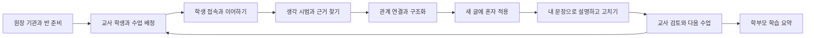

# ReadX-Ray 학원과 공부방용 제품 개발 계획

<!-- readx-document-context -->
> 작성 당시의 설계·조사·구현 기록입니다. 현재 기능과 운영 상태는 최신 현황을 우선합니다. [문서 목차](README.md) · [최신 현황](PROJECT_STATUS.md)

2026년 10월 14일 기준. **학원·공부방용으로 먼저 출시한다**는 사용자 결정을 반영한다. 기존 ReadX-Ray의 교육 철학과 자산을 유지하면서, 실제 수업 운영과 학습 증거가 연결되는 상품으로 완성한다.

첫 개발 목표는 **교사가 수업을 배정하고, 학생이 근거를 찾고 생각을 연결해 자기 문장으로 설명하며, 그 수행 결과가 교사 지도와 학부모 상담으로 이어지는 한 수업의 완결**이다. 제품의 판매 준비 여부는 이 흐름이 실제 학생 계정에서 반복적으로 작동하는지로 판단한다.

사용자가 추가로 확정한 제품의 중심은 **세부목표 기반의 정밀한 진단·처방과, 학생이 읽기를 하나의 사고 과정으로 따라 배우는 경험**이다. 2022 개정 교육과정의 모든 초등 교과 개념을 활용하는 대규모 지문 은행은 이를 위한 소재 기반이다. 교과 개념을 많이 아는 것과 읽기 세부목표를 수행하는 것을 같은 점수로 취급하지 않는다. 같은 목표를 서로 다른 교과 지문에서도 수행하는지 확인한다.

첫 기반 구현과 남은 작업은 [1차 구현 기록](./IMPLEMENTATION_01_2026-10-14.md), 대량 콘텐츠 제작 원칙은 [목표·사고 과정·교과 지문 설계](./GOAL_PROCESS_CONTENT_STRATEGY.md)에 정리한다. 초3~4 파일럿 제안은 첫 운영 검증 범위이며 초1~6 전 교과 소재 확장 목표를 제한하지 않는다.

현재 구현의 문제와 재현 근거는 [상용화 점검 보고서](./COMMERCIAL_READINESS_AUDIT_2026-10-14.md)에 있다. 아래 학년 범위·일정·수량·지표는 실행을 위한 제안이며 확정된 계약이나 현장 검증 결과가 아니다.

## 첫 상품과 고객

| 구분 | 제안 |
| --- | --- |
| 구매자 | 초등 수업을 운영하는 학원장·공부방 운영자 |
| 핵심 사용자 | 교사와 학생. 소규모 공부방에서는 원장과 교사가 같은 사람일 수 있음 |
| 학부모가 받는 가치 | 무엇을 배웠고 어디에 도움이 필요하며 집에서 무엇을 물어볼지 확인 |
| 해결할 운영 문제 | 수업 준비, 수준 차이 대응, 과제 확인, 피드백, 상담 자료 작성 |
| 첫 상품 형태 | 교사 운영형 설명문 문해력 수업 패키지와 학생별 이용 권한 |
| 권장 파일럿 학년 | 초3~4. 설명문 이해와 근거 설명을 관찰하는 한 학년군부터 검증 |
| 교육과정 확장 | 기존 초1~6 구조는 유지. 검수와 사용성 검증을 통과한 학년부터 추가 개방 |
| 사용 환경 | 학생 태블릿·교사 PC 중심, 학부모 스마트폰 중심 |

초3~4 우선은 시장점유율에 대한 주장이 아니라 **초기 범위를 줄이고 수업과 UX를 검증하기 위한 제품 판단**이다. 협력 학원의 실제 수요가 고학년에 집중되면 첫 학년군을 바꿀 수 있으며, 데이터·권한·학습 엔진은 특정 학년에 종속시키지 않는다.

초기 패키지는 학년별 16차시를 주 2회 운영하는 8주 과정으로 가정한다. 3·4학년 합계 정규 32개와 해당 학년 공통기초 12개를 검수하고, 필요에 따라 하위 학년 선수 활동을 추가한다. 단순히 44개 JSON을 올리는 것이 아니라 교사용 운영안, 실제 활동, 쓰기 산출, 독립 확인 문항, 상담 예시까지 갖춘다.

132개는 교육과정의 슬롯 수다. 슬롯당 현재 문항 수와 재학습 변형 지문의 양을 고려하면 이를 바로 무제한 연간 학습 콘텐츠로 판매하기 어렵다. 반복 사용 시에는 새로운 지문과 활동, 다음 과정의 공급 계획이 필요하다.

## 제품이 지킬 원칙

1. **학습 목표에서 활동을 설계한다.** 지문·단서·구조도·평가가 같은 목표를 가리켜야 한다.
2. **정답과 근거를 함께 본다.** 맞힌 답, 선택한 근거, 설명한 관계를 구분해서 기록한다.
3. **도움이 줄어드는 경험을 만든다.** 시범을 본 뒤 함께 연습하고 새 글에서 혼자 수행한다.
4. **읽기를 쓰기로 연결한다.** 읽기 구조도를 재사용해 개요와 자기 문장을 만들고 고쳐 쓴다.
5. **관찰한 만큼만 설명한다.** 기록이 부족하면 ‘더 살펴볼 필요가 있어요’로 표시한다.
6. **교사의 판단을 지원한다.** 추천 이유를 보여주고 교사가 배정과 피드백을 조정할 수 있게 한다.
7. **학생에게 필요한 말로 안내한다.** 내부 코드와 전문 용어는 콘텐츠 관리·교사 상세 영역에서 사용한다.

수능형 근거 독해라는 장기 방향은 고학년의 복합 지문과 독립 적용 과제에 반영한다. 초등학생이 당장 수행할 행동은 단서 찾기, 이유 연결하기, 자기 말로 설명하기로 안내한다. 수능 등급 향상이나 공인 진단처럼 읽히는 홍보 문구는 검증 근거 없이 사용하지 않는다.

## 실제 수업 흐름

### 대표 수업의 학습 경험

초3~4용 대표 수업은 약 20~30분 활동을 가정하되 실제 수업 관찰로 조정한다. 속도 자체를 능력 점수로 삼지 않는다.

| 단계 | 학생이 하는 일 | 남기는 증거 |
| --- | --- | --- |
| 준비 | 오늘 배울 한 가지를 읽고 핵심 어휘 확인 | 선수 확인 결과와 필요 도움 |
| 생각 시범 | 선생님의 단서 찾기와 연결 과정을 짧게 관찰 | 시범 제공 여부. 독립 성공과 구분 |
| 함께 읽기 | 문장이나 구절을 골라 근거 표시 | 문단·문장 ID, 선택 범위, 시도 |
| 관계 연결 | 원인과 결과, 공통점과 차이점 등을 구조도로 연결 | 노드와 연결 관계, 수정 이력 |
| 혼자 적용 | 다른 문장·문항·지문에서 도움 없이 같은 기능 수행 | 첫 응답, 근거, 정오답, 사용 도움 |
| 내 말로 표현 | 구조도를 바탕으로 1~3문장 설명 또는 해당 쓰기 과제 수행 | 초안, 자기 점검, 수정본 |
| 마무리 | 무엇을 배웠는지 확인하고 제출 | 서버 접수, 교사 검토 상태, 다음 활동 |

모든 하위기능에 같은 7개 화면을 강제로 적용하지 않는다. 목표별 필요한 활동으로 구성하되, 기능을 배웠다는 근거를 남긴다. W1~W5는 기존의 계획·내용 생성·조직·초고·퇴고 목표를 이어받아 확장된 쓰기 수업으로 설계한다. 객관식 문장 고르기만으로 쓰기 목표 완료를 판정하지 않는다.

평가에서는 훈련 때 정답과 해설을 본 동일 문항을 재사용한 점수와 새로운 지문에 적용한 결과를 구분한다. 초기·종료 평가는 목표와 난도를 맞춘 별도 문항 묶음으로 편집한다.

## 역할별 화면 구성

| 사용자 | 기본 화면과 주요 행동 | 첫 화면의 우선 정보 |
| --- | --- | --- |
| 원장 | 오늘의 운영, 반·교사·원생, 이용권, 상담 자료, 기관 설정 | 운영할 반, 등록 누락, 이용 기간, 필요한 조치 |
| 교사 | 오늘 수업, 우리 반, 수업 자료, 검토할 학습, 학생 리포트 | 지금 할 수업과 도움이 필요한 학생 |
| 학생 | 오늘의 학습, 진행 중 수업, 나의 기록 | 이어할 활동 하나와 시작·계속 버튼 |
| 학부모 | 이번 주 학습, 실제 수행 예시, 교사 코멘트, 집에서 나눌 질문 | 배운 점 하나, 잘한 점 하나, 다음 도움 하나 |
| 플랫폼 편집자 | 목표·지문·활동·검수·게시·버전 관리 | 오류와 검수 대기 콘텐츠 |

원장에게 플랫폼 전체 문항 은행의 수정 권한을 기본 제공하지 않는다. 기관별 브랜드 설정과 수업 운영은 원장 권한으로, 공용 콘텐츠 게시와 진단 규칙 변경은 플랫폼 권한으로 나눈다.

공부방 운영자는 같은 로그인에서 ‘운영’과 ‘수업’을 오갈 수 있다. 학생 화면에는 성인 역할을 선택하는 메뉴를 두지 않고, 보호자도 연결된 자녀의 자료만 볼 수 있게 한다.

### 학생 읽기 화면

태블릿 가로 화면은 본문과 현재 활동을 나란히 두되 본문 폭을 충분히 확보한다. 세로 화면은 본문과 활동을 전환해도 읽던 위치와 작성 중 답이 보존되어야 한다. 지문 옆에는 지금 해야 할 행동 한 가지를 표시하고, 어휘·읽어주기·글자 크기 같은 보조 도구는 필요할 때 펼친다.

본문을 확인하면서 답을 고르는 현재 분할 화면의 장점은 유지한다. 상단의 전체 모드 전환, 점수·배지·기술 설명이 독서를 방해하지 않도록 수업 중에는 학습 맥락에 필요한 항목만 둔다. 단서 찾기·관계 연결·쓰기 진행 상황과 저장 상태는 항상 확인할 수 있게 한다.

### 교사 수업 화면

‘학생 25명 실시간 관제’ 같은 고정 화면을 반과 수업 선택에 종속된 실제 현황으로 바꾼다. 미시적인 시선·행동 추측보다 미시작, 학습 중, 도움 요청, 제출, 검토 완료를 우선 보여준다. 학생을 선택하면 원문 근거, 답안, 도움 수준과 자기 설명을 함께 볼 수 있어야 한다.

수업 템플릿을 고르고 반 전체 또는 일부 학생에게 배정한다. 기본 수업과 보충 활동을 구분하고, 배정 미리보기에서 학생·마감·수업 버전을 확인한다. 교사 피드백은 빠른 문장 틀로 시작하되 실제 수행 내용에 맞춰 수정할 수 있게 한다.

### 학부모 모바일 리포트

첫 화면에는 ‘이번 주 배운 것’, 실제 표시한 근거나 쓴 문장, 교사가 제안하는 다음 행동을 배치한다. 자세한 영역별 기록은 아래에서 펼친다. 기술 용어가 긴 가로 탭과 임의의 성장 숫자는 제거하고, 기간·수업명·관찰 횟수·도움 수준을 함께 표시한다.

예시 문구: ‘원인과 결과를 잇는 문장을 스스로 찾았어요. 이유를 자기 문장으로 설명할 때는 연결어 연습이 더 필요해요.’ 이 문구도 해당 수행 근거가 있을 때만 생성한다.

## 브랜딩과 디자인 시스템

### 브랜드 방향

기존 **ReadX-Ray Pro / 리드엑스레이 프로** 명칭과 Rx 심볼을 출발점으로 삼는다. 새 이름을 만드는 작업보다 일관된 적용과 고객이 이해할 설명을 먼저 완성한다. 제품에서 ‘Pro’를 어디까지 노출할지는 브랜드 시안에서 검토한다.

| 요소 | 유지·정리 방향 |
| --- | --- |
| 핵심 가치 | 따뜻한 정밀함. 학습 행동을 살피고 구체적으로 돕는 수업 |
| 설명 문장 제안 | ‘근거를 찾고, 생각을 연결하는 문해력 수업’ |
| 학생용 표현 | ‘왜 그렇게 생각했는지 글에서 찾아볼까?’ |
| 교사용 표현 | ‘판단은 맞았고 근거 연결에는 도움이 필요합니다.’ |
| 학부모용 표현 | ‘무엇을 이해했고 다음에 무엇을 연습할지 보여드립니다.’ |
| 피할 표현 | 근거 없는 1등급·상위 1%·정밀 지수, 찍기 위험군 같은 낙인, 구현되지 않은 AI·실시간 기능 |

`X-Ray`는 읽기 과정이 드러난다는 은유로 사용한다. 학생을 결손·위험 중심으로 규정하지 않고 관찰된 행동과 연습 방향을 설명한다. `$0 클라우드` 대신 필요한 경우 검증된 운영 비용 구조를 기관 제안 자료에서 다룬다.

### 시각 체계 제안

| 항목 | 기준안 |
| --- | --- |
| 로고 | 기존 Rx-5 심볼의 기본형·단색형·작은 크기형을 하나의 원본에서 관리 |
| 기본 색 | 기존 네이비와 따뜻한 종이색을 유지. 주 행동은 파랑, 성공·성장은 청록 계열 |
| 강조 색 | 노랑은 근거와 주의 집중에 한정. 오답 피드백은 색과 문장을 함께 사용 |
| 학생 본문 | 초3~4 기준 18~20px부터 검토, 충분한 행간과 사용자 확대. 실제 기기에서 결정 |
| 성인 화면 | 본문 14~16px, 조밀한 표도 읽을 수 있게 대비·간격 확보 |
| 조작 | 주요 터치 영역 44px 이상을 내부 설계 목표로 설정, 드래그에 탭·키보드 대안 제공 |
| 카드와 장식 | 과도한 둥근 카드 중첩, 모든 제목의 굵은 강조, 이모지 중복을 줄이고 내용 위계로 구분 |
| 상태 | 로딩·빈 기록·기록 부족·저장 중·저장 완료·오프라인·실패·만료를 공통 언어로 정의 |
| 모션 | 학습 결과를 이해시키는 짧은 변화에 사용, 지속 점멸은 기본 해제 |

WCAG 2.2 AA를 검증 목표로 삼고 대비·키보드·초점·대체 조작을 검사한다. 44px은 이 제품의 내부 목표이며 WCAG의 모든 요구를 대신하는 숫자가 아니다. [W3C 접근성 기준](https://www.w3.org/WAI/WCAG22/quickref/).

브랜드 산출물은 로고 SVG, 간격·최소 크기 규칙, 색·타입 토큰, 아이콘 규칙, 화면 문구 사전, 리포트·제안서·도입 안내 템플릿이다. 디자인 시스템에는 Button, FormField, Tabs, Dialog, Status, EmptyState, Table, LessonStep, EvidenceSelection, Feedback, ReportCard를 실제 컴포넌트로 포함한다.

랜딩 페이지의 주 고객도 원장으로 맞춘다. 상품 설명 → 실제 수업 예시 → 교사 운영 방법 → 상담 리포트 예시 → 제공 범위와 이용 조건 → 도입 문의 순서로 구성한다. 예시 화면에는 데모 표시를 한다.

## 첫 출시의 필수 범위

| 구분 | 첫 출시 필수 | 후속 확장 |
| --- | --- | --- |
| 기관 운영 | 기관·반·교사·학생, 역할 권한, 입퇴원·비활성, 이용 기간·좌석 | 다지점 통합, 외부 학원 관리 시스템 연동 |
| 계정 | 성인 로그인, 학생 간편 접속, 보호자 연결, 회수·재발급 | 다양한 소셜 로그인, 복잡한 기관 SSO |
| 수업 | 반·학생별 배정, 이어하기, 도움 요청, 제출·재시도 | 고빈도 실시간 행동 관제, 원격 화면 조작 |
| 학습 활동 | 근거 선택, 짧은 사고구술, 구조도, 독립 확인, 실제 쓰기·수정 | 고급 펜 제스처, 음성 사고구술 자동 분석 |
| 진단과 추천 | 기능별 초기 확인, 근거 기반 수업 추천, 교사 조정 | 보정된 적응형 검사와 표준화 지수 |
| 교사·학부모 결과 | 실제 학습 기록, 교사 피드백, 기간별 요약, A4 인쇄 | 다채널 알림톡 자동화, 대규모 통계 |
| 콘텐츠 | 승인된 첫 학년군과 선수 활동, 출처·검수·버전 관리 | 1~6학년 전체, 논설·서사·문학 장르 |
| 판매와 지원 | 이용 조건, 청구·입금 상태, 이용권 발급·만료, 문의·장애 대응 | 셀프서비스 정기 카드결제와 자동 청구 |
| 참여 유도 | 수업 완료와 구체적 성취 피드백 | 은하계 원정대, AI 어휘 경쟁, 광범위한 배지 체계 |

초기에는 수동 계약·청구로 협력 기관을 운영할 수 있으나, 입금·환불·이용 기간에 따른 권한 처리는 기록되어야 한다. 결제 UI 모양만으로 결제 기능을 완성했다고 취급하지 않는다.

## 기술 구조와 데이터

React·TypeScript·Tailwind를 유지하고 앱을 인증, 기관 운영, 콘텐츠, 수업 실행, 배정, 학습 기록, 리포트, 이용권 도메인으로 나눈다. 초기에는 하나의 명확한 서비스 구조로 시작한다. 기존 문서의 마이크로서비스·전체 오프라인·온디바이스 AI를 모두 선행 조건으로 두지 않는다.

Firebase는 기존 기획과 이어지는 **우선 검증 후보**다. 인증과 기관별 접근 통제, 관계 조회, 리포트 집계, 운영비를 작은 실험으로 검증한 뒤 확정한다. 다른 스택을 택하더라도 기관·학생·수업·기록의 개념 모델은 유지한다.

| 데이터 | 핵심 관계와 규칙 |
| --- | --- |
| Organization | 기관 식별자, 상태, 이용권. 모든 기관 데이터의 경계 |
| Membership | 사용자·기관·역할. 원장·교사·편집자 권한 구별 |
| Class와 Enrollment | 담당 교사, 소속 학생, 시작·종료 일자 |
| GuardianLink | 보호자와 학생 연결, 확인 상태·해제 이력 |
| Goal와 Prerequisite | 기존 목표 코드와 선수 관계. 화면 표시명과 내부 ID 분리 |
| LessonVersion | 지문·활동·정답·해설·출처·검수·버전. 게시본 불변 |
| Assignment | 기관·반·학생·수업 버전·배정자·마감·상태 |
| LearningSession | 배정, 학생, 기기 세션, 현재 단계, 초안과 제출 상태 |
| Attempt와 Artifact | 문항 응답·근거·힌트 수준·수정 이력·쓰기 산출. 중복 이벤트 방지 |
| TeacherFeedback와 Report | 실제 근거 참조, 교사 확인, 기간, 산출 규칙 버전 |
| Entitlement와 AuditLog | 좌석·이용 기간·권한 변경·게시·청구 관련 이력 |

학습 기록은 최소 `organizationId`, `studentId`, `assignmentId`, `lessonVersionId`, `sessionId`, `activityId`, `attemptId`, `timestamp`, `response`, `hintLevel`, `mode`를 포함한다. `mode`는 연습·독립 확인·평가를 구별한다. 날짜를 포함한 표준 타임스탬프와 서버 접수 시각을 사용한다.

학생은 응답을 제출하며 공식 결과·숙련 상태를 임의로 쓰지 못하게 한다. 서버는 제출자와 수업 버전을 검증하고 중복 요청에 동일 결과를 반환한다. 즉시 학습 피드백과 공식 집계는 역할을 나누되 서로 모순되지 않게 한다. 오류가 있는 슬롯을 임의의 다른 슬롯으로 대체하지 않는다.

Firestore를 사용한다면 기관 소속·자녀 관계를 규칙과 서버에서 확인하고, A기관과 B기관 간 접근 차단을 자동 검사한다. 서버 SDK 경로에도 별도 인가를 적용한다. [Firebase 보안 규칙](https://firebase.google.com/docs/firestore/security/rules-conditions), [에뮬레이터 테스트](https://firebase.google.com/docs/rules/unit-tests).

첫 버전은 온라인 학습을 기본으로 하되 작성 중 응답을 기기 내에 임시 저장하고 연결 복구 후 재전송한다. 수업의 완전한 오프라인 배포와 여러 기기의 동시 편집은 후속 범위로 두고, 지원 범위를 화면에 명확히 표시한다. 공유 태블릿에서는 이전 학생의 기록이 다음 학생에게 노출되지 않아야 한다.

## 콘텐츠 편집과 학습 결과 산출

### 콘텐츠 제작 순서

1. 목표와 선수 조건을 확정하고 원천 ID를 연결한다.
2. 지문 출처·작성 방식·이용 범위·사실 근거를 기록한다.
3. 단서 위치, 관계, 정답, 오답 이유, 사고 시범을 서로 대조한다.
4. 활동별 데이터 형식을 검사하고 모든 지원 화면에서 렌더한다.
5. 내용·교육 검수자가 학년 적절성과 수행 목표를 확인한다.
6. 현장 사용성 검토 후 버전을 고정해 게시한다.

생성기는 초안을 만들 수 있다. 게시 상태는 검수 기록이 있어야 변경되며, 본문 인용 불일치를 앞 문장으로 자동 교체하지 않는다. 코드 오류와 내용 오류를 각각 담당자에게 돌려보낸다.

첫 상품용 콘텐츠에는 다음을 포함한다: 학년별 16차시 운영표, 수업별 준비·질문·예상 반응·보충 지도, 학생 활동, 독립 확인 자료, 쓰기 산출 기준, 가정 대화 질문. 16개 슬롯이 곧 충분한 수업 시간이나 연간 콘텐츠 분량을 뜻하지 않으므로 실제 소요 시간과 재사용 가능성을 확인한다.

### 초기 결과 표시 기준

성취 상태는 ‘아직 기록 없음 / 도움받아 연습 / 혼자 적용 관찰 / 추가 확인 필요’ 등 수행 중심으로 시작한다. 판정 규칙은 콘텐츠 책임자와 정하고 버전 관리한다. 학습 속도만으로 찍기·주의력·인지 특성을 확정하지 않는다.

6개 영역을 유지하려면 어떤 활동이 어떤 영역의 근거가 되는지 매핑부터 정한다. 쓰기와 초인지처럼 단순 객관식만으로 충분히 관찰하기 어려운 영역은 자기 점검과 교사 평가를 사용한다. KReaD, 백분위, 학년 수준 환산은 해당 지표의 사용 근거·권리·타당성을 확인한 별도 과제로 관리한다.

보고서에는 수업 버전과 기간, 관찰 횟수, 독립 수행과 도움 후 수행을 표시한다. 학생 원문과 교사 의견, 시스템 계산 결과를 구분한다. 표본이 적으면 숫자의 정밀함을 높이지 않고 기록 부족을 보여준다.

## 개인정보와 운영 준비

학생 개인정보의 처리 목적과 항목을 최소화하고 기관·서비스 운영자의 역할, 위탁 관계, 보호자 연결·동의, 보관·삭제, 열람 요청, 장애 대응을 출시 전에 정한다. 만 14세 미만 아동에 대해 법에 따른 동의를 받아야 하는 경우 법정대리인의 동의와 확인이 필요하다. 구체적인 적용은 실제 수집·처리 방식에 맞춰 검토한다. [개인정보 보호법 제22조의2](https://www.law.go.kr/lsLinkCommonInfo.do?chrClsCd=010202&lsJoLnkSeq=1029331673).

운영 준비에는 개발·검증·운영 환경 분리, 비밀 설정 관리, 오류 모니터링, 백업과 복구 훈련, 배포 되돌리기, 고객 문의 창구가 포함된다. 학생 기록·기관 권한·콘텐츠 출판·이용권 변경은 추적 가능해야 한다. 특정 인증 취득을 근거 없이 일괄 선행 조건으로 두지 않고 적용 의무를 확인한다.

## 개발 단계와 완료 기준

예상 규모는 **개발 8~10주와 8주 현장 운영을 합한 16~18주**다. 제품 담당, 프론트엔드, 백엔드, 디자인, 콘텐츠 편집·교육 검수, QA 역할을 확보해 일부 작업을 병행하는 가정이다. 한 사람이 여러 역할을 순차 수행하거나 콘텐츠를 크게 다시 써야 하면 재산정한다. 고정 오픈일보다 단계별 완료 기준을 우선한다.

| 단계 | 기간 가정 | 주요 결과물 | 통과 기준 |
| --- | --- | --- | --- |
| 0 현재 구현 안정화 | 1주차 | 빌드 복구, 데이터 계약, 오류 목록, 데모 구분, 소스 버전 관리 | 빌드 성공. 잘못된 과제가 다른 지문으로 열리지 않음. 문제 데이터가 게시되지 않음 |
| 1 상품과 대표 수업 설계 | 2~3주차 | 기관용 제품 설명, IA, 브랜드 규칙, 핵심 화면 시안, 대표 수업 2개 | 목표→활동→근거→쓰기 연결. 교사·학생 관찰에서 다음 행동을 이해함 |
| 2 실제 계정과 수업 연결 | 4~6주차 | 기관·역할·학생, 배정·학습 세션·저장·제출, 기초 보충 연결 | 서로 다른 기관·학생 격리. 새로고침·재접속·중복 제출에도 기록 보존 |
| 3 상품 범위와 운영 완성 | 7~10주차 | 첫 학년군 검수 콘텐츠, 교사 검토, 부모 리포트, 이용권·문의·인쇄 | 판매 범위 전수 QA, 실제 데이터로 일관된 결과, 미지원 기능 표시 |
| 4 협력 기관 파일럿 | 개발 통과 후 8주 | 3~5개 기관, 총 30~60명 규모 제안, 수업 운영과 지원 기록 | 수업 완주·교사 업무·기록 신뢰·재구매 판단. 중대 결함 해결 |
| 5 정식 판매 전환 | 파일럿 판정 후 | 판매 자료, 운영 매뉴얼, 계약·가격 확정, 지원 체계 | 출시 기준 충족. 제공 학년·기능·콘텐츠·지원 범위를 명확히 설명 |

기관 수와 학생 수는 모집 목표이며 확보된 고객 수가 아니다. 초기 1~2주에는 사용성과 장애를 먼저 확인하고, 8주 전체에서는 수업 운영과 과정 완료를 살핀다. 소규모 파일럿의 전후 변화만으로 인과적인 학습 효과나 전국 규준을 주장하지 않는다.

브랜딩과 디자인은 2단계 개발 뒤에 붙이는 작업이 아니다. 대표 수업 설계부터 콘텐츠·권한·화면·기록 구조와 함께 검토하고, 구현 중에도 실제 화면과 기기에서 조정한다.

## 첫 10개 개발 작업

| 순서 | 작업 | 관련 점검 항목 | 완료 조건 |
| --- | --- | --- | --- |
| 1 | Git 기준점·개발 실행 절차·정식 빌드 복구 | A01, A15 | 새 환경에서 같은 잠금 파일로 빌드 가능 |
| 2 | 콘텐츠 스키마와 기존 데이터 이관 규칙 확정 | A02, A09, A11 | 96개 설명문과 36개 기초 데이터의 형식·참조 오류를 모두 검출하고 이관 추적 |
| 3 | 과제·정규 수업·공통기초 ID와 경로 통일 | A03 | 없는 ID 차단, 배정 제목과 실제 지문 일치 |
| 4 | 실제 기록과 데모 표시 분리 | A05, A06 | 신규 학생에게 과거 점수·연속 학습·성장 결과를 임의로 표시하지 않음 |
| 5 | 기관용 IA와 대표 수업 두 개 설계 | A08, A12, A13 | 사고 시범·독립 적용·실제 쓰기를 포함한 클릭 시안과 수업안 |
| 6 | 브랜드·언어·디자인 토큰 적용 기준 | A12, A13 | 핵심 6개 화면이 같은 구성요소와 상태 표현 사용 |
| 7 | 기관·학생·보호자·플랫폼 편집자 권한 구현 | A04 | 타 기관·타 학생·미연결 보호자 접근 테스트 차단 |
| 8 | 배정→학습→제출→검토 기록 연결 | A05, A07, A10 | 실제 응답으로만 완료, 재전송해도 1회 반영 |
| 9 | 대표 수업의 태블릿·부모 모바일 사용성 검증 | A08, A13 | 교사·학생이 도움 없이 주요 과업 수행, 문제 원인과 수정 기록 |
| 10 | 같은 기준으로 첫 상품 콘텐츠 확장 | A02, A09, A11 | 지원하는 모든 수업이 구조·렌더·내용·수업 운영 검수 통과 |

이 목록의 첫 묶음은 ‘빌드·데이터·잘못된 과제·데모 지표’다. 대표 수업의 기능이 확정되기 전에 전체 24개 화면을 일괄 재디자인하면 데이터 구조와 사용자 여정 변경으로 재작업이 커진다.

## 통합 체험판 진행 상황

2026-10-14에 안정화·브랜드·대표 학습 여정·교과 지문 확장 결과를 같은 앱에 연결하고 공개 체험판을 배포했다. 현재 구현 범위, 검증 결과, 배포 주소와 남은 순서는 [통합 현황과 다음 개발 순서](READX_INTEGRATION_AND_RELEASE_2026-10-14.md)에 정리했다. 기관 권한·학생별 서버 기록·판매용 콘텐츠 승인 등 아래 출시 기준은 여전히 별도 완료가 필요하다.

## 검증과 출시 기준

| 검증 영역 | 필수 기준 |
| --- | --- |
| 데이터 | 지원 콘텐츠의 필수 필드·ID·정답·근거·버전·출처 검증 통과. 오류 자동 치환 없음 |
| 화면 | 지원 콘텐츠 모든 활동 렌더 성공. 빈 데이터·긴 텍스트·로딩·실패 상태 포함 |
| 학습 여정 | 배정·이어하기·도움·쓰기·제출·교사 검토·리포트 E2E 통과 |
| 점수와 기록 | 중복 제출·재접속으로 성취 부풀림 없음. 도움 후 정답과 독립 성공 구분 |
| 격리 | 기관 A와 B, 서로 다른 학생, 연결되지 않은 보호자 접근 차단 |
| 기기 | 1024×768·1280×800 태블릿, 390px 부모 모바일, 교사 PC. 실제 iPad Safari·Android Chrome 확인 |
| 접근성 | 키보드·초점·대화상자·확대·색상·터치 대안 검사 |
| 성능 | 실제 대상 기기와 학원 네트워크에서 수업 시작·저장·제출 측정. 초기 내부 목표는 수업 시작 3초 이내, 저장 상태 즉시 표시 |
| 운영 | 복구·백업·배포 되돌리기, 이용 기간 만료, 문의 대응 시나리오 수행 |
| 콘텐츠 | 교육 검수와 권리·출처 기록 완료. 검증되지 않은 지수·기관 경력·성과 표현 없음 |

동시접속 수치는 사업 가정과 실제 파일럿 규모로 정한다. 초기 부하 시험은 가령 5개 기관에서 20명씩 동시에 제출하는 상황을 설계하되, 테스트 결과 없이 100명 동시접속을 지원한다고 표시하지 않는다.

## 파일럿에서 확인할 상품 가치

다음 수치는 출시 판단을 위한 초기 가설이다. 사전 인터뷰와 첫 수업 관찰 후 기준을 보정한다.

| 질문 | 측정 방법과 목표안 |
| --- | --- |
| 교사가 빠르게 배정하는가 | 기존 방식과 비교해 반 전체 수업 배정 2분 이내 |
| 학생이 스스로 시작하는가 | 안내를 받은 후 주요 시작·이어하기 과업 성공률 90% 이상 |
| 학습 기록이 믿을 만한가 | 시험 시나리오에서 유실·타 학생 혼합 0건, 서버 접수와 보고서 일치 |
| 수업이 지속되는가 | 예정된 수업 대비 참여·완료율을 기관별·학생별로 기록. 초기 목표 80% 이상 |
| 교사의 일이 줄어드는가 | 준비·확인·리포트 작성 시간을 도입 전후 비교. 대시보드 열람만으로 성공 판정하지 않음 |
| 학부모에게 이해되는가 | 리포트를 읽고 배운 점과 다음 도움을 정확히 설명하는지 확인 |
| 읽기에서 쓰기로 이어지는가 | 새 지문 근거 찾기와 설명 문장 산출을 같은 루브릭으로 검토 |
| 비용을 낼 이유가 있는가 | 기관별 도입 목적·사용 빈도·지원 부담·유료 연장 의향을 기록 |

수업 실패나 저조한 완료율을 학생의 능력 문제로 단정하지 않고, 콘텐츠 난도·인터페이스·교사 운영 방식·기기 장애를 함께 조사한다.

## 판매와 비용 검증

파일럿에서는 기관별 기본 이용료와 활성 학생 수에 따른 이용료, 또는 8주 과정 단위 패키지를 비교한다. 금액은 아직 확정하지 않는다. 원장의 지불 의사와 실제 운영 원가, 콘텐츠 제공 범위를 확인한 후 결정한다.

원가에는 인증·DB·저장소·호스팅·문자·결제 수수료·고객지원·콘텐츠 편집과 검수·백업이 들어간다. 외부 LLM 호출을 하지 않는 구조를 선택하더라도 서비스 전체 비용이 0원인 것은 아니다.

판매 준비물은 수업 시연, 학년별 8주 운영안, 실제 데이터에 기반한 리포트 예시, 도입 안내, 교사 시작 매뉴얼, 이용 조건과 문의 창구다. 협력 기관에서 실제 사용하는 흐름을 확인한 다음 학교용과 가정 구독용을 각각 별도 요구사항으로 확장한다.

## 기존 문서와 파일을 운영하는 방식

이 계획은 2026년 10월 14일 이후 **학원용 첫 출시의 우선순위 기준안**이다. 기존 PRD·UI 명세·브랜드 문서는 교육 철학과 확장 기능의 참조로 유지하며, 구현 완료의 증거로 사용하지 않는다. 초기 제품 범위와 충돌하는 일정·AI·모드 확장 내용은 이번 계획의 출시 범위에 따라 조정한다.

`docs`를 기획 정본으로 정리하고 루트 중복 문서는 정본 링크로 전환하는 작업을 별도로 수행한다. 콘텐츠는 원천 → 검수된 버전 → 앱 배포본의 한 방향으로 생성한다. 이전 프로토타입과 미사용 컴포넌트는 기능 회수 여부를 판단한 뒤 명확히 보관한다. 이번 점검에서는 원본 삭제나 대규모 이동을 수행하지 않았다.
