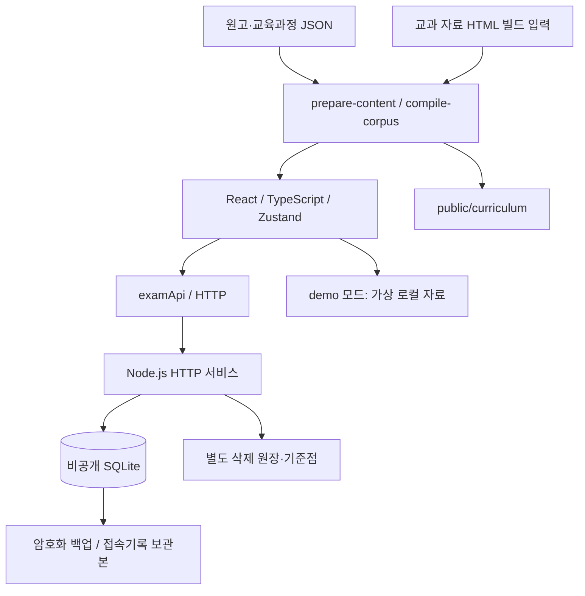

# 현재 시스템 구조

기준일: 2026-11-18. 저장소 코드의 현재 구조다.

| 경로 | 역할 |
| --- | --- |
| `webapp/src/App.tsx` | 해시 경로·역할별 화면 진입 |
| `webapp/src/components/` | 학생·교사·보호자·원장 화면, TEI 활동 |
| `webapp/src/store/`, `src/services/` | 상태·학습 로직·API·기기 초안 |
| `webapp/server/` | 계정·평가·수업·권리·접속기록·복구와 CLI |
| `webapp/shared/` | 서버/체험판 공유 도메인·평가 자료 |
| `webapp/scripts/` | 콘텐츠 준비·검사·운영 준비 검증 |
| `data/`, `scripts/` | 원고·교육과정·생성/편집/검수 파이프라인 |
| `output/`, `outputs/` | 교재·리포트·브랜드 전달본·일부 빌드 입력 |

기본 개발은 Vite의 `vite-exam-plugin.mjs`가 API를 제공한다. 빌드 뒤 `server/start.mjs`는 `dist/`와 `/api/exam/`을 함께 제공한다. `VITE_EXAM_MODE=demo`는 가상 로컬 클라이언트를 사용한다.

계정·세션·학생 응답·키·원장은 Git에 포함하지 않는다. 운영 모드는 웹 첫 등록을 닫고 MFA·보호자 확인·준비 증거·분리 키·기준점을 요구한다. [배포](DEPLOYMENT.md)와 [복구](RECOVERY_OPERATIONS_2026-11-18.md)를 따른다.

기본 서버용 브라우저 번들에는 비공개 평가 엔진/정답 모듈이 들어가지 않도록 검사한다. 하지만 **이 GitHub 저장소에는 예제 정답과 서버 코드 자체가 공개**된다. 번들 경계와 평가 자료의 비밀성은 다르다.

`firebaseDbService.ts`, `firestore.rules`, Firestore 시드는 초기 설계·호환 내보내기 자산이다. 현재 기본 실행은 Firebase 인증·Firestore 동기화를 사용하지 않는다. 과거 PWA·Kiwi WASM·결제/문자·마이크로서비스 계획은 현 구조와 구분한다.
