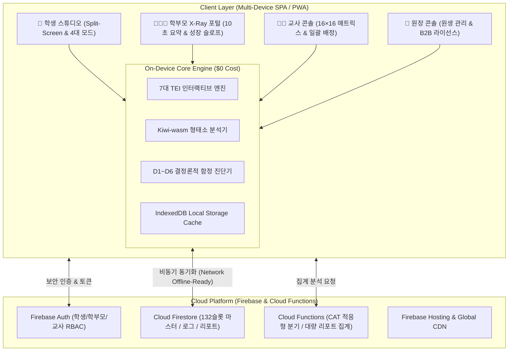
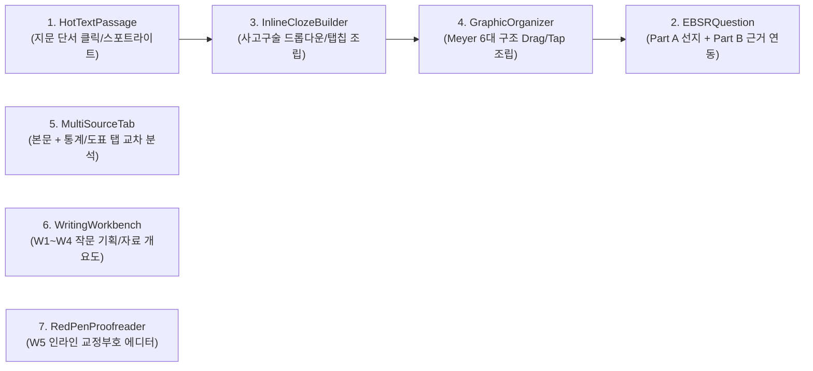
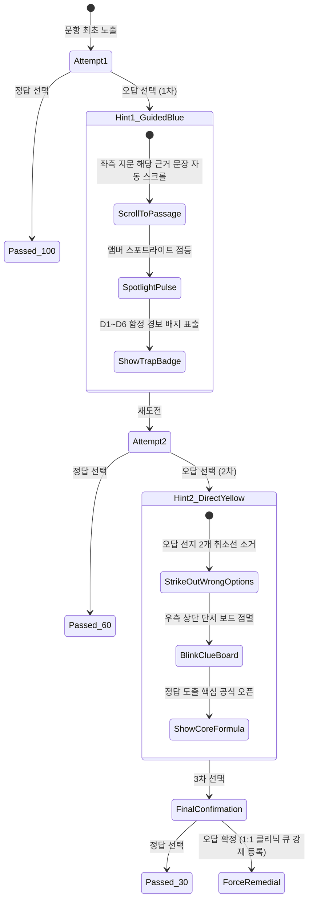
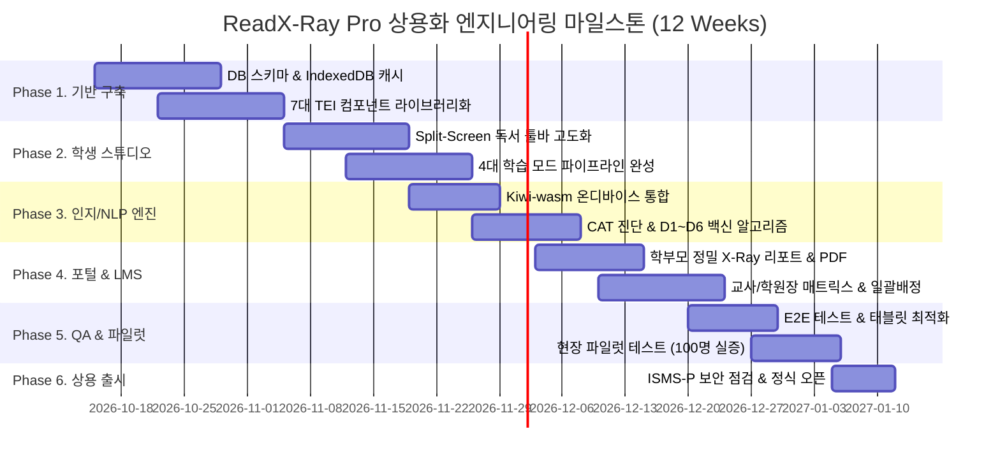

# 🚀 [ReadX-Ray Pro] 문해력 코스웨어 상용화 실제 개발 계획서 (Software Development Plan)

<!-- readx-document-context -->
> 작성 당시의 설계·조사·구현 기록입니다. 현재 기능과 운영 상태는 최신 현황을 우선합니다. [문서 목차](README.md) · [최신 현황](PROJECT_STATUS.md)


> **문서 식별자**: `SDP-READX-COMMERCIAL-2026-V1.0`  
> **기반 PRD**: `courseware/PRD_2022개정_교과개념_설명문_문해력_코스웨어.md` (v6.0), `courseware/PRD_문해력_코스웨어_상용화_마스터.md` (v1.0), `courseware/Google_Stitch_UIUX_Design_Prompt_Guide.md` (v6.0)  
> **공식 서비스명**: **초등 2022 개정 전교과 설명문 수능형 문해력 코스웨어 「ReadX-Ray Pro (리드엑스레이 프로)」**  
> **문서 버전**: v1.0 (상용화 엔지니어링 마스터 플랜)  
> **작성일자**: 2026년 10월  
> **문서 성격**: 소프트웨어 개발 계획서 (WBS, 시스템 아키텍처, 6단계 스프린트 로드맵, QA 및 텔레메트리 파이프라인)

---

## Executive Summary (총괄 요약)

본 개발 계획서는 국내 최초로 **초등 1~6학년 9대 전 교과 설명문(96개 위계) + 선수 공통기초(36개 위계)**를 관통하는 수능형 적응형 문해력 코스웨어 **「ReadX-Ray Pro」**의 상용 서비스를 성공적으로 구현·출시하기 위한 종합 엔지니어링 실행 계획서입니다.

현재 구축된 **단일 번들 프론트엔드 프로토타입(React + Zustand + 2.4MB JSON 마스터 데이터)**을 기반으로, 실제 다중 사용자(학생·학부모·교사·학원장)를 수용하는 **엔터프라이즈급 클라우드 SaaS(Firebase/Cloud Functions + Offline-First IndexedDB) 및 $0 온디바이스 로컬 AI(Kiwi-wasm 형태소 분석기)** 시스템으로 도약하기 위한 상세 기술 명세, 24개 마이크로 화면 개발 공정, 6단계 WBS, 품질 보증(QA) 게이트를 정의합니다.

---

## 1. 프로젝트 개요 및 추진 목표

### 1.1 제품 비전 및 핵심 가치 (Product Vision)
> **"글의 골격을 꿰뚫어 보는 6차원 X-Ray 진단, 빈틈을 채우는 1:1 Rx 맞춤 처방"**
* **초등 전교과 설명문 100% 특화**: 국어, 수학, 사회, 과학, 도덕, 실과, 음악, 미술, 체육 9대 교과 개념을 수능 5대 출제 영역(인문, 사회, 과학, 기술, 예술)과 1:1 직결.
* **Dick & Carey 인지 과제분석 파이프라인**: 단순 문항 나열을 탈피하여 `Step 1 단서 포착(Hot Text)` ➔ `Step 2 관계 연결(사고구술/도해)` ➔ `Step 3 구조화·판단(KICE 수능 문항)`의 3단계 인지 사슬 강제.
* **KICE 수능 6대 매력적 오답 함정 백신화**: `D1(인과 역전)`, `D2(과잉 일반화)`, `D3(주객 전도)`, `D4(속성 교차)`, `D5(단정적 비약)`, `D6(본문 외 상식 왜곡)`을 감지하고 3단계 점진적 스캐폴딩으로 자립 유도.
* **$0 온디바이스 인프라**: 학생 1인당 클라우드 LLM API 비용을 전면 배제($0.00), 로컬 WASM 형태소 분석기(Kiwi) 및 규칙 기반 인지 엔진으로 초저비용 고신뢰성 서비스 운영.

### 1.2 개발 현주소 (As-Is vs To-Be)

| 구분 | 현재 상태 (As-Is Prototype) | 상용화 출시 목표 (To-Be Production) |
| :--- | :--- | :--- |
| **아키텍처** | 단일 SPA 번들 (`vite-plugin-singlefile`), 브라우저 메모리/LocalStorage 의존 | 분산 마이크로서비스 / 오프라인 퍼스트 PWA + IndexedDB 영속화 + Firebase 동기화 |
| **데이터셋** | 2.44MB 정적 `commercialMasterData.json` 일괄 로딩 | Firestore 청크 단위 비동기 로딩, 학년/단원별 지연 로딩(Code Splitting) |
| **문항 인터랙션** | 기본 클릭 및 드롭다운 위주 폼 요소 | **글로벌 표준 7대 TEI 엔진**(Hot Text, EBSR, 도해조직자 드래그앤드롭, 교정부호 에디터) 완비 |
| **사용자 체계** | 상단 탭 기반 로컬 역할 전환 (모의 시뮬레이션) | Role-Based Access Control (RBAC), 학생-학부모 페어링, 교사-학급 멀티테넌시 콘솔 |
| **AI / NLP** | 정적 단서 매핑 및 시뮬레이션 | **Kiwi-wasm 온디바이스 형태소 분석**, 실시간 어휘 난이도 판정, $0 로컬 룰 엔진 |
| **단말 최적화** | 데스크톱 해상도 중심 뷰 | **아이패드 / 갤럭시탭 터치 제스처 최적화 (가로 1024×768 / 1440×900)** |

---

## 2. 시스템 아키텍처 및 기술 스택

### 2.1 전체 시스템 아키텍처 다이어그램



### 2.2 기술 스택 확정

| 계층 (Layer) | 채택 기술 | 선정 사유 및 기술적 이점 |
| :--- | :--- | :--- |
| **Frontend Framework** | **React 18.3+ / TypeScript 5.6+** | 강력한 컴포넌트 생태계, 엄격한 정적 타입 검사(132슬롯 데이터 무결성 보장) |
| **Build & Tooling** | **Vite 6.0+** | 초고속 HMR, 최적화된 청크 분할(Code Splitting), 모던 브라우저 타깃 빌드 |
| **Styling & Design** | **Tailwind CSS v3.4 + Headless UI** | Dual-Context 테마(웜 페이퍼 `#FCFBF7` vs 다크 네이비 `#0F172A`) 고속 구현, 인체공학적 타이포그래피 |
| **State Management** | **Zustand 5.0 + Immer** | 가벼운 번들 크기(<3KB), 보일러플레이트 제로, 슬라이스 패턴 기반 모듈 분리 |
| **Local Storage / Offline** | **IndexedDB (via idb-keyval)** | 2.4MB 마스터 데이터 및 텔레메트리 로그를 브라우저 내 오프라인 영속화 |
| **On-Device NLP** | **Kiwi-wasm (한국어 형태소 분석기)** | 외부 API 통신 제로, 어휘 조사/어미 분리, 인라인 빈칸 채점 및 텍스트 난이도 분석 |
| **Backend & Database** | **Firebase Firestore & Cloud Functions** | 실시간 NoSQL DB, 오프라인 자동 동기화, 제로 서버 관리(Serverless), 세밀한 Security Rules |
| **Authentication** | **Firebase Auth** | 이메일/소셜 로그인, 익명 온보딩(학생 간편 로그인), 커스텀 클레임(역할 기반) |
| **Testing & QA** | **Vitest + React Testing Library + Playwright** | 컴포넌트 단위 테스트 및 24개 화면 핵심 사용자 여정(E2E) 자동화 |

---

## 3. 4대 사용자 주체별 24개 마이크로 화면 개발 범위

`Google_Stitch_UIUX_Design_Prompt_Guide.md`에 명세된 24개 화면을 4개 개발 도메인으로 분류하여 개발을 진행합니다.

```
┌──────────────────────────────────────────────────────────────────────────────────┐
│                   ReadX-Ray Pro 24개 마이크로 화면 개발 매트릭스                  │
├─────────────────────┬───────────────────┬───────────────────┬────────────────────┤
│ 👦 학생 (9종)       │ 👨‍👩‍👧 학부모 (5종)   │ 👩‍🏫 교사 (5종)     │ 🏢 학원장 (5종)    │
├─────────────────────┼───────────────────┼───────────────────┼────────────────────┤
│ 1. 홈 대시보드      │ 10. 10초 핵심요약 │ 15. 학급 히트맵   │ 20. 원생/반 콘솔   │
│ 2. 두뇌 예열        │ 11. 6차원 X-Ray   │ 16. 조기경보      │ 21. 강사 벤치마크  │
│ 3. Split 스튜디오   │ 12. Before/After  │ 17. 일괄 처방     │ 22. 상담용 성적표  │
│ 4. 자립 소거        │ 13. 식탁 질문     │ 18. 위계 탐색기   │ 23. 교재/문항 제작 │
│ 5. 1:1 처방클리닉   │ 14. PDF 인쇄      │ 19. 지도서 오버레이│ 24. 라이선스/빌링  │
│ 6. CBT 모의고사     │                   │                   │                    │
│ 7. 오답 백신도감    │                   │                   │                    │
│ 8. 교과 어휘수첩    │                   │                   │                    │
│ 9. 온보딩 진단(CAT) │                   │                   │                    │
└─────────────────────┴───────────────────┴───────────────────┴────────────────────┘
```

---

## 4. 7대 TEI 엔진 & 인지 스캐폴딩 엔지니어링 계획

### 4.1 TEI(Technology-Enhanced Items) 컴포넌트 상세 명세



1. **`TEI-1: HotTextPassage`**:
   - 지문 내 문장/어구 단위에 고유 ID(`<span data-cue-id="c1">`) 부여.
   - 단서 클릭 시 우측 단서 카운터(`2/3개 포착`) 갱신 및 앰버 펄스 애니메이션(`ring-4 ring-amber-300`).
2. **`TEI-2: EBSRQuestion`**:
   - 2단계 증거 기반 선택형. Part A(추론 선지)와 Part B(본문 근거)가 유기적으로 연동되며, Part A 오답 시 Part B가 활성화되지 않음.
3. **`TEI-3: InlineClozeBuilder`**:
   - 사고구술 문장 내 빈칸 `{b1}`, `{b2}`에 단어 칩을 탭(Tap-to-Place)하여 문장을 완성. 오답 시 칩이 붉게 튕기며(Shake 애니메이션) 힌트 제공.
4. **`TEI-4: GraphicOrganizerBuilder`**:
   - Meyer 6대 설명 구조(분석, 분류, 순서, 비교대조, 인과, 문제해결) SVG 캔버스.
   - 데스크톱 마우스 드래그 및 태블릿 터치 제스처를 동시 지원하는 더블 인터랙션 모드.
5. **`TEI-5: MultiSourceTabViewer`**:
   - 좌측에 `[📄 본문]`, `[📊 통계 도표]`, `[⚖️ 종합 비교]` 탭 제공. 도표의 데이터 포인트를 호버/터치하면 본문의 대응 문장이 하이라이트됨.
6. **`TEI-6: WritingWorkbench`**:
   - 설명문 쓰기 과정(W1~W4)을 위한 깔때기 주제 좁히기, 자료 카드 휴지통 버리기, 개요도 블록 재배열.
7. **`TEI-7: RedPenProofreader`**:
   - W5 퇴고 단계에서 5대 표준 교정부호(삭제, 삽입, 대체, 자리바꿈, 줄바꿈)를 문맥에 적용하여 실시간으로 초고를 고쳐 쓰는 에디터.

### 4.2 3단계 점진적 스캐폴딩(Progressive Hinting) 상태 머신



---

## 5. 단계별 WBS (Work Breakdown Structure) & 마일스톤 계획

총 12주(3개월) 스프린트 일정으로 상용화 론칭을 완성합니다.



### 상세 스프린트 계획

#### [스프린트 1~2: Phase 1. 기반 구축 및 TEI 모듈화 (Week 1~3)]
* **데이터 최적화**: 2.4MB 정적 JSON을 학년별(G1~G6) 및 슬롯별(132개)로 분할하여 IndexedDB에 캐싱하는 로컬 데이터 브리지 구축.
* **TEI 라이브러리 개발**: `HotTextPassage`, `EBSRQuestion`, `InlineClozeBuilder`, `GraphicOrganizerBuilder` 4종 컴포넌트 독립 분리 및 Vitest 단위 테스트 작성.
* **디자인 토큰 통일**: `CI_AND_UI_UX_THEME_KIT_MASTER.md`에 명세된 `Rx-5` CI SVG 심볼 및 듀얼 테마 컬러 변수 적용.

#### [스프린트 3~4: Phase 2. 학생 Split-Screen 독서 스튜디오 완성 (Week 4~6)]
* **독서 인체공학 툴바**: 3색 형광펜, 인라인 어휘 팝오버 사전, 포커스 리더(현재 문단 외 마스킹), 의미 마디 끊어 읽기(`/`), Web Speech API TTS 완동.
* **4대 학습 모드 연결**: `Mode 1 CAT 온보딩` ➔ `Mode 2 오늘의 문해력` ➔ `Mode 3 처방 클리닉` ➔ `Mode 4 CBT 모의고사` 간의 상태 전환 및 라우팅 확립.
* **3단계 점진적 스캐폴딩 엔진**: 오답 클릭 시 자동 스크롤/스포트라이트 및 취소선 소거 애니메이션 구현.

#### [스프린트 5~6: Phase 3. 온디바이스 NLP & 인지 알고리즘 고도화 (Week 7~8)]
* **Kiwi-wasm 엔진 통합**: 브라우저 백그라운드 Web Worker에서 형태소 분석 수행, 학생 초고 어휘 적합도 판정 및 오답 단서 키워드 매칭.
* **6차원 X-Ray 연산 엔진**: 학생의 풀이 행동 텔레메트리(`passageReadingTimeMs`, `optionChangeCount`, 정오답 로그)를 바탕으로 6개 차원 점수 실시간 연산.
* **D1~D6 오답 백신 도감**: 클리닉 통과 시 방어 배지 획득 및 해금 상태 영속화.

#### [스프린트 7~8: Phase 4. 학부모 리포트 & 교사/학원장 콘솔 구축 (Week 9~10)]
* **학부모 포털**: 10초 요약(Where/Why/How), Before/After 슬로프 차트, 5분 식탁 코칭 가이드, `@media print` 기반 고해상도 PDF 리포트 출력 기능.
* **교사/학원장 콘솔**: 학급 16x16 마스터리 히트맵, `🔴 긴급 개입` 학생 Triage 필터, 원클릭 일괄 처방(Batch Assign) 드로어, 132개 교육과정 위계 탐색기.
* **Firebase 동기화**: 로컬 변경사항을 Firestore에 비동기 배치로 업로드하여 실시간 대시보드 반영.

#### [스프린트 9~10: Phase 5. 종합 QA, 최적화 및 파일럿 실증 (Week 11)]
* **태블릿 터치 제스처 최적화**: 아이패드 및 갤럭시탭에서 Drag & Drop 터치 이벤트 지연(`300ms delay`) 제거, 폰트 렌더링 최적화.
* **E2E 테스트**: Playwright를 이용한 전 학년 학습 흐름 및 진단-처방-모의고사 자동화 시나리오 50개 검증.
* **100인 현장 파일럿**: 초등학생 100명 대상 1주일간 실전 코스웨어 투입 및 UX 사용성 평가.

#### [스프린트 11~12: Phase 6. 정식 출시 및 운영 전환 (Week 12)]
* **보안 및 규정 준수**: 교육부 디지털 교과서 가이드라인 및 미성년자 개인정보 보호 규정 점검.
* **CI/CD 파이프라인**: GitHub Actions 자동 빌드/테스트/배포 파이프라인 구축.
* **그랜드 론칭**: B2B 학교·학원 보급 및 대고객 서비스 개시.

---

## 6. 데이터베이스 및 텔레메트리 파이프라인 설계

### 6.1 Firestore NoSQL 컬렉션 구조

```text
firestore/
├── users/ {userId}
│   ├── profile: { name, grade, role, kreadIndex, smartScore, streakDays }
│   ├── subskillMastery: { "G5-EXP-V3-2": 85, "G5-EXP-V1-1": 100, ... }
│   ├── vaccineInventory: [ "D1", "D2", "D4" ]
│   └── savedVocab: [ { word, meaning, grade, savedAt } ]
│
├── attemptLogs/ {logId}
│   └── { userId, slotId, step, questionNo, chosenOption, isCorrect, trapCode, readingTimeMs, latencyMs, timestamp }
│
├── diagnosticReports/ {reportId}
│   └── { userId, grade, calculatedKread, bottleneck: { step1, step2, step3 }, domainScores, createdAt }
│
├── classes/ {classId}
│   ├── meta: { teacherId, name, grade }
│   ├── students: [ { studentId, name, status } ]
│   └── assignments: [ { assignmentId, slotId, mode, targetStudentIds, assignedAt } ]
│
└── itemBank/ {slotId}
    └── { slotId, grade, domain, title, kread, passage, questions, step0Remedial, clozeScript, graphicOrganizer }
```

### 6.2 학생 행동 텔레메트리 수집 명세

* `passageReadingTimeMs`: 지문 로드 후 스크롤/체류 시간. 25초 미만일 시 **`⚡ 찍기 위험(Guessing Alert)`** 플래그.
* `clueInteractionCount`: TEI-1 단서 클릭 및 형광펜 사용 횟수. (과정 중심 독서 성실도 측정)
* `optionSwitchCount`: 답안을 변경한 횟수. (고민 지수 및 확신도 분석)
* `trapHistory`: 선택한 오답 선지의 `D1~D6` 누적 빈도. (개인 맞춤 취약도 레이더 자동 반영)

---

## 7. 리스크 관리 및 품질 보증 (QA Gates)

### 7.1 핵심 리스크 및 대응 전략

| 리스크 요인 | 심각도 | 발생 가능성 | 기술적 대응 방안 |
| :--- | :---: | :---: | :--- |
| **대용량 마스터 데이터 (2.4MB) 로딩 지연** | High | High | • 학년별 청크 분할(`g1~g6_item_bank.json`)<br>• IndexedDB에 1회 저장 후 캐시 히트(Cache-First) 전략<br>• FCP 1.2초 이내 달성 |
| **저사양 태블릿에서의 복잡한 도해 렌더링 저하** | Med | High | • 무거운 라이브러리 배제, 순수 SVG/Tailwind 기반 도해 렌더링<br>• `will-change: transform` 및 CSS 하드웨어 가속 적용 |
| **네트워크 불안정으로 인한 학습 데이터 유실** | High | Med | • 오프라인 퍼스트 큐(Offline Action Queue) 구현<br>• 네트워크 복구 시 백그라운드 자동 동기화 |
| **온디바이스 WASM 로딩 시간** | Med | Low | • Kiwi-wasm 바이너리를 Service Worker에 프리캐시<br>• 백그라운드 초기화로 사용자 대기 시간 0초화 |

### 7.2 출시 품질 게이트 (QA Definition of Done)

- [ ] **성능 게이트**: Google Lighthouse 기준 Performance 90+, Accessibility 95+ 달성.
- [ ] **데이터 무결성**: 132개 전 슬롯(96 설명문 + 36 공통기초) 지문, 발문, 선지, 해설 누락 0건.
- [ ] **상태 영속성**: 네트워크 단절 후 브라우저를 닫고 다시 열어도 학습 진행도 100% 보존.
- [ ] **디바이스 호환성**: 데스크톱 크롬/웨일/엣지, 아이패드 사파리, 안드로이드 태블릿 크롬 완벽 동작.
- [ ] **교육적 정합성**: 2022 개정 성취기준 매핑 및 KICE 수능 6대 함정 피드백 일치율 100%.

---

## 8. 결론 및 향후 추진 일정

본 개발 계획서는 이미 확보된 **학술 백서(PRD), 24개 마이크로 화면 UI/UX 명세, 132슬롯 마스터 데이터셋, React 기반 프로토타입**이라는 강력한 자산을 토대로 작성되었습니다.

정의된 6단계 WBS와 스프린트 운영 계획에 따라 개발을 추진함으로써, 일정 지연 리스크를 최소화하고 교육 현장과 학부모가 즉각 체감할 수 있는 **대한민국 최고의 수능형 설명문 적응형 문해력 코스웨어**를 완결할 것입니다.
