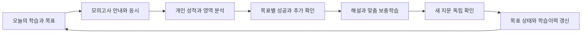

# 초등 수능형 모의고사와 학생 대시보드 개발 계획

<!-- readx-document-context -->
> 작성 당시의 설계·조사·구현 기록입니다. 현재 기능과 운영 상태는 최신 현황을 우선합니다. [문서 목차](README.md) · [최신 현황](PROJECT_STATUS.md)


작성일: 2026년 10월 15일

**초등학생이 수능 국어의 사고 방식을 경험하는 모의고사와, 자신의 성적·학습이력·목표 달성 근거를 확인하는 학생 대시보드를 함께 만든다.** 모의고사의 결과는 취약 목표의 보충학습과 새 글 재평가로 이어진다. 대상은 사용자가 확정한 초등 1~6학년이며, 첫 검증은 초5·6에서 시작한다.

이 문서는 개발·집필·시범 운영의 계획이다. 현재 구현 완료를 의미하지 않는다. 외부 근거와 현재 코드의 상세 확인 결과는 [조사 보고서](../research/ELEMENTARY_MOCK_EXAM_AND_DASHBOARD_RESEARCH_2026-10-15.md), 수업 철학은 [세부목표와 사고 과정 전략](./GOAL_PROCESS_CONTENT_STRATEGY.md)을 따른다.

2026년 10월 15일 첫 개발 묶음의 브라우저 개인 연습판을 구현했다. 초5·6 미니 모의고사와 성적·학습이력·목표·보충학습 연결, 검증 결과와 운영 경계는 [구현 기록](./STUDENT_MINI_EXAM_IMPLEMENTATION_2026-10-15.md)에서 확인한다.

## 제품 범위와 출시 순서

| 구분 | 설계 결정 |
| --- | --- |
| 제품명 | ReadX 수능형 문해력 모의고사. 여러 지역 기관에 회차를 개방하는 단계에서 ReadX 전국 문해력 모의고사 명칭 사용 |
| 핵심 경험 | 지문 묶음 풀이 → 성적표 → 목표별 증거 → 추천 학습 → 새 지문에서 다시 확인 |
| 전체 대상 | 초1~6. 학년마다 다른 시험지와 기준을 사용하며 같은 학년군이라고 점수를 합치지 않음 |
| 최초 구현 | 초5·6 각각의 독서 미니 모의고사, 개인 성적표, 학습이력, 목표 지도, 복습 연결 |
| 정기 시험 | 학년별 독서·문학·언어와 매체를 포함하는 종합 시험. 월 1회 운영을 초기 가정으로 함 |
| 비교 성적 | 처음에는 개인 성적. 검증된 회차 운영 이후 동일 조건의 ReadX 참여자 비교를 추가 |
| 후속 확장 | 초3·4, 초1·2, 여러 기관 연합 운영, 시험 간 비교 척도 |
| 첫 출시에서 제외 | 실제 고교 수능 대비, 수능 예상 등급, 대학 예측, 전국 규준을 가장한 순위, 검증되지 않은 단일 문해력 지수 |

첫 정식 서비스의 완성 기준은 학생이 **현재 성적, 확인된 목표, 아직 확인하지 못한 목표, 다음에 할 일**을 자신의 실제 기록으로 설명할 수 있는 것이다.

## 조사 결과를 반영한 설계 원칙

수능 국어는 초등용 시험의 사고 과제 설계에 참고한다. 2028학년도 국어의 45문항·80분은 고교 시험 사양이므로 초등 시험에는 별도의 문항 수와 시간을 적용한다. [교육부 수능 체제 안내](https://www.korea.kr/news/policyNewsView.do?newsId=148938778)

EBSi의 시험별 성적·오답노트·유사 문제 연결은 모의고사 이후 학습 동선에 참고한다. [EBSi 활용 안내](https://www.ebsi.co.kr/ebs/xip/xipa/retrieveSCVPreparation.ebs?irecord=202506041&targetCd=D100) Khan Academy와 Lexia에서 확인한 완료·숙달·수행 확인의 구분은 활동량과 능력 지표를 나누는 설계에 반영한다. [Khan Academy](https://support.khanacademy.org/hc/en-us/articles/360031123551-How-can-I-view-my-students-progress-towards-their-Unit-Missions), [Lexia](https://community.lexialearning.com/student-progress-reports-97/mylexia-reports-core5-student-skills-1559)

반복 확인과 설명 활동은 학습에 포함하되, 같은 문항을 다시 맞힌 성적과 새 글에서 혼자 수행한 성적은 따로 저장한다. [IES 학습 설계 지침](https://ies.ed.gov/ncee/wwc/PracticeGuide/1) 대시보드의 모든 분석은 근거 기록과 다음 활동까지 연결한다.

## 학생의 전체 이용 흐름



예를 들어 학생이 비교 관계 문제를 틀렸다면 성적표에서 관련 목표를 열 수 있다. 목표 화면은 해당 응답과 근거를 보여 주고, 비교 대상의 특징을 정리하는 수업을 추천한다. 수업 뒤에는 처음 보는 다른 글로 같은 기능을 확인한다. 그 기록이 목표 지도와 다음 모의고사 준비 화면에 연결된다.

## 모의고사 설계

### 응시 모드

| 모드 | 용도 | 도움과 결과 공개 | 비교 집계 |
| --- | --- | --- | --- |
| 미니 연습 | 지문 1~3묶음의 짧은 실전 연습 | 풀이 중 정답 비공개, 제출 후 해설. 필요하면 별도 도움 학습으로 전환 | 개인 기록만 |
| 학원 정기 평가 | 담당 교사가 지정한 반·학년의 공통 평가 | 정해진 시간과 공통 시험지, 교사가 정한 종료 시점 이후 해설 | 해당 학원 내 동일 조건 |
| 전국 참여 회차 | 여러 기관 학생이 같은 기간에 치르는 시험 | 서버 마감·최초 응시·공개 시각을 통일 | 해당 회차 ReadX 유효 참여자 |
| 재학습과 재확인 | 오답 이해와 목표 수행 확인 | 원문 복습과 새 지문 확인을 별도 활동으로 구분 | 공식 회차 성적에는 미반영 |

첫 구현에서는 미니 연습과 학원 정기 평가를 우선 연결한다. 전국 참여 회차는 서버 응시 기록, 정답 비공개, 중복 응시 방지, 기관별 권한, 집계 검증이 준비된 뒤 연다.

### 학년별 시험 사양 초안

아래 수치는 파일럿에서 조정할 **제품 가설**이며 국가 기준이나 검증된 규준이 아니다. 학년별 별도 시험지를 만들되 학년군별 화면 사양을 공유한다.

| 대상 | 지문 묶음 | 문항 | 기본 선택지 | 제안 시간 | 강조할 경험 |
| --- | ---: | ---: | ---: | ---: | --- |
| 초1·2 | 4 | 12 | 3개 | 20분 | 짧은 글·그림·생활 자료, 사실과 간단한 관계 |
| 초3·4 | 5 | 20 | 4개 | 35분 | 문단 관계, 비교·인과, 간단한 도표·새 사례 |
| 초5·6 | 6 | 24 | 5개 | 45분 | 여러 문단·복합 자료, 추론·판단·적용 |
| 첫 미니판 초5·6 | 3 | 12 | 5개 | 20~25분 | 독서 중심으로 응시부터 재학습까지 검증 |

한 묶음은 한 편의 글 또는 연결된 두 글·자료로 구성된다. 글 길이는 기존 `readingPolicy.ts`의 학년별 기준을 출발점으로 삼고, 시험 전체 분량과 실제 풀이 시간을 함께 검토한다. 글자 수만으로 난도를 결정하지 않는다.

초기 채점은 문항당 1점으로 통일한다. 원점수 `정답 수/전체 문항 수`와 `100점 환산 점수`를 함께 제공한다. 24문항 중 19문항 정답이면 원점수 19/24, 환산 79.2점이다. 수능의 공식 원점수·표준점수라는 명칭을 붙이지 않는다. 차등 배점이 필요해지면 시험지 버전에서 배점표를 고정한다.

### 초5·6 종합형 출제표

| 내용 영역 | 묶음과 문항 | 소재와 형식 |
| --- | --- | --- |
| 독서 | 3묶음 12문항 | 인문·사회·과학 등 교과 소재, 정보 비교, 원리와 사례, 표·그래프 결합 |
| 문학 | 2묶음 8문항 | 이야기·동시, 인물의 마음·사건 변화·표현의 효과 |
| 언어와 매체 | 1묶음 4문항 | 문맥 어휘, 안내문·광고·대화·매체 자료의 목적과 정보 |
| 합계 | 6묶음 24문항 | 학년마다 다른 본문과 문항 |

같은 24문항을 사고 수준 축으로도 배분한다. 초안은 직접 확인 6, 정보 연결 6, 추론 5, 근거 판단 3, 새 상황 적용 4문항이다. 내용 영역과 사고 수준은 서로 다른 태그이며 각 축의 합은 각각 24가 된다. 시험 한 번으로 516개 세부목표를 모두 진단하지 않는다. 회차별 대표 목표 4~6개를 집중 확인한다.

### 문항과 해설의 필수 조건

각 문항에는 지문 버전, 주목표 1개, 보조목표, 내용 영역, 사고 수준, 정답, 선지별 이유, 본문 근거 위치, 배점, 검수 상태를 연결한다. 주목표가 아닌 모든 태그에 정답을 중복 가산하지 않는다. 교과 개념 이해가 목표인 문항과 독해 기능을 평가하는 문항의 요구를 집필 단계에서 구별한다.

해설은 `어디를 보아야 하는가 → 무엇을 연결하는가 → 어떤 조건으로 판단하는가` 순서로 쓴다. 내부 오답 분류 D1~D6는 편집용 태그로 유지하며, 학생에게는 `조건을 놓쳤어요`, `대상의 특징을 바꾸어 읽었어요`처럼 구체적으로 설명한다. 선택지만으로 오류 원인을 확정하지 않고 필요한 근거 확인을 제안한다.

새 사례 문항의 설계 예시는 본문에서 두 가지 물질의 흡수 조건을 설명하고, 보기에서 다른 조건의 실험 결과를 제시한 뒤 적용 가능한 결론을 고르게 하는 방식이다. 학교에서 배우지 않은 과학 지식보다 글에 주어진 정보가 해결 근거가 되도록 한다. 이는 문항 원형이며 바로 출제할 완성 문항은 아니다.

### 시험 화면과 상태

입장 화면에는 회차·학년·영역·문항 수·시간·지원 조건·결과 공개 시각을 보여 준다. PC·태블릿에서는 지문과 문제를 좌우로 두고, 휴대전화에서는 지문/문제 전환과 문항 이동을 명확히 한다. 글자 크기 조절, 키보드 이동, 색상 외 상태 표시, 터치 가능한 선택지를 제공한다.

풀이 중에는 남은 시간, 답한 문항 수, 다시 볼 문항, 저장 상태를 보여 준다. 학생이 직접 한 밑줄·메모는 허용할 수 있으나 시스템이 근거를 표시하거나 정답을 암시하지 않는다. 제출 전 미응답 수를 확인하고, 제출 또는 제한 시간 종료 후 응답을 잠근다.

응시 상태는 `ready → in_progress → submitted/auto_submitted → graded → released`로 관리한다. 기술 문제에 따른 `needs_recovery`, 무효 처리된 `invalidated`, 채점 이의에 따른 검토 상태를 별도로 둔다. 회차가 종료되기 전에는 문제·정답·해설이 다른 응시자에게 유출되지 않도록 공개 정책을 서버에서 적용한다.

## 학생 대시보드 설계

### 화면 구성

상위 메뉴는 **오늘의 학습 / 모의고사 / 성장 리포트 / 나의 목표 / 학습이력**으로 정리한다. 기존 교과 자료실과 단어장은 오늘의 학습에서 바로 들어갈 수 있게 유지한다. 현재 `StudentJourneyHub`를 중심으로 확장한다.

```text
학생 홈                 기간 선택  이번 주 | 이번 달 | 직접 선택
─────────────────────────────────────────────────────
오늘 할 일              진행 중인 목표               최근 시험
새 글에서 비교해 보기   이번 달 목표 4개 중 2개 달성   19/24 · 79.2점
─────────────────────────────────────────────────────
최근 회차 기록          목표 지도와 다음 확인         학습 달력
─────────────────────────────────────────────────────
최근 기록 3개           다가오는 모의고사             복습 시작
```

위 값은 화면 구성 설명을 위한 예시다. 실제 데이터가 없으면 `첫 학습을 시작해 보세요`, `아직 평가한 목표가 없어요`처럼 다음 행동을 제시한다. 홈에는 핵심 카드 3개와 요약을 두고 상세 차트는 성장 리포트에서 연다.

### 분석 항목과 표시 형태

| 항목 | 학생이 알게 되는 것 | 표시 형태 | 누르면 열리는 내용 | 우선순위 |
| --- | --- | --- | --- | --- |
| 최근 성적 | 어느 시험에서 얼마나 맞혔는지 | 점수 카드와 응답 수 | 회차 성적표·문항별 결과 | P0 |
| 학습이력 | 언제 무엇을 했는지 | 달력과 시간순 기록 | 응답·도움·피드백·재학습 이력 | P0 |
| 목표 달성 | 목표별로 어디까지 확인했는지 | 상태 지도와 달성 막대 | 수행 기준·증거·다음 확인 | P0 |
| 영역별 수행 | 독서·문학·언어와 매체 중 무엇이 강한지 | 가로 막대와 분자/분모 | 해당 영역 문항 | P0 |
| 사고 수준별 수행 | 확인·연결·추론·판단·적용의 차이 | 작은 막대 차트 | 단계별 문항과 설명 | P0 |
| 회차별 기록 | 시험마다 결과가 어땠는지 | 점 그래프와 회차 표 | 시험 범위·조건·원문 성적 | P0 |
| 오답과 재확인 | 어떤 문제를 다시 익혀야 하는지 | 오답 목록과 상태 필터 | 해설·보충학습·새 글 확인 | P0 |
| 독립 수행 | 도움 없이 수행한 증거가 늘었는지 | 도움 수준별 누적 막대 | 최초 응답과 도움 사용 기록 | P1 |
| 시간 배분 | 어느 묶음에서 시간이 많이 들었는지 | 지문별 시간 막대 | 답안 변경·미응답과 함께 보기 | P1 |
| 사고 과정 | 단서·관계·판단·표현의 관찰 결과 | 단계별 증거 수와 상태 | 학생의 실제 밑줄·응답·교사 검토 | P1 |
| 참여자 내 위치 | 같은 조건의 참여자 중 내 위치 | 분포도와 내 점수 | 모집단 조건·인원·집계 기준 | P2 |
| 장기 성장 | 비교 가능한 검사에서 변화했는지 | 연결된 점수 추이 | 척도·오차·적용 검사 설명 | P3 |

색만으로 상태를 전달하지 않는다. 차트에는 표 보기와 쉬운 설명을 제공하고, 모든 비율에는 기간·응시 조건·분모를 표시한다. 저학년은 달성한 일과 다음 활동을 먼저 보여 주고, 순위나 복잡한 비교 그래프는 기본 화면에서 제외한다.

### 지표 정의

| 지표 | 산식 또는 기준 | 해석 규칙 |
| --- | --- | --- |
| 시험 원점수 | 유효 문항에서 얻은 점수의 합 | 공식 최초 응시 성적만 사용. 미응답은 0점 |
| 100점 환산 | 100 × 획득 점수 / 유효 만점 | 소수 첫째 자리. 0개 문항이면 산출하지 않음 |
| 영역 정답률 | 해당 영역 정답 수 / 해당 영역 유효 문항 수 | 미응답 포함. 비율과 정답 수/문항 수 병기 |
| 학습 중 최초 정답률 | 최초로 제출한 채점 가능 응답의 정답 수 / 그 응답 수 | 도움 사용·새 글 여부를 필터로 분리. 시험 정답률과 같은 카드에 합치지 않음 |
| 목표 달성률 | 현재 계획의 목표 중 정해진 수행 기준에 도달한 수 / 현재 계획 목표 수 | 전체 516개가 분모가 아님. 계획과 기준 버전을 고정 |
| 과제 완료율 | 제출 완료한 배정 과제 수 / 기간 내 배정 과제 수 | 내용 이해·목표 달성과 별개 |
| 독립 수행 성공률 | 도움 없는 유효 확인에서 성공한 수 / 검토가 끝난 유효 확인 수 | 미검토는 별도 대기 건수. 도움받은 연습은 분리 |
| 새 글 전이 성공률 | 처음 보는 다른 맥락의 글에서 독립 성공한 수 / 해당 조건의 검토 완료 확인 수 | 노출 여부 unknown, 같은 글의 재서술, 정답을 본 뒤 재시도는 제외 |
| 학습일 수 | 실제 학습 이벤트가 있는 서로 다른 한국 날짜 수 | 로그인만으로 학습일을 늘리지 않음 |
| 활성 화면 시간 | 해당 활동의 전경 상태에서 수집한 시간 | 읽기 속도·집중력·이해도로 단정하지 않음 |

성적표에서 시간 종료 미응답과 실제 오답을 구분해서 보여 주되 시험 점수의 분모에는 둘 다 포함한다. 기술 문제로 무효 처리한 문항은 채점 정책 버전과 함께 분모에서 제거하고 모든 응시자에게 일관되게 적용한다.

## 목표 달성과 수준 판정

### 목표의 구조

원천 516개 목표를 학생의 학습 계획과 연결하되, 첫 출시에서 전부 검증 완료한 것처럼 표시하지 않는다. 목표마다 `학년·성취기준·수행 문장·성공 준거·선수목표·확인 문항·필요 증거·판정 규칙 버전`을 둔다. 현재 슬롯 ID와 원천 목표 ID는 검수된 대응표로 연결한다.

학생의 목표는 두 종류다. **학습 습관 목표**는 `이번 주 3일 학습하기`, **수행 목표**는 `새 글에서 비교 기준과 두 대상의 특징을 연결하기`처럼 표현한다. 습관 목표를 달성해도 수행 수준은 자동으로 올라가지 않는다.

### 상태와 근거

| 표시 상태 | 의미 | 학생에게 제시할 다음 행동 |
| --- | --- | --- |
| 아직 확인하지 않았어요 | 해당 목표의 유효 증거가 없음 | 짧은 확인 활동 시작 |
| 도움받아 연습하고 있어요 | 시범·힌트와 함께 수행한 기록이 있음 | 도움을 줄여 다시 해 보기 |
| 혼자 해냈어요 | 목표별 독립 수행 기준에 도달함 | 다른 소재의 새 글에서 확인 |
| 새 글에도 적용했어요 | 다른 맥락의 새 지문에서 전이 기준에 도달함 | 시간을 두고 다시 확인 |
| 시간이 지나도 할 수 있어요 | 지연된 독립 확인 기준까지 도달함 | 다음 목표로 확장 |

수행 상태와 함께 `증거 부족 / 검토 대기 / 근거 충분 / 최근 재확인 필요`를 별도 표시한다. 미평가를 미달성 점수 0으로 처리하지 않고, 검토 대기는 실패로 계산하지 않는다. 목표 카드에는 기준과 성공/전체 횟수, 서로 다른 글의 수, 마지막 확인 날짜를 보여 준다.

첫 규칙의 **검증용 예시**는 다음과 같다. 실제 운영에는 목표별 교사 검토와 파일럿 후 확정한 버전을 사용한다.

- 독립 수행: 최근 28일 내 서로 다른 글 계열 3개 이상, 2회 이상의 학습 세션에서 수집한 적격 첫 응답 5건 이상. 최근 5건 중 4건 이상이 목표의 전체 채점 준거를 충족하고 가장 최근 확인도 성공.
- 전이 확인: 독립 수행 기준을 충족하고, 도움·정답 노출 없이 다른 소재의 새 글 2개에서 추가 성공. 같은 글의 도움글/기준글/도전글은 한 글 계열로 취급.
- 유지 확인: 전이 확인 후 최소 7일이 지난 다른 세션에서 새 글 독립 확인 성공.

28일·5건·4건·2개·7일은 공인된 숙달 기준이 아닌 시험 운영용 가설이다. 별도의 검증 전에는 `교사 확인을 기다리는 달성 후보`로 제공할 수 있다. 객관식 정답만으로 쓰기·근거 설명까지 달성 판정하지 않는다. 설명이 필요한 목표는 해당 수행의 검토를 반드시 포함한다.

한 번의 실수로 과거 달성을 지우지 않는다. 새 관찰이 기준과 충돌하면 `재확인 필요`를 표시하고 추가 확인을 제공한다. 일정 시간이 지났다는 이유만으로 실패로 낮추지 않는다. 교사의 변경에는 이유·근거·변경 시각을 남긴다.

### 목표 카드의 예

`두 대상의 특징을 같은 기준으로 비교하기` → `혼자 해냈어요` → `독립 확인 4/5, 글 계열 3개` → `다른 교과 글 2개에서 적용 확인이 남았어요` → `새 글로 확인하기` 버튼.

대시보드에는 현재 계획의 4~8개 목표를 우선 보여 주고 전체 지도는 접어서 탐색한다. 선행 목표나 상위 목표는 관계를 보여 주되 하위 목표 하나의 성공으로 자동 달성시키지 않는다.

## 전국 참여 회차와 성적 공개

### 비교 집단

비교 단위는 `회차 + 실제 학년 + 시험지 버전 + 시간·지원 조건 + 최초 유효 응시`다. 동일 학생이 여러 기관에 속해도 한 회차의 공식 응시는 한 건만 인정한다. 재응시·연습·정답 노출 후 풀이·무효 응시는 공식 분포에서 제외한다. 정상 응시에서 미응답이 많거나 점수가 낮다는 이유로 제외하지 않는다.

첫 회차에는 하나의 학년별 공통 시험지를 사용한다. A/B형은 우선 별도 회차나 별도 집단으로 운영하고, 난도가 비슷해 보인다는 이유만으로 합산하지 않는다. 화면 표기는 `이번 회차 초5 ReadX 참여자 138명 기준`처럼 실제 집단을 명시한다.

| 집단 크기 | 초기 공개 정책 제안 |
| --- | --- |
| 20명 미만 | 개인 성적만 제공, 집단 분포 숨김 |
| 20~99명 | 집단 평균과 넓은 점수 구간을 조건부 제공. 개인 백분위·세부 순위 숨김 |
| 100명 이상 | 유효성·조건 검토 후 참여자 내 상대 위치 제공 가능 |

20명·100명은 보수적인 제품 공개 기준의 초안이며 통계적 신뢰도나 전국 대표성을 보장하는 수가 아니다. 필터를 적용한 작은 집단에도 같은 기준을 적용한다. 공개 분포는 학생 개인을 식별할 수 없도록 집계한다.

참여자 내 백분위가 필요하면 동점 중간순위 방식 `100 × (내 점수 미만 인원 + 0.5 × 동점 인원) / 유효 응시 인원`을 제품 산식으로 명시한다. 본인도 동점 인원에 포함하며 표시할 때 정수로 반올림한다. 전원 동점이거나 비교 조건이 성립하지 않으면 상대 위치 대신 그 사유를 표시한다. 이 값은 공식 수능 백분위가 아니다.

### 회차 운영

운영자는 출제표 확인 → 시험지 검수 승인 → 대상 기관과 기간 지정 → 응시 개방 → 마감 → 기술 문제·문항 이의 검토 → 성적 확정 → 해설·비교 공개 순서로 진행한다. 학생에게는 개인 채점과 비교 성적이 공개되는 시점을 구분해서 안내한다.

교사 화면에는 반별 응시 배정, 미시작·진행·제출·복구 상태, 목표별 추가 확인 대상, 보충학습 배정을 제공한다. 콘텐츠 운영 화면에는 시험지 버전과 검수, 회차 개방·중단, 공개 시각, 문항 이의와 성적 정정을 둔다. 보호자 화면은 연결된 학생의 확정 성적·현재 목표·권장 학습을 같은 집계 결과로 보여 준다.

첫 운영은 학원 수업 시간대에 맞춘 예약 세션을 기본으로 한다. 여러 날 같은 시험지를 쓰는 경우 마지막 세션이 끝나기 전에는 정답과 해설을 열지 않는다. 온라인 응시만으로 완전한 감독을 보장한다고 표현하지 않는다. 이상 기록은 담당자 검토 대상으로 보내고 자동으로 부정행위로 확정하지 않는다.

문항 오류를 인정하면 기존 응답을 보존한 상태에서 정답·배점 정책을 새 버전으로 만들고, 전체 대상의 성적과 목표 증거·집계 결과를 함께 재산출한다. 과거 성적표에는 정정 이력을 남긴다.

서로 다른 회차의 원점수는 이력으로 보여 준다. 시험지 간 난도 연결이 검증되기 전에는 `실력 15점 상승`이나 종단 능력 점수로 표시하지 않는다. 이후 측정 단계에서 공통 기준 문항, 표본 구성, 점수 연결, 신뢰도·오차를 검토한다. [ETS 점수 비교 원리](https://www.ets.org/research/policy_research_reports/publications/periodical/2020/kgqh.html)

## 데이터와 기술 구조

### 핵심 기록

| 데이터 | 필요한 내용 |
| --- | --- |
| GoalDefinition | 원천 목표와 운영 목표 ID, 수행 준거, 선수목표, 규칙·교육과정 버전 |
| Item과 Passage | 내용 버전, 글 계열 ID, 주목표·보조목표, 영역·사고 수준, 근거 위치, 검수·권리 상태 |
| ExamBlueprint와 ExamForm | 학년·범위·출제표·문항 순서·시간·만점·비교 조건·불변 버전 |
| ExamSession | 회차, 참여 기관, 개방·시작·마감·공개 시각, 정책 버전 |
| ExamAttempt | 학생·기관·반, 회차·시험지 버전, 공식/연습, 시작·서버 마감, 상태·무효 사유 |
| ItemResponse | 시도·문항 버전, 첫 선택·마감 시 최종 선택, 변경 순서, 미응답, 지원 사용, 노출 상태 |
| ActivityEvent | 이벤트 ID, 학생·활동·문항·지문, 종류, 클라이언트 시각·서버 수신 시각, 계측 버전 |
| GoalEvidence | 목표, 근거 응답, 독립 여부, 새 글 여부, 과정·결과, 검토자, 정정·취소 참조 |
| GoalPlan과 GoalState | 대상 목표와 기한, 달성 기준, 현재 상태, 증거 수·증거 ID, 재확인 상태 |
| CohortSnapshot | 집단 조건, 유효 인원·제외 사유, 분포, 산식·채점 버전, 확정 시각 |
| ReviewAssignment | 원래 오답·취약 목표, 추천 이유, 보충학습, 별도의 새 글 확인, 진행 상태 |

점수는 응답에서, 목표 상태는 증거에서, 차트는 이 집계 결과에서 만든다. 화면마다 별도의 점수 계산을 하지 않는다. 학년이 바뀌어도 과거 응시 당시의 학년·조건을 보존한다. 시각은 UTC로 저장하고 학습일·기간 경계는 Asia/Seoul로 계산한다.

### 기존 코드 활용과 추가 위치

| 기존 위치 | 변경 방향 |
| --- | --- |
| `StudentJourneyHub.tsx`, `App.tsx`, `BrandHeader.tsx` | 현재 학생 홈과 헤더를 확장하고 모의고사 목록·리포트 진입 연결 |
| `CbtMockExamStudio.tsx` | 지문/문항/OMR UI를 재사용하고 회차 엔진·응시 저장과 분리 |
| `reportMetrics.ts` | 최초 응답·분모 처리·도움·전이 구분을 유지하고 실제 기록 어댑터 추가 |
| `processEvidence.ts`, `contentLibrary.ts` | 검수된 목표 연결, 글 계열·노출 기록, 목표 상태 판정의 입력 확장 |
| `useCoursewareStore.ts` | UI 상태와 기록 원장을 분리. 최근 100개 로그는 화면 캐시 용도로만 사용 |
| `firebaseDbService.ts`, `firestore.rules` | 실제 인증·기관 분리·서버 저장·채점 서비스를 구현하고 규칙 교체 |

제안 모듈은 `types/exam.ts`, `types/goalProgress.ts`, `services/examRepository.ts`, `services/learningAnalytics.ts`, `services/goalMastery.ts`, `components/student/MockExamHub.tsx`, `StudentGrowthDashboard.tsx`, `GoalProgressMap.tsx`, `LearningHistoryTimeline.tsx`다. 함수와 타입의 계약을 먼저 고정하고 기존 화면에서 점진적으로 연결한다.

`StudentModeType`과 현재 해시 탐색의 허용 목록도 함께 확장한다. 분석 화면을 열 때 학습 슬롯이 없다는 이유로 홈으로 돌아가지 않게 하고, 현재의 `portal 이외는 읽기 화면` 분기를 시험·리포트·목표 화면별로 나눈다. 현재 App에서 사용하지 않는 과거 `StudentHeader`와 `TopGlobalNav`를 별도 탐색 체계로 다시 연결하지 않는다.

기존 Firebase 설계에 맞춰 인증·Firestore·서버 함수 조합을 우선 검토한다. 현재는 SDK와 서버 구현이 없으므로 로컬 저장 성공을 운영 준비 완료로 간주하지 않는다. 시작·답안 저장·제출·결과 조회·검토·공개의 서버 경계를 따로 둔다.

### 정확한 기록과 안정적인 응시

- 시험지는 시작 시 고정된 버전으로 스냅샷을 남긴다. 배포 중 원문이 수정되어도 진행 중 시험은 바뀌지 않는다.
- 시작 시 서버가 `startedAt`과 `deadlineAt`을 정한다. 새로고침·브라우저 종료·기기 시각 변경으로 시간이 늘어나지 않는다.
- 답안 변경은 서버 확인 번호를 표시하고 재전송 시 같은 이벤트를 중복 반영하지 않는다. 로컬 임시저장은 복구용이며 공식 저장 완료와 구분한다.
- 제출은 같은 요청을 여러 번 보내도 한 번만 확정한다. 마감 시 서버에 수신된 마지막 유효 응답으로 자동 제출한다.
- 네트워크가 끊기면 미동기화 상태를 알린다. 마감 뒤 들어온 로컬 응답은 조용히 정상 성적으로 편입하지 않고 복구 정책에 따라 검토한다.
- 시험 본문과 정답 키·선지별 정오 정보·해설을 분리한다. 정답 키는 번들, 공개 JSON, 클라이언트 읽기 가능한 문서에 포함하지 않는다.
- 기관·반·본인·연결 보호자의 접근 범위를 서버에서 확인한다. 다른 기관의 학생 기록은 조회할 수 없고, 전국 집계에는 개인 식별자를 노출하지 않는다.
- 기존 `reading_time_sec`의 균등 배분 값은 `legacy_estimate`로 유지하거나 시간 분석에서 제외한다. 문항별 활성 시간을 새로 계측할 때 지문 공통 읽기 시간과 문항 응답 시간을 구분한다.
- 기존 미분류 오답의 D6 대체를 없애고 `unanswered`, `unclassified`, 검수된 오류 유형을 구분한다.
- 기록 이관 시 학생·회차·노출을 알 수 없는 값을 추측해서 채우지 않는다. 예전 로컬 기록은 개인 연습 이력으로만 남기고 공식 비교 집계에서 제외한다.

## 출제 콘텐츠 확보

지문 원장 144편은 현재 승인 0편이므로 **사용 가능한 정식 시험지 수는 아직 확정할 수 없다.** 교육과정·학년 적합성, 사실, 표현, 정답 유일성, 선지별 해설, 목표 정렬, 사용 권리를 검토하고 승인된 버전만 시험에 편성한다.

초5·6 시범 운영의 집필 목표는 학년별 A/B 각 1종, 총 4종의 종합 시험지다. 24문항 기준으로 96문항·24지문 묶음이 필요하다. 복합 지문 묶음에는 여러 본문이 있을 수 있으므로 묶음 수와 본문 수를 구별한다. A/B는 동등화 전까지 서로 다른 시험으로 기록한다.

정규 수업과 평가용 은행을 나누고 지문 계열의 노출 여부를 추적한다. 첫 미니판은 독서 지문 3묶음·12문항을 학년별로 우선 완성한다. 문학과 매체 자료가 준비되기 전에는 `국어 종합 진단`으로 표시하지 않는다. 목표 재확인용으로는 학년별 핵심 목표 3개에 대해 새로운 글 2묶음씩, 총 12묶음을 별도로 확보하는 것을 초안 물량으로 잡는다.

집필자와 다른 검토자가 정답·근거·학년 적합성을 교차 검토한다. AI를 초안 작성에 활용하더라도 자동 생성만으로 승인 상태를 부여하지 않는다. 파일럿에서는 풀이 시간, 미응답 위치, 문항 정답률, 선지 선택 분포, 오해 사례를 확인한다. 난도나 변별도 지표는 검토 자료로 활용하고 작은 표본의 수치만으로 문항을 기계적으로 폐기하지 않는다.

## 단계별 개발 계획

아래 기간은 **개발자 2명, 콘텐츠 책임자 1명, 별도 교차 검토자와 시범 학원 협조**를 가정한 초기 추정이다. 실제 인력·콘텐츠 검수·참여 기관 확보에 따라 조정한다. 각 단계의 완료 조건을 충족한 뒤 운영 범위를 넓힌다.

| 단계 | 예상 기간 | 산출물 | 완료 조건 |
| --- | --- | --- | --- |
| 0 기준 확정 | 1주 | 학년별 출제표, 대표 목표 대응표, 지표 사전, 시험·목표 데이터 계약 | 초5·6의 첫 목표와 문항 연결이 검수되고 점수·달성·완료의 정의가 일치 |
| 1 개인용 흐름 | 2주 | 미니 모의고사, 응답 원장, 성적표, 학습이력, 목표 카드 | 응시 → 결과 → 근거 → 재학습 → 새 글 확인이 한 학생 기록으로 연결 |
| 2 운영 기반 | 2주 | 인증·권한·서버 채점, 저장 복구, 회차·공개 관리 | 기관 분리·정답 비노출·새로고침·마감·중복 제출 검증 통과 |
| 3 종합 시험과 분석 | 2주 | 독서·문학·매체 시험지, 성장 리포트, 목표 지도, 과정 분석 | 검수 승인된 시험지와 실제 응답으로 모든 핵심 카드 재현 가능 |
| 4 학원 연합 시범 | 2주 | 운영 회차, 교사 검토, 성적 정정, 집계 검증 보고서 | 기록 유실·오채점·권한 결함 해소, 교사 판정과 시스템 근거 대조 |
| 5 공개와 확대 판단 | 1주 이상 | 전국 참여 회차 준비, 표본별 비교 표시, 초3·4 확장안 | 참여 기관·지원 운영·집계 조건 충족. 조건 미달 시 개인/기관 성적만 출시 |

총 10주 이상을 초기 운영판의 계획 범위로 잡는다. 콘텐츠 제작은 단계 0부터 병행하되 승인 전 시험지는 개발용으로만 쓴다. 초1~4 전체 확장과 전국 규준·동등화는 이 일정에 포함하지 않는다.

### 첫 개발 묶음

1. `ExamForm`, `ExamAttempt`, `ItemResponse`, `GoalEvidence`와 지표 사전을 확정한다.
2. 기존 CBT의 인접 슬롯 자동 조합 대신 검수된 명시적 시험지를 입력한다.
3. 초5·6 독서 미니판을 각각 만들고 응시·제출·개인 성적표를 연결한다.
4. 학생 홈에 최근 성적, 현재 목표, 다음 확인 활동 카드와 실제 학습이력을 넣는다.
5. 대표 목표 3개씩에서 문항 → 목표 → 응답 근거 → 보충학습 → 새 글 확인을 완성한다.
6. 같은 기록을 교사가 검토하고 학생이 확인할 수 있게 연결한다.

## 검증과 출시 조건

| 영역 | 필수 확인 사례 |
| --- | --- |
| 점수 | 전부 정답·전부 오답·전부 미응답, 문항 무효, 0분모, 환산 반올림 |
| 응시 복구 | 새로고침·강제 종료·네트워크 끊김·마감 직전 저장·다중 탭·중복 제출 |
| 기록 | 첫 응답과 수정 응답 보존, 이벤트 중복 제거, 기간 경계, 학생·기관 분리 |
| 목표 판정 | 도움 뒤 성공, 이미 본 글, 다른 수준의 같은 글, 검토 대기, 증거 부족, 상충 증거, 규칙 변경 |
| 비교 집계 | 동점, 전원 동점, 작은 표본, 재응시, 다른 학년·시험지·지원 조건의 혼입, 정정 후 재집계 |
| 콘텐츠 | 정답 유일성, 본문 근거, 선지 설명, 문항·목표 참조 무결성, 승인 버전만 출제 |
| 화면 | PC·태블릿·휴대전화, 키보드·큰 글자, 표 대체, 빈 데이터·로딩·오류·검토 대기 |
| 접근 통제 | 타 기관 기록 차단, 정답 키·해설 조기 접근 차단, 보호자 연결, 결과 공개 시점 |

현재 프로젝트의 관련 회귀 검사에 새 동작을 추가하고, 운영 기능에는 서버 권한 검사와 브라우저 응시 시나리오를 적용한다. 시험 저장·채점·권한은 모의 데이터만으로 완료 판정하지 않는다.

시범 운영에서는 응시 시작 대비 제출 완료율, 답안 저장 실패·복구율, 미응답 위치와 시간 분포, 결과 확인 후 보충학습 시작률, 새 글 확인 완료율, 교사의 판정 변경 이유를 수집한다. 사용성 검토에서는 학생이 자신의 현재 목표와 다음 행동을 찾을 수 있는지 확인한다. 동일 문항 재풀이 점수 상승은 학습 효과의 증거로 사용하지 않는다.

출시를 막는 결함은 답안 유실, 잘못된 채점, 기관 간 기록 노출, 정답 사전 노출, 근거 없는 목표 달성, 잘못된 비교 집단이다. 전국 참여자 모집이나 문항 검수가 지연되면 개인 모의고사·학습이력·목표 리포트까지 출시하고 비교 기능은 해당 조건이 갖춰진 회차에서 연다.
