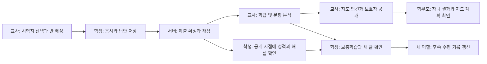

# 초1부터 초6까지 수능형 모의고사와 세 역할 화면 구현 계획

<!-- readx-document-context -->
> 작성 당시의 설계·조사·구현 기록입니다. 현재 기능과 운영 상태는 최신 현황을 우선합니다. [문서 목차](README.md) · [최신 현황](PROJECT_STATUS.md)

작성일: 2026년 10월 24일  
상태: 구현 제안안. 아래의 신규 기능과 시험지는 아직 구현·출제 완료 상태가 아니다.

**학년별 시험지, 학생 응시, 서버 채점, 문항별 분석, 교사 지도, 학부모 결과 확인을 하나의 제품으로 완성한다.** 같은 학생의 실제 응답을 학생·교사·학부모 화면에서 목적에 맞게 보여 주며, 오답 복습과 새로운 글에서의 재확인까지 연결한다.

대상은 기존 프로젝트에서 확정한 초등 1~6학년이다. 첫 완성 단위는 초5 한 회차의 전체 이용 흐름으로 잡지만, 전체 범위는 초1~6 각각의 독립 시험지와 세 역할 화면이다. 기존 [초등 모의고사 계획](./ELEMENTARY_MOCK_EXAM_AND_DASHBOARD_PLAN_2026-10-15.md)을 확장하며, 이번 개발의 범위·물량·우선순위는 이 문서를 기준으로 한다. 기존 개인 연습판의 구현 기록은 [미니 모의고사 구현 기록](./STUDENT_MINI_EXAM_IMPLEMENTATION_2026-10-15.md)에 보존한다.

## 1. 현재 구현과 남은 일

2026년 10월 24일 작업 폴더의 코드와 기존 구현 기록을 기준으로 정리했다. 이번 계획 작업에서는 앱을 실행하거나 기존 테스트 결과를 다시 검증하지 않았다.

| 영역 | 현재 확인한 상태 | 이번에 완성할 내용 |
| --- | --- | --- |
| 학년별 시험지 | `miniExams.ts`에 초5·6 각각 독서 3지문·12문항·25분 시범 시험 | 초1~6 각각 독서·문학·언어/매체 읽기를 포함하는 독립 시험지 |
| 학생 응시 | `StudentAssessmentHub.tsx`에 응시·문항 이동·표시·제출·결과·복습 | 배정된 정식 회차, 개인 식별, 서버 저장, 복구, 공개 대기 |
| 학년 지원 | `MiniGrade`는 `5 \| 6`, 검증·선지 처리도 5지선다에 고정 | 학년 1~6, 3·4·5지선다, 학년별 안내와 글자·배치 사양 |
| 기록 | `useStudentAssessment.ts`의 로컬 저장, `learnerId: 'local-practice'` | 실제 계정·기관·반·자녀 연결, 여러 기기에서 같은 기록 조회 |
| 교사 화면 | 수업 운영·생각 기록·가상 학급 리포트 구성 존재 | 시험 배정, 진행 확인, 학급·문항·학생 분석, 보충 배정, 결과 공개 |
| 학부모 화면 | 생각 기록·가정 질문·체험 리포트 구성 존재 | 연결 자녀의 공개된 시험 결과, 문항 근거, 지도 의견, 보충 진행 |
| 채점과 분석 | `miniExam.ts`에서 브라우저 채점, 정답·선지 해설은 콘텐츠에 포함 | 서버 채점과 공통 분석 결과, 정답 자료 분리, 재채점 이력 |
| 서버 | `firebaseDbService.ts`는 실제 인증·동기화 없는 로컬 시연이라고 명시 | 인증·응시 API·서버 시간·저장·권한·집계 구현 |
| 접근 규칙 | 기존 `firestore.rules`에는 전체 읽기 또는 인증 여부만 확인하는 경로가 있음 | 모의고사 전용 기관·담당 반·본인·연결 보호자 권한 적용 |

`CbtMockExamStudio.tsx`의 인접 수업 슬롯 조합은 연습 기능으로 유지한다. 정식 회차에는 출제표와 문항 순서를 고정한 시험지를 사용한다. 기존 로컬 기록은 개인 연습 이력으로 남기고, 실제 학생의 공식 성적으로 자동 이관하지 않는다.

## 2. 시험의 성격과 학년별 구성

수능 스타일은 지문 묶음, 근거에 따른 선지 판단, 보기의 새 상황 적용, 자료 통합으로 구현한다. 고교 수능의 어휘·시간·문항 수를 그대로 적용하지 않는다. 2027학년도 수능 안내자료는 개념·원리 이해를 바탕으로 한 사고력 학습과 영역별 예시 문항을 안내한다. 이를 출제 방식의 참고로 삼고 초등 평가 내용은 해당 학년의 교육과정과 프로젝트 목표에 맞춘다. [교육부 수능 안내자료 공개](https://www.moe.go.kr/boardCnts/viewRenew.do?boardID=294&boardSeq=105763&lev=0&m=020402&s=moe)

교육과정 코드는 기존 `achievement_standards.json`에서 연결하되, 해당 원장의 `noticeVersion: 2022-33`을 최신 검토 완료로 취급하지 않는다. 국가교육위원회는 2026년 1월 21일 일부개정을 고시했다. 출제 승인 단계에서 관련 원문과 적용 시기·변경 여부를 대조하고 실제 사용한 기준 버전을 기록한다. [국가교육위원회 일부개정 고시](https://www.ne.go.kr/user/bbs/BD_selectBbs.do?q_bbsDocNo=20260121102419070&q_bbsSn=1016)

아래 문항 수·시간·영역 배분은 기존 계획을 이어받은 **파일럿 제안값**이다. 학년별 사용성·소요시간 검토 후 확정한다. 같은 문항 수를 사용하는 학년도 지문과 문항은 각각 집필한다.

| 학년 | 지문 묶음 | 문항 | 선택지 | 시간 | 독서 / 문학 / 언어·매체 문항 | 주로 확인할 행동 |
| --- | ---: | ---: | ---: | ---: | --- | --- |
| 초1 | 4 | 12 | 3개 | 20분 | 4 / 5 / 3 | 짧은 문장·그림에서 사실 찾기, 순서, 인물의 마음 |
| 초2 | 4 | 12 | 3개 | 20분 | 4 / 5 / 3 | 두 정보 연결, 이유, 생활 안내 이해 |
| 초3 | 5 | 20 | 4개 | 35분 | 8 / 7 / 5 | 중심 내용, 문단 관계, 비교, 간단한 표 |
| 초4 | 5 | 20 | 4개 | 35분 | 8 / 7 / 5 | 원인과 결과, 생략 정보 추론, 주장과 근거 |
| 초5 | 6 | 24 | 5개 | 45분 | 12 / 8 / 4 | 조건 비교, 보기 적용, 설명과 자료 연결 |
| 초6 | 6 | 24 | 5개 | 45분 | 12 / 8 / 4 | 복수 자료 통합, 관점 비교, 판단의 범위와 한계 |

묶음 구성은 초1·2의 경우 독서 1, 이야기 1, 시 1, 생활·언어 자료 1로 잡는다. 초3·4는 독서 2, 이야기 1, 시 1, 언어·매체 1이고, 초5·6은 독서 3, 이야기 1, 시 1, 언어·매체 1이다. 하나의 묶음에 글 두 편이나 도표가 들어갈 수 있으므로 묶음 수와 본문·이미지 수는 따로 관리한다.

어휘는 독립 영역 점수로 중복 합산하지 않고 문항의 하위기능으로 연결한다. 영역별 점수는 문항마다 하나의 주영역에만 포함한다. 선택형 읽기 평가의 결과로 듣기·말하기·실제 쓰기 능력 전체를 판정하지 않는다.

초1·2는 큰 선택 영역, 짧은 안내, 실제 그림 자료를 제공하고 부정 발문을 가급적 줄인다. 시험 조작 안내를 읽어 주는 기능과 지문을 읽어 주는 지원은 구분한다. 지문 읽어 주기·추가 시간 등 사전 승인된 지원 조건은 기록하고 비교 집계에서도 같은 조건을 구분한다.

### 최초 콘텐츠 물량

| 납품 단위 | 시험지 | 지문 묶음 | 문항 | 완료 기준 |
| --- | ---: | ---: | ---: | --- |
| 전 학년 01회 | 6종 | 30 | 112 | 초1~6 모두 응시부터 세 역할 리포트까지 운영 가능 |
| 전 학년 02회 | 6종 추가 | 30 추가 | 112 추가 | 새 지문·새 문항으로 후속 회차 운영 가능 |
| 목표별 새 글 확인 | 학년별 핵심 목표 3개 × 글 2개 | 36 | 36 | 별도 답·근거 확인 과제, 같은 글 재풀이와 구분 |
| 최초 운영 묶음 합계 | 정식 시험지 12종 | 96 | 260 | 정식 224문항과 새 글 확인 36문항을 구분하여 관리 |

위 수량은 제작 목표이며 보유한 승인 콘텐츠 수가 아니다. 기존 미니판 24문항은 검수 후보로 활용할 수 있지만 추가 납품으로 중복 계산하지 않는다. 02회는 01회와 동등한 난도라고 미리 주장하지 않는다. 매월 추가 시험지 공급 여부는 최초 두 회차의 제작·검수 부담을 확인한 뒤 결정한다.

## 3. 한 문항을 완성하는 기준

문항은 아래 자료를 한 묶음으로 제작한다. 문제를 먼저 대량 생성하고 해설·리포트 재료를 나중에 붙이는 방식은 사용하지 않는다.

| 항목 | 필수 내용 |
| --- | --- |
| 출제 정보 | 학년·회차·문항 번호·주영역·하위기능·성취기준·프로젝트 목표·출제 의도 |
| 지문 자료 | 본문, 문단·문장 ID, 그림·표·보기, 자료 설명, 출처·사용 범위, 글 계열 ID |
| 문항 | 발문, 부정 표현 표시, 3~5개 선지, 유일한 정답, 배점 |
| 근거 | 정답 판단에 필요한 문장·표의 셀·그림 요소 ID, 근거와 결론의 관계 |
| 선지별 해설 | 모든 선지의 적절성, 정답 선지인 이유 또는 제외되는 이유, 관련 근거 |
| 오답 정보 | 검수된 선지별 오류 태그와 설명. 미응답·미분류는 별도 값 |
| 사고 과정 | 단서 확인 → 관계 연결 → 조건과 선지 대조의 풀이 시범 |
| 지도 연결 | 보충 활동 ID, 새로운 글 확인 ID, 교사 지도 질문, 가정 대화 질문 |
| 검수 | 집필자·검토자·버전·승인 상태·수정 이력·학년 적합성 확인 |

선지의 오류 유형은 학생이 실제로 그렇게 생각했다는 확정 진단이 아니다. 예를 들어 조건을 빠뜨린 선지를 골랐다면 “선택한 답에서 조건 누락이 관찰됨”으로 기록하고, 후속 근거 질문으로 확인한다. 무응답을 임의의 오답 유형으로 분류하지 않는다.

사고 기능은 `직접 확인`, `정보 연결`, `추론`, `근거 판단`, `새 상황 적용`의 공통 분류를 유지하되 학년별 수행 조건을 달리한다. 한 시험으로 전체 516개 목표를 진단한 것처럼 표시하지 않는다. 이번 시험에서 직접 확인한 목표와 아직 확인하지 않은 목표를 구분한다.

출제 흐름은 `출제표 확정 → 지문 집필 → 문항·해설·리포트 재료 작성 → 자동 무결성 검사 → 별도 검토자의 정답·학년 검토 → 학생 파일럿 → 승인 → 회차 고정`이다. 자동 검사는 ID, 선지 수, 정답 참조, 근거 존재, 필수 해설, 합계·배점, 금지 상태 편성을 점검한다. 내용의 정답 유일성·표현의 모호함·학년 적합성은 사람이 검토한다.

## 4. 세 역할이 연결되는 이용 흐름

첫 통합 검수는 실제 로그인 가능한 교사 계정 1개, 학생 계정 2개 이상, 연결 보호자 계정으로 수행한다. 두 학생이 다른 답을 제출하면 각자의 결과가 달라지고, 교사는 두 결과를 함께 분석하며, 보호자는 연결된 자녀의 공개 결과만 보게 해야 한다.

### 학생 화면

| 화면 | 주요 내용 | 반드시 동작할 행동 |
| --- | --- | --- |
| S1 모의고사 홈 | 배정 시험, 응시 가능 기간, 진행·제출·공개 상태, 최근 결과 | 시험 선택, 이어 풀기, 결과 열기 |
| S2 응시 안내 | 학년·회차·문항 수·시간·지원 조건·공개 시각 | 기기 점검, 예시 조작, 시작 |
| S3 시험실 | 지문/문제, 보기·도표, 문항 번호판, 남은 시간, 저장 상태 | 답 선택·변경, 표시, 이동, 복구 |
| S4 제출 확인 | 미응답 문항, 표시 문항, 제출 결과 | 해당 문항 복귀, 최종 제출, 중복 클릭 처리 |
| S5 제출 완료·공개 대기 | 제출 시각·상태, 결과 공개 안내 | 공개 전 대기, 공개 후 성적표 이동 |
| S6 개인 성적표 | 정답·오답·미응답, 영역별 결과, 확인한 목표, 추천 활동 | 영역에서 문항 목록으로 이동 |
| S7 문항 상세·오답노트 | 내 답, 정답, 본문 근거, 모든 선지 해설, 풀이 시범 | 근거 위치 열기, 오답·미응답 필터, 복습 시작 |
| S8 보충·새 글·이력 | 배정 활동, 도움받은 복습, 새 글 독립 확인, 회차 기록 | 활동 제출, 완료 확인, 과거 결과 재열기 |

PC·태블릿은 지문과 문제를 함께 볼 수 있게 한다. 휴대전화는 지문/문제 전환을 제공하고 탭을 바꿔도 답과 위치를 보존한다. 글자 확대, 키보드 조작, 선택 상태의 비색상 표시를 지원한다. 시험 중 풀이 시범·정답 해설·정오 피드백은 제공하지 않는다.

### 교사 화면

| 화면 | 주요 내용 | 반드시 동작할 행동 |
| --- | --- | --- |
| T1 시험 운영 홈 | 담당 반, 회차, 미응시·응시 중·제출 인원 | 반·회차 선택, 시험 배정으로 이동 |
| T2 시험 배정 | 승인된 학년별 시험지, 대상, 응시 기간·시간·공개 정책 | 미리보기, 배정, 시작 전 수정·취소 |
| T3 진행 현황 | 학생별 접속·답안 저장·제출 상태, 연결 이상 | 학생 상태 확인, 사유 있는 운영 예외 기록 |
| T4 학급 분석 | 응시 인원, 제출 결과, 영역별 수행, 지도할 목표 | 학생·문항 상세로 이동, 대상 필터 |
| T5 문항 분석 | 정답률, 미응답률, 선지별 선택 수, 해당 학생, 문항 근거 | 특정 선지 학생 묶기, 설명·보충 과제 배정 |
| T6 학생 리포트 | 전체 응답, 문항·목표별 결과, 실제 근거 기록, 보충 이력 | 교사 의견 작성, 지도 계획 저장 |
| T7 검토·공개 | 학부모용 미리보기, 공개 상태, 수정 이력 | 학생별·반별 결과 공개, 공개 버전 확인 |
| T8 후속 지도 | 목표별 학생 묶음, 배정 활동, 복습·새 글 수행 | 재배정, 추가 관찰 기록, 지도 결과 확인 |

진행 현황의 지연은 마지막 동기화 시각으로 드러낸다. 미접속과 연결 끊김을 성적 0점으로 처리하지 않는다. 응시가 시작된 시험지는 배정 화면에서 수정할 수 없고, 운영 예외는 별도 이력으로 남긴다.

### 학부모 화면

| 화면 | 주요 내용 | 반드시 동작할 행동 |
| --- | --- | --- |
| P1 자녀 홈 | 연결 자녀, 공개된 최근 결과, 예정 평가, 보충 진행 | 자녀 전환, 해당 회차 열기 |
| P2 성적 요약 | 이번 시험 결과, 잘한 행동, 더 확인할 행동, 교사 의견 | 근거가 되는 문항으로 이동 |
| P3 문항 이해 | 아이가 고른 답, 필요한 본문 근거, 쉬운 해설, 지도 질문 | 원문·선지 펼치기, 가정 질문 확인 |
| P4 변화와 지도 계획 | 회차별 관찰 기록, 복습·새 글 결과, 다음 활동 | 과거 회차 비교, 공개된 리포트 인쇄 |

학부모 요약도 실제 응답에서 계산한다. 점수만으로 “집중력이 부족함” 같은 행동·성격 진단을 만들지 않는다. 교사 의견 초안이 있다면 근거 문항을 함께 제공하고, 교사가 검토한 버전만 보호자에게 공개한다.

공통으로 로그인·소속 없음·자녀 연결 대기·배정 없음·결과 미공개·권한 없음·불러오기 실패·저장 재시도 화면이 필요하다. 빈 상태를 샘플 성적으로 채우지 않는다.

## 5. 리포트 구성과 계산 규칙

### 네 종류의 리포트

| 종류 | 주요 이용자 | 반드시 포함할 내용 |
| --- | --- | --- |
| 개인 시험 리포트 | 학생·교사·학부모 | 원점수, 환산점수, 정답·오답·미응답, 영역·기능별 분자와 분모, 다음 활동 |
| 개인 문항 리포트 | 세 역할 | 실제 선택, 정답, 본문 근거, 선지별 이유, 관찰된 오류, 후속 활동 |
| 학급·문항 통계 | 교사 | 집계 대상 인원, 정답·선지·미응답 분포, 해당 학생 목록, 공동 지도 과제 |
| 후속 학습 리포트 | 세 역할 | 최초 평가, 도움받은 복습, 새 글 독립 수행을 분리한 이력과 교사 의견 |

성적표는 웹 화면과 인쇄/PDF용 레이아웃을 함께 제공한다. 학생·보호자용 요약과 교사용 상세의 열람 범위는 다르지만 같은 채점 버전의 숫자는 일치해야 한다. 다운로드에도 역할·공개 권한을 적용한다.

### 공통 산식과 해석

- 최초 버전은 문항당 1점이다. 환산점수는 `정답 수 / 유효 문항 수 × 100`, 소수 첫째 자리로 표시한다. 정식 시험의 미응답은 0점이지만 별도 개수로 표시한다.
- 영역별 정답률은 해당 주영역의 유효 문항을 분모로 삼는다. 기능별 결과에는 반드시 `정답 수 / 확인 문항 수`를 함께 표시한다. 확인 문항이 없으면 `평가하지 않음`이다.
- 문항 통계의 분모는 그 문항이 유효한 동일 시험지·버전·응시 조건의 유효 제출자다. 미제출자는 집계에서 분리하고 미응답은 별도 선택 범주로 포함한다.
- 한 학급의 문항 통계는 “이 반 제출자 N명”으로 표기한다. 학년·시험지·지원 조건이 다른 학생을 합쳐 순위를 만들지 않는다. 전국 백분위·수능 등급은 최초 범위에 포함하지 않는다.
- 01회와 02회의 점수는 응시 기록으로 나란히 보여 준다. 난도 연결을 검증하기 전에는 차이를 능력 상승분으로 해석하지 않는다.
- 시험 중 수집하지 않은 근거 선택·자신감·사고 과정을 추정해서 표시하지 않는다. 복습 때 쓴 설명은 복습 기록이라는 시점을 붙인다.
- 지문 읽기와 여러 문항을 오가는 시간을 특정 문항의 독해 시간으로 분배하지 않는다. 수집한 경우에만 활성 화면 체류 시간을 보조 정보로 표시한다.
- 초기 리포트의 기능별 표현은 `이번에 확인한 수행`과 `추가 확인 필요`다. 기존 미니판 목표 달성 규칙을 전 학년의 공인 숙달 기준으로 확대하지 않는다.
- 문항 무효 시 해당 문항을 분모와 정답 수에서 제외해 재채점한다. 유효 문항이 0이면 `채점 보류`이며 0점으로 표시하지 않는다. 정답 변경·복수정답 인정도 승인된 새 채점 버전으로 처리한다.

### 문항과 리포트 연결 예시

다음은 구현 계약을 설명하는 초5 조건 적용형 예시이며, 정식 출제 승인을 받은 문항이 아니다.

**지문**  
학교 전시실은 방문 전에 예약한 학생만 들어갈 수 있다. 토요일에는 예약한 학생도 보호자와 함께 와야 한다. 평일에는 보호자가 없어도 된다.

**보기**  
민서는 이번 토요일 방문을 예약했다. 친구와 함께 가기로 했지만 보호자는 동행하지 않는다.

**문제** 보기의 민서에게 알맞게 안내한 것은?

1. 예약했으므로 친구와 바로 들어갈 수 있다.
2. 토요일에는 예약 없이도 보호자와 들어갈 수 있다.
3. 예약했어도 토요일에는 보호자가 함께 와야 들어갈 수 있다.
4. 평일에도 모든 학생이 보호자와 함께 와야 한다.
5. 학생 두 명이 함께 오면 보호자가 없어도 된다.

**정답: ③.** 예약 조건과 토요일의 보호자 동행 조건을 함께 적용한다. ①은 토요일의 추가 조건을 빠뜨렸고, ②는 예약 조건을 빠뜨렸다. ④는 토요일의 조건을 평일까지 넓혔다. ⑤의 학생 두 명 예외는 본문에 없다.

| 관점 | ①을 고른 학생에게 제공할 내용 |
| --- | --- |
| 학생 | 내 답 ①·정답 ③, 둘째 문장 강조, “예약과 보호자 동행을 함께 확인해 보자”, 조건 두 개를 표시하는 복습 |
| 교사 | 이 문항에서 추가 조건을 빠뜨린 선지를 선택한 사실, 같은 선지 선택 학생 목록, 조건 결합 지도 질문 |
| 학부모 | “이번 문제에서는 예약 여부와 토요일의 추가 조건을 함께 확인하는 연습이 필요했습니다”, 실제 선택과 근거 보기 |
| 새 글 확인 | 다른 소재의 새 글에서 두 조건을 적용하고 근거까지 확인. 원문 반복 성공과 별도 저장 |

문항 하나로 학생의 전반적인 추론 능력을 단정하지 않는다. 교사 통계의 선택 수·비율은 실제 응답이 모인 뒤 계산한다.

## 6. 데이터와 서버 구조

기존 React 화면과 디자인 요소를 활용하고 모의고사 도메인을 분리한다. 현재 Firebase 설계 방향에 맞춰 인증·문서 저장·서버 함수를 우선안으로 삼되, 구체적인 배포 환경은 첫 서버 작업에서 확정한다. 로컬 시연 어댑터와 실제 서버 저장소는 같은 계약을 사용하되 운영 화면은 서버 어댑터만 사용한다.

| 데이터 | 핵심 연결과 책임 |
| --- | --- |
| 사용자·소속·반 | 사용자 ID, 기관 ID, 역할, 담당 반, 학생의 재적·학년 이력 |
| 보호자 연결 | 보호자 ID, 학생 ID, 확인 주체·상태·시각, 연결 해제 이력 |
| 출제표·시험지 | 학년, 범위, 영역·기능 배분, 문항 순서, 시간, 승인된 불변 버전 |
| 지문·문항 | 본문 버전, 글 계열, 공개용 문항, 별도 정답·해설·지도 자료 |
| 회차·배정 | 시험지 버전, 대상 반·학생, 기간, 지원 조건, 결과·해설 공개 정책 |
| 응시·답안 | 학생, 회차, 기관·반·학년 스냅샷, 서버 시작·마감, 최초·최종 선택, 저장 순서 |
| 채점 결과 | 응시 ID, 문항 결과, 유효 분모, 채점 버전, 계산 시각, 정정 사유 |
| 교사 검토·공개 | 응시·채점 버전, 지도 의견, 공개 범위, 공개 시각, 수정·회수 이력 |
| 보충·새 글 확인 | 원래 응시·문항·목표, 과제, 노출 이력, 도움 여부, 수행 결과 |
| 통계 스냅샷 | 회차·반·시험지·조건별 대상과 제외 사유, 집계 버전·시각 |

학생·교사·학부모 리포트는 하나의 채점 결과와 지도 기록을 읽고 표현만 달리한다. `demoReportRecords` 등의 가상 데이터 생성 경로는 운영 리포트에서 사용하지 않는다.

### 서버가 책임질 동작

1. **배정:** 승인된 시험지·담당 반·학년을 검증하고 대상과 기간을 저장한다.
2. **시작:** 배정 권한과 기존 응시를 확인하고 `min(시작+허용 시간, 회차 마감)`으로 마감 시각을 고정한다. 늦은 시작의 남은 시간은 시작 전에 안내한다.
3. **답안 저장:** 문항·선지 범위와 마감을 확인한다. 요청 ID와 답안 순서 번호로 중복·역순 전송을 처리하고 저장 확인 번호를 반환한다.
4. **제출:** 서버 트랜잭션으로 한 번만 확정한다. 자동 마감은 클라이언트가 꺼져 있어도 서버의 마지막 유효 답안으로 처리한다.
5. **채점:** 비공개 정답 자료와 고정 시험지 버전으로 계산한다. 클라이언트가 제출한 점수는 채점 입력으로 사용하지 않는다.
6. **조회:** 학생 본인, 담당 교사, 확인된 보호자 연결을 검사하고 공개 시점에 맞는 필드만 반환한다.
7. **공개·정정:** 교사 검토와 공개 버전을 저장한다. 정정 시 개인 성적·학급 집계·목표 근거를 재계산하고 공개된 이전 결과에 정정 상태를 표시한다.
8. **후속 활동:** 실제 오답 또는 교사 선택에서 과제를 만들고, 원래 성적을 보존한 채 새 수행을 별도 기록한다.

답안은 선택 즉시 로컬 복구 큐에도 기록하고 `기기 저장`과 `서버 저장 완료`를 구분한다. 재연결 시 서버가 승인한 순서로 복구한다. 마감 후 도착한 답안은 공식 성적에 자동 편입하지 않고 별도 복구 검토 대상으로 남긴다. 동시에 두 기기에서 응시할 때는 단일 활성 세션으로 제한하고 기기 전환을 명시적으로 기록한다.

정답·선지별 정오 정보·해설은 학생용 초기 번들, 공개 JSON, 응시 API에 포함하지 않는다. 교사의 출제 미리보기는 별도의 권한으로 제공한다. 학생은 회차의 결과 공개 시점 이후, 보호자는 해당 자녀의 교사 공개 이후에만 승인된 결과를 조회한다.

응시 상태는 `배정 → 응시 중 → 제출 확정/자동 마감 → 채점 대기 → 채점 완료`로 관리한다. 공개 상태는 학생 공개와 보호자 공개를 별도로 관리한다. 재채점·무효·공개 회수는 이력으로 보존한다. 시각은 UTC로 저장하고 화면과 기간 경계는 `Asia/Seoul`을 사용한다.

### 코드 작업 위치 제안

| 기존 코드 또는 추가 위치 | 작업 |
| --- | --- |
| `types/exam.ts` 신규 | 학년·시험지 공개 데이터·비공개 채점 데이터·응시·결과 계약 |
| `services/examRepository.ts` 신규 | 시작·저장·제출·조회 API 계약과 어댑터 |
| 서버 전용 모듈 신규 | 인증·권한, 마감, 채점, 공개, 재채점, 통계 |
| `store/useExamSession.ts` 신규 | 현재 응시 UI, 임시 답안 큐, 저장 상태. 공식 결과의 원장은 서버 |
| `StudentAssessmentHub.tsx` | 연습 기록 유지, 정식 시험 목록·시험실·결과 연결, 학년 고정 분기 제거 |
| `TeacherJourneyHub.tsx` | 모의고사 운영·문항 분석·학생 리포트·공개 메뉴 연결 |
| `ParentJourneyHub.tsx` | 연결 자녀·공개 시험·문항 근거·후속 계획 연결 |
| `components/common/exam/` 신규 | 공통 결과 카드, 영역 표, 문항 근거, 인쇄용 리포트 |
| `App.tsx` 및 탐색 허용 목록 | 역할별 시험·회차·리포트 직접 링크와 뒤로 가기 지원 |
| `firestore.rules` 및 서버 권한 검사 | 기관·담당 반·본인·보호자 연결·공개 범위 검증 |
| 콘텐츠 저장소 | 승인 전용 원장과 공개용 시험 자료 분리, 정답 자료는 서버 전용 경로 |

현재 `miniExam.ts`의 `options.length === 5`, `choice < 5`, 학년 5·6 제한과 화면의 고정 문항 수는 새 도메인에서 일반화한다. 기존 브라우저 연습 기록의 스키마를 강제로 덮어쓰지 않고 구버전 읽기 경로를 유지한다.

## 7. 구현 순서와 완료 조건

기간은 달력 약속보다 아래 완료 조건을 우선한다. 초기 추정은 개발자 2명, 콘텐츠 책임자 1명, 별도 학년 검토자·시범 운영 협조를 전제로 한다. 인력이 확정되지 않았으므로 일정은 확정 납기로 사용하지 않는다.

| 단계 | 예상 작업 구간 | 핵심 산출물 | 통과 조건 |
| --- | --- | --- | --- |
| 0 계약과 출제표 | 1주 | 전 학년 출제표, 문항 패키지, 역할 권한, 점수·공개 규칙 | 세 역할이 같은 기록을 사용하는 데이터 계약과 화면 목록 확정 |
| 1 초5 전체 흐름 | 2~3주 | 초5 01회 24문항, 로그인·배정·응시·채점·세 역할 리포트 | 교사 배정부터 보호자 결과 조회까지 실제 계정과 저장된 응답으로 완주 |
| 2 운영 안정성과 초6 | 2~3주 | 초6 01회, 저장 복구, 문항 통계, 재채점·공개, 인쇄 | 경계 사례·기관 분리·답안 복구·통계 일치 검증 |
| 3 초3·4 확장 | 2~3주 | 각각 01회, 4지선다, 학년별 과제와 리포트 | 초3·4도 동일한 세 역할 흐름을 각각 완료 |
| 4 초1·2 확장 | 2~3주 | 각각 01회, 실제 그림, 3지선다, 저학년 조작·지원 조건 | 저학년 학생의 사용성 확인과 출제 검수 통과 |
| 5 두 번째 회차와 시범 | 2~3주 | 전 학년 02회, 새 글 확인 36개, 시범 운영·정정 결과 | 12종·224문항과 재확인 36문항 승인, 모든 학년 운영 가능 |

이 가정에서 전체는 **약 11~16주**의 초기 계획 범위다. 지문·문항·그림·해설 집필은 0단계부터 개발과 나란히 진행하며, 단계별 승인 콘텐츠가 지연되면 해당 운영 단계도 늦어진다. 학생 화면을 전 학년에 먼저 늘린 뒤 교사·학부모를 뒤에 붙이지 않고, 초5에서 세 역할의 연결을 먼저 완성한다.

### 다음 개발 묶음의 구체적인 작업

1. 6개 학년 출제표와 초5 01회의 문항별 출제표를 만든다. 각 문항에 주영역·목표·근거·선지 해설·후속 과제를 연결한다.
2. 실제 계정·반·보호자 연결과 시험지·응시·결과·공개 데이터 계약을 구현한다.
3. 교사 배정 화면, 학생 시험 목록·시험실, 공통 문항 결과, 교사 학생 상세, 보호자 결과 화면을 같은 응시 ID로 연결한다.
4. 초5 한 회차에서 시작·서버 저장·수동/자동 제출·채점·공개·재접속을 완성한다.
5. 실제 오답 한 건에서 교사 보충 배정 → 학생 복습 → 새 글 확인 → 보호자 진행 확인을 연결한다.
6. 기능과 콘텐츠 검수 결과를 남기고 초6 확장으로 넘어간다.

## 8. 검수와 전체 완료 기준

| 검수 축 | 반드시 확인할 사례 |
| --- | --- |
| 콘텐츠 | 학년별 독립 시험, 본문·그림 완성, 정답 유일성, 전체 선지 해설, 근거 위치, 승인 버전 |
| 점수 | 전부 정답·오답·미응답, 1/12=8.3점·11/12=91.7점, 문항 무효·정답 변경·0분모 |
| 응시 | 새로고침, 종료 후 재접속, 기기 시각 변경, 마감 경계, 중복 제출, 역순 저장, 다중 기기 |
| 연결 실패 | 저장 실패·재전송, 미확인 답안 표시, 마감 후 복구 검토, 채점 지연 안내 |
| 접근 | 다른 학생·다른 기관 기록 차단, 담당 반만 조회, 미연결·연결 해제 보호자 차단 |
| 공개 | 응시 중 정답 비노출, 학생 공개 대기, 보호자 미공개 차단, 수정본·정정본의 버전 일치 |
| 리포트 | 한 응시의 점수·분모·문항 결과가 세 화면에서 일치, 선택 분포 합계와 대상 인원 일치 |
| 후속 학습 | 최초 성적 보존, 도움받은 복습 구분, 노출된 지문을 새 글 확인으로 중복 집계하지 않음 |
| 화면 | PC·태블릿·모바일, 키보드·글자 확대, 긴 지문·표·그림, 오류·빈 상태·인쇄 확인 |

기존 `npm run build`는 TypeScript·기존 자동 검사·패키징 확인에 사용한다. 신규 서버 규칙·채점·동시성은 해당 서버 테스트로 검증하고, 실제 브라우저의 세 역할 흐름은 별도 통합 검사와 사용자 검수로 확인한다. 테스트 데이터의 예상 답·점수·집계값을 먼저 고정하여 화면에 나타난 결과를 대조한다.

전체 완료는 다음 조건을 모두 만족하는 시점이다.

- 초1~6 각각 01·02회 시험지가 실제 본문·그림·문항·근거·전체 선지 해설을 갖추고 승인되어 있다.
- 교사가 회차를 배정하고 학생이 실제 답안을 제출하면 서버에 기록되며, 기기를 바꿔도 같은 결과를 확인할 수 있다.
- 모든 문항에서 학생용 상세 해설, 교사용 개인·집단 분석, 보호자용 근거 설명이 실제 응답과 연결된다.
- 교사는 문항 분석에서 학생을 선택해 보충학습을 배정하고, 보호자는 공개된 결과와 지도 계획을 확인한다.
- 복습과 새 글 확인 결과가 원래 시험 기록과 구분되어 세 역할 화면에 반영된다.
- 답안 유실·오채점·다른 학생 기록 노출·정답 조기 노출 등 핵심 결함이 해결되고, 학년별 출제·사용성 검수를 통과한다.

초기 운영 장소·인력·정기 발행 주기·배포 환경은 착수 시 확정할 운영 변수다. 이 변수 때문에 출제표와 화면·데이터 계약 작성을 미루지 않는다. 범위를 조정할 경우 학생·교사·학부모의 연결은 유지하고 추가 회차 수와 확장 시점을 조정한다.
