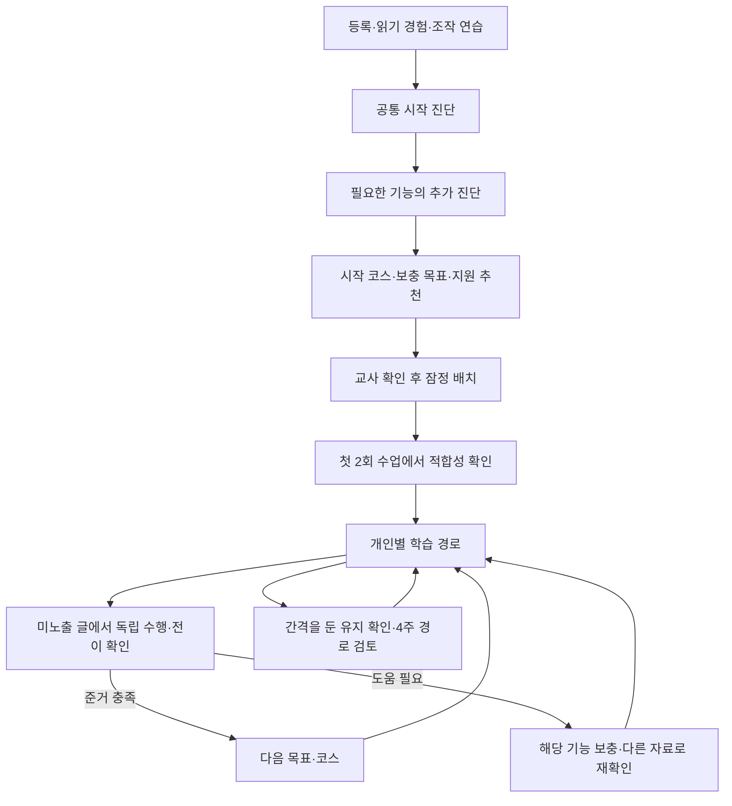

# Read X 레벨 테스트·배치·학습 전 과정 설계

<!-- readx-document-context -->
> 작성 당시의 설계·조사·구현 기록입니다. 현재 기능과 운영 상태는 최신 현황을 우선합니다. [문서 목차](README.md) · [최신 현황](PROJECT_STATUS.md)

작성일: 2026년 11월 14일  
상태: 제품 설계 초안 v1. 구현·학생 파일럿 전. 시간, 문항 수, 판정 기준은 검증할 운영 가설이다.

## 1. 제품이 제공할 경험

**시작 진단 → 시작 코스 추천 → 교사 확인 → 첫 2회 수업에서 배치 확인 → 맞춤 학습 → 새 글에서 성취 확인 → 다음 코스**를 하나의 흐름으로 제공한다.

학원·공부방을 우선 운영 환경으로 삼는다. 학생은 오늘 할 학습을 바로 시작하고, 교사는 추천 이유를 확인해 배치를 조정하며, 보호자는 무엇을 배웠고 어떤 수행이 달라졌는지 확인한다. 코스는 처음 4주 분량을 제안하되 진행에 따라 조정한다.

학생에게 약속할 결과는 “문해력 몇 점”보다 **어디서 시작하고, 무엇을 배우고, 무엇을 할 수 있으면 다음으로 가는지**다. 최초 진단만으로 모든 세부목표의 숙달 여부를 확정하지 않는다.

## 2. 기존 설계와 연결할 기준

- [국어 콘텐츠 구조 v2](KOREAN_CONTENT_ARCHITECTURE_V2_2026-11-14.md)의 학년·기능·수행 단계·지문 부담·지원 구분을 유지한다.
- [목표·사고 과정 설계](GOAL_PROCESS_CONTENT_STRATEGY.md)의 시범 → 함께 연습 → 도움 축소 → 새 글 확인 → 자기 표현을 수업의 기본 골격으로 사용한다.
- 기존 학년은 실제 재학 학년과 콘텐츠의 편집 학년을 분리한다. 초4 학생의 일부 기능 보충이 학생 전체를 “초2 수준”으로 표시하는 근거가 되지 않는다.
- 기존 `supported / standard / challenge`는 글의 변형 수준이다. 학생의 능력 등급이나 힌트 사용 여부로 통합하지 않는다.
- S1~S6는 수행을 조직하는 틀이다. 모든 영역에서 동일한 순서·난도로 작동하는 공인 척도로 취급하지 않는다.

**배치 결과는 하나의 점수 대신 아래 다섯 값의 조합으로 저장한다.**

| 값 | 의미 | 예시 |
| --- | --- | --- |
| 기준 자료군 | 어떤 언어·소재·분량의 자료를 사용할지 | 초4 편집 자료군, 기준글 중심 |
| 주 학습 코스 | 가장 먼저 배울 핵심 기능 묶음 | 관계 엮기 / 문단 사이 원인과 결과 |
| 시작 단원·목표 | 코스 안에서 실제로 시작할 위치 | 인과 연결 1단원, 떨어진 두 단서 연결 |
| 보충·확장 목표 | 주 코스와 함께 다룰 개별 목표 | 지시어 보충, 명시 정보 찾기는 확인 후 생략 |
| 지원과 배치 상태 | 어떤 도움을 주고 얼마나 확인됐는지 | 연결도 틀 제공, 첫 2회 확인 중 |

학생 화면에는 “관계 엮기 코스 · 1단원”을 먼저 보여준다. 교사에게는 자료군, 목표별 근거, 지원, 아직 확인하지 않은 기능을 함께 보여준다.

## 3. 코스의 구조

### 3.1 S1~S6의 사용

| 코스 명칭 | 중심 경험 | 예시 |
| --- | --- | --- |
| S1 뜻 익히기 | 낱말·문장·읽기 방법의 뜻 이해 | 문맥에서 낱말 뜻 구별 |
| S2 단서 짚기 | 필요한 정보를 찾아 근거로 사용 | 답의 근거가 되는 문장 선택 |
| S3 관계 엮기 | 문장·문단·자료 사이 관계 연결 | 순서·비교·인과·중심과 세부 연결 |
| S4 의미 풀기 | 생략된 의미와 표현을 근거로 해석 | 인물 변화, 생략된 이유 설명 |
| S5 근거 따지기 | 판단·해석·자료의 적절성 검토 | 주장과 근거의 범위 비교 |
| S6 새롭게 엮기 | 새 자료·목적에 맞춰 통합·표현 | 복수 자료로 안내문·제안 작성 |

각 학년 자료군 안에서 이 수행을 다룬다. “초3의 관계 엮기”와 “초6의 관계 엮기”는 언어·단서 거리·정보량·조건이 다르다. 과제별 실제 난도는 파일럿에서 따로 확인한다.

주 코스 명칭은 학생의 현재 학습 초점을 요약한다. S3 코스 학생도 친숙한 짧은 글의 S5 활동을 경험할 수 있고, 필요한 S1 낱말 활동을 함께 할 수 있다. 모든 학생이 S1 콘텐츠 전체를 끝내야 S2로 가는 구조를 만들지 않는다.

### 3.2 실제 경로의 단위

`자료군 → 주 코스 → 단원 → 세부목표 → 수업·확인 활동`으로 구성한다.

단원은 서로 관련된 2~3개 세부목표를 다루는 편성 단위로 시작한다. 목표에는 선수목표, 필요한 수행 준거, 적합한 과제 유형, 독립 확인 자료를 붙인다. 수업 횟수는 예상치이며 수료 조건이 아니다.

배치에는 다음 연결표가 필요하다.

`진단 문항 → 관찰할 세부목표 → 선수목표 → 코스의 시작 단원 → 사용 가능한 수업·보충·확인 자료`

현재 132개 큰 목표와 확장된 미세 수행 ID를 보존하고 연결한다. 기존 ID를 새 레벨 번호로 덮어쓰지 않는다.

## 4. 시작 진단 설계

### 4.1 진단 전에 확인할 것

재학 학년, 읽기 경험, 필요한 화면·입력 지원, 기존 수업 기록을 확인한다. 읽기 경험은 참고 자료이며 점수로 환산하지 않는다. 학생은 근거 선택·페이지 이동·답 수정 등을 연습용 문항으로 익힌다. 연습 결과는 배치 근거에 넣지 않는다.

기존 학생에게 유효한 최근 기록이 있으면 그 기록으로 확인 가능한 기능은 재검사 범위를 줄인다. 해당 기록의 자료 노출·도움·검토 상태를 먼저 확인한다.

### 4.2 두 단계 진단

| 순서 | 목적 | 초3~6 파일럿안 | 결과 |
| --- | --- | --- | --- |
| 공통 진단 | 시작 자료군과 어려운 기능 후보 찾기 | 12문항, 이야기·정보 글·생활/시각 자료를 포함 | 후속 진단 분기 |
| 분기 진단 | 배치에 중요한 경계·선수 기능 추가 확인 | 8문항 + 짧은 설명 2과제 | 잠정 코스와 보충 목표 |
| 교사 확인 | 서술 응답·상충 증거·지원 조건 확인 | 설명 2과제와 표시된 쟁점 우선 검토 | 잠정 배치 승인·수정 |

초3~6은 총 22개 응답 과제, 약 25~35분을 시작안으로 둔다. 글·자료 묶음은 전체 4~6개 범위에서 구성하되 문항 수에 맞추느라 긴 글을 과도하게 넣지 않는다. 실제 응시시간·이탈·채점 부담을 보고 조정한다.

초1~2는 짧은 문장·자료를 중심으로 12~16개 응답 과제와 약 15~20분의 분할 실시를 설계한다. 필요한 경우 교사가 약 5분간 실제 읽기와 구두 설명을 관찰한다. 타이핑 숙련으로 읽기 능력을 판정하지 않는다.

진단은 속도 경쟁으로 제시하지 않는다. 예상 시간을 넘겼다는 이유만으로 미응답을 모두 오답 처리해 낮게 배치하지 않는다. 중단·재개를 지원하고 피로·기기 문제로 끝나지 않은 검사는 추가 확인 상태로 둔다.

### 4.3 관찰할 기능

| 관찰 영역 | 대표 수행 | 구분할 사항 |
| --- | --- | --- |
| 어휘·문장 이해 | 문맥 의미, 지시 대상, 문장 관계 | 낱말의 어려움과 정보 탐색의 어려움 |
| 명시 정보·근거 | 필요한 정보와 근거 선택 | 답만 맞힘과 근거까지 맞힘 |
| 관계·중심 내용 | 비교·인과·문단 관계·요약 | 부분 정보 확인과 관계 보존 |
| 추론·해석 | 생략된 이유·인물 변화 설명 | 배경지식에 의존한 추측과 본문 근거 |
| 평가·자료 통합 | 주장·출처·표·본문의 일치 판단 | 형식 이해와 내용 판단 |
| 자기 설명 | 판단과 근거를 연결해 표현 | 읽기 이해와 쓰기 표현의 부담 |

공통 진단은 위 기능을 넓게 표집하고, 분기 진단은 배치를 바꿀 가능성이 큰 기능에 집중한다. 22문항으로 모든 미세 수행의 수준을 판정하지 않는다. 문학·정보·매체별 정밀 결과와 글쓰기 전체 성취도도 이 검사만으로 산출하지 않는다.

글자·낱말을 실제로 읽는 데 어려움이 관찰되면 별도의 기초 읽기 확인으로 연결한다. 선택형 이해 문제만으로 해독·유창성을 확인했다고 처리하지 않는다. 초기 제품에서는 교사 관찰 입력으로 운영하고, 자동 음성 판정은 별도 개발·검증 대상으로 둔다.

### 4.4 분기와 채점

- 학년은 시작 자료의 기본값이다. 공통 진단에서 언어 부담이 크면 짧고 쉬운 자료로 같은 기능을 확인하고, 여유가 있으면 관계·조건이 복잡한 자료로 확인한다.
- 관계 연결에서 어려움이 보이면 문장 뜻·지시어·인과 방향 등 실제 선수 기능을 확인한다. 총점 하나로 전체 시험의 난도를 올리거나 내리지 않는다.
- 첫 버전은 검수한 문항 묶음 사이를 이동하는 규칙 기반 분기다. 보정된 문항 모수가 없는 상태에서 IRT/CAT 능력치나 정밀 확률을 표시하지 않는다.
- 선택형은 정답, 근거 선택은 근거 준거, 짧은 설명은 목표별 루브릭으로 각각 기록한다. 설명은 `충족 / 일부 충족 / 미충족 / 검토 대기`를 구분한다.
- 도움 없이 한 최초 응답을 먼저 보존한다. 이후 도움을 제공해 반응을 볼 수 있으나 독립 수행과 별도 기록한다. 배치 중 정답 해설은 노출하지 않는다.
- 지시문 읽어주기와 지문 읽어주기는 구별한다. 지문 TTS·성인 대독으로 수행한 결과는 읽기 독립 수행과 구분해 해석한다. 큰 글자 등 접근 지원 자체를 힌트 사용으로 처리하지 않는다.
- 교과 선수지식이 정답의 주된 조건이 되지 않도록 필요한 정보는 본문에 제공한다. 낯선 소재 때문에 틀렸을 가능성은 다른 소재로 확인한다.

## 5. 배치 결정 규칙

### 5.1 배치 순서

1. **검사 상태 확인:** 응시 완료, 유효 응답, 지원·노출 상태, 교사 채점 대기를 점검한다. 부족한 결과는 낮은 점수로 대체하지 않는다.
2. **자료군 제안:** 글을 이해할 때 언어·정보량의 부담이 어디서 커졌는지 본다. 필요한 기능만 쉬운 자료로 보충할 수 있다.
3. **기능 프로필 생성:** `시작에 필요한 수행 확인 / 연습 필요 / 추가 확인`으로 표시한다. 시작 적합성 확인은 장기 숙달 판정과 별도다.
4. **시작 단원 선택:** 해당 단원의 필수 선수목표를 확인하고, 필요한 지원으로 진입 가능한 단원을 고른다. 필수 선수목표가 확인되지 않았으면 그 목표를 확인하거나 짧은 연결 수업을 먼저 편성한다.
5. **주 코스와 보충 결정:** 여러 수업을 막는 선수 기능을 우선하되, 주 코스 1개와 보충 목표 최대 2개로 학습 초점을 제한한다. 이미 확인한 강점은 새 소재·확장 활동으로 유지한다.
6. **교사 확인:** 추천의 근거, 아직 모르는 부분, 첫 2회 확인 항목, 처음 배정할 수업을 보여준다. 교사는 승인·수정·추가 진단 중 하나를 선택한다.
7. **잠정 배치 실행:** 첫 2회 수업의 미노출 자료 수행과 지원 요구를 보고 유지·조정한다. 근거가 부족하면 확인 기간을 늘리고 이유를 표시한다.

후보 단원이 여러 개면 선수목표 연결 → 관찰된 어려움 → 교사 우선 목표 → 승인 콘텐츠 가용성 순으로 선택한다. 정규 경로와 쉬운 자료를 오갈 때 학생의 다른 기능 이력은 유지한다.

### 5.2 불확실할 때의 처리

| 상황 | 처리 |
| --- | --- |
| 경계에 걸린 결과 | 두 후보를 제시하고 지원 가능한 코스로 잠정 시작, 첫 수업에서 경계 기능 확인 |
| 정답과 근거·설명이 엇갈림 | 서술·근거 응답 검토 후 추가 관찰. 즉시 높은 단계로 확정하지 않음 |
| 일부 문항만 끝냄 | 완료한 기능만 기록하고 나머지는 추가 확인 |
| 쉬운 자료에서도 실제 읽기에 어려움 | 기초 읽기 관찰과 교사 중심 지원 경로 |
| 준비된 최고 범위를 넘어서는 수행 | “준비된 상위 과제에서 수행 확인”으로 기록하고 확장 자료/교사 확인. 상위 학년 능력으로 환산하지 않음 |
| 맞는 수업·새 확인 자료가 없음 | 교사에게 공급 부족 표시. 미검수 자료를 자동 생성해 배정하거나 단계 완료 처리하지 않음 |

### 5.3 배치 결과 예시

아래는 실제 학생 데이터가 아닌 설명용 사례다.

> 재학: 초4 / 추천: **관계 엮기 코스, 문단 연결 1단원**  
> 자료: 초4 기준글 중심, 어휘 부담이 큰 글에는 별도 낱말 지원  
> 근거: 명시된 정보는 잘 찾았으나 떨어진 원인·결과 단서를 연결하는 과제에서 추가 연습 필요  
> 보충: 지시어가 가리키는 내용, 인과 방향  
> 첫 2회 확인: 처음 보는 두 자료에서 연결도를 완성하고 근거 설명  
> 아직 모르는 것: 장문 요약·출처 평가의 안정적인 수행

교사 변경은 추천 원안, 변경 결과, 이유, 시각, 규칙 버전을 남긴다. 교사의 수정은 기존 응시 기록을 바꾸지 않는다.

## 6. 개인별 학습 구성

### 6.1 첫 4주 계획

주 2회 기준 8회 계획을 기본 초안으로 제공한다. 초1~2는 약 20~25분, 초3~6은 약 30~40분 수업을 파일럿한다. 수업 횟수와 시간은 운영 일정에 맞게 조정한다.

| 주차 | 목적 | 위 초4 사례의 학습 |
| --- | --- | --- |
| 1주 · 1~2회 | 배치 적합성 확인과 첫 목표 학습 | 인과 단서 연결 시범·연습, 새 짧은 글에서 확인, 지시어 보충 필요 판단 |
| 2주 · 3~4회 | 주 목표 연습과 도움 축소 | 문단 사이 인과 연결, 다른 소재의 독립 확인, 필요 학생만 지시어 보충 |
| 3주 · 5~6회 | 관계를 보존해 설명·요약 | 처음 목표의 유지 확인, 인과 연결을 짧은 요약에 적용 |
| 4주 · 7~8회 | 새 상황 적용과 경로 검토 | 새 소재·자료 형식에서 수행, 최근 증거·교사 검토로 다음 계획 결정 |

주차가 지나도 해당 목표가 안정적이지 않으면 관련 활동을 더 배정한다. 이미 충족한 목표는 반복 분량을 줄인다. 지연 확인은 마지막 독립 성공 시점을 기준으로 예약하므로 모든 학생이 4주차에 같은 검사를 치르지는 않는다.

### 6.2 한 차시의 경험

30분 수업의 편성 예시는 다음과 같다. 글·목표에 따라 일부 단계는 다음 차시로 나눌 수 있다.

| 구간 | 시간 예시 | 학생 경험 | 기록 |
| --- | ---: | --- | --- |
| 떠올리기·목표 | 3분 | 지난 기능 확인, 오늘 할 일 확인 | 복습 수행 |
| 생각 시범 | 5분 | 교사가 본문을 짚으며 판단하는 과정 보기 | 시범 노출 |
| 함께 연습 | 8분 | 근거 선택, 관계 연결, 막힌 부분의 힌트 | 도움받은 수행 |
| 스스로 적용 | 8분 | 도움을 줄여 해결, 확인 차시는 별도 새 자료 사용 | 자료 노출·도움별 수행 |
| 내 말로 설명·마무리 | 6분 | 근거와 판단 연결, 피드백과 다음 목표 | 실제 답안·수정 이력 |

시범과 연습에 사용한 글 A에서 혼자 맞힌 것은 연습 수행이다. 독립 확인에는 노출되지 않은 별도 계열의 글 B를 사용한다. 소재·이름만 바꾼 A의 변형을 B로 인정하지 않는다.

모든 과제를 긴 글쓰기로 끝내지 않는다. 저학년이나 읽기 확인이 목적이면 선택·연결·짧은 구두 설명과 교사 관찰을 사용할 수 있다. 쓰기 자체가 목표인 수업에서는 별도의 쓰기 준거를 적용한다.

### 6.3 매번 다음 활동을 정하는 순서

`미완료 수업 재개 → 도래한 유지 확인 → 현재 목표 학습·확인 → 필요한 보충 → 다음 목표·확장`

한 학생에게 한 번에 너무 많은 취약점을 과제로 쌓지 않는다. 보충은 주 수업을 수행하는 데 필요한 목표부터 제한해 배정한다. 결석 후에는 남은 과제를 무조건 누적하지 않고 교사가 다음 계획을 정리한다.

## 7. 성취 확인·다음 단계·재학습

### 7.1 기록할 상태

`미관찰 → 학습 중 → 독립 수행 확인 → 새 상황 적용 확인 → 유지 확인`

`추가 확인 필요`는 위 상태와 함께 표시하는 별도 신호다. 과거의 성취 이력과 현재 확인 필요성을 함께 보존한다. 코스 완료와 한 차시 완료도 따로 저장한다.

### 7.2 파일럿 판정 규칙

아래 수치는 초기 운영에서 비교·조정할 기준이다. 기존 미니 모의고사의 제한된 세 목표용 규칙을 참고하되 모든 국어 목표에 그대로 적용하지 않는다.

| 결정 | 제안 조건 |
| --- | --- |
| 다음 활동 열기 | 활동 제출과 필수 확인 완료. 이것만으로 목표 숙달을 선언하지 않음 |
| 목표의 독립 수행 확인 | 목표별로 지정한 최근 유효 확인 5회 중 4회 성공, 마지막 확인 성공, 각 확인은 서로 다른 미노출 자료 계열 사용, 수업일 2일 이상 |
| 핵심 준거 확인 | 정답률 조건과 함께 해당 목표의 필수 근거·관계·설명 준거 충족. 설명 목표는 교사 검토 완료 |
| 다음 단원·코스 추천 | 현재 단원의 필수 목표 확인 + 다음 단원의 선수목표 충족 + 해당 목표의 새 소재 전이 확인 |
| 유지 확인 | 독립·전이 성공 후 1~2주에 새 자료로 재확인. 결석·노출 상황에 따라 일정 조정 |
| 재학습 | 최근 실패·상충 증거 시 해당 기능만 확인. 반복 어려움이 확인되면 지원 또는 선수목표 조정 |

‘유효 확인’은 최초 독립 응답, 채점 완료, 목표에 맞는 준거, 자료 계열의 사전 미노출이 확인된 경우다. 같은 자료 묶음의 여러 문항은 같은 목표에 대해 확인 1회로 묶는다. 같은 날의 여러 묶음은 서로 다른 수업일 요건을 대신하지 않는다.

자료 묶음의 첫 제시 직전 노출 이력을 기준으로 새 자료 여부를 판단한다. 첫 화면을 열었다는 이유로 그 응시 전체를 연습으로 바꾸지 않으며, 해설·시범·이전 응시가 있으면 이후에는 새 독립 증거로 사용하지 않는다. 묶음 안의 피드백은 확인 응답을 마친 뒤 제공한다.

5회 규칙은 짧은 읽기 기능 확인을 위한 출발안이다. 장문 쓰기·발표·일부 문학 해석은 별도 목표별 루브릭과 관찰 횟수를 정한 뒤 운영한다. 승인된 판정 정책이 없는 목표는 자동 이동을 하지 않는다.

한 번의 낮은 결과로 코스 전체를 내리지 않는다. 먼저 지문 부담, 특정 선수 기능, 도움 의존, 검사 중단 등 무엇을 추가로 확인할지 정한다. 반대로 반복 응시의 높은 점수만으로 코스를 올리지 않는다.

## 8. 학생·교사·보호자 화면

| 사용자·화면 | 먼저 보일 내용 | 핵심 행동 |
| --- | --- | --- |
| 학생 첫 진입 | “나에게 맞는 시작점을 찾아요”, 예상 분량, 조작 연습 | 진단 시작·이어 하기 |
| 학생 배치 결과 | 시작 코스, 잘한 수행 1~2개, 이번에 배울 것, 배치 확인 중 여부 | 첫 수업 시작 |
| 학생 홈 | 오늘의 학습 1개, 이어 할 위치, 다음 확인 | 학습 시작·이어 하기 |
| 학생 코스 지도 | 현재 단원, 확인한 목표, 다음 목표 | 목표와 학습 기록 보기 |
| 교사 진단·배치 | 추천 코스, 실제 답안·근거, 확인 부족, 첫 수업 계획 | 승인·조정·추가 확인 |
| 교사 수업 운영 | 지원 필요 학생, 검토할 설명, 이동 추천, 확인 자료 부족 | 필요한 학생 개입·수업 배정 |
| 보호자 리포트 | 시작점, 배운 기능, 실제 수행 변화, 다음 계획 | 교사 공개 기록 확인 |

학생 홈의 대표 버튼은 상태별로 `시작 진단 / 진단 이어 하기 / 첫 수업 / 오늘의 학습 / 새 글 확인` 중 하나가 된다. 기존 모의고사와 자유 자료 탐색은 보조 메뉴로 연결한다.

보호자에게는 “관계 엮기 3단계” 숫자만 제시하지 않는다. “서로 떨어진 두 문장의 원인과 결과를 도움 없이 연결했고, 다른 자료에서도 확인 중”처럼 관찰 범위와 실제 예를 보여준다. 전국 백분위·읽기 연령·임의 성장률은 산출하지 않는다.

## 9. 콘텐츠 공급 조건

코스가 배정 가능하려면 진단뿐 아니라 첫 학습·보충·확인까지 연결된 승인 자료가 필요하다.

| 용도 | 필요한 구성 |
| --- | --- |
| 시작 진단 | 학년 자료군별 공통형, 기능별 분기형, 경계 확인형, 재검사 대체형 |
| 정규 수업 | 목표 설명, 실제 사고 시범, 함께 연습, 도움 축소, 표현 활동 |
| 보충 | 필요한 선수 기능을 짧게 확인하고 가르치는 자료 |
| 독립 확인 | 수업과 다른 계열의 미노출 자료, 채점 준거·예시 답안 |
| 전이·유지 | 새 소재·형식 자료와 간격을 두고 사용할 예비 자료 |

최초 파일럿은 최근 5회 규칙을 적용할 각 목표에 서로 다른 계열의 독립 확인 묶음 최소 5개를 준비하고, 별도 계열의 전이 1개·유지 1개·재확인 예비 1개를 확보한다. 이는 해당 판정 규칙을 운영할 초기 공급 예산이며, 학생별로 이미 확보한 유효 증거가 있으면 추가 확인 분량을 줄인다. 실패 후 재확인이 늘면 예비 자료를 추가 공급한다. 진단에서 이미 사용한 계열은 해당 학생의 수업 이후 새 확인 자료 예산에서 제외한다.

같은 진단지를 반복 사용해야 한다면 노출된 문항임을 기록하고, 배치를 바꿀 근거는 대체 자료에서 확보한다. 진단 문항이 수업에 사용된 경우에도 같은 계열로 연결해 이후 평가에서 제외한다.

초기 범위는 **초3~4의 어휘·문장, 명시 정보, 관계·중심 내용 기능을 중심으로 한 완결 경로**를 권장한다. 문학·정보·생활 자료를 포함하고, 다른 영역은 관찰 범위만큼만 표시한다. 기존 초5~6 모의고사는 별도 실전 평가로 유지한다. 전 학년의 빈 배치 메뉴를 먼저 만드는 대신 승인된 공급 범위를 차례로 확장한다.

## 10. 현재 앱에서 재사용할 것과 추가할 것

2026-11-14에 확인한 아래 파일 범위의 판단이다. 기존 기능의 존재를 전체 경로 구현 완료로 해석하지 않는다.

| 현재 기반 | 재사용 | 추가·보완 |
| --- | --- | --- |
| `webapp/src/data/readingPolicy.ts` | 학년별 편집 기준·글 변형 | 학생 배치와 자료군의 별도 연결 |
| `webapp/src/services/learningJourney.ts` | 시범·지원·새 글·교사 검토 기록 | 여러 목표·단원에 일반화한 코스 진행 |
| `webapp/src/services/progressiveReading.ts` | 근거·설명·힌트·수정 이력 | 연습 완료와 독립 확인 분리 연결 |
| `webapp/src/services/miniExam.ts` | 노출 계열·반복 수행·전이/유지의 참고 구현 | 정식 배치 정책, 목표별 별도 준거 |
| `webapp/server/learning-service.mjs` | 계정별 수업 배정·제출·교사 검토 | 진단→추천→코스 계획→다음 배정 연결 |
| `webapp/src/types/contentLibrary.ts` | 목표·선수목표·과정 관찰 구조 | 검사 목적·배치 근거·유지 확인·정책 버전 확장 |

읽기 수업 서버는 현재 수업 중 수행을 `passageExposure: practiced`로 기록한다. 여기에 이름만 ‘독립 확인’인 화면을 붙여 새 글 수행으로 계산하면 안 된다. 별도 평가 목적, 계열별 노출 확인, 최초 응답, 검토 결과를 연결해야 한다.

### 새로 필요한 데이터

| 객체 | 핵심 내용 |
| --- | --- |
| 진단 설계·응시 | 시험지·문항 버전, 분기 경로, 원응답, 채점, 중단, 지원, 노출 |
| 기능 프로필 | 목표별 관찰, 지원 조건, 확인 범위, 미관찰, 검토 상태 |
| 배치 추천·결정 | 자료군, 코스·단원, 보충 목표, 추천 근거, 후보, 교사 변경 |
| 코스·단원 정의 | 필수/선택 목표, 선수목표, 사용 가능한 자료, 완료 준거 |
| 학습 계획·등록 | 학생, 결정 버전, 첫 4주 계획, 현재 위치, 계획 수정 이력 |
| 수행 증거·노출 이력 | 목표, 자료 계열·버전, 첫 응답, 목적, 도움, 결과, 수업일, 응시 출처 |
| 이동·재확인 결정 | 증거 ID, 규칙 버전, 이전/다음 경로, 검토자, 다음 확인 시점 |

진단 응시는 `진행 중 / 일시 중단 / 제출 / 채점 대기 / 완료`를, 코스 등록은 `배치 대기 / 잠정 배치 / 학습 중 / 경로 검토 / 완료`를 구분한다. 채점이나 교사 배치 확인을 기다리는 동안 학생에게 다음 안내와 재개 위치를 보여준다.

노출·수행은 학생 계정 기준으로 모의고사·수업·진단 사이에서 연결한다. 체험 데이터는 실제 배치 근거에서 제외한다. 서버에 저장된 원응답과 승인된 콘텐츠·정책 버전을 기준으로 추천하며, 재전송은 같은 응답을 중복 집계하지 않는다.

## 11. 구현 순서와 완료 조건

| 순서 | 작업 | 완료 조건 |
| --- | --- | --- |
| 1 | 코스·목표·선수목표·시작 단원 연결표 | 모든 파일럿 코스에 진입·완료 준거와 수업·확인 자료가 연결됨 |
| 2 | 시작 진단과 교사용 배치 결과 | 분기·저장·재개·채점·근거 확인·교사 조정까지 가능 |
| 3 | 첫 4주 계획과 학생 홈 통합 | 진단 결과에서 첫 수업으로 이어지고 매번 다음 할 일이 하나 제시됨 |
| 4 | 독립 확인·전이·재학습·다음 코스 | 자료 노출·도움·교사 검토를 반영한 이동 추천이 동작함 |
| 5 | 파일럿 운영·정책 보정 | 오배치 사례, 검토 시간, 수행 변화, 자료 부족을 분석해 규칙 수정 |

처음에는 교사가 배치와 단원 이동을 확인하는 방식으로 운영한다. 자동 적용 범위는 교사 수정 사례와 실제 학습 결과가 쌓인 뒤 넓힌다. 파일럿 규모·모집 범위·운영 기간은 참여 학원과 콘텐츠 검수 가용성을 보고 별도 확정한다.

### 확인할 대표 시나리오

1. 신규 학생이 진단을 마치면 추천 근거를 가진 시작 코스와 첫 수업이 생성된다.
2. 진단이 중단되면 이어서 응시하고, 미응답으로 전체 수준이 떨어지지 않는다.
3. 어휘가 강하고 관계 연결이 어려운 학생은 관계 코스와 필요한 보충만 받는다.
4. 교사가 배치를 바꾸면 이유와 원추천이 남고 학생의 다음 수업이 갱신된다.
5. 해설을 본 글·변형 글·반복 응시의 성공은 새로운 독립 확인으로 중복 계산되지 않는다.
6. 서술 채점이 남아 있으면 해당 목표의 성취와 이동이 확정되지 않는다.
7. 한 번의 실패는 재확인으로 연결되고 다른 목표의 성취를 삭제하지 않는다.
8. 승인된 새 확인 자료가 부족하면 교사에게 알리고 이동 결정을 보류한다.
9. 다른 기기로 옮겨도 같은 계정의 코스·초기 응답·자료 노출 이력이 이어진다.

파일럿에서는 진단 완료율·시간, 첫 2회 후 배치 변경 비율과 이유, 도움 사용 변화, 새 자료 수행, 교사 검토 시간, 확인 자료 부족을 본다. 점수 상승만으로 제품 효과를 결론짓지 않는다. 초기 컷 점수와 관찰 횟수는 이 자료를 바탕으로 조정한다.

## 12. 설계 근거와 적용 범위

- [PIRLS 2026 읽기 평가틀](https://timssandpirls.bc.edu/pirls2026/frameworks/downloads/P26_Ch1_Reading-Assessment.pdf)은 문학·정보 읽기에서 정보 확인, 추론, 해석·통합, 평가를 구분한다. 기능과 글의 맥락을 함께 다루는 데 참고했다. 초등 4학년 중심의 평가틀이며 본 제품의 6단계·22문항·배치 규칙을 검증하는 자료는 아니다.
- [IES 저학년 기초 읽기 지침](https://ies.ed.gov/ncee/wwc/PracticeGuide/21)은 해독, 낱말 부분 분석, 연결된 글의 정확성·유창성·이해를 다룬다. 실제 읽기 관찰을 이해 선택형과 분리하는 설계에 참고했다. 한글 읽기의 관찰 준거와 적정 과제는 별도 검토한다.
- [IES 4~9학년 읽기 지도 지침](https://ies.ed.gov/ncee/wwc/PracticeGuide/29)은 기초 읽기, 유창성, 어휘·배경지식, 질문, 요지, 이해 점검과 도전적 글 읽기를 다룬다. 필요한 기초 지원과 주 학습을 함께 편성하는 데 참고했다. 영어권 지침을 한국 학생의 학년 규준이나 배치 점수로 사용하지 않는다.

시간·문항 수·4주 운영·5회 중 4회·전이/유지 시점은 본 문서의 제품 제안이다. 운영 전에 목표별 문항·루브릭과 교사 검토를 완료하고, 실제 자료로 배치 적합성을 확인한다.
