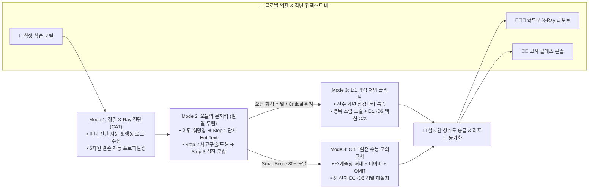

# 📋 [Master PRD] 초등 수능형 설명문 적응형 코스웨어 「ReadX (리드엑스)」 상용화 공학 명세서 (v1.0)

<!-- readx-document-context -->
> 작성 당시의 설계·조사·구현 기록입니다. 현재 기능과 운영 상태는 최신 현황을 우선합니다. [문서 목차](README.md) · [최신 현황](PROJECT_STATUS.md)


- **문서 상태**: 확정 판 (ReadX 상용화 아키텍처 및 7대 TEI 엔진 명세 완료)
- **공식 브랜드**: **ReadX (리드엑스) / ReadX-Ray Pro**
- **기반 프로토타입**: `courseware/output/expository_literacy_courseware.html` 및 `courseware/data/` 마스터 데이터셋
- **목표 기술 스택**: React 18+ · TypeScript · Tailwind CSS · Vite · Zustand (LocalStorage/IndexedDB 영속화 및 백엔드 API 확장 아키텍처)
- **커리큘럼 범위**: 2022 개정 초등 1~6학년 **9대 전 교과 설명문(Expository) 96개 위계** 플래그십 완결 구현

---

## 1. 제품 비전 및 핵심 가치 제안 (Product Vision & Core Value)

### 1.1 제품 정의 (Product Statement)
> **"학습자가 어디가·왜·어떻게 부족한지 6차원으로 정밀 투시(X-Ray)하고, 선수 결손 징검다리 복습부터 Dick & Carey 인지 병목 돌파·수능 6대 오답 함정 백신까지 1:1로 처방하여, 초등 1~6학년 교과 개념 지문 위에서 KICE 평가원 수준의 실전 문해력을 완성하는 국내 최초의 수능형 적응형(Adaptive) 문해력 코스웨어"**

### 1.2 프로토타입 대비 5대 상용화 혁신 포인트
1. **정적 시뮬레이터에서 ‘살아 움직이는 적응형(Adaptive) 학습 루프’로 진화**:
   - 단순 탭 클릭 뷰어를 넘어 **① 온보딩 정밀 진단(CAT) ➔ ② 오늘의 문해력(일일 루틴) ➔ ③ 1:1 약점 처방 클리닉 ➔ ④ CBT 실전 수능 모의고사**의 4대 학습 모드가 학생의 실시간 정오답·풀이시간·오답 함정 패턴에 따라 유기적으로 분기합니다.
2. **글로벌 표준 7대 TEI(Technology-Enhanced Items) 인터랙티브 문항 엔진**:
   - NAEP·PISA·SBAC 표준에 기반하여 **지문 단서 직접 클릭(Hot Text)**, **2단계 근거 연동(EBSR)**, **사고구술 인라인 조립(Tap-Cloze)**, **6대 설명 구조 도해조직자(Graphic Organizer)**, **다중 매체 탭·차트 교차 분석**, **작문 워크벤치(`W1~W4`)**, **인라인 빨간펜 교정부호 에디터(`W5`)**를 전량 탑재합니다.
3. **Lexia / ITS 방식 ‘3단계 점진적 스캐폴딩(Progressive Hinting)’**:
   - 오답 선택 시 정답을 곧바로 노출하지 않고, **1차 오답 시 `[D1~D6 함정 경고 + 좌측 지문 근거 문장 자동 스크롤 & 스포트라이트]`** ➔ **2차 오답 시 `[오답 선지 취소선 소거 + 사고구술 힌트 팝업]`**으로 스스로 깨닫게 유도합니다.
4. **전문 디지털 독서 스튜디오(Split-Screen Reader) & 학년군별 적응형 UI**:
   - 3색 전략 형광펜, 인라인 어휘 툴팁 사전, 문단/문장 번호 토글, 포커스 라인 리더(집중 마스킹), 의미 마디 끊어 읽기(`/`), 싱크로 TTS, 고정형 ‘나의 단서 보드’를 제공하며, **초저(1~2학년 3지선다) / 초중(3~4학년 4지선다) / 초고(5~6학년 5지선다)** 학년군별로 타이포그래피와 UI 밀도가 자동 최적화됩니다.
5. **학생·학부모·교사 3대 역할별(Role-Based) 전용 대시보드 분리**:
   - **학생용 포털**(오늘의 미션, SmartScore 0~100, D1~D6 오답 백신 도감) + **학부모용 리포트**(10초 요약 Where·Why·How, 6차원 X-Ray 차트, 처방 전후 Before/After 슬로프, 5분 식탁 질문 가이드) + **교사용 콘솔**(학급 전체 16하위기능 히트맵 매트릭스, 위험군 분류, 원클릭 클리닉 일괄 배정)을 완벽히 제공합니다.

---

## 2. 타깃 사용자 페르소나 및 핵심 사용자 스토리 (User Stories & Acceptance Criteria)

| 역할 | 대표 페르소나 | 핵심 사용자 스토리 (User Story) | 수용 기준 (Acceptance Criteria) |
| :--- | :--- | :--- | :--- |
| **👦 학생**<br>*(초1~6)* | • **초1 김도윤** (지시어·부위 역할 혼동)<br>• **초4 최지호** (복합 그래프·비례 추론 취약)<br>• **초5 김민준** (다단계 인과 역전·비판 준거 취약) | *"나는 지문이 길고 어려워도 문단별로 단서를 찾고 사고구술 힌트를 조립하면서 포기하지 않고 수능형 문제를 스스로 풀고 싶다."* | - 오답 클릭 시 정답이 바로 보이지 않고 좌측 지문의 단서 문장으로 자동 스크롤·하이라이트되어야 함.<br>- 클리닉 통과 시 ‘D1~D6 오답 함정 백신 도감’에 방어 카드가 적립되고 SmartScore가 실시간 상승해야 함. |
| **👨‍👩‍👧 학부모** | • 초등 자녀의 문해력 수준과 중·고등 수능 국어 기초가 걱정되는 학부모 | *"나는 복잡한 교육학 용어 대신, 우리 아이가 정확히 어디가·왜·어떻게 부족한지 10초 만에 파악하고 처방 후 얼마나 좋아졌는지 눈으로 확인하고 싶다."* | - 리포트 최상단에 `어디가(Where)`·`왜(Why)`·`어떻게(How)` 3단 요약 배너가 자연어로 표시되어야 함.<br>- 처방 전(Before)과 처방 후(After) 성취도 점수 및 KReaD 지수 상승 폭이 시각적으로 비교되어야 함.<br>- 가정에서 바로 쓸 수 있는 ‘오늘 저녁 5분 식탁 질문 스크립트’가 제공되어야 함. |
| **👩‍🏫 교사 / 원장** | • 초등 학급 담임교사 또는 문해력·국어 전문 학원 원장 | *"나는 우리 반 학생 전체의 16대 하위기능 결손 현황을 히트맵으로 한눈에 스캔하고, 취약한 학생들에게 맞춤형 처방 클리닉을 원클릭으로 일괄 배정하고 싶다."* | - 학생(행) × 16대 하위기능(열) 마스터리 히트맵에서 `🔴긴급 개입`, `🟠주의`, `⚡찍기 의심` 필터링이 작동해야 함.<br>- 특정 하위기능 결손 학생들을 체크박스로 선택해 맞춤 처방 클리닉을 일괄 배정(Batch Assign)할 수 있어야 함. |

---

## 3. End-to-End 서비스 여정 (Service Journey) 및 4대 학습 모드 상세 명세



### 3.1 [Mode 1] 온보딩 & 정기 정밀 X-Ray 진단 모드 (`Diagnostic CAT Mode`)
* **진입 경로**: 신규 학습자 온보딩 시, 월간 정기 진단 시, 또는 상단 학년별 페르소나(초1~초6) 선택 시 즉시 시뮬레이션/재진단 가능.
* **측정 메커니즘**:
  1. **정답률 및 오답 공식 태그 수집**: 학생이 고른 오답 선지에 매핑된 `D1~D6` 함정 코드 및 측정 위계(`V1-1~W5`) 성취도를 즉시 연산.
  2. **풀이 행동 데이터(Behavioral Telemetry) 수집**:
     - `passageReadingTimeMs`: 지문 최초 노출부터 첫 문항 응답까지의 정독 시간 측정 (권장 시간의 25% 미만일 경우 **`⚡ 성급한 추측형(찍기 위험)`** 플래그 생성).
     - `optionChangeCount`: 선지 변경 횟수 및 고민 시간(`responseLatencyMs`) 측정 (**`🤔 과도한 고민형`** 판별).
* **산출 결과**: 완료 즉시 **6차원 정밀 X-Ray 진단 데이터**를 갱신하고 개인화 추천 학습 큐(`My Literacy Path`)를 생성.

### 3.2 [Mode 2] 일일 루틴 학습 모드 (`Daily Routine Studio — "오늘의 문해력 15분"`)
* **구성 단계 (4-Step Micro-Loop)**:
  - **Phase 0. 핵심 어휘 워밍업 (2분)**: 오늘 읽을 교과 연계 지문의 Tier 2(범교과 사고어) 및 Tier 3(교과 개념어) 3~4개를 플립 카드(뜻·예문·형태소 힌트)로 사전 학습.
  - **Step 1. 지각·단서 포착 미션 (`Dick & Carey Step 1`, 4분)**:
    - **Guided Reading Chunking** 옵션 지원: 문단별로 집중해서 읽으며, 발문이 요구하는 핵심 단서(지시어, 담화표지, 실험 변인, 개념 정의)를 좌측 지문에서 직접 **Hot Text 클릭**하여 하이라이팅.
  - **Step 2. 관계·맥락 연결 및 구조화 (`Dick & Carey Step 2`, 4분)**:
    - 포착한 단서들을 바탕으로 **Meyer 6대 설명 구조 그래픽 오거나이저**(분류 트리, 분석 구조도, 비교표, 과정 타임라인, 인과 사슬도)를 조립하고, **사고구술(Think-Aloud) 빈칸(Inline Cloze)**을 완성.
    - 완성된 결과물은 우측 상단 **‘📌 나의 단서 보드’**에 요약 고정됨.
  - **Step 3. 구조화·판단·산출 (`Dick & Carey Step 3`, 5분)**:
    - 학년군 스케일링(초저 3지선다 / 초중 4지선다 / 초고 5지선다)이 적용된 **KICE 평가원 스타일 실전 문항** 풀이 및 **3단계 점진적 스캐폴딩** 작동.

### 3.3 [Mode 3] 1:1 맞춤형 약점 처방 클리닉 모드 (`Adaptive Prescription Clinic`)
* **진입 경로**: X-Ray 진단에서 `Critical(🔴 50점 이하)`로 판정된 하위기능이거나, Mode 2에서 동일 오답 함정(`D1~D6`)에 2회 이상 빠진 경우 자동/수동 진입.
* **3단계 처방 프로토콜**:
  1. **🪜 [처방 1단계: 역추적된 하위 학년 선행 결손 징검다리 복습 (`Step 0 Remedial`)]**:
     - 종적 역추적 경로(Backtracking Path)에서 식별된 하위 학년 공통기초(`COM-A1~A6`) 또는 선수 설명문 위계의 핵심 원리 공식 카드 + 워밍업 미니 퀴즈.
  2. **🧠 [처방 2단계: Dick & Carey 인지 병목 돌파 드릴 (`Step 1+2 Drill`)]**:
     - 지문 내 단서 칩(`rx-cue`)을 클릭해 깨운 뒤, 화살표 사고구술 문장의 빈칸을 드롭다운/탭칩으로 조립하여 끊어진 인지 고리를 연결.
  3. **🛡️ [처방 3단계: 수능 매력적 오답 함정 백신 드릴 (`Step 3 Vaccine O/X`)]**:
     - 학생이 가장 취약한 함정(예: `D1 인과 역전` 또는 `D4 속성 교차`)만 집중적으로 변형한 진술문 2~4개를 제시하고, 참(O)/거짓(X)을 빠르게 판별하게 하여 함정 면역력 형성.
* **완료 보상**: 클리닉 완주 시 해당 하위기능 점수가 `🔴 Critical ➔ 🟢 Mastered`로 승급되고, **‘수능 오답 함정 백신 도감’**에 해당 함정 방어 배지가 수여됨.

### 3.4 [Mode 4] CBT 실전 수능 모의고사 모드 (`Mastery Mock Exam Mode`)
* **목적**: 모든 스캐폴딩(단서 표시, 사고구술 힌트, 어휘 툴팁)을 제거한 상태에서 실제 KICE 수능/학업성취도 평가와 동일한 환경에서 진정한 전이(Transfer) 여부를 검증.
* **핵심 기능**:
  - 상단 제한시간 타이머(학생 불안 방지를 위해 숨김 토글 가능) 및 우측 상단 **OMR 문항 팔레트**(안 푼 문항, 헷갈리는 문항 `🚩별표 체크` 기능).
  - 최종 `[답안 제출 및 채점하기]` 클릭 시:
    - 종합 점수, 소요 시간, KReaD 성취 지수 변화 산출.
    - 전 문항의 **정답 재진술(Paraphrasing) 공식** 및 **오답 선지별 D1~D6 함정 해부 해설지** 일괄 공개.
    - 틀린 문항은 즉시 **오답 복습 큐** 및 관련 **처방 클리닉**으로 원클릭 연동.

---

## 4. 차세대 7대 TEI 인터랙티브 문항 엔진 및 스캐폴딩 상세 명세

### 4.1 7대 TEI(Technology-Enhanced Items) 컴포넌트 규격

| TEI 코드 | 컴포넌트명 | 대상 위계 (`V1~W5`) | 인터랙션 및 UI/UX 상세 동작 요구사항 |
| :--- | :--- | :--- | :--- |
| **`TEI-1`** | **`HotTextPassage`**<br>*(본문 단서 클릭)* | 전 차시 Step 1,<br>`V1-1`, `V1-2`, `W5` | - 지문 내 `<span data-cue-id="...">` 토큰을 클릭하여 선택/해제.<br>- 목표 단서를 모두 찾으면 상단 단서 카운터(`3/3 포착 완료! ✨`)가 켜지며 지문 내 노란색 형광펜 고정 및 툴팁 활성화. |
| **`TEI-2`** | **`EBSRQuestion`**<br>*(2단계 근거 연동)* | `V2-2`, `V2-4`,<br>`V3-1`, `V3-2` | - **Part A**(추론/평가 선지 선택)와 **Part B**(본문 근거 문장 선택) 2단 카드 구조.<br>- Part A 선택 후 Part B가 활성화되며, 둘 다 맞혀야 완전 정답(2점), Part A만 맞히면 부분 점수(1점) 및 근거 재탐색 유도. |
| **`TEI-3`** | **`InlineClozeBuilder`**<br>*(사고구술 조립)* | 전 차시 Step 2,<br>`V1-4`, `V2-1` | - 사고구술 스크립트 내 `{b1}`, `{b2}` 슬롯을 드롭다운 또는 하단 단어 칩 탭(Tap-to-Place)으로 채움.<br>- 정답 선택 시 초록색 배지로 고정되며 우측 상단 ‘나의 단서 보드’에 자동 요약 등록. |
| **`TEI-4`** | **`GraphicOrganizer`**<br>*(6대 구조 도해 빌더)* | `V1-2`, `V1-3`,<br>`V2-2`, `V3-3` | - Meyer 6대 설명 구조 템플릿 렌더링 (① 전체-부분 분석도, ② 상하위 분류 트리, ③ 비교·대조 표, ④ 순서·과정 기차/타임라인, ⑤ 다단계 인과 사슬도, ⑥ 문제-해결 매트릭스).<br>- **Drag & Drop**과 **Tap-to-Select ➔ Tap-to-Slot** 듀얼 인터랙션 필수 지원. |
| **`TEI-5`** | **`MultiSourceTabViewer`**<br>*(다중매체·도표 탭)* | `V2-3`, `V3-1`,<br>`V3-3`, `W2` | - 좌측 지문 영역 상단에 `[📄 (가) 설명문 본문]` / `[📊 (나) 시각·통계 자료]` / `[⚖️ 통합 비교 뷰]` 탭 제공.<br>- 차트의 특정 막대·꺾은선 포인트 호버/클릭 시 수치 하이라이트 및 본문 원리 문장 연동. |
| **`TEI-6`** | **`WritingWorkbench`**<br>*(작문 과정 워크벤치)* | `W1`, `W2`,<br>`W3`, `W4` | - **`W1`**: 독자 분석 카드 + 3단계 깔때기(대➔중➔소주제) 슬롯 매칭.<br>- **`W2`**: 수집 자료 카드 중 출처 불분명/주제 일탈 카드를 `🗑️ 휴지통`에 버리고 적합 그래프 선택.<br>- **`W3`**: `처음-가운데-끝` 개요 블록 순서 이동 및 담화표지 장착.<br>- **`W4`**: 작문 조건 3가지 충족 여부 실시간 신호등(`🟢/🔴`) 검증기. |
| **`TEI-7`** | **`RedPenProofreader`**<br>*(교정부호 퇴고 에디터)* | `W5` (3단계 고쳐쓰기) | - 학생 초고의 `㉠~㉤` 밑줄 구간 클릭 시 상단 교정부호 팔레트(`빼기`, `고치기`, `넣기`, `자리 바꾸기`, `줄 바꿈`) 팝오버.<br>- 알맞은 교정부호 적용 시 초고 본문에 빨간펜 첨삭 표시와 수정 문장이 실시간 반영됨. |

### 4.2 3단계 점진적 스캐폴딩(Progressive Hinting) 알고리즘 명세
학생이 실전 문항(Step 3)에서 선지를 클릭할 때 다음 상태 머신 규칙을 따릅니다.
1. **Attempt 1 (최초 시도)**:
   - **정답 클릭 시**: 즉시 `🎉 1차 정답 통과!` 배너 + `SmartScore +20` + 정답 선지의 패러프레이징(재진술) 구조 해설 표시.
   - **오답 클릭 시 (`Guided Blue` 발동)**:
     - **정답 번호를 절대 바로 노출하지 않음.**
     - 선택한 오답 선지 아래에 **`🚨 [함정 경보: D1 인과 역전 함정!]`** 배지와 함께 1단계 코칭 힌트 노출.
     - 동시에 **좌측 지문의 해당 근거 문장으로 부드럽게 자동 스크롤(`scrollIntoView`)되며 노란색 펄스 스포트라이트(`ring-4 ring-amber-300 bg-amber-100`)가 점등**됨.
2. **Attempt 2 (2차 재시도)**:
   - **정답 클릭 시**: `👏 단서를 다시 찾아 스스로 해결했어요!` + `SmartScore +12` + 전체 해설 오픈.
   - **오답 클릭 시 (`Direct Yellow` 발동)**:
     - 이미 선택한 오답 선지 2개에 **취소선(`line-through opacity-50`)**을 그어 소거해 줌.
     - 우측 상단 ‘나의 단서 보드’의 **Step 2 사고구술 요약 카드**를 깜빡이며 정답 도출 공식을 직관적으로 안내한 뒤 최종 확인 유도.

---

## 5. 디지털 독서 스튜디오(Split-Screen Reader) 및 학년군별 UI/UX 디자인 시스템

### 5.1 Split-Screen Reader 7대 인체공학 도구 모음 (Reading Toolbar)
학습 스튜디오 좌측 지문 패널 상단에 고정 배치되는 플로팅 툴바입니다.

| 도구 아이콘 & 명칭 | 기능 상세 동작 | 기본값 (초1~2 / 초3~4 / 초5~6) |
| :--- | :--- | :--- |
| **1. `🖍️ 전략 형광펜`** | 마우스 드래그 또는 문장 클릭 시 3색 라벨 마킹:<br>• `🟡 중심 문장` / `🟢 핵심 단서·어휘` / `🩷 주의·조건(부정/한정어)` + `🧹 지우개` | 전 학년 ON |
| **2. `🔍 단서 스포트라이트`** | Step 1 목표 단서 하이라이팅 토글 및 문항 근거 위치 즉시 포커스 | 전 학년 ON |
| **3. `📖 어휘 사전 툴팁`** | 지문 내 파란 점선 밑줄 어휘(Tier 2/3) 클릭 시 **인라인 팝오버 카드**(발음 기호, 눈높이 뜻풀이, 유의어/반의어, 예문, `[+ 내 단어장 저장]`) 표시 | 전 학년 ON |
| **4. `🔢 문단·문장 번호`** | `[1문단]`, `[2문단]` 배지 및 문장 원문자 번호(`①, ②...`) 표시/숨김 토글 | 초1~2(문장번호) / 초3~6(문단번호 ON) |
| **5. `📏 포커스 리더 & 끊어읽기`** | • **포커스 리더**: 현재 읽는 문단만 밝게 하고 나머지 문단은 반투명(`opacity: 0.3`) 마스킹<br>• **끊어 읽기(`/`)**: 주어부/부사절/서술어부 의미 마디 사이에 연한 슬래시(`/`) 가이드 표시 | 초1~2 기본 권장 / 초3~6 선택 토글 |
| **6. `🔊 싱크로 TTS 읽어주기`** | Web Speech API (`ko-KR`) 연동 지문 전체/문단별 읽기 (속도 `0.8x / 1.0x / 1.2x`) 및 초1~2 발문·선지 옆 개별 스피커 아이콘 제공 | 초1~2 상시 노출 / 초3~6 툴바 제공 |
| **7. `🔤 서체·크기·배경 테마`** | • 글자 크기(`보통 / 크게 / 아주 크게`), 서체(`고딕 Pretendard` ↔ `명조 바탕체`)<br>• 배경색(`기본 종이 #FCFBF7` / `눈이 편한 세피아 #F4EFE6` / `고대비 다크 #1E293B`) | 학년별 최적 크기 자동 세팅 |

### 5.2 Dual-Context 테마 & 학년군별 스케일링 디자인 토큰
* **Analytics Mode (대시보드·리포트 뷰)**:
  - Surface: `#F8FAFC` (Slate 50) + Card `#FFFFFF`, Primary: `#0F172A` (Navy) & `#1D4ED8` (Royal Blue)
  - Mastery Colors: `🟢 Mastered (#10B981 / #ECFDF5)`, `🟡 Fragile (#F59E0B / #FFFBEB)`, `🔴 Critical (#F43F5E / #FFF1F2)`
  - 모든 점수·백분율·KReaD 지수에 `font-variant-numeric: tabular-nums` 고정폭 숫자 적용.
* **Reading Studio Mode (지문 학습·클리닉·모의고사 뷰)**:
  - Surface: 눈부심 없는 따뜻한 종이 질감 `#FCFBF7`, 지문 최대 폭 `65ch`, 줄간격 `1.85~2.1`.

---

## 6. 3대 역할별 대시보드(LAD) 정보 설계 및 6차원 X-Ray 시각화 명세

### 6.1 👦 학생용 학습 포털 (`Student Portal View`)
1. **Top Hero — 오늘의 맞춤 학습 미션 큐 & 스트릭(🔥)**:
   - 현재 선택된 학년 학습자의 **오늘의 미션 카드**(예: `[처방 클리닉] V2-3 복합 도표 추론 병목 돌파` ➔ `[실전 수능] 산호초 백화 현상 5지선다`)와 `[▶ 이어서 미션 시작하기]` 원클릭 CTA.
   - 우측에는 **현재 KReaD 읽기 지수 게이지**(목표 KReaD 대비 현재 위치), **동적 숙련도(`SmartScore 0~100`)**, **연속 학습일(`🔥 5일 연속 스트릭`)** 표시.
2. **나의 16대 하위기능 마스터리 맵 (Interactive Skill Matrix)**:
   - 4대 영역(`사실적 이해 V1`, `추론적 이해 V2`, `비판적 이해 V3`, `표현·작문 W`) × 16개 하위기능의 현재 마스터 상태(`👑 마스터`, `🔧 보강 필요`, `🚨 집중 처방`)를 시각적 타일로 제공.
3. **🛡️ 수능 6대 오답 함정(`D1~D6`) 백신 도감 & 내 어휘 노트**:
   - `D1(인과 역전)`부터 `D6(본문 외 상식 함정)`까지 6종의 함정 몬스터/백신 카드 보유 현황 및 방어율 게이지 표시.
   - 지문에서 저장한 Tier 2/3 어휘 모아보기 및 퀴즈 복습.

### 6.2 👨‍👩‍👧 학부모용 정밀 X-Ray 진단 & 성장 리포트 (`Parent Report View`)
1. **10초 핵심 요약 배너 (10-Second Executive Summary — Where · Why · How)**:
   - 비전문가 학부모도 10초 만에 이해하는 3단 구조:
     - **`📍 어디가 부족한가요? (Where)`**: 16개 하위기능 및 공통기초 중 가장 시급한 결손 위치 명시.
     - **`🧠 왜·어떻게 틀리나요? (Why & How)`**: Dick & Carey 3단계 중 어디서 막히는지(예: Step 1 단서는 찾으나 Step 2 연결에서 42%로 급락)와 주로 걸려드는 수능 오답 함정(`D1~D6`) 설명.
     - **`💊 어떻게 처방·개선되었나요? (Action & Growth)`**: 배정된 3단계 클리닉 내역과 처방 전후 성취도 상승 요약.
2. **6차원 정밀 X-Ray 진단 시각화 보드**:
   - **차원 ①**: 설명문 16대 하위기능(`V1-1~W5`) 전수 X-Ray 히트맵 & 셀 클릭 시 정밀 진단 소견 드릴다운.
   - **차원 ②**: 어휘 등급(`Tier 1·2·3`) · 문장 통사 해독력 · 담화 응집력 수평 불릿 바 차트(동학년 기준선 핀 표시).
   - **차원 ③**: Meyer 설명문 6대 텍스트 구조(`기술·열거 / 분석 / 분류 / 순서·과정 / 비교·대조 / 인과·문제해결`) 숙련도 그리드.
   - **차원 ④**: **Dick & Carey 3단계 인지 병목 퍼널 차트** (`Step 1 단서 포착 ➔ Step 2 관계 연결 ➔ Step 3 선지 판별` 정답률 및 급락 병목 구간 경고 콜아웃).
   - **차원 ⑤**: **KICE 수능 6대 매력적 오답 함정(`D1~D6`) 취약도 레이더/바 차트**.
   - **차원 ⑥**: **종적 위계 결손 뿌리 역추적(Root-Cause Backtracking) 트리** (하위 학년 선수 결손 ➔ 현재 목표 위계 ➔ 후속 학년 확장 경로).
3. **처방 전후(Before ➔ After) 클리닉 효과 검증 슬로프 카드 & 🏠 5분 식탁 대화 가이드**:
   - 클리닉 수행 전후의 하위기능 점수 상승(`38점 ➔ 94점 ▲56p`) 및 KReaD 지수 성장 시각화.
   - 오늘 저녁 가정에서 부모가 아이에게 바로 질문할 수 있는 **맞춤형 발문 스크립트 카드** 및 `[📄 리포트 인쇄 / PDF 저장]` 버튼 제공.

### 6.3 👩‍🏫 교사/원장용 클래스 매트릭스 & 콘솔 (`Teacher Console View`)
1. **조기 경보 Triage 요약 바**:
   - 학급(초1~초6 대표 페르소나 및 추가 학생 로스터) 중 **`🔴 긴급 개입 필요`**, **`🟠 주의·정체`**, **`⚡ 찍기 의심(정독 시간 부족)`**, **`🟢 순항`** 학생 자동 필터링.
2. **학급 전체 하위기능 마스터리 매트릭스 (`Class Mastery Matrix`)**:
   - **행(학생) × 열(16대 하위기능 `V1-1~W5`)** 전체 히트맵 테이블.
   - 특정 학생이나 특정 하위기능 열을 클릭하면 우측에 **1:1 맞춤 처방 일괄 배정 슬라이드오버 드로어(Batch Clinic Drawer)**가 열려 원클릭으로 클리닉 과제를 배정.
3. **커리큘럼 마스터 위계 탐색기 (`96 설명문 + 36 공통기초`) & 설계 표준 뷰**:
   - 학년·영역·키워드 필터링, 각 위계별 Dick & Carey 3단계와 Mager 목표 상세 조회, 해당 위계 진단·처방 스튜디오로 즉시 점프 기능.

---

## 7. 기술 아키텍처 및 프로젝트 폴더 구조 (React + TypeScript + Tailwind + Vite)

### 7.1 시스템 폴더 구조 (`courseware/webapp/`)
```text
courseware/webapp/
├── index.html
├── package.json
├── tsconfig.json
├── vite.config.ts
├── tailwind.config.js
└── src/
    ├── main.tsx
    ├── App.tsx
    ├── types/
    │   └── courseware.ts            # 6차원 X-Ray, 7대 TEI, 96+36 위계, 학습 상태 TypeScript 인터페이스
    ├── data/
    │   ├── masterData.ts            # unified_courseware_master_data.json + 7대 TEI 확장 데이터 바인딩
    │   └── hierarchyData.ts         # expository_courseware_hierarchy.json (96+36 마스터 위계)
    ├── store/
    │   └── useCoursewareStore.ts    # Zustand + LocalStorage 영속화 (역할, 학년, SmartScore, 백신도감, 하이라이트, 클리닉 이력)
    ├── components/
    │   ├── layout/
    │   │   ├── TopGlobalNav.tsx     # 역할 전환(학생/학부모/교사), 학년 페르소나 선택기, 학습 모드 네비게이터
    │   │   └── XRaySummaryHero.tsx  # 상단 Where·Why·How 핵심 진단 배너 & KReaD 게이지
    │   ├── student/
    │   │   ├── StudentPortalDashboard.tsx   # 학생 홈 대시보드 (오늘의 미션, SmartScore, 백신 도감, 복습 큐)
    │   │   ├── SplitScreenStudio.tsx        # 좌측 지문 리더 + 우측 학습 워크스페이스 통합 스튜디오
    │   │   ├── ReadingPaneToolbar.tsx       # 7대 독서 인체공학 도구 모음 (3색 형광펜, 사전, 포커스리더, 끊어읽기, TTS 등)
    │   │   ├── AdaptiveClinicStudio.tsx     # Mode 3: 1:1 약점 처방 클리닉 (징검다리 복습 + 병목 조립 + 백신 O/X)
    │   │   └── CbtMockExamStudio.tsx        # Mode 4: CBT 실전 수능 모의고사 (타이머, OMR, 전 선지 해설)
    │   ├── tei/
    │   │   ├── HotTextPassage.tsx           # TEI-1: 지문 단서 직접 클릭 & 스포트라이트 연동 뷰어
    │   │   ├── EbsrQuestionCard.tsx         # TEI-2: Part A + Part B 근거 연동 2단계 문항
    │   │   ├── InlineClozeBuilder.tsx       # TEI-3: 사고구술 인라인 드롭다운 / 탭-칩 조립기
    │   │   ├── GraphicOrganizerBuilder.tsx  # TEI-4: Meyer 6대 설명 구조 도해조직자 (Drag & Tap)
    │   │   ├── MultiSourceTabViewer.tsx     # TEI-5: (가) 지문 + (나) 인터랙티브 통계 차트 탭 뷰어
    │   │   ├── WritingWorkbench.tsx         # TEI-6: W1~W4 작문 계획·자료 휴지통·개요 워크벤치
    │   │   └── RedPenProofreader.tsx        # TEI-7: W5 인라인 교정부호 퇴고 에디터
    │   ├── parent/
    │   │   └── ParentXRayReportView.tsx     # 학부모용 10초 요약 + 6차원 X-Ray 차트 + Before/After + 식탁 질문 가이드
    │   └── teacher/
    │       ├── TeacherClassMatrixView.tsx   # 교사용 학급 전체 히트맵 + Triage 필터 + 일괄 처방 배정 드로어
    │       └── CurriculumStandardsExplorer.tsx # 96+36 위계 탐색기 & KReaD/KICE 설계 표준 뷰
    └── utils/
        ├── ttsEngine.ts             # Web Speech API 한국어 TTS 제어기
        └── scoringEngine.ts         # SmartScore 가감점, 3단계 점진적 스캐폴딩 상태 판정, 백신 카드 해금 로직
```

---

## 8. 품질 검증 및 출시 기준 (Definition of Done & QA Gate)
1. **기존 프로토타입 자산 100% 보존 및 승계**:
   - 기존 `expository_literacy_courseware.html`에 있던 초1~초6 전 학년 지문, 어휘, 시각자료, 6차원 X-Ray 진단 데이터, 처방 클리닉, 실전 수능 문항, 설계 표준표, 96+36 위계 탐색기 데이터가 단 하나도 누락 없이 보존·확장되어야 합니다.
2. **7대 TEI 및 3단계 점진적 스캐폴딩 완동**:
   - 단서 직접 클릭(Hot Text), 6대 구조 그래픽 오거나이저(Tap & Drag), EBSR 2단계 문항, 작문/교정부호 인터랙션, 그리고 오답 선택 시 지문 자동 스크롤 스포트라이트(1차 오답) ➔ 선지 취소선 소거(2차 오답)가 에러 없이 매끄럽게 작동해야 합니다.
3. **3대 역할 대시보드(학생·학부모·교사) 및 상태 영속화**:
   - 학생이 클리닉이나 실전 문제를 풀어 성취도를 올리면, 학부모 리포트의 Before/After 차트와 교사 대시보드의 학급 히트맵 셀에 즉시 반영되고 새로고침 후에도 유지(`localStorage`)되어야 합니다.
4. **빌드 무결성**:
   - `npm run build` 시 TypeScript 컴파일 에러 및 번들링 에러 0건, 데스크톱·태블릿 반응형 레이아웃 완결성을 검증합니다.
