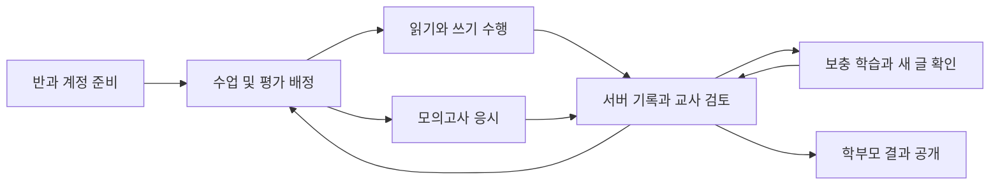

# 리드엑스 실제 학원 운영 전환 계획

<!-- readx-document-context -->
> 작성 당시의 설계·조사·구현 기록입니다. 현재 기능과 운영 상태는 최신 현황을 우선합니다. [문서 목차](README.md) · [최신 현황](PROJECT_STATUS.md)

작성일: 2026년 11월 14일  
상태: 현재 코드 점검을 반영한 개발 계획. 기능 구현 및 운영 배포 완료를 뜻하지 않는다.

학원 한 곳에서 학생·교사·학부모가 각자의 기기로 사용하는 서비스를 완성한다. 초1~6 읽기 수업, 과제, 모의고사, 분석, 보충 학습, 교사 피드백, 학부모 리포트를 모두 개발 범위에 포함한다. 원장 운영과 콘텐츠 관리도 이를 지원하는 실제 기능으로 구현한다. 단계는 구현 순서를 뜻하며, 일부 기능만 구현한 상태를 전체 완료로 처리하지 않는다.

사용자가 확정한 방향은 **학원 한 곳에서 실제 사용**, **수업과 모의고사를 모두 구현**이다. 학년 범위는 기존 제품 계획의 초1~6을 유지한다. 인원·예산·도입일은 미정이며 아래 수량과 성능 목표 중 제안값은 별도로 표시한다.

## 1. 현재 상태와 가장 먼저 해결할 문제

2026년 10월 문서의 구현·검증 기록과 현재 작업 폴더에는 차이가 있다. 이번 개발의 출발점은 다음 코드 상태다.

| 영역 | 현재 확인한 사실 | 개발 결정 |
| --- | --- | --- |
| 학생 읽기 | 지문, 단계별 읽기, 근거 표시, 쓰기, 도움·수정 이력과 로컬 저장 구현 | 학습 UI와 규칙을 재사용하고 실제 학생·배정·서버 기록에 연결 |
| 교사·원장·학부모 | 역할 화면 및 집계기가 있으나 학원 체험 학생·기록을 사용하는 경로 존재 | 실제 반·학생·수행·공개 기록으로 조회 원천 통합 |
| 모의고사 화면 | `examApi.ts`는 HTTP 호출 대신 `createLocalExamClient`를 항상 사용 | 운영 API 어댑터와 로그인·학생 등록 화면 복원, 체험판 명시적 분리 |
| 모의고사 서버 | 계정, 배정, 저장, 마감, 채점, 공개, 후속 활동 구현 존재 | 검증된 도메인 동작을 공통 서비스로 확장 |
| 정답 자료 | 브라우저용 로컬 엔진이 `shared/exam-engine.mjs`를 거쳐 정답 포함 `g5-01.mjs`를 가져옴 | 운영 빌드에서 비공개 시험 콘텐츠와 채점 엔진 분리 |
| 저장 구조 | SQLite의 `exam_state` 한 행에 전체 상태 JSON을 저장하고 요청마다 읽고 갱신 | 사용자·수업·응답별 테이블, 트랜잭션, 버전 관리로 이관 |
| 인증·기관 | 모의고사 서버에 기본 계정·기관 구분이 있으나 전체 수업과 통합되지 않음 | 한 계정·기관·반·보호자 연결을 모든 기능에 적용 |
| 콘텐츠 | 개정 지문 144편, 3수준 432개 본문, 기본 문항 720개. 144편 모두 교사 검수·학생 보정 `pending` | 파일 수와 운영 승인 수를 구분하고 검수 후 게시 |
| 시험지 | 초5 01회 24문항 시범 콘텐츠와 초5·6의 별도 12문항 개인 연습 존재 | 정식 시험지를 초1~6 각각 2회차로 제작·검수 |
| 배포 | 로컬 Node 서버 및 별도 Sites 체험판 소스 존재 | `webapp`을 구현 원천으로 삼아 운영 서버와 체험판의 배포 절차 정리 |

이번 점검에서 실행한 결과:

- `npm test`: 73개 통과.
- `npm run test:exam`: 4개 중 3개 통과, 1개 실패. `server/exam-service.mjs`의 정의되지 않은 `fail` 호출로 잘못된 Origin 요청이 기대한 403 대신 500을 반환한다. 해당 테스트의 나머지 조건까지 통과했다고 볼 수 없다.
- `npx --no-install tsc --noEmit -p tsconfig.json`: 통과.
- 전체 `npm run build`와 브라우저 실제 조작은 이번 계획 작업에서 재실행하지 않았다. 현재 빌드 명령에는 실패한 서버 검사가 포함되어 있다.

주요 근거: [화면 어댑터](../webapp/src/services/examApi.ts), [로컬 모의고사](../webapp/shared/local-exam-client.mjs), [시험 엔진](../webapp/shared/exam-engine.mjs), [서버 저장](../webapp/server/exam-service.mjs), [체험 리포트](../webapp/src/components/common/QuantifiedReport.tsx), [콘텐츠 원장](../webapp/src/data/corpusLessons.generated.json).

## 2. 완성할 이용 흐름

원장이 학원·반·교사·학생을 등록한다. 교사는 검수된 수업과 평가를 배정한다. 학생은 자신의 계정으로 읽고, 근거를 표시하고, 생각을 쓰고, 제출한다. 교사는 실제 응답을 검토해 피드백과 보충 활동을 배정한다. 학부모는 연결 자녀의 공개된 결과를 본다. 다음 수업과 평가에서도 같은 학생의 기록을 이어 쓴다.

| 사용자 | 실제 구현할 기능 | 완료 사례 |
| --- | --- | --- |
| 학생 | 로그인, 오늘 과제, 이어하기, 수준별 읽기, 사고 시범, 근거 표시, 구조화, 자기 설명·수정, 제출, 평가, 복습 | 학원 태블릿의 저장 기록을 집 기기에서 이어 수행하고 교사에게 제출 |
| 교사 | 담당 반, 수업·시험 배정, 진행 상태, 도움 요청, 응답 검토, 루브릭 평가, 피드백, 보충, 공개 | 서로 다른 학생의 답과 도움 이력을 보고 각기 다른 다음 과제를 배정 |
| 학부모 | 자녀 연결, 공개 학습 요약, 실제 답안 예시, 교사 의견, 주간 추이, 가정 질문, 인쇄 | 자기 자녀의 공개된 기록만 보고 공개 회수 시 접근 종료 |
| 원장 | 교사·반·원생 관리, 반 이동·휴원·퇴원, 출석, 운영 현황, 상담 메모, 이용 상태 | 새 반과 담당 교사를 만들고 재원 상태를 바꿔도 과거 기록 보존 |
| 콘텐츠 담당 | 지문·활동·문항·해설 편집, 검토, 승인, 버전, 게시·회수, 오류 정정 | 승인한 새 버전을 배정하되 이미 진행한 수업·시험의 원문과 점수 보존 |

원장이 교사 역할을 겸할 수 있다. 학원 운영 권한과 공용 콘텐츠 게시 권한은 구분한다. 여러 학원에 판매하는 계약·자동 결제·다기관 영업 기능은 이후 사업 확장 단계이며, 이번의 전체 학습 기능 완료 조건과 별개다. 학생별 이용 기간과 활성 상태 관리는 이번에 포함한다.

## 3. 구현 구조

### 하나의 앱과 하나의 공통 서버

기존 React·TypeScript·Vite UI와 검증된 학습 규칙을 유지한다. 서버는 기존 Node 기반을 발전시킨 하나의 API 서비스로 구성하고, 내부에서 계정·학급·콘텐츠·학습·평가·리포트 모듈을 나눈다. 초기 운영 DB는 관리형 PostgreSQL을 제안한다. 학생·반·보호자·배정·답안 관계와 변경 이력을 명시적으로 관리하기 위한 선택이다. 단계 1에서 기존 SQLite 기록의 이관 리허설과 운영 조건을 확인하여 확정한다.

브라우저는 화면 상태와 전송 전 초안을 보관한다. 성적, 제출 확정, 권한, 공식 리포트의 원장은 서버다. 사이트를 여는 정적 호스팅 외에 API 서버·DB·HTTPS 운영 환경을 구성한다. 호스팅 업체와 유료 요금제는 예산과 운영 조건을 검토한 뒤 선택하며 이번 계획에서 구매하지 않는다.

| 데이터 묶음 | 핵심 개체와 제약 |
| --- | --- |
| 계정과 관계 | 기관, 사용자, 기관 역할, 반, 담당 교사, 학생 소속, 보호자 연결. 기관 ID와 유효 기간 유지 |
| 콘텐츠 | 목표, 지문 계열, 지문 버전, 수업 버전, 활동·문항, 시험지 버전, 검수 이력. 배정 시 승인 버전 고정 |
| 수업 | 배정, 학생별 수행, 응답, 근거 위치, 도움 사용, 초안·수정본, 제출. 학생·배정·버전 연결 필수 |
| 평가 | 시험 배정, 응시, 최초·최종 답안, 서버 마감, 채점 버전, 재채점 이력. 연습·정식 응시 구분 |
| 지도와 공개 | 교사 검토, 루브릭, 보충 배정, 새 글 확인, 리포트 공개 스냅샷·회수 |
| 운영 | 출석, 상담, 이용 상태, 계정 복구, 주요 변경 감사 기록, 백업·복구 실행 기록 |

### 계정과 권한

역할 메뉴를 누르는 것으로 권한이 바뀌지 않게 한다. API가 기관·담당 반·본인 학생·보호자 연결·공개 여부를 매 요청 검증한다. 명시적으로 허용하지 않은 접근은 차단한다. 이는 [OWASP 권한 지침](https://cheatsheetseries.owasp.org/cheatsheets/Authorization_Cheat_Sheet.html)의 기본 거부·매 요청 검사 원칙에 따른다.

초기 원장 생성, 교사 초대, 학생 계정 발급, 보호자 연결 승인, 비밀번호 변경·복구, 사용자 비활성화, 로그아웃과 세션 폐기를 구현한다. 운영용 쿠키·세션과 공용 기기의 사용자 전환을 검사한다. 복구·연결 변경·점수 수정은 실행자와 사유를 남긴다. 개인정보 수집 항목, 아동·보호자 동의 절차, 보관·삭제 정책은 운영 담당자와 확정하여 화면과 운영 절차에 반영한다.

기관 구분은 한 학원 운영 단계부터 유지한다. PostgreSQL의 행 접근 정책을 추가 방어 수단으로 적용할 경우, 정책만으로 권한이 완성됐다고 보지 않고 서버 계정 권한과 우회 조건도 검사한다. [PostgreSQL 행 보안 문서](https://www.postgresql.org/docs/current/ddl-rowsecurity.html)는 테이블 소유자 등의 예외를 설명한다.

### 저장과 복구 계약

- 저장 상태는 `기기에 임시 저장`, `서버 저장 중`, `서버 저장 완료`, `재시도 필요`로 구분한다. 응답을 받은 뒤에만 서버 저장 완료로 표시한다.
- 요청 ID로 중복 제출을 막고 응답별 순번·버전으로 늦게 도착한 요청의 덮어쓰기를 막는다.
- 사용자·수행별 초안과 재시도 큐를 격리한다. 로그아웃·계정 전환 시 다른 학생에게 이전 입력이 보이지 않아야 한다.
- 기기 간 이어하기는 서버 접수된 기록을 기준으로 한다. 다른 기기에서 같은 수행을 열면 편집권 이전 또는 충돌 안내를 제공하고 자동으로 두 답을 합치지 않는다.
- 일반 수업은 통신 단절 중 초안 작성과 복구 후 재전송을 지원한다. 시험의 마감·채점은 서버 시각과 접수 답안을 기준으로 한다. 마감 후 미전송 답안은 교사 복구 심사 절차로 분리한다.
- 체험 로컬 기록은 실제 학생의 공식 성적에 자동 이관하지 않는다. 기존 실제 서버 기록이 있으면 ID·버전·점수·공개 상태를 대조해 이관한다.

### 체험판과 운영판

빌드·데이터·접속 경로를 명시적으로 구분한다. 운영 API 장애 시 로컬 체험 모드로 자동 전환하지 않는다. 운영 학생 번들에 정식 시험의 비공개 정답·해설·채점 원본이 포함되지 않도록 import 경로와 최종 산출물을 검사한다. 공개 체험에 사용한 시험지는 정식 평가 후보에서 제외하거나 노출 사실을 기록한 연습용으로만 사용한다. 현재 초5 시범 시험도 이 기준으로 다시 분류한다.

`sites/readx-demo`를 별도 수작업 제품으로 계속 유지하지 않고 정본에서 체험용 산출물을 만드는 절차로 통합한다. 기존 링크·저장 기록은 호환 정책을 마련한 후 정리한다.

## 4. 학습과 평가의 구현 범위

읽기 수업은 목표에 맞게 어휘·사고 시범·근거 표시·관계 연결·구조화·독립 적용·자기 설명·고쳐쓰기를 구성한다. 모든 목표에 동일한 활동을 강제로 넣지 않는다. 교사는 수업을 배정할 때 학년, 목표, 지원 수준을 선택하고 학생별로 조정할 수 있다.

객관식 채점과 근거 선택 검사는 규칙으로 처리한다. 자유 서술·쓰기의 내용 평가는 교사 검토 상태와 루브릭을 갖춘다. 단순히 글을 입력하거나 선택 답을 맞힌 것으로 쓰기 능력·독립 수행을 확정하지 않는다. 힌트·시범·해설 노출과 최초 응답·수정 응답을 분리하여 기록한다.

모의고사는 학년별 문항 수, 보기 수, 시간과 글자 크기를 설정으로 다룬다. 현재 코드의 초5·24문항·5지선다 고정값을 제거한다. 시험지 버전 고정, 배정 기간, 응시, 자동 저장, 다시 보기, 마감, 제출, 결과 공개, 문항별 분석, 정정·무효·재채점까지 구현한다.

| 학년 | 회차당 문항 | 보기 | 제안 시간 | 2회차 합계 |
| --- | ---: | ---: | ---: | ---: |
| 초1 | 12 | 3 | 20분 | 24 |
| 초2 | 12 | 3 | 20분 | 24 |
| 초3 | 20 | 4 | 35분 | 40 |
| 초4 | 20 | 4 | 35분 | 40 |
| 초5 | 24 | 5 | 45분 | 48 |
| 초6 | 24 | 5 | 45분 | 48 |

시간·구성은 기존 [전 학년 모의고사 계획](GRADE_MOCK_EXAM_FULL_PRODUCT_PLAN_2026-10-24.md)의 제안값이며 학년별 실제 사용 관찰 후 확정한다. 정식 시험지 12종·224문항과 새 글 확인 36문항을 최초 공급 목표로 잡는다. 기존 초5 시범·개인 연습 문항을 단순 합산해 납품 수량을 늘리지 않는다.

리포트는 학생·교사·학부모가 동일한 응답·채점·검토 원장을 조회한다. 활동 제출률, 첫 응답, 근거 수행, 도움 사용, 새 글 확인, 교사 관찰을 분모와 함께 제공한다. 기록 없음·미응답·0점·미검토를 구분하고, 연습 재풀이와 새 지문 적용을 구분한다. 검증되지 않은 전국 백분위·등급·독서지수를 생성하지 않는다.

## 5. 콘텐츠 제작과 검수

세부 제작 물량·순서·완결 수업 기준은 [실제 학습 콘텐츠 제작 계획](CONTENT_PRODUCTION_PLAN_2026-11-14.md), 지문·문항·시범·쓰기·검수와 생성 프롬프트는 [콘텐츠 생성 규칙](CONTENT_AUTHORING_RULES.md)을 따른다. 새 자료 확인 활동 확대 수량은 해당 제작 계획의 제안값이다.

기존 96개 정규 목표와 36개 공통기초 목표를 모두 운영 가능한 수업으로 연결한다. 지문 144편의 학년별 분포는 초1·2 각 20편, 초3~6 각 26편이다. 3수준 본문은 별도 신작 3편으로 계산하지 않는다. 지문 계열과 노출 이력을 공유한다.

| 작업 | 완료 조건 |
| --- | --- |
| 운영 콘텐츠 목록 | 목표 132개와 지문·활동·평가·보충의 연결표, 누락 목록, 버전과 원천 확정 |
| 읽기 수업 검수 | 144편과 관련 수준·문항의 사실, 어휘, 정답·근거, 복수정답, 학년 적합성 검토. 반려 콘텐츠는 수정 또는 교체 |
| 공통기초 | 36개 목표의 실제 수행·피드백·완료 조건 검수 |
| 시험 출제 | 초1~6 각 2회차, 각 선지 설명·근거·보충 연결. 학생 응시 전 비공개 유지 |
| 새 글 확인 | 정식 평가 후속 36문항과 수업 목표별 부족분을 별도로 작성. 이미 본 글은 독립 전이 확인에 재사용하지 않음 |
| 승인 과정 | 초안 → 자동 검사 → 독립 교사 검토 → 수정 → 학년별 시범 → 승인 → 게시 |
| 콘텐츠 정정 | 승인 버전 불변, 정정 사유와 새 버전 기록. 성적 영향이 있으면 재채점과 리포트 재공개 |

현재의 `AI 집필·검토` 표기를 독립 교사 승인으로 바꾸지 않는다. 출처·이용 범위·검수자·검수일·교육과정 기준 버전을 기록한다. 기술 구현과 별도로 콘텐츠 담당자 및 실제 학년별 검토 교사의 참여가 필요하다.

## 6. 단계별 실행 순서와 완료 기준

아래 기간은 **개발 담당 1~2명과 콘텐츠 검토 담당의 지속 참여**를 가정한 초기 추정이다. 단계 1의 실제 작업량과 검수 처리량을 확인한 뒤 조정한다. 콘텐츠 검수는 단계 1부터 함께 진행하고, 출시일은 가장 늦게 완료되는 개발·콘텐츠·현장 검증에 맞춘다.

| 단계 | 개발 묶음 | 선행 조건 | 완료 기준 | 초기 기간 가정 |
| --- | --- | --- | --- | --- |
| 0 | 기준 상태 정리와 실패 복구 | 없음 | 현재 작업 보존, 실행 정본 지정, 서버 실패 수정, 전체 빌드 통과, 운영·체험 분리 설계 | 2~3일 |
| 1 | 계정·기관·반·DB·배포 기반 | 0 | 교사·학생·보호자 실제 로그인, DB 마이그레이션, 서로 다른 기기의 서버 기록 공유, 검증 서버 배포 | 1~2주 |
| 2 | 수업·과제·제출·교사 검토 | 1 | 대표 수업의 배정부터 검토까지 연결, 중단·재접속·중복 제출·반 이동 처리, 전체 수업 유형 적용 | 2~3주 |
| 3 | 초1~6 모의고사와 보충 | 1, 학생·교사 공통 흐름은 2 | 학년별 설정, 정식 응시, 공개·재채점, 오답 복습·새 글·교사 검토 연결 | 2~3주 |
| 4 | 공통 리포트·학부모·원장·콘텐츠 운영 | 2, 3 | 동일 기록에 대한 세 역할 수치 일치, 공개·회수, 상담·출석·이용 상태, 콘텐츠 승인 도구 | 2~3주 |
| 5 | 운영 안정화와 학원 시범 | 1~4 및 승인 콘텐츠 | 실제 기기 수업, 백업 복원, 권한·성능·접근성 검사, 중대 결함 해소 | 2~4주 |

개발과 검수 준비가 갖춰졌을 때 대략 10~16주를 초기 계획 범위로 본다. 전 학년 콘텐츠 승인·현장 검증에 더 시간이 필요하면 전체 완료도 늦어진다. 먼저 초5 서버 자산과 대표 읽기 수업으로 연결 구조를 검증하고 다른 학년·활동으로 확장하되, 전체 완료는 초1~6 수업과 평가를 모두 확인한 뒤 선언한다.

### 바로 착수할 첫 개발 묶음

| 순서 | 작업 | 주요 위치 | 확인 방법 |
| --- | --- | --- | --- |
| P0-01 | 현재 변경·미추적 파일을 보존하고 정본·검증 명령 기록 | 저장소, `docs`, `webapp/package.json` | 관련 소스가 재현 가능한 기준 상태로 기록되고 비밀·학생 DB는 제외 |
| P0-02 | `fail` 누락과 요청 검증 오류 경로 수정 | `server/exam-service.mjs` | 기존 서버 4개 검사와 잘못된 JSON·형식·크기 응답 검사 통과 |
| P0-03 | 운영 API와 로컬 체험 어댑터 분리 | `src/services/examApi.ts`, `shared/local-exam-client.mjs` | 운영에서 실제 HTTP 요청, 서버 중단 시 저장 실패 표시, 로컬 대체 금지 |
| P0-04 | 계정 로그인·등록·세션 UI 복원과 역할 권한 연결 | `ExamPortal.tsx`, 공통 계정 모듈 | 계정별 실제 화면 및 담당 범위 확인, 주소 역할 조작으로 권한 변경 불가 |
| P0-05 | 비공개 정답·해설을 운영 클라이언트 import에서 제거 | `shared/exam-engine.mjs`, `shared/g5-01.mjs`, 서버 콘텐츠 | 운영 번들·소스맵·응시 응답 검사, 응시 전 정답 비노출 |
| P0-06 | 공통 데이터 스키마와 이관 리허설 | 서버 저장소·마이그레이션 | 기존 응시의 ID·답안·점수·공개 상태 전후 일치, 롤백 가능 |
| P0-07 | 두 기기에서 첫 실제 흐름 검증 | 공통 UI·API·DB | 교사 배정 → 학생 제출 → 교사 검토 → 보호자 공개가 같은 기록으로 연결 |

P0-03~05는 함께 완료해야 운영 모의고사를 연결했다고 볼 수 있다. P0-07은 첫 통합 검증이며 전체 수업·전 학년 콘텐츠의 개발 완료와는 구분한다.

## 7. 출시를 결정하는 검사

| 항목 | 합격 기준 |
| --- | --- |
| 실제 데이터 | 새 운영 환경은 가상 학생·점수 없이 시작. 세 학생의 서로 다른 응답이 각 역할에서 정확히 연결 |
| 권한 | 다른 학생, 다른 반의 비담당 교사, 미연결 보호자, 비활성 계정, 다른 기관 테스트 계정의 접근 차단 |
| 제출 무결성 | 새로고침·연결 끊김·중복 클릭·역순 저장·기기 전환·서버 재시작에도 확정 답안과 점수 보존 |
| 시험 | 서버 마감, 미응답, 중복 제출, 결과 공개 전 차단, 정답 비노출, 정정·재채점 이력 검증 |
| 학습 | 첫 응답·도움·재노출·수정본 보존. 미검토 서술 답을 자동 정답 또는 목표 달성으로 표시하지 않음 |
| 리포트 | 학생·교사·학부모 화면과 인쇄·CSV의 같은 지표 일치. 공개 스냅샷과 회수 동작 확인 |
| 콘텐츠 | 운영에 게시되는 목표·본문·문항·해설·권리·검수 상태에 누락 없음. 미승인 자료 배정 차단 |
| 기기 | 학생 태블릿 가로·세로, 교사 PC, 학부모 모바일에서 실제 조작. 터치·키보드·확대·초점·긴 글 읽기 확인 |
| 동시 사용 | 계획 부하를 동시 학생 50명으로 우선 가정. 자동 저장·제출·교사 조회를 함께 실행하여 유실·중복 0건 |
| 응답 속도 | 위 부하와 명시한 테스트 환경에서 저장 API의 95%가 1초 이내, 주요 조회 2초 이내를 초기 목표로 검증 |
| 복구 | 자동 백업과 별도 환경 복원 리허설. 초기 목표는 장애 시 최대 1시간 이전으로 복원, 4시간 내 서비스 복구 |
| 배포 | 개발·검증·운영 분리, HTTPS, 비밀 설정 관리, 오류 관찰, 실패 시 롤백, 마이그레이션 복구 절차 |
| 현장 | 한 학원에서 최소 2주 실제 수업 관찰. 출시 대상 각 학년의 사용성 확인과 수업 중단·기록 유실 결함 해소 |

부하·속도·복구 수치는 달성 사실이 아닌 제안 합격선이다. 실제 학생 수·기기·네트워크와 호스팅 비용을 확인해 단계 1에서 확정한다. PostgreSQL의 [백업·복원 문서](https://www.postgresql.org/docs/current/backup.html)에 따라 정기 덤프와 시점 복구 등 방식의 차이를 검토하고, 위 복구 목표를 만족하는 서비스를 선택한다. 백업 파일 생성만으로 복구 검증을 대체하지 않는다.

CI에는 타입 검사, 콘텐츠 무결성, 학습 도메인 검사, 서버·권한 통합 검사, 운영 빌드 및 비공개 자료 검사, 핵심 브라우저 이용 흐름 검사를 넣는다. 현재의 73개 검사와 서버 검사는 회귀 기반으로 유지한다.

## 8. 진행 관리와 남은 운영 입력

작업 항목은 담당, 선행 작업, 결과물, 합격 기준, 검증 증거로 관리한다. 상태는 예정·진행·검증·완료로 구분한다. 화면이 보이는 것만으로 완료 처리하지 않고 실제 계정·저장·권한·예외 상황이 연결된 단위로 검토한다.

지금 확정되지 않아도 설계와 P0 작업은 진행할 수 있다. 외부 운영 환경 확정 전에는 예상 학생·교사 수, 실제 기기, 시작 희망일, 월 운영 예산, 도메인·호스팅 계정, 검수 교사와 학년별 시범 참여자를 확인한다. 자동 결제·문자·카카오 알림은 별도 서비스 연동 결정이 필요하며 첫 운영은 앱 안의 과제·피드백·공개 알림으로 구성한다.

이번 계획은 새 운영 전환 작업의 우선순위 기준이다. 기존 교육 철학·디자인·학년별 출제 사양은 유지한다. [학원 제품 로드맵](ACADEMY_PRODUCT_ROADMAP_2026-10-14.md)과 [초5 구현 기록](G5_MOCK_EXAM_01_IMPLEMENTATION_2026-10-24.md)은 당시 기록으로 보존하고, 현재 구현 여부는 이 문서 1절과 실제 검사 결과로 판단한다.

## 첫 개발 묶음 진행 기록

2026년 11월 14일 [실제 로그인과 평가 운영 구현 기록](PRODUCTION_BATCH_01_2026-11-14.md)을 추가했다. 서버 요청 오류 수정, 운영 HTTP 연결, 교사 초기 설정·로그인·학생·보호자 등록, 시험 배정·학생 제출·교사 공개·보호자 리포트 연결을 구현했다. 최종 빌드, 82개 검사, 비공개 시험 자료의 운영 번들 비노출 검사가 통과했다. 실제 서버에서 세 역할의 1/24·4.2점 일치와 공개 전 보호자 차단을 확인했다.

이 기록은 첫 묶음의 구현 증거이며 전체 운영 전환의 완료 선언이 아니다. 평소 읽기 수업의 서버 이관, 공통 DB 개편, 전체 학급·원장 운영, 계정 복구, 전 학년 정식 평가, 콘텐츠 승인·현장 검증, 운영 배포·복구는 계속 진행한다. 학생 응시부터 보호자 리포트까지 최종 브라우저 조작 재검증도 남아 있다.

## 두 번째 개발 묶음 진행 기록

2026년 11월 14일 [계정 기반 읽기 수업 구현 기록](PRODUCTION_BATCH_02_2026-11-14.md)을 추가했다. 기존 읽기 화면을 재사용하여 콘텐츠 검토·시범 승인, 배정, 학생별 서버 초안·제출, 교사 문항별 검토, 보호자 공개본과 회수를 연결했다. 배정·수행·공개·승인은 별도 SQLite 행으로 저장하고, 실제 서버에서 5개 활동 제출·5개 검토·공개 전 보호자 차단과 지도 의견 일치를 확인했다. 원장·기관·반 운영, 전 학년 평가 완성, 공통 DB 전체 이관과 현장·브라우저 검증은 계속 진행한다.

## 세 번째 개발 묶음 진행 기록

2026년 11월 14일 [실제 학원 운영과 계정 복구](PRODUCTION_BATCH_03_2026-11-14.md)를 추가했다. 원장 권한, 기관·반·교사·원생 관리, 재원 상태·반 이동, 출석·상담, 보호자 연결 변경, 비밀번호 변경·일회용 복구·로컬 원장 복구를 구현했다. 담당 반 제한을 수업과 평가 양쪽에 적용하고 기관별 콘텐츠 승인 저장 키를 이관했다. 92개 자동 검사와 전체 빌드가 통과했다. 사용자가 컴퓨터 제어를 중단해 최종 브라우저 조작 검증은 미완료로 유지한다. 전체 운영 전환 목표는 계속 진행 중이다.

## 개인정보 법률 보안 운영 범위 추가

2026년 11월 14일 사용자가 실사용에 법률·개인정보·보안·운영·유지보수를 모두 포함하도록 명시했다. 운영 전제는 직접 운영하는 학원, 교사 등록 후 보호자 동의·연결, 국내 운영 예정이며 결제·문자 도입도 검토한다. [개인정보 법률 보안 운영 계획](PRIVACY_SECURITY_OPERATIONS_PLAN_2026-11-14.md)과 [23개 운영 준비 통제](PRODUCTION_READINESS_2026-11-14.json)를 전체 완료 기준에 추가한다. 현재 실제 개인정보 운영 준비와 법률 검토가 완료된 상태가 아니다. 기능 검사 통과만으로 전체 목표를 완료 처리하지 않는다.

## 네 번째 개발 묶음 진행 기록

2026년 11월 14일 [공통 운영 홈·실제 기록 리포트·개인정보 운영 기준](PRODUCTION_BATCH_04_2026-11-14.md)을 추가했다. 서버 원장에서 실제 수행의 분모·첫 응답·도움·수정·교사 검토·공개 범위를 계산하고 공통 홈·CSV·인쇄·개별 기록 이동을 연결했다. 103개 자동 검사와 전체 빌드가 통과했다. 외부 글꼴 자동 요청 제거, 로컬 음성 선택, 의존성 수정과 운영 준비 증거 검사도 추가했다. 운영 준비 원장은 현재 `ready:false`이며 전체 실제 개인정보 운영·법률 검토·보안·기기·현장 검증의 완료를 뜻하지 않는다.

## 다섯 번째 개발 묶음 진행 기록

2026년 11월 14일 [보호자 확인·동의와 이용 제어](PRODUCTION_BATCH_05_2026-11-14.md)를 추가했다. 기본 서버에서 안내문 게시와 최소 등록 근거·법정대리인 확인·보호자 동의를 요구하며 학생 로그인·학습 배정·보호자 연결을 통제한다. 변경·철회·확인 해제와 만료, 이전 요청 재전송·기관 간 접근을 검사한다. 기존 연결을 동의로 추정하지 않는다. 실제 확인 절차·법률 검토·파기·감사 보호·추가 인증·운영 계약·기기 현장 검증은 미완료로 유지한다.

사용자의 추가 요청에 따라 이후에도 개발 묶음의 검증이 끝날 때마다 사이트 반영을 함께 진행하고 배포 버전·주소·제약을 기록한다. 기존 공개 Sites는 정적 체험용이며 실제 학원 계정·학생 DB를 연결한 국내 운영 환경이 아니다. 공개 체험본에는 가상 자료만 포함하고 실제 운영과 구분한다. 국내 실사용 서버·처리 방침·업체와 운영 준비 증거가 갖춰진 뒤 실제 계정 기능을 활성화한다.

## 여섯 번째 개발 묶음 진행 기록

[기기 초안 보호와 로그아웃](PRODUCTION_BATCH_06_2026-11-14.md)에서 실제 읽기·평가의 기기 초안을 암호화하고 본인 인증 키로 복구하도록 바꿨다. 계정 변경·철회·비밀번호 변경·로그아웃과 늦은 응답·오프라인 종료 재시도를 보완했다. 물리적 기기 파기·실제 단말/브라우저·서버 키 관리와 추가 인증은 미완료로 유지한다.

## 일곱 번째 개발 묶음 진행 기록

2026년 11월 15일 [교사·운영자 추가 인증과 안전한 초기 등록](PRODUCTION_BATCH_07_2026-11-15.md)을 추가했다. 인증앱과 복구·권한 작업 재인증, 인증 전 데이터 차단, 설정키 암호화·분리 구성, 운영 웹 초기 등록 차단과 로컬 첫 운영자 등록을 연결했다. 세션 만료에서는 기기 초안을 잠근 뒤 본인 재인증으로 복구하고, 명시적 로그아웃에서는 정리한다. 전체 빌드 141개 검사와 마지막 등록·복구 보완의 관련 20개 검사가 통과했다. 실제 인증앱·브라우저·서버 키 운영·접속기록 보호·권리 처리·파기·복구 훈련·법률 검토는 계속 진행하며 23개 준비 통제는 완료로 바꾸지 않는다.

## 여덟 번째 개발 묶음 진행 기록

2026년 11월 17일 [개인정보 접속·반출 기록과 변경 탐지](PRODUCTION_BATCH_08_2026-11-17.md)를 추가했다. 실제 HTTP 조회·변경·인증·거부·다운로드·인쇄 준비를 추가 전용 서명 연결 기록에 저장하고 원장 조회·점검·자료 반출과 별도 기준점 검증 CLI를 연결했다. 리포트 파일·인쇄는 현재 권한을 재확인하며 교사의 목적을 기록한다. 로컬 계정 등록·복구도 같은 기록 체계에 포함한다. 전체 빌드에서 158개 검사를 통과했고 마지막 대상 추적 보완에 관련 검사도 통과했다. 과거 접속 이력 복원·외부 변경 방지 보관소·정기 점검·키 복구·아카이브/만료 파기·권리 처리·현장 검증까지 완료한 것은 아니다. 실제 준비 23개 통제는 미완료로 유지한다.

## 아홉 번째 개발 묶음 진행 기록

2026년 11월 17일 [권리 요청과 검토 사본](PRODUCTION_BATCH_09_2026-11-17.md)을 추가했다. 실제 계정의 열람·정정·삭제·처리정지 접수, 원장 확인·검토, 암호화한 사본 제공, 이의 제기·취소와 방문·서면 접수를 연결했다. 현재 계정 표시 이름 정정은 실제 변경·세션 회수까지 구현했다. 동의 철회 뒤의 권리 행사와 연결 해제 뒤 별도 직접 전달을 구분하며 일반 학습 접근을 복원하지 않는다. 전체 빌드 176개 검사를 통과했다. 실제 삭제·처리정지 집행과 다른 항목 정정·보유기간·보존 예외·백업 재처리·키 운영·법률·현장 검증은 남아 있고 전체 목표와 23개 준비 통제는 미완료로 유지한다.

## 2026년 11월 17일 일반 서비스 처리정지 구현 상태

[열 번째 구현 기록](PRODUCTION_BATCH_10_2026-11-17.md)에 실제 일반 API 제한, 집계·파일 제외, 관련 세션·초안 키 회수, 중첩·보호자 종속 제한, 진행 시간 보관, 보호자 공개 회수와 명시적 해제를 기록했다. 본인 권리·필요한 보안 업무는 유지하며, 개인정보 전체 파기·법률 적합성·국내 운영 준비 완료를 뜻하지 않는다. 실제 삭제·보유기간·보존 예외·백업 복원 후 재처리·키 운영과 실제 단말·현장 검증이 남아 있어 23개 준비 통제는 계속 미완료다.

## 2026년 11월 18일 운영 자료 삭제·별도 보존 구현 상태

[열한 번째 구현 기록](PRODUCTION_BATCH_11_2026-11-18.md)에 확인된 요청의 실제 운영 자료 제거, 9개 자료 종류별 삭제·별도 보존 결정, 암호화한 사본·목록 분리·보존 만료·연장·운영 행 파기와 검증을 기록했다. 로그인 비밀·관계를 제거하고 다른 학생 자료는 유지한다. 결과는 `live_data_removed`이며 디스크·WAL·백업·반출 자료·공동 자유 서술까지 전부 파기했다고 표시하지 않는다. 보호자 인계·마지막 운영자 보호, 동시 변경·중복·감사 장애를 통제한다. 매체 정리·백업 복원 후 재적용·잔여 보존 자료 만료 집행·법률·국내 운영·현장 검증이 남아 있고 23개 통제는 계속 미완료다.

## 2026년 11월 18일 삭제 원장·암호화 백업·복원 구현 상태

[열두 번째 구현 기록](PRODUCTION_BATCH_12_2026-11-18.md)에 DB 밖 삭제 원장과 전달 대기 처리, 과거 백업의 삭제 재적용·별도 보존 검증, 복원 계정·MFA·보호자 재확인, 암호화 백업·보존 종료·만료 파일 제거와 SQLite/WAL 정리를 기록했다. [운영 절차](RECOVERY_OPERATIONS_2026-11-18.md)의 기준점·키·이관·장애 순서를 함께 검토해야 한다. 물리적 매체 파기·최신 접속기록 아카이브 자동 병합·외부 복제·실제 국내 저장소·복구 목표/훈련·법률·현장 검증은 남아 있어 전체 목표와 23개 준비 통제를 미완료로 유지한다.

2026-11-18 13차: 접속기록 전체 암호화 보관본과 원래 HMAC 기록의 격리 복원 병합을 구현했다. [구현·검증 범위](PRODUCTION_BATCH_13_2026-11-18.md). 자동 보관 주기·외부 저장·경보·만료 사본 파기·현장 훈련 및 운영 준비 23개 통제는 미완료로 유지한다.

2026-11-18 14차: [만료 접속기록 보관본 제거·복원 재사용 차단](PRODUCTION_BATCH_14_2026-11-18.md)을 연결했다. 준비/완료 기록과 중간 장애 재개를 검증한다. 다른 사본·매체와 운영 DB 기록 전체의 파기, 자동 보관/파기·국내 운영 준비 23개 통제는 미완료로 유지한다.
