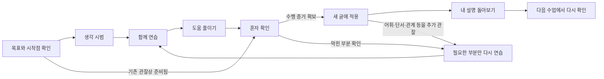

# ReadX 학습 철학을 담는 UI·UX 설계 계획

<!-- readx-document-context -->
> 작성 당시의 설계·조사·구현 기록입니다. 현재 기능과 운영 상태는 최신 현황을 우선합니다. [문서 목차](README.md) · [최신 현황](PROJECT_STATUS.md)


작성일: 2026-10-14  
문서 상태: 코드·콘텐츠·기획 문서를 조사한 후속 설계안. 아래 화면과 기능은 구현 예정이며, 이번 작업에서는 앱을 수정하지 않았다.  
대상: 학원·공부방에서 사용하는 학생 학습 경험과 이를 지원하는 교사·학부모·관리자 화면.

후속 진행: 대표 목표의 사고 과정 수업과 역할별 기록 화면을 구현했다. 적용 범위와 검증 결과는 [1차 개편 기록](READX_LEARNING_EXPERIENCE_IMPLEMENTATION_2026-10-14.md)을 참조한다.

## 1. 제품 경험의 중심

**ReadX는 학생이 글을 이해하는 사고 과정을 배우고, 도움을 점차 덜 받으며, 새로운 글에서도 자기 근거로 설명하도록 돕는다.**

이 철학이 화면에서 보이려면 학생은 언제나 세 가지를 알 수 있어야 한다. 지금 무엇을 배우는지, 이 활동이 왜 필요한지, 자신이 어떤 근거로 생각했는지다. 교사는 학생의 응답과 도움 이력을 보고 다음 지도를 결정할 수 있어야 한다.

이번 디자인에서 가장 크게 바꿀 것은 학습 화면의 구조다. 현재의 여섯 활동 탭을 수업 과정에 맞게 배치하고, 본문에서 고른 근거가 관계 정리와 자기 설명으로 이어지게 한다. 기존 CI의 색상과 새 심벌은 유지하되, 색과 형태가 학습에서 맡는 역할을 명확하게 만든다.

기존 [전체 UI·UX 개선 계획](UI_UX_IMPROVEMENT_AND_FEATURE_PLAN_2026-10-14.md)의 넓은 기능 목록보다 이 문서의 학습 흐름을 먼저 검증한다. [디자인 시스템 v2](READX_DESIGN_SYSTEM_V2.md)는 시각적 기반으로 사용한다.

## 2. 현재 구현과 철학 사이의 간격

코드와 원본 콘텐츠를 기준으로 확인했다. 실제 학생의 사용성·학습 효과를 관찰한 결과는 아니다.

| 철학 | 현재 확인한 상태 | 필요한 변화 |
| --- | --- | --- |
| 세부목표에 맞는 학습 | 목표·선수목표 데이터가 있지만 개별 활동과 수행 조건의 정합성에 차이가 있음 | 목표별로 지문, 활동, 관찰 증거, 판정 준거를 함께 검수 |
| 생각하는 방법을 배움 | ‘함께 생각하는 안내’는 `prototype_step1_2`의 활동 지시문을 표시 | 본문의 특정 구절을 짚는 질문·사고구술·자기점검 시범 작성 |
| 점진적 책임 이양 | 근거 찾기·판단하기·답과 근거·관계 연결·생각 연습·쓰기가 병렬 탭으로 노출 | 시범, 공동 수행, 도움 축소, 독립 수행에 맞춰 도구를 제시 |
| 읽기와 쓰기의 연결 | 근거 선택과 쓰기 작업 공간이 있으나 산출물이 이어지는 구조는 부족 | 인용 구절 → 정리표/관계 → 자기 문장 → 수정 이력 연결 |
| 정밀한 진단과 처방 | `ProcessObservation`과 관찰 요약 함수가 있으나 전체 학습 행동·서버 기록과 연결되지 않음 | 정오답, 근거, 도움, 지문 노출 여부를 함께 기록하고 교사가 판단 |
| 다른 글에 적용 | 현재 수업은 대표 지문 중심 | 같은 목표에 시범·연습·독립확인·전이확인용 지문 묶음 연결 |
| 성장의 가시화 | 초안·활동 저장 기반은 마련됨 | ‘혼자 수행한 부분’과 ‘도움을 받은 부분’을 실제 응답과 함께 제시 |

특히 현재 열린 `G5-EXP-V1-1`은 ‘내용 확인’ 목표인데, 일부 활동은 인과 설명과 보고문 작성을 요구한다. 목표의 조건에는 4~6문단과 도표 정보가 있지만 실제 본문은 3문단이다. 인과 활동 자체의 유용성과 별개로, 이를 세부 정보 확인의 성취 증거로 모두 합칠 수는 없다. 먼저 목표 조건을 만족하는 콘텐츠를 보완하거나, 해당 수업이 목표의 어느 부분만 연습하는지 명시해야 한다.

## 3. 서로 구분해야 할 세 가지 흐름

아래 세 가지를 하나의 진행률이나 네 단계 장식으로 합치지 않는다. 각 흐름은 학생에게 다른 정보를 준다.

| 구분 | 의미 | 화면에서 보이는 방식 |
| --- | --- | --- |
| 장기 학습 경로 | 목표 확인 → 필요한 학습 → 독립 확인 → 새 글 적용 → 다시 확인 | 홈의 ‘오늘의 목표’와 교사의 지도 기록 |
| 수업의 도움 수준 | 생각 시범 → 함께 연습 → 도움 줄이기 → 혼자 하기 | 학습 화면 상단의 현재 과정과 그에 맞는 안내량 |
| 실제 사고 활동 | 단서 포착·관계 연결·판단·자기 표현 중 목표에 필요한 활동 | 본문 옆의 현재 질문, 학생의 응답, 연결된 근거 |

예를 들어 독립 수행에서도 단서를 찾고 판단할 수 있다. ‘근거 찾기’는 곧 ‘시범 단계’가 아니다. 사실 확인 목표에는 간단한 대상–정보 표가 적합할 수 있고, 추론 목표에는 단서 사이의 관계가 더 중요하다. 모든 목표에 같은 네 화면을 통과시키지 않는다.



자기 표현과 피드백은 마지막에만 생기는 활동이 아니다. 시범 이후 각 연습에서도 짧게 설명하고 고쳐 본다. 처음부터 잘 수행하는 학생에게 시범 전체를 강제하지 않으며, 아직 증거가 없으면 짧은 시작 과제로 경로를 정한다.

## 4. 학생이 경험할 수업

| 장면 | 학생에게 보이는 내용과 행동 | 다음 단계의 근거 |
| --- | --- | --- |
| 오늘의 목표 | ‘글에서 낱말의 뜻과 특징을 찾아 정확히 설명해요.’ 이전 활동과 연결한 추천 이유 한 문장 | 시작 과제 또는 교사의 배정 |
| 생각 시범 | 실제 구절을 짚으며 ‘무엇을 묻지? 어디를 볼까? 왜 이 부분일까?’를 보여줌 | 시범을 본 사실만 기록. 이해 완료로 판정하지 않음 |
| 함께 연습 | 학생이 직접 구절을 고르고, 필요한 경우에만 다음 질문이나 문장 틀을 받음 | 선택한 근거·설명·사용한 도움 |
| 도움 줄이기 | 다른 내용에서 같은 기능 수행. 정답 구절의 사전 강조와 완성된 문장 틀을 줄임 | 도움 없이 할 수 있는 부분과 아직 필요한 부분 |
| 혼자 확인 | 학습 중 답을 보여 주지 않은 과제에서 수행. 제출 전 정답·해설을 숨김 | 목표 준거에 맞춘 응답과 근거, 도움 상태 |
| 새 글에서 사용 | 다른 소재의 미노출 글에서 같은 기능을 사용 | 새 지문 여부와 수행 조건을 함께 확인 |
| 돌아보기 | ‘내가 고른 구절 → 처음 설명 → 고친 설명’을 비교하고 다음 연습을 안내 | 교사 검토 또는 정해진 관찰 규칙 |

메인 버튼은 ‘다음’보다 다음 행동을 말한다. 예: ‘이 구절을 고른 이유 적기’, ‘내 설명과 원문 비교하기’, ‘새 글에서 해보기’. 뒤로 가기와 작성 내용 수정은 허용하고, 저장 상태와 이어 할 위치를 표시한다.

도움을 요청하면 학습은 계속된다. 다만 그 응답을 ‘도움 없이 수행한 증거’로 기록하지 않는다. 독립 수행이 막혔을 때는 현재 시도를 보존하고 연습으로 전환한 뒤, 다른 미노출 과제로 다시 확인한다. 글자 크기·대비·키보드 조작 같은 접근성 설정은 인지적 힌트와 구별한다. 낭독 기능은 평가하려는 읽기 기능에 따라 수행 조건을 별도로 기록한다.

## 5. 학습 화면의 구조

데스크톱은 본문과 현재 활동을 나란히 두는 기존 장점을 살린다. 학생이 동시에 관리해야 하는 큰 패널은 두 개로 제한하고, ‘내 생각의 흔적’은 활동 아래에서 펼친다.

```text
ReadX   오늘의 목표: 대상의 뜻과 특징을 찾아 설명하기     저장됨
생각 시범 ─ 함께 연습 ─ 도움 줄이기 ─ 혼자 확인
                    현재 과정과 짧은 안내

┌───────────────────────┬────────────────────────┐
│ 읽고 있는 글            │ 지금 해볼 일             │
│                       │ 질문 한 가지              │
│ 문단 / 문장 / 도표       │ 학생의 응답 공간           │
│ 선택한 근거와 표시       │ [필요한 도움 보기]         │
│                       │ [근거를 고른 이유 적기]    │
│ [읽기 설정]             │                          │
│                       │ 내 생각의 흔적 ▾          │
│                       │ 인용 → 정리 → 내 설명      │
└───────────────────────┴────────────────────────┘
```

시범에서는 본문에 연결된 짧은 사고구술 카드를 보여 준다. 순서를 따라 강조되는 구절과 ‘선생님의 생각’ 표시를 함께 사용한다. 긴 설명을 읽기 전에 단서를 직접 생각할 작은 멈춤 질문을 넣는다. 자동 재생과 긴 강제 애니메이션은 기본값으로 두지 않는다.

함께 연습에서는 시범 카드를 학생 입력으로 바꾸고, 독립 수행에서는 같은 위치에 질문과 입력만 남긴다. 화면 전체를 갈아엎지 않고 안내량을 줄여, 익숙한 공간에서 학생의 책임이 커지도록 한다. 여섯 도구는 목표에 맞게 현재 활동에 삽입하고, 완료 후 복습에서는 필요한 활동으로 자유롭게 돌아갈 수 있게 한다.

모바일에서는 본문과 활동을 전환하되, 질문과 선택한 구절을 짧게 유지한다. 응답 중 근거를 누르면 해당 문장이 있는 본문 위치가 열리고, 돌아오면 입력·스크롤·선택 상태가 보존된다. 전체 본문을 작은 두 칸에 동시에 압축하지 않는다.

‘내 생각의 흔적’의 각 항목은 본문 위치, 학생이 고른 이유, 연결된 설명을 가진다. 선생님 예시와 학생 작성물은 작성 주체를 표시한다. 근거를 바꾸면 연결된 설명에 ‘근거가 바뀌었어요. 설명도 맞는지 살펴봐요’를 표시하고, 학생의 문장을 자동으로 덮어쓰지 않는다.

## 6. 현재 수업을 바꾸는 구체적인 예

대상: `G5-EXP-V1-1`, ‘물질이 골고루 섞이는 용해 현상과 온도의 영향’. 아래는 **명시적 정의·세부 정보 확인 부분의 수업 예시**다. 원본 목표 전체의 성취 판정이나 과학 콘텐츠 검수가 완료됐다는 의미는 아니다.

1. **목표 제시:** ‘글에서 용질·용매·용액의 뜻을 구별하고, 근거를 보여 주며 설명해요.’ 학생이 배울 읽기 기능을 먼저 제시하고 과학 소재를 보조 정보로 표시한다.
2. **시범:** 선생님이 ‘용질은 무엇일까?’를 묻는다. 첫 문단의 ‘녹는 물질’을 짚고 ‘이 말이 용질을 설명하는구나. 바로 옆의 녹이는 물질과 구별해서 읽어야겠어’라고 생각을 보여 준다. 이어 질문의 대상과 고른 정보가 맞는지 점검한다.
3. **함께 연습:** 학생이 용매를 설명하는 구절을 고른다. 필요하면 ‘녹는 물질과 녹이는 물질 중 어느 쪽일까?’라는 질문을 제공한다. 답을 직접 알려 주는 도움은 한 단계 뒤에 둔다.
4. **도움 줄이기:** 용액의 정의를 직접 찾아 대상–설명 표를 채운다. 근거 위치를 미리 표시하지 않는다. 이것은 같은 글에서의 연습 성공이며 새 글 전이로 집계하지 않는다.
5. **자기 표현:** 자신이 만든 표를 옆에 두고 용질·용매·용액의 차이를 자기 말로 정리한다. 현재 목표에는 짧고 정확한 설명을 요구한다. 긴 인과 보고문 작성은 별도 목표가 있을 때 배치한다.
6. **피드백과 수정:** 원문과 비교하여 ‘녹는’과 ‘녹이는’이 바뀌었는지 확인한다. 내용의 정확성과 문장 표현을 분리해 피드백하고, 한 번에 고칠 핵심 한 가지를 제시한다.
7. **혼자 확인:** 별도로 집필·검수한 정의와 세부 정보가 포함된 글을 제시한다. 목표에서 요구하는 정보 수·도표·조건을 충족하는지 편집 검수 후 사용한다.
8. **새 소재 적용:** 다른 교과 소재의 미노출 글에서 같은 기능을 확인한다. 과학 용어를 기억한 것과 정보 확인 기능을 구별할 수 있도록 어휘 부담을 검토한다.
9. **돌아보기:** 실제 수행을 바탕으로 ‘정의를 설명하는 구절을 골랐어요. 다음에는 다른 글에서도 해봐요’처럼 알려 준다. 수행 증거가 부족하면 ‘확인 중’으로 남긴다.

독립 확인과 새 소재 적용은 수업 운영에 따라 다음 차시로 나눌 수 있다. 한 차시에 모두 넣고 완료 속도를 재촉하지 않는다. 해당 원본의 과학 설명과 비교표도 게시 전 사실 검수 대상에 포함한다.

### 목표가 바뀌면 활동 구조도 바뀐다

| 목표 유형 | 중심 질문 | 연결할 산출물 | 자기 표현 |
| --- | --- | --- | --- |
| 사실 확인 | ‘무엇에 대해 어떤 정보가 적혀 있지?’ | 대상–정보–출처 표 | 왜곡·누락 없이 정보 정리 |
| 추론 | ‘이 단서들을 연결하면 무엇을 알 수 있지?’ | 단서 A·B, 연결 이유, 잠정 결론 | 글에 있는 정보와 내가 추론한 내용 구별 |
| 평가 | ‘어떤 기준으로 이 주장을 판단할까?’ | 평가 기준–주장–증거–한계 | 판단과 근거, 다른 해석의 가능성 설명 |

도해는 사고를 정리하는 수단이다. 모든 수업에 인과 도해나 같은 빈칸 양식을 넣지 않는다. 긴 글쓰기가 목표인 수업에서는 읽기에서 만든 산출물을 계획·글감 선택·조직·초고·퇴고로 확장한다.

## 7. 막혔을 때의 흐름과 피드백

학생의 한 번의 오답에서 원인을 확정하지 않는다. 아래는 추가 관찰과 지도에 사용할 설계 규칙 후보이며 자동 진단 규칙은 아니다.

| 관찰된 모습 | 화면에서 할 일 | 기록·교사 판단 |
| --- | --- | --- |
| 답은 맞지만 근거가 맞지 않음 | ‘이 구절이 네 답을 어떻게 뒷받침하는지 설명해 볼까?’ | 답 정오와 근거 적절성을 분리. 추측으로 맞혔다고 단정하지 않음 |
| 관련 구절을 찾지 못함 | 질문의 대상 확인 → 낱말 확인 → 탐색 범위 도움을 순차 제공 | 어휘·정보 위치 탐색 중 어느 지원이 필요했는지 확인 |
| 구절은 적절하지만 연결이 어려움 | 두 정보의 관계를 묻는 짧은 활동 제공 | 해당 목표와 관련 선수 기능을 추가 관찰 |
| 내용 이해는 확인되나 글로 표현하기 어려움 | 문장 틀 또는 교사에게 말로 설명하는 경로 제공 | 표현 지원을 기록. 구두 설명을 쓰기 성취로 대체하지 않음 |
| 도움 후 성공 | 성공한 부분을 알려 주고 다음에는 도움을 줄여 다시 시도 | 지원을 받은 성공으로 보존. 도움 요청에 벌점 없음 |
| 새 글에서 어려움 | 어휘·배경지식·글 구조·이전 도움 여부를 확인 | 기존 기능 미습득이라고 즉시 단정하지 않음 |
| 이미 독립 수행 증거가 충분함 | 시범을 건너뛰고 새 글 확인으로 이동 가능 | 교사가 조건과 추천 이유를 확인·변경 |
| 입력 없이 종료하거나 기록이 없음 | 이어 할 위치와 마지막 저장 내용을 안내 | ‘미관찰’로 표시. 오답 또는 능력 부족으로 환산하지 않음 |

선수 기능이 필요하면 짧은 보충 활동으로 이동하되, 끝나면 막혔던 질문과 자신의 응답으로 돌아온다. 학생에게는 ‘이 부분을 먼저 함께 해봐요’라고 설명한다. 지도용 목표 위계와 원래 학년 정보는 교사 화면에서 확인한다.

피드백은 ‘관찰한 것 → 다음에 확인할 것 → 수정 행동’의 순서를 따른다. 예: ‘용매와 관련된 문장을 찾았어요. 녹는 쪽과 녹이는 쪽을 다시 비교해서 설명을 고쳐 볼까요?’ 실제 판단에 교사 검토가 필요한 경우에는 검토 전 상태를 명확히 표시한다.

## 8. 브랜드와 전체 디자인에 반영할 원칙

ReadX의 X-Ray/Rx 모티프를 제품 경험으로 연결한다. X-Ray는 학생이 선택한 근거와 생각의 연결을 드러내고, Rx는 그 관찰에 근거한 다음 도움을 설명한다. 학생에게는 진단·결손 같은 전문 용어보다 ‘내가 할 수 있는 것’과 ‘다음에 연습할 것’을 말한다.

| 요소 | 적용 방향 |
| --- | --- |
| 심벌 | 현재 정제한 SVG를 공통 브랜드 표식으로 사용. 단계·정답·보상 아이콘으로 반복하지 않음 |
| 네이비·종이색 | 화면의 기본 틀과 긴 글 읽기 영역. 본문이 가장 안정적으로 보이게 구성 |
| 블루 | 현재 수행할 주 행동과 선택 상태 |
| 시안 | 선생님 시범과 도움 카드. ‘선생님의 생각’이라는 글자 표식 병기 |
| 에메랄드 | 학생이 작성·수정한 생각과 산출물. 자동으로 정답을 뜻하게 하지 않음 |
| 골드 | 주목할 근거의 절제된 강조. 문장 전체에 다량 사용하지 않음 |
| 상태 표현 | 정답·재검토·저장 상태는 아이콘과 문구로 구별. 색 하나로 뜻을 전달하지 않음 |
| 여백·서체 | 본문, 질문, 도움, 입력의 위계를 일정하게 유지. 긴 지시문은 현재 필요한 부분부터 표시 |
| 동작 | 근거를 선택하면 대응 카드가 나타나는 등 인과가 분명한 변화. 동작 줄이기 지원 |

선택한 구절은 점선/실선·번호·라벨로도 구별하고 키보드로 선택·해제할 수 있게 한다. 대비, 확대, 포커스 이동, 읽기 순서를 실제 화면에서 검증한다. 학생이 문장을 생각하는 동안 카운트다운이나 순위 경쟁으로 시선을 빼앗지 않는다.

진행 표시는 ‘오늘 수업에서 어디쯤 왔는지’를 보여 준다. 과정을 끝냈다는 사실을 숙련도 100%와 혼동하지 않게 한다. 성장 화면에서는 처음 응답과 수정본, 도움 없이 수행한 새 과제를 함께 보여 준다.

저학년과 읽기 지원이 필요한 학생에게는 한 화면의 지시량을 줄이고 선택·짧은 입력·교사와의 구두 설명을 조합한다. 학생의 겉모습이나 캐릭터만 바꾸는 방식보다 입력 부담과 지원 방식을 먼저 조정한다. 최초 검증은 현재 수업의 고학년 대상에서 진행하고 저학년 설계는 별도로 검증한다.

## 9. 교사·학부모·관리자가 보는 같은 학습 과정

**교사:** 첫 화면에서 오늘 지도할 학생과 그 이유를 확인한다. 학생 한 명을 열면 목표, 실제 답, 선택한 근거, 도움 단계, 수정 이력, 새 글 여부가 같은 순서로 보인다. 추천 지도 옆에는 관찰 근거와 미확인 사항을 표시한다. 교사는 목표·시작 단계·보충 활동을 변경하고 이유를 남길 수 있다. 배정은 목표 → 필요한 지원 → 적합한 지문 묶음 순서를 기본으로 하되 교과 소재로도 찾을 수 있게 한다.

**학부모:** ‘이번에 배운 것 / 아이가 직접 한 것 / 다음 연습 / 대화 질문’의 네 항목으로 요약한다. 실제 구절 선택과 고친 문장 하나를 보여 주고, 여러 수행 조건을 합친 능력 점수나 근거 없는 상승 그래프로 성장을 표현하지 않는다. 예시는 실제 기록과 명확히 구별한다.

**관리자·콘텐츠 편집자:** 지문 개수뿐 아니라 목표별 수업 묶음이 완성됐는지 확인한다. 시범 대본, 본문 연결, 연습, 독립 확인, 전이 지문, 판정 준거, 사실·권리 검수의 누락을 볼 수 있어야 한다. 조건이 맞지 않는 수업은 게시 전에 잡고, 이전 응답이 참조하는 콘텐츠 버전은 보존한다.

공개 소개 화면도 동일한 흐름으로 설명한다. ‘목표를 찾고 → 생각하는 방법을 배우고 → 새 글에서 혼자 설명한다’는 경험을 실제 수업 예시로 보여 준다. 소개 페이지의 약속과 학생 화면의 수행 과정이 일치해야 한다.

## 10. 화면을 가능하게 하는 콘텐츠와 기록

### 수업 묶음의 필수 구성

| 구성 | 작성·검수할 내용 |
| --- | --- |
| 목표 | 학생용 목표 문장, 수행 조건, 관찰할 행동, 판정 준거, 선수 기능 |
| 지문 | 독립 ID·버전, 개념, 어휘 부담, 구조, 원천 및 검수 상태 |
| 생각 시범 | 멈춤 질문, 1인칭 사고구술, 본문 연결 위치, 자기점검 |
| 연습 | 직접 수행할 과제, 가능한 근거, 허용되는 다른 표현, 예상 오해 |
| 도움 | 질문 → 범위 단서 → 부분 예시 등 단계별 내용과 언제 제공할지 |
| 독립·전이 확인 | 훈련 중 답이 노출되지 않는 과제, 다른 지문, 노출 이력, 동등한 목표 조건 |
| 자기 표현·피드백 | 읽기 산출물과의 연결, 내용·조직·표현 준거, 교사 검토가 필요한 조건 |

완성된 시범 대본과 독립 확인 지문이 없으면, UI만으로 사고 과정 수업을 만들 수 없다. 첫 제작은 세부목표 하나와 서로 다른 지문 3~4편으로 시작한다. 예를 들어 시범·공동 연습 1편, 도움 축소 1편, 독립 확인 1편, 다른 소재 전이 1편이다. 짧은 시작 과제와 재확인용 예비 문항은 별도 준비한다. 이미 정답을 보여 준 글을 다시 제시하면서 ‘새 글’로 기록하지 않는다.

### 구현 기반의 확장

기존 `LiteracyGoalRecord`, `PassageRecord`, `ProcessObservation`의 분리를 이어 간다. 다음 항목이 추가로 필요하다.

- **수업 실행 계획:** 목표·콘텐츠 버전·현재 도움 수준·진행 위치·다음 활동 조건. 화면 컴포넌트에 단계 순서를 고정하지 않는다.
- **학생 산출물 연결:** 인용 범위 → 관계/정리 항목 → 초안 → 수정본의 식별자와 연결. 본문 위치는 문단 번호만이 아니라 버전과 안정적인 문장·구절 식별자로 관리한다.
- **시도 단위 기록:** 같은 학생이 같은 목표를 다시 해도 이전 응답과 도움 이력이 덮어써지지 않게 한다. 시도 ID, 노출 이력, 입력 방식, 피드백 제공 시점을 보존한다.
- **판정 근거:** 원응답과 해석을 분리하고 사용한 준거·규칙 버전, 검토 주체, 미판정 상태를 남긴다.
- **저장과 제출:** 작성 중 저장·기기 내 저장·서버 제출을 구별한다. 실제 학원 운영 전에 인증·권한·다중 기기 복원·교사 제출 상태를 연결한다.

기존 `useReadingWorkspace`는 이어 하기의 출발점이다. 현재의 로컬 저장을 정식 제출이나 장기 학습 이력처럼 표시하지 않는다. `summarizeProcessEvidence`는 관찰 요약 기반으로 재사용하고, 능력 지수 또는 검증된 자동 처방 엔진으로 확대 해석하지 않는다.

## 11. 우선순위와 실행 순서

첫 목표는 **한 세부목표의 수업을 처음부터 끝까지 완성하고 학생·교사가 이해할 수 있는지 확인하는 것**이다. 전체 목표와 모든 교과로 한꺼번에 확대하지 않는다.

| 단계 | 우선순위·산출물 | 주 담당 | 완료 조건 |
| --- | --- | --- | --- |
| 1. 수업 정합성 | P0. 대표 목표의 조건·활동·준거 대조표, 3~4편 지문 묶음, 시범·도움 대본 | 교육 설계·콘텐츠 편집 | 모든 과제가 무엇을 가르치고 확인하는지 설명되고 검수됨 |
| 2. 경험 설계 | P0. 목표 시작 화면, 과정별 학습 화면, 돌아보기, 교사 검토, 학부모 요약의 5종 시안 | 제품·디자인·교사 | 초보·숙련·도움 요청·중단 후 재개 경로를 클릭 모형에서 수행 가능 |
| 3. 대표 수업 구현 | P0. 단계 전환, 본문 연결 시범, 산출물 이어 쓰기, 관찰 기록, 복원 | 프런트엔드·백엔드 | 독립 확인의 도움·노출 구분이 지켜지고 기록이 복원됨 |
| 4. 소규모 확인 | P0. 학생 사용 관찰과 교사 판정 비교, 수정 목록 | 제품·교육 설계·교사 | 아래 검증 기준을 만족하거나 실패 지점 수정 후 재확인 |
| 5. 유형 확장 | P1. 사실·추론·평가 목표별 템플릿, 선수 기능 보충·복귀, 교사 배정 개선 | 콘텐츠·디자인·개발 | 동일 UI를 억지로 복제하지 않고 목표별 증거가 유지됨 |
| 6. 운영 확장 | P1. 학원 운영 기록·권한·제출, 편집 검수·게시, 재확인 경로 | 제품·백엔드·편집 | 실제 운영 가능한 데이터 흐름과 역할 권한 검증 |

1~4단계는 디자이너 1명, 프런트엔드 개발자 1명, 콘텐츠 담당 1명과 교사 검토 참여를 가정할 때 약 4~6주의 탐색·구현 범위로 잡는다. 백엔드 신규 구축, 대량 콘텐츠 집필, 장기 효과 검증은 포함하지 않은 초기 추정이다. 1단계에서 실제 제작량을 확인한 뒤 일정과 범위를 다시 산정한다.

첫 구현에서는 자동 AI 첨삭·자동 숙련 판정·대규모 추천 엔진보다 교사가 검토할 수 있는 실제 응답 연결을 우선한다. 학생의 사고 흔적과 교사의 판단 기준이 쌓인 이후 자동화 범위를 정한다.

## 12. 검증할 질문과 출시 판단

아래 수치는 제품 검증을 위한 제안 기준이며 연구에서 확인된 학습 효과 수치가 아니다. 첫 라운드는 대표 수업 대상 학생 6~9명과 교사 2~3명의 사용 관찰로 시작한다. 소규모 관찰로 장기 성취 향상을 주장하지 않는다.

| 확인할 것 | 방법과 제안 기준 |
| --- | --- |
| 학생이 목적과 다음 행동을 아는가 | 첫 화면과 과정 전환 후 ‘무엇을 연습하니? 다음에 무엇을 하니?’ 질문. 외부 설명 없이 80% 이상 이해하는지 확인 |
| 시범이 생각하는 방법을 보여 주는가 | 학생이 시범을 본 뒤 새로운 항목에서 ‘어디를 왜 봤는지’ 말하는지 관찰. 화면을 끝까지 본 비율로 대체하지 않음 |
| 근거가 쓰기로 이어지는가 | 학생이 자기 설명의 근거를 눌러 원문으로 돌아갈 수 있고, 수정 후 연결이 보존되는지 확인 |
| 독립 수행이 구별되는가 | 도움 사용·기존 지문 노출·정답 열람 사례가 독립 성공으로 집계되지 않는지 검증. 위반 시 출시 보류 |
| 보충 뒤 원래 과제로 돌아오는가 | 막힌 질문에서 도움·보충을 거쳐 복귀할 때 응답·근거·진행 위치 손실이 없는지 확인 |
| 교사가 실제로 지도 결정을 할 수 있는가 | 답만 맞음 / 근거만 적절함 / 도움 후 성공 / 새 글에서 성공의 사례를 실제 기록으로 구별할 수 있는지 확인 |
| 접근성과 복원이 유지되는가 | 키보드, 확대, 모바일 전환, 저장 실패, 새로고침, 중단 후 재개의 핵심 경로 확인 |
| 다른 글에서도 수행하는가 | 목표 조건이 맞는 미노출 과제와 이후 재확인에서 수행을 관찰. 내용 기억·어휘 부담·도움 조건을 함께 기록 |

첫 화면 검증 이후에는 시범을 반복해서 보는 이유, 도움을 요청한 지점, 근거를 바꾼 이유를 인터뷰한다. 체류 시간·완료율·클릭 수는 사용 과정의 보조 지표다. 이해·숙련의 직접 증거로 쓰지 않는다.

## 13. 설계 근거와 참고 자료

프로젝트 내부의 [세부목표·사고 과정·교과 지문 설계](GOAL_PROCESS_CONTENT_STRATEGY.md), [교육과정 설계 철학](../textbook_reference/docs/01_기획과_철학/01_교육과정_설계_철학_및_나선형_위계.md), [GRR·사고구술 설계](../textbook_reference/docs/01_기획과_철학/02_점진적_책임이양%28GRR%29_및_사고구술_이론.md), [읽기·쓰기 수평 전이 설계](../textbook_reference/docs/03_교과서_구성_및_레이아웃_디자인/02_읽기_쓰기_1대1_수평전이_및_2층첨삭노트.md)를 제품 흐름으로 번역했다. 교재의 지면 규격과 전체 장르 범위까지 이번 설명문 앱에 그대로 옮기지는 않는다.

외부 근거는 다음 범위에서 참고했다.

- 미국 IES의 [Providing Reading Interventions for Students in Grades 4–9, 2022](https://ies.ed.gov/ncee/wwc/PracticeGuide/29/i)는 배경·어휘 지식, 질문과 응답, 짧은 글의 요지 파악, 이해 점검을 다룬다. 본 계획에서는 낱말 부담을 구별하고 학생이 자신의 이해를 확인하는 활동을 설계할 때 참고했다. 미국 4~9학년 읽기 중재 지침이며 한국어 초등 전 학년의 ReadX 효과를 검증한 자료는 아니다.
- IES의 [Organizing Instruction and Study to Improve Student Learning, 2007](https://ies.ed.gov/ncee/wwc/PracticeGuide/1)은 풀이 예시와 직접 연습의 교차, 시각 자료와 언어 설명의 결합, 설명을 요구하는 질문, 시간 간격을 둔 학습을 권고한다. 본 계획의 시범·연습 배치와 근거 설명, 이후 재확인의 참고 근거다. 화면 구성과 전환 규칙은 이 프로젝트를 위한 설계 제안이다.

구현 확인 파일: [SplitScreenStudio.tsx](../webapp/src/components/student/SplitScreenStudio.tsx), [콘텐츠 자료 구조](../webapp/src/types/contentLibrary.ts), [과정 관찰 요약](../webapp/src/services/processEvidence.ts), [이어 하기 상태](../webapp/src/store/useReadingWorkspace.ts), [기존 수업 원본](../webapp/src/data/commercialMasterData.json).
