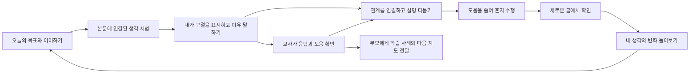

# ReadX 전체 UI UX와 사고구술 학습 경험 개선 계획

<!-- readx-document-context -->
> 작성 당시의 설계·조사·구현 기록입니다. 현재 기능과 운영 상태는 최신 현황을 우선합니다. [문서 목차](README.md) · [최신 현황](PROJECT_STATUS.md)


작성일: 2026년 10월 15일

첫 UI와 기기 내 학습 흐름의 구현 범위·검증·남은 작업은 [2026년 10월 16일 구현 기록](./THINKING_EXPERIENCE_IMPLEMENTATION_2026-10-16.md)을 따른다. 아래 전체 제품 계획과 운영 기반이 모두 구현되었다는 의미는 아니다.

**ReadX의 중심 경험은 본문의 어디를 보고, 무엇을 연결하고, 왜 그렇게 판단하는지를 사고구술과 어노테이션으로 배우는 것이다.** 학생은 선생님의 생각 시범을 보고, 자신의 근거와 이유를 남기고, 도움을 줄이며 다른 글에 같은 읽기 방법을 적용한다. 이 경험을 브랜드 소개, 학생 홈, 학습 화면, 교사 지도, 콘텐츠 제작, 성장 기록과 상담까지 일관되게 연결한다.

범위는 소개와 첫 진입부터 학생·교사·학부모·원장·콘텐츠 편집자의 전체 화면, 공통 디자인, 학습 조작, 저장·복구, 접근성과 리포트다. [학원과 공부방 우선 출시 전략](./ACADEMY_PRODUCT_ROADMAP_2026-10-14.md), [기존 UI 개선 계획](./UI_UX_IMPROVEMENT_AND_FEATURE_PLAN_2026-10-14.md), [미니 모의고사 구현](./STUDENT_MINI_EXAM_IMPLEMENTATION_2026-10-15.md)의 자산을 통합한다. 이 문서를 이후 전체 화면 개선의 우선순위 기준으로 사용한다.

READ와 러니에서는 탐색·과제·수업 관리·결과 설명의 완성도를 참고한다. 사고구술과 어노테이션을 점진적 독립 수행으로 연결하는 경험은 ReadX가 집중할 차별점이다. 다만 [공개 자료 조사](../research/READ_LEARNEY_BENCHMARK_2026-10-15.md)만으로 경쟁 제품에 유사 기능이 전혀 없다고 단정하지 않는다.

## 제품 전체를 관통하는 설계

학생에게 보여줄 핵심 약속은 **“글을 읽는 방법을 보고, 표시하고, 내 말로 설명하며 배운다”**다. 소개 화면의 시연과 실제 수업이 같은 조작을 사용해야 한다. 학생 홈에서 사고구술·어노테이션 수업을 접힌 추가 연습으로 두지 않고 오늘 배정된 학습의 중심에 배치한다.

| 제품 원칙 | 화면에서 나타나는 방식 |
| --- | --- |
| 읽는 과정을 눈앞에서 보여준다 | 본문의 구절과 그 구절을 보는 이유가 연결된 생각 시범 |
| 학생이 생각의 주체가 된다 | 선생님 표시와 내 표시를 구별하고, 내 선택·이유·수정을 보존 |
| 도움을 조금씩 줄인다 | 같은 읽기 공간에서 안내와 문장 틀을 줄이며 독립 수행으로 전환 |
| 표시를 설명에 활용한다 | 고른 구절과 연결 이유를 정리·쓰기·교사 피드백에서 재사용 |
| 다른 글에서 다시 확인한다 | 시범을 본 글의 성공과 미노출 글에서의 수행을 따로 기록 |
| 사용자의 다음 행동이 보인다 | 학생은 이어하기, 교사는 지도할 응답, 부모는 변화와 다음 학습부터 확인 |

학습에는 두 축이 있다. **사고 활동**은 단서 찾기·관계 연결·조건 점검·설명하기이며, **도움 수준**은 시범·함께 연습·도움 줄이기·혼자 수행이다. 두 축을 혼동해 ‘단서를 찾았으니 초급, 설명했으니 고급’으로 판정하지 않는다. 목표에 필요한 사고 활동을 각 도움 수준에서 수행하도록 설계한다.



준비된 학생은 시작 과제의 수행에 따라 시범을 건너뛸 수 있다. 교사가 경로를 조정할 수 있으며, 모든 학생에게 모든 단계를 같은 분량으로 강제하지 않는다.

## 제품의 완성 기준

화면의 완성도와 운영의 완성도를 함께 평가한다.

| 기준 | ReadX가 도달해야 할 상태 |
| --- | --- |
| 학생 | 오늘 할 일을 찾고, 구절을 고른 까닭을 설명하며, 도움을 줄인 새 글에서 읽기 방법을 사용한다 |
| 교사 | 정오답과 함께 학생의 표시·이유·도움·수정 흔적을 보고 필요한 단계의 지도를 배정한다 |
| 학부모 | 자녀가 무엇을 배웠고 어디에서 도움이 필요했는지 실제 사례로 이해한다 |
| 리포트 | 모든 수치에 기간·대상·분모가 있고 원래 응답과 다음 학습으로 이동한다 |
| 운영 | 같은 학생의 배정·제출·검토·공개 기록이 다른 기기에서도 일치한다 |
| 시각 품질 | 글·수치·행동의 우선순위, 여백, 상태 표시, 모바일·인쇄 결과가 일관된다 |
| 콘텐츠 제작 | 시범 대본·본문 연결·학생 활동·도움·독립 확인·검토 기준이 하나의 수업 묶음으로 완성된다 |

전 학년 초1~6 범위는 유지한다. 첫 학습 경험 검증은 이미 있는 초5 대표 사고 과정 수업과 초5·6 미니시험·새 글 확인을 활용한다. 초3·4는 짧은 표시·연결 중심으로 확장하고, 초1·2는 문장 선택·짧은 구두 설명·큰 조작 영역으로 별도 검증한다. 이는 화면과 콘텐츠의 단계별 제작 순서다.

## 기존 자산과 변경 범위

| 그대로 활용할 자산 | 보완할 부분 |
| --- | --- |
| 종이색 읽기 화면, 글자 조절, 지문과 활동 분할, 이어하기 | 여러 읽기 엔진의 공통 진행 표시와 기록 연결 |
| 본문에 연결된 생각 시범, 대상·근거·연결·질문 표시, 구절 메모 | 구절 직접 선택, 관계의 양 끝 지정, 조건 표시, 편집·되돌리기, 중복 입력 제거 |
| 초5·6 미니시험, 성적표, 오답 보충, 목표 지도, 학습이력 | 교사 배정과 학생·교사·부모의 동일 기록 조회 |
| 첫 응답, 도움 사용, 근거 일치, 독립 수행, 새 글 확인 구분 | 서로 다른 기록 저장소를 공통 보고 모델로 변환 |
| 교사 응답 검토와 루브릭, 상담 리포트, CSV | 가상 학급에서 실제 기관·학생 데이터로 연결 |
| ReadX 네이비·블루·에메랄드와 기존 로고 | 역할별 정보 순서, 중복 메뉴, 과도한 카드와 긴 스크롤 정리 |

현재 교사·학부모의 정량 리포트는 가상 기록을 집계하며, 학생 미니시험 기록은 브라우저에 별도 보관된다. 따라서 화면만 바꾸어서는 실제 학습 리포트가 완성되지 않는다.

사고구술은 현재 텍스트 시범과 소리 내어 말하기 안내다. 실제 녹음·음성 인식 평가까지 구현된 것으로 보지 않는다. 어노테이션은 문장을 고른 뒤 구절 문자열을 입력하는 방식이며, 같은 문구가 반복되면 첫 위치를 표시한다. 이 조작과 기록 구조를 개선하되 기존 수업과 사용자의 응답을 보존한다.

## 전체 화면 범위와 처리 방식

| 화면 묶음 | 처리 | 주요 수정과 완료 조건 |
| --- | --- | --- |
| 브랜드 소개와 체험 | 개편 | 본문 표시와 생각 시범의 짧은 체험을 먼저 제공. 학생·교사·상담 가치와 실제 이용 흐름 연결 |
| 가입과 로그인 | 신설 | 기관 초대·학생 반 참여·보호자 연결·복구 흐름. 체험 역할 전환과 실제 권한 구별 |
| 교사 첫 설정 | 신설 | 반 생성→학생 등록/초대→대표 수업 미리보기→첫 배정까지 완료 |
| 학생 첫 방문 | 개편 | 배정 확인·읽기 설정·표시 연습·짧은 시작 과제. 긴 설명 튜토리얼을 강제하지 않음 |
| 학생 홈 | 통합 | 배정/이어하기 최상단, 오늘의 읽기 방법, 최근 피드백. 별도 학습 엔진 이름을 학생 메뉴에서 제거 |
| 읽기 스튜디오 | 핵심 개편 | 시범·어노테이션·자기 설명·도움 축소가 같은 공간에서 이어짐 |
| 단어와 배경 도움 | 통합 | 본문 문맥 안에서 뜻 확인·저장·복귀. 독립 확인에서는 지원 조건 기록 |
| 정리와 쓰기 | 통합 | 학생이 만든 표시·관계를 설명과 글감으로 사용. 최초 설명과 수정본 비교 |
| 학습 완료와 복습 | 개편 | 무엇을 어떻게 읽었는지 한 장면으로 확인. 오답·막혔던 단계로 복귀 |
| 모의고사와 성적 | 유지·연결 | 평가 모드의 도움 제한과 현재 성적표 유지. 오류에서 해당 읽기 방법의 연습으로 이동 |
| 목표와 성장 기록 | 통합 | 성적·학습이력·표시/설명 사례를 내 성장에서 연결. 활동량과 수행을 구별 |
| 자료실과 단어장 | 통합 | 읽기 목표·학년·교과 소재·도움 수준으로 탐색. 학생에게 필요한 필터만 노출 |
| 교사 홈과 수업 진행 | 개편 | 오늘 배정·제출·도움 요청·검토 대기에서 응답 상세로 이동 |
| 수업 찾기와 배정 | 개편 | 목표·시범·예상 활동·독립 확인 미리보기, 반/학생·도움 경로·마감 선택 |
| 학생 생각 검토 | 핵심 개편 | 원문과 학생 표시·이유·수정·도움 기록을 연결. 구절에 피드백하고 재학습 배정 |
| 반과 학생 관리 | 운영 연결 | 실제 소속·배정·기록·개별 지도 계획 관리 |
| 학부모 공간 | 개편 | 학생의 읽기 사례, 교사가 확인한 변화, 다음 지도와 가정 질문 |
| 원장 운영 | 운영 연결 | 반·교사·학생·초대·이용 상태·상담 자료. 결제 자동화는 운영 정책 이후 확장 |
| 콘텐츠 편집과 검수 | 핵심 확장 | 지문에 시범·표식·관계·질문·도움을 연결하고 학생 화면으로 미리보기 |
| 설정과 공통 상태 | 공통화 | 글자·대비·음성 선택, 접근성, 로딩·빈 기록·오류·오프라인·복구·권한 안내 |

‘통합’은 기존 콘텐츠를 지우는 뜻이 아니다. 겉으로는 동일한 읽기 경험을 제공하면서 활동 유형과 기존 기록을 보존하도록 경로와 공통 컴포넌트를 정리한다.

## 역할별 화면 구조

### 학생

상위 메뉴는 **오늘의 학습 / 읽기 연습 / 모의고사 / 내 성장** 네 가지로 정리한다. 읽기 연습 안에 복습·교과 글·단어장을, 내 성장 안에 생각 기록·목표·성적과 학습이력을 묶는다. 기존 경로는 호환 이동으로 보존한다. 학년이나 배정 조건에 맞지 않는 항목은 빈 메뉴로 나열하지 않는다.

| 화면 | 먼저 보여줄 것 | 다음 행동 |
| --- | --- | --- |
| 오늘의 학습 | 배정/이어할 학습 한 개, 오늘 배울 읽기 방법, 교사 피드백 | 이어하기 또는 시작하기 |
| 읽기와 활동 | 읽을 글과 현재 질문, 사고구술 또는 학생 생각, 도움·저장 상태 | 구절 선택·관계 연결·이유 설명·도움 요청 |
| 학습 완료 | 대표 표시와 설명, 바뀐 생각, 혼자 확인할 것 | 원문 복습 또는 다음 확인 |
| 읽기 연습 | 다시 연습할 읽기 방법, 적절한 교과 글과 낱말 | 특정 단계 연습 후 원래 과제 복귀 |
| 내 성장 | 처음 생각과 수정, 새 글에서의 수행, 목표 상태, 평가 기록 | 근거와 지도 열기 또는 다음 확인 |

학습 시작 전에 분석 카드와 메뉴를 모두 읽게 하지 않는다. 평가와 도움 학습은 구분하고, 힌트 사용을 실패처럼 표현하지 않는다. 정답 여부만으로 사고 과정의 원인을 확정하지 않는다.

학습 중에는 일반 앱 메뉴를 줄이고 목표·현재 질문·본문·생각·저장 상태에 집중한다. 앱으로 돌아가기와 나중에 이어하기는 항상 찾을 수 있어야 한다. 배지와 완료 연출은 짧게 사용하며, 표시 개수나 빠른 제출 경쟁으로 읽기를 재촉하지 않는다.

### 사고구술과 어노테이션을 배우는 읽기 스튜디오

핵심 구현은 [사고구술과 어노테이션 상세 설계](./THINK_ALOUD_ANNOTATION_EXPERIENCE_SPEC_2026-10-15.md)를 따른다. 어노테이션은 문장을 꾸미는 도구가 아니라 학생이 본 정보와 생각을 연결하는 학습 산출물이다.

```text
오늘의 방법  조건을 구별해 결과 판단하기               저장됨
생각 시범 → 같이 해보기 → 도움 줄이기 → 새 글에서 확인
────────────────────────────────────────────────────────
읽고 있는 글                          지금의 생각
본문에 연결된 대상·근거·조건 표시       시범: 나는 이 조건을 먼저 볼 거야
선택한 관계만 연결해서 보기             연습: 이 구절을 고른 이유는…
                                     독립: 내 근거와 설명
읽기 설정 · 낱말 도움                  내 생각 정리 · 필요한 도움
────────────────────────────────────────────────────────
선생님 표시 / 내 표시 / 피드백       이전 단계       다음 행동
```

큰 화면에서는 본문을 넓게 두고 옆에 현재 생각·활동을 배치한다. 태블릿에서는 두 패널을 유지할 공간이 있는지 실제 지문으로 확인하고, 작은 화면에서는 본문과 생각 패널을 전환한다. 현재 질문·선택 구절·작성 초안은 전환 후에도 보존한다. 작은 글자로 두 칸을 억지로 유지하지 않는다.

| 수업 국면 | 학생이 보는 것과 하는 일 | 남는 기록 |
| --- | --- | --- |
| 먼저 읽기 | 글 전체와 질문을 살펴보고 필요한 곳을 찾음 | 시작 위치와 설정. 읽은 시간만으로 이해 판정하지 않음 |
| 생각 시범 | 본문 강조와 “왜 이 구절인가”를 함께 보고 멈춤 질문에 생각해 봄 | 시범 노출과 도움. 시청 완료는 수행 성공과 별개 |
| 같이 해보기 | 관련 구절을 선택하고 표시의 뜻과 짧은 이유를 남김 | 학생 표시·이유·안내 수준 |
| 도움 줄이기 | 표시 위치와 문장 틀을 줄인 과제에서 관계와 설명을 만듦 | 첫 생각·도움·수정과 그 이유 |
| 혼자 확인 | 미리 표시되지 않은 과제에서 자신의 방식으로 읽고 설명 | 과제 노출·지원 조건을 붙인 응답 |
| 새 글 적용 | 다른 글 계열·소재에서 같은 읽기 방법을 사용 | 새 글 여부와 답·근거·설명 확인 |
| 돌아보기 | 중요한 표시와 처음/수정 설명, 다음에 쓸 방법을 살펴봄 | 대표 사례와 교사 확인 상태 |

표시 도구는 대상·근거·관계·조건·질문의 공통 체계를 갖추되, 목표마다 필요한 2~3종부터 보여준다. 선택 구절의 원문 위치를 보존하고, 같은 문장 안의 두 구절도 연결할 수 있게 한다. 관계선은 선택한 관계 중심으로 보여주며 문장 목록으로도 조작할 수 있게 한다. 작은 화면이나 긴 글을 연결선으로 덮지 않는다.

표시할 때 적은 이유는 자기 설명의 재료로 가져온다. 같은 내용을 메모·답·이유 칸에 반복해서 쓰게 하지 않는다. 근거를 바꾸면 설명도 맞는지 확인하게 하되 학생 문장을 자동으로 바꾸지 않는다. 모든 문장에 표시하거나 모든 표식에 긴 이유를 작성하도록 강제하지 않는다.

학습 중 `선생님 시범`, `내 생각`, `선생님 피드백`을 글자 표식과 시각 양식으로 구별한다. 독립 확인에서 시범이나 인지적 도움을 열면 그 조건을 기록한다. 새 글 확인은 도움을 보지 않은 다른 과제로 다시 제공하며, 접근성 설정을 인지적 힌트와 혼동하지 않는다.

### 교사와 원장

교사는 **오늘 수업 / 수업 준비 / 학생 / 검토와 피드백 / 리포트**를 중심으로 이용한다. 원장은 **운영 현황 / 반·교사·학생 / 상담 자료 / 이용·기관 설정**으로 구성한다. 실제 권한에 따라 두 역할을 함께 사용하는 운영자에게만 전환을 제공한다.

교사 홈 상단은 반과 수업 선택, 진행 상태, 지도 대기 목록으로 구성한다. 우선순위는 도움 요청과 검토 대기, 반복해서 확인할 목표, 마감된 미제출이다. 단순 접속 시간이나 마우스 움직임으로 집중력을 판정하지 않는다.

학생 행을 누르면 지문 위의 표시, 연결 이유, 최초 설명, 사용한 도움, 수정 설명과 교사 검토를 함께 연다. 표시를 누르면 해당 원문으로 이동하고, 교사는 그 구절이나 관계에 짧은 피드백을 남긴다. 학생의 재작성과 새 글 확인까지 연결한다. 점수만 보고 사고 원인을 추정하지 않는다.

수업 준비에서는 수업 자료와 교과 지문 자료실을 하나의 탐색 공간으로 통합한다. 읽기 목표를 먼저 고르고 학년·교과 소재·길이·지원 수준을 좁힐 수 있게 한다. 배정 전에 사고구술 대본, 학생이 남길 산출물, 독립 확인 글을 미리 본다. 같은 목표라도 반 전체와 특정 학생의 도움 경로를 다르게 지정할 수 있게 한다.

원장 화면은 가입·초대 오류, 미배정, 검토 지연, 이용 만료처럼 조치할 운영 상태를 우선한다. 원장의 반 편집, 담당 교사 변경, 학생 이동이 이미 완료된 학습과 발행 리포트의 소속 이력을 바꾸지 않도록 한다.

### 학부모

상위 구조는 **이번 배움 / 아이의 생각 / 지난 리포트**다. 모바일 첫 화면에서 배운 읽기 방법과 교사의 핵심 설명을 읽고, 아이의 실제 표시와 수정한 설명을 이어서 볼 수 있게 한다. 원문 구절을 짧게 보여주고 전체 글은 필요할 때 연다.

예시 해석은 “비교할 대상을 찾는 것은 안정적이지만, 같은 기준으로 차이를 설명하는 연습이 더 필요합니다”처럼 관찰한 수행을 설명한다. 이어서 학생의 실제 응답과 교사의 지도, 가정에서 나눌 질문 하나를 보여준다. 세부 지표와 계산법은 펼쳐서 확인한다.

### 콘텐츠 편집자

상위 구조는 **수업 묶음 / 지문과 목표 / 사고 시범과 활동 / 검수와 게시**다. 목표 코드와 파일 개수보다 학생이 완주할 수 있는 수업 묶음을 우선한다.

수업 하나에는 목표·지문 버전·시범 대본·시범이 짚는 구절·멈춤 질문·학생 표시 활동·단계별 도움·설명 준거·독립 확인·새 소재 적용 글을 연결한다. 편집자는 본문에서 구절을 선택해 시범과 연결하고, 학생 화면에서 시범과 도움 축소를 미리 본다.

검수 화면은 본문과 다른 구절, 끊어진 연결, 답을 미리 노출하는 독립 확인, 시범만 있고 학생 수행이 없는 수업, 기준이 없는 평가를 찾는다. 지문을 수정하면 관련 앵커와 기존 버전을 재검토하며 이미 제출된 응답은 당시 버전을 유지한다. 자동 생성된 대본은 검토 대기 초안으로 보관한다.

## 학년과 읽기 목표별 경험 조정

아래는 설계 가설이며 학년만으로 학생의 지원 수준을 고정하지 않는다.

| 구분 | 표시와 생각 표현 | 화면에서 조정할 것 |
| --- | --- | --- |
| 초1·2 | 문장·그림이나 짧은 어절 선택, 두 정보 연결, 짧은 말/이유 틀 | 한 번에 한 행동, 큰 조작 영역, 짧은 지시, 교사의 구두 관찰 기록 |
| 초3·4 | 구절 선택, 비교·순서·인과 연결, 이유 한 문장 | 필요한 표시 2~3종, 부분 문장 틀, 단계별 도움 |
| 초5·6 | 복수 근거, 조건·예외·자료 연결, 판단과 설명 수정 | 관계의 타당성 점검, 여러 문단 이동, 독립 확인과 시험 연결 |

| 읽기 목표 | 사용할 표시와 질문 | 확인할 산출물 |
| --- | --- | --- |
| 뜻과 사실 확인 | 대상과 설명을 짝짓고 “이 말은 무엇을 뜻하지?” | 대상·설명 연결과 자기 말 풀이 |
| 비교 | 같은 기준으로 두 대상의 정보를 고름 | 비교 기준과 공통점·차이 |
| 인과와 조건 | 원인·결과·조건을 구별하고 방향을 확인 | 관계 설명과 조건이 달라진 사례의 판단 |
| 추론 | 단서 A·B를 연결하고 글의 정보와 추론을 구별 | 추론 이유와 원문 근거 |
| 평가와 자료 판단 | 주장·근거·범위·예외를 살펴봄 | 판단 기준과 자료로 말할 수 있는 한계 |

초기 수업 묶음은 사실·정의 확인, 비교, 조건과 결과의 세 전략을 우선한다. 첫 대표 수업의 조작과 기록을 검증한 뒤 전략별 3~4편의 시범·연습·독립·전이 글을 편집한다. 전체 목표를 동일한 다섯 단계 객관식 형식으로 바꾸지 않는다.

## 리포트 상품 구성

리포트의 중심 사례는 `본문 구절 → 처음 표시와 이유 → 받은 도움 → 바꾼 설명 → 새 글에서의 수행`이다. 학생은 읽는 방법의 변화를 돌아보고, 교사는 다음 지도를 정하며, 학부모는 실제 배움을 이해한다. 표시 수·시범 재생 횟수는 성취 지표로 사용하지 않는다.

| 리포트 | 주 사용자와 목적 | 필수 구성 | 우선순위 |
| --- | --- | --- | --- |
| 학습 완료 | 학생이 오늘 한 일을 이해 | 목표, 응답·근거, 도움, 다음 활동 | P0 |
| 회차 성적 | 학생·교사가 시험 결과를 해석 | 원점수, 환산점수, 영역별 정답/전체, 미응답, 해설, 보충학습 | 기존 기능 유지·연결 P0 |
| 반 수업 현황 | 교사가 수업 중 개입 | 배정·진행·제출·검토 상태, 목표별 관찰, 학생 상세 | P0 |
| 한 수업의 배움 | 학생·교사·학부모가 같은 수행 확인 | 표시·설명·교사 확인·다음 활동의 간단한 요약 | P0 |
| 학생 주간 | 교사·학부모가 지도 방향 공유 | 한 문장 해석, 참여, 수행 근거, 지도 내용, 다음 목표 | P1 |
| 학생 월간 | 상담에서 일정 기간의 변화 설명 | 주간 기록 묶음, 비교 가능한 수행, 대표 사례, 다음 기간 계획 | P1 |
| 첫 진단 | 교사가 시작 수준과 과제 선택 | 평가 범위, 확인된 목표, 미확인 목표, 첫 학습 제안 | P1 |

주간 리포트는 모바일 요약과 A4 1~2쪽 인쇄본을 목표로 한다. 월간은 요약 1쪽과 근거 부록으로 나눈다. 웹과 PDF는 같은 확정 기록을 사용한다. 학원명·학생·학년·기간·담당 교사·발행일·버전·페이지 번호를 포함한다.

레이더 차트는 공통 척도가 있는 영역을 요약하는 경우에만 보조적으로 사용한다. 기본은 분자·분모가 붙은 가로 막대와 목표 상태 목록이다. 기록이 없는 날짜는 공백으로 표시하고 0점으로 연결하지 않는다. 시험 범위나 난도가 다르면 회차 기록으로 보여주며 점수 차이를 능력 향상으로 단정하지 않는다.

## 지표와 해석의 규칙

| 지표 | 정의 초안 | 해석과 표시 |
| --- | --- | --- |
| 제출률 | 기간 내 마감된 유효 배정 중 제출한 활동 수 / 해당 배정 수 | 취소·면제 제외. 진행 중이며 마감 전인 과제는 별도 |
| 첫 응답 정답률 | 채점 가능한 첫 응답 중 정답 수 / 채점 가능한 첫 응답 수 | 연습 지표. 시험 성적은 시험 전체 문항을 분모로 하고 미응답 0점 |
| 근거 적절성 | 기준으로 평가한 근거 중 적절한 근거 수 / 평가한 근거 수 | 시스템 기준 대조와 교사 판단을 구별. 대체 근거 인정 |
| 도움 사용 | 첫 제출 전 도움을 사용한 활동 수 / 제출 활동 수 | 활동 난도·지원 조건과 함께 해석. 낮을수록 무조건 좋다고 표시하지 않음 |
| 독립 수행 | 도움 없이 수행한 기록 | 도움 미사용과 성공은 다른 상태. 성공 판정에는 답·근거 기준 필요 |
| 새 글 확인 | 새 글 계열에서 기준을 충족한 확인 수 / 채점 완료 확인 수 | 미채점은 분모에서 제외하고 대기 건수 표시. 같은 글 반복은 별도 |
| 설명 루브릭 | 단서·관계·조건·자기 설명의 평가 결과 | 평가자가 확인한 기준만 집계. 선택형 정답으로 글쓰기 점수 생성 금지 |
| 읽기 시간 | 정의한 시작·중지·완료 조건에서 측정한 활동 시간 | 집중력·시선·읽기 유창성으로 명명하지 않음 |
| 생각 수정 사례 | 최초와 수정된 표시·이유·설명 및 피드백을 함께 보관 | 수정 횟수보다 무엇을 어떤 근거로 바꾸었는지 확인 |

집계값이 없으면 `아직 확인한 기록이 없어요`, 평가 전이면 `교사 확인 중`, 실제 실패면 그 결과를 표시한다. 관찰 1건의 100%를 안정적인 숙달로 표현하지 않는다. 목표 상태는 기존 기준을 보존하고 해당 과제·기간의 수행으로 한정한다.

문해력 나이, 전국 백분위, 통합 문해력 지수는 측정 모델·검증 자료·비교집단이 마련된 뒤 별도 판단한다. 시선추적은 READ의 기술적 특징으로 참고하며 현재 ReadX의 필수 출시 범위에 포함하지 않는다.

## 리포트 발행과 교사 의견

발행 흐름은 `기간 선택 → 미채점 확인 → 초안 생성 → 교사 편집 → 확정 → 학부모 공개 → 보관`으로 설계한다. 수정하면 새 버전을 발행하고, 이전 발행본과 비교할 수 있게 한다.

첫 버전의 설명은 검증 가능한 규칙과 교사 문장을 조합한다. 생성형 AI 초안은 이후 선택 기능으로 추가하며, 사용한 응답·평가 기록을 함께 열 수 있게 한다. 교사가 확인하지 않은 원인 진단과 능력 평가를 자동으로 확정하지 않는다.

주간·월간 리포트 초안의 자동 생성은 P1이다. 실제 외부 이메일·문자 전달은 수신 대상과 채널 설정, 실패 처리, 중복 발송 방지가 갖춰진 후 연결한다. 처음에는 서비스 안에서 공개·열람하고 PDF를 저장하는 흐름을 완성한다.

## 화면 디자인 사양

기존 [디자인 시스템 v2](./READX_DESIGN_SYSTEM_V2.md)를 기준으로 다음을 보완한다. 아래 수치는 디자인 시작값이며 실제 사용자 관찰로 조정한다.

| 항목 | 시작 기준 |
| --- | --- |
| 정보 밀도 | 첫 화면 요약은 핵심 3개 이하. 상세 분석은 아래 또는 펼쳐보기 |
| 여백 | 8px 간격 체계, 패널 내부 20~24px, 모바일 16px |
| UI 글자 | 주요 본문 16px 전후, 학생 지문 20~24px 출발·크기 조절, 보조 텍스트 13~14px |
| 지문 | 학년에 맞는 행 길이·1.7~1.9 행간 검토. 명조는 기존 선택지를 유지하고 저학년 고딕도 비교 |
| 색 | 네이비는 구조, 블루는 주 행동, 에메랄드는 확인·성장, 골드는 읽기 근거에 제한 |
| 카드 | 요약·현재 과제처럼 묶을 이유가 있는 곳만 사용. 긴 기록은 표와 목록 |
| 그래프 | 동일 척도·분모·기간·단위 명시. 실제 값·데이터 없음·검토 중을 구별 |
| 조작 | 주요 터치 영역 44px 이상을 내부 목표로 사용. 드래그에 탭·키보드 대안 제공 |
| 반응형 | 390px 모바일, 768px 태블릿, 1280px 이상 PC를 대표 검토 폭으로 사용 |
| 상태 | 첫 방문·기록 없음·로딩·저장 중·저장 실패·오프라인·권한 없음·완료 상태를 같은 수준으로 디자인 |
| 생각 표시 | 종류는 선·기호·라벨로 구별하고 작성 주체는 별도 표식. 색상만으로 해석하지 않음 |
| 움직임 | 선택한 구절과 생각의 연결을 짧게 알려줌. 강제 자동 진행·지속 점멸을 피하고 모션 축소 지원 |
| 문구 | 학생에게는 “조건을 다시 살펴볼까요?”처럼 다음 행동을 말함. 목표 코드·TEI·분류명은 편집 화면에 둠 |

학생 화면은 따뜻한 본문과 적은 선택지, 교사·원장 화면은 탐색 가능한 표와 검토 공간, 학부모 화면은 짧은 설명과 사례 중심으로 디자인한다. 같은 로고·타입·버튼·상태 규칙을 공유하되 모든 역할을 같은 카드 대시보드로 만들지 않는다.

디자인 산출물에는 색·글자·간격 토큰, 역할별 화면 틀, 본문·선택 도구·생각 카드·관계 표시·단계 이동·응답/피드백·표·필터·대화상자의 공통 부품, 학년군별 밀도 규칙을 포함한다. 대표 정상 화면뿐 아니라 빈 기록·실패·긴 문장·많은 표시·오래된 지문 버전의 상태도 제작한다.

READ·러니의 색이나 캐릭터를 복제하지 않는다. 제품 수준을 판단하는 기준은 화면 계층, 행동 연결, 읽기 편의, 사고 과정의 표현과 설명력이다.

## 기록을 연결하는 구현 설계

최소 연결 단위는 기관, 반, 사용자 역할, 학생, 배정, 콘텐츠 버전, 수행 시도, 구절 앵커, 어노테이션, 관계, 생각 설명, 수정, 도움, 평가, 리포트다. 하나의 정답률을 모든 활동 형식에 억지로 적용하지 않고 원래 활동의 평가 기준을 유지한다.

`기관·학생 → 배정 → 학습 시도 → 최초/수정 응답과 도움 → 평가/교사 검토 → 공개된 리포트`의 식별자를 보존한다. 미니시험은 시험지·문항·채점 버전, 읽기 활동은 지문·목표·근거 위치와 평가 기준을 연결한다. 날짜 집계는 한국 시간 경계를 사용한다.

구절은 원문 버전과 정확한 범위를 기준으로 보관한다. 문자열이 같은 다른 위치에 임의로 붙이지 않는다. 선생님 시범과 학생 표시, 교사 피드백은 작성 주체와 목적을 구별한다. 이전 기록에서 정확한 범위를 알 수 없으면 원문 인용을 유지하고 재확인이 필요함을 표시한다.

공통 학습 화면에는 목표·진행·본문·현재 생각·기록·저장 상태를 두고, 기존 읽기 엔진의 활동을 연결한다. 같은 글에서 여러 질문을 푼 기록과 새 글에 적용한 기록의 차이는 유지한다. UI 통합을 위해 서로 다른 평가 조건을 하나의 완료율로 합치지 않는다.

서버는 제출 시각과 공식 채점·공개 상태를 관리한다. 브라우저 저장은 초안·임시 복구용으로 남긴다. 저장 재시도로 같은 활동이 중복 집계되지 않도록 하고, 다른 기기의 수정 충돌을 숨기지 않는다. 교사·학생·보호자는 자신에게 허용된 기관·반·자녀 기록만 접근한다.

| 기존 파일 | 적용 방향 |
| --- | --- |
| `App.tsx`, `MainLandingPage.tsx` | 체험·운영 경로 구별, 대표 사고 과정 체험, 공통 학습 진입 |
| `StudentJourneyHub.tsx`, `StudentAssessmentHub.tsx` | 상위 이동 통합, 기존 성적·목표·이력 화면 재사용 |
| `LearningJourneyStudio.tsx`, `ProgressiveReadingStudio.tsx`, `CorpusReadingStudio.tsx`, `SplitScreenStudio.tsx` | 공통 읽기 화면에 기존 활동·수업 흐름을 단계적으로 연결 |
| `ReadingAnnotations.tsx`, `services/learningJourney.ts` | 범위 선택·두 구절 연결·수정/취소·작성 주체·버전·사고 설명 연결 |
| `TeacherJourneyHub.tsx` | 오늘 수업과 지도 대기 목록을 첫 화면에 배치 |
| `LearningEvidenceReport.tsx` | 본문·표시·이유·도움·수정 비교와 구절 피드백 |
| `ParentJourneyHub.tsx`, `QuantifiedReport.tsx` | 집계 계산 공유, 교사 분석과 부모 요약의 표시 컴포넌트 분리 |
| `useStudentAssessment.ts`, `useLearningJourney.ts`, `useReadingWorkspace.ts` | 공통 보고 모델로 연결하는 변환 계층 추가, 원본 기록 보존 |
| `reportMetrics.ts`, `miniExam.ts` | 기존 계산 기준 유지, 필터·대상·채점 상태의 일관성 검증 |
| `firebaseDbService.ts`, `firestore.rules` | 인증·기관 권한·동기화 실제 구현. 기존 파일명을 운영 연결 증거로 간주하지 않음 |
| `demoReportRecords.ts` | 시연 전용 데이터로 명확히 격리 |
| `ItemBankAdminStudio.tsx`, `data/learningJourney.ts`, `data/progressiveReading.ts` | 시범·표시·학생 수행·독립 확인을 묶는 콘텐츠 편집과 검수 |

## 개발 순서와 완료 조건

P0는 대표 학습 경험과 실제 수업 운영에 필수인 범위, P1은 전 역할과 초기 전략으로의 확장, P2는 후속 고도화다. 기존 계획에서 후순위였던 **생각 시범·어노테이션·표시와 설명 연결·간단한 생각 수정 비교를 P0**로 올린다. 장기간의 풍부한 포트폴리오와 음성 기능은 이후에 확장한다.

P0 운영 전에 대표 수업의 교육 검수·승인·게시 버전 고정과 미승인 수업의 배정 차단을 마련한다. P1에서 확장하는 것은 여러 전략과 콘텐츠 저작·검수 화면의 편의 기능이다. 학부모에게 한 수업의 확인된 사례를 보여주는 것은 P0, 기간별 정식 발행·보관은 P1로 구분한다.

프론트엔드·백엔드·디자인·콘텐츠 검수 역할을 병행하는 가정에서 **대표 경험과 운영 연결은 4~6주, 전체 개편은 10~14주 정도의 추정**이다. 기존 부분 개선보다 범위가 넓어졌으며, 인력·콘텐츠 검수 처리량·코드 통합 상태에 따라 재산정한다. 장기 현장 운영은 별도다.

| 단계 | 예상 구간 | 산출물 | 다음 단계 진입 조건 |
| --- | --- | --- | --- |
| P0 전체 구조와 대표 수업 | 1~2주차 | 전체 화면 지도, 공통 디자인, 학생 홈·읽기·교사 검토 시안, 대표 목표와 지문 묶음 | 구절→구술→학생 표시→설명→새 글 확인의 정합성 확인 |
| P0 핵심 읽기 경험 | 3~5주차 | 공통 읽기 화면, 직접 표시·관계·수정, 도움 축소, 생각 기록 | 실제 응답으로 한 수업 완주. 근거·도움·수정·노출 보존 |
| P0 운영 연결 | 2~6주차 병행 | 가입·반 참여·권한·배정·제출·교사 피드백 | 실제 계정과 다른 기기에서 같은 수업 기록 확인 |
| P1 전체 제품 확장 | 6~10주차 | 초기 세 전략, 시험·복습·성장 통합, 부모·원장·콘텐츠 편집 흐름 | 모든 주요 역할의 과제 수행, 검수된 수업만 배정 |
| P1 리포트와 품질 완성 | 9~12주차 | 주간·월간·인쇄, 학년군·반응형·접근성·복구 검증 | 원문·표시·설명과 보고 수치 일치. 기기별 핵심 조작 완료 |
| P1 파일럿 보완 | 12~14주차 | 학생·교사·부모 사용 관찰, 교육 콘텐츠 수정, 장애 개선 | 읽기 전략 설명과 독립 수행, 운영·복구 기준 통과 |
| P2 후속 확장 | 별도 산정 | 선택형 음성 사고구술, 교사 보조 AI, 자동 추천·알림·장기 포트폴리오 | 기본 경험의 사용성·기록 신뢰 확인 후 범위 결정 |

### 첫 개발 묶음

1. 전체 화면 목록과 역할별 이동, 공통 명칭·상태·디자인 토큰을 확정한다.
2. 기존 초5 사실·정의 수업으로 본문 앵커·사고구술·학생 표시·설명·새 글 확인의 완성 묶음을 검수한다.
3. 학생 홈에서 배정/이어하기와 이 수업을 중심에 놓고 여러 읽기 화면의 공통 구조를 만든다.
4. 구절 선택→표시→이유→내 설명 재사용→수정의 핵심 조작을 구현한다.
5. 도움 수준과 글 노출 이력을 보존하며 독립·새 글 확인과 생각 기록을 연결한다.
6. 교사가 원문 위 표시와 처음/수정 설명을 보고 피드백하고 학생이 다시 반영하게 한다.

첫 묶음의 완료는 학생이 시범을 재생하거나 표시를 많이 남겼다는 것으로 판정하지 않는다. **학생이 구절을 왜 골랐는지 설명하고, 도움을 줄인 다른 과제에서 그 읽기 방법을 사용하며, 교사가 그 근거로 다음 지도를 결정할 수 있어야 한다.** 정식 기관 운영의 완료는 서버·권한·실제 계정 연결까지 확인한다.

## 검증 과제

초기 사용성 목표는 교사 3명, 초5·6 학생 6~8명, 학부모 3~5명 규모의 관찰로 잡는다. 모집 목표이며 확보된 참여자가 아니다. 성공률은 반드시 분자·분모와 함께 기록한다.

| 과제 | 확인할 기준 |
| --- | --- |
| 학생 첫 접속 | 진행자 도움 없이 오늘 과제를 찾고 시작. 내부 목표 30초 이내 |
| 시범의 이해 | 다른 항목에서 어느 구절을 왜 볼지 설명. 시범 재생률로 대체하지 않음 |
| 표시 조작 | 같은 문구의 두 번째 위치와 같은 문장 안 두 구절도 정확히 지정·수정·되돌리기 |
| 설명의 연결 | 표시 메모를 가져와 자기 설명을 만들고, 원문으로 돌아와도 초안 유지 |
| 도움 축소 | 같은 글의 복습·도움받은 성공·미노출 글의 독립 수행이 서로 구별됨 |
| 읽기 부담 | 표시 도구를 찾거나 메모를 반복 작성하느라 글의 흐름을 놓치는지 관찰 |
| 교사 수업 준비 | 콘텐츠 미리보기부터 배정까지 완료. 익숙한 교사 기준 3분 이내 목표 |
| 교사 개입 | 원문·표시·이유·도움·수정을 보고 구절 피드백과 후속 과제 선택 |
| 학부모 이해 | 1분 안에 잘한 점·추가 지도·다음 학습을 자신의 말로 설명 |
| 수치 검증 | 역할별 화면·CSV·PDF가 같은 확정 기록과 기간에서 같은 값 산출 |
| 상태 검증 | 미응시·미채점·0점·도움 후 성공·동일 문항 재시도·새 글 독립 확인 구분 |
| 저장 검증 | 새로고침·연결 끊김·재전송·기기 변경 후 소실이나 중복 없이 복구 |
| 접근성 | 키보드만으로 주요 흐름 수행, 포커스·이름·대비·상태 전달 확인 |
| 인쇄 | 실제 생성 PDF에서 한글·표·그래프·쪽 나눔·빈 데이터 사례 시각 검수 |
| 콘텐츠 검수 | 시범과 학생 과제 목표 일치, 앵커 유효성, 독립 과제 답 노출 방지, 글 계열 구분 |

시안에서 확인하는 가독성과 실제 수업에서 확인하는 사용성을 구분한다. 작은 파일럿의 점수 변화는 제품 개선 자료로 사용하며 전국 규준이나 학습 효과의 인과적 증거로 확대하지 않는다.
