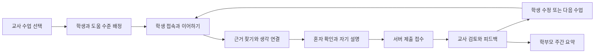

# ReadX-Ray 전체 UI UX 개선 및 기능 확장 실행 계획

<!-- readx-document-context -->
> 작성 당시의 설계·조사·구현 기록입니다. 현재 기능과 운영 상태는 최신 현황을 우선합니다. [문서 목차](README.md) · [최신 현황](PROJECT_STATUS.md)


작성일: 2026년 10월 14일 · 대상: 제품 기획, 디자인, 개발, 콘텐츠 편집, 교육 검수 담당자

후속 실행 기준은 [2026년 10월 15일 전체 UI UX와 사고구술 학습 경험 개선 계획](./READ_LEARNEY_UIUX_REPORT_PLAN_2026-10-15.md)을 따른다. 대표 수업의 생각 시범, 어노테이션, 이유와 설명 연결, 간단한 수정 비교는 P0로 우선한다. 아래의 초기 F10·F18 우선순위, 학년별 검증 순서와 일정은 후속 계획에서 조정한 범위에 한해 새 기준을 적용한다.

**첫 목표는 교사가 배정한 한 수업을 학생이 끝내고, 실제 수행 근거가 교사 검토와 학부모 리포트까지 이어지게 만드는 것이다.** 학생에게는 다음 행동이 분명한 읽기 화면을, 교사에게는 수업 운영과 답안 검토 시간을 줄이는 도구를, 학부모에게는 아이가 실제로 읽고 쓴 내용을 보여준다.

기존 [학원과 공부방용 제품 개발 계획](./ACADEMY_PRODUCT_ROADMAP_2026-10-14.md)의 출시 방향을 유지한다. 이 문서는 그 방향을 화면 설계, 기능별 완료 기준, 개발 순서로 구체화한 실행 기준안이다. **학생 태블릿, 교사 PC, 학부모 모바일을 우선 지원하고 초3~4 파일럿부터 검증한다.** 초1~6 콘텐츠 구조는 유지하되 검수된 범위만 운영에 공개한다. 일정·인력·성과 목표는 아래의 가정에 따른 제안이다.

제품의 중심은 **세부목표에 따른 진단·처방과 읽기 사고 과정 학습**이다. 초1~6 전 교과 개념을 활용하는 지문 은행은 같은 읽기 기능을 다양한 소재에서 연습하고 확인하는 기반으로 확장한다. 초3~4는 첫 사용성·운영 검증 범위이며 장기 콘텐츠 범위를 제한하지 않는다. [목표·사고 과정·교과 지문 설계](./GOAL_PROCESS_CONTENT_STRATEGY.md)의 구분을 화면과 데이터에 적용한다.

## 1 먼저 결정할 제품 방향

| 결정 | 실행 방향 | 이유 |
| --- | --- | --- |
| 핵심 사용자 경험 | 배정 → 이어하기 → 근거 찾기 → 생각 연결 → 자기 설명 → 제출 → 교사 검토 | 개별 기능보다 한 수업의 완결이 도입 가치를 만든다 |
| 학생 첫 화면 | 가장 먼저 할 수업 한 개와 큰 시작 또는 이어하기 버튼 | 모드와 게임 중 무엇을 선택할지 고민하는 시간을 줄인다 |
| 읽기 화면 | 본문과 현재 활동에 집중하고 보조 도구는 필요할 때 펼침 | 지문·활동·도움 사이의 이동을 단순하게 만든다 |
| 진단 결과 | 첫 응답, 근거 선택, 도움 수준, 자기 설명을 구분해 표시 | 점수 하나로 관찰하지 않은 능력까지 해석하지 않는다 |
| 교사 첫 화면 | 오늘 수업, 도움 요청, 제출·검토 대기 | 수업 중 조치와 수업 후 피드백에 바로 연결된다 |
| 학부모 첫 화면 | 이번 주 배운 점, 실제 수행 예시, 교사 코멘트, 다음 도움 | 복잡한 지표를 해독하지 않고 학습 내용을 이해한다 |
| 추가 기능 순서 | 계정·배정·저장·제출 → 교사 검토 → 근거 리포트 → 복습·추천 | 기록의 신뢰를 갖춘 뒤 개인화 기능을 확장한다 |
| 첫 출시에서 보류 | 공개 경쟁, AI 자동 확정 채점, 표준화 CAT, 시선 추정, 완전한 오프라인 | 콘텐츠·측정·운영 검증이 선행되어야 한다 |

## 2 현재 구현과 개선 출발점

### 2.1 확인 범위와 최신 상태

현재 작업 폴더의 수정 중인 코드를 기준으로 확인했다. 이전 [상용화 점검 보고서](./COMMERCIAL_READINESS_AUDIT_2026-10-14.md)는 보완 전 상태를 포함하므로 현재 결함 목록으로 그대로 사용하지 않는다.

| 항목 | 현재 확인 결과 | 계획에 반영할 판단 |
| --- | --- | --- |
| 빌드와 회귀 검사 | `npm run build` 성공. TypeScript, 기존 테스트 10개, Vite 빌드 통과 | 빌드 복구를 신규 과제로 다시 잡지 않는다 |
| 콘텐츠 렌더 | 기존 테스트에서 설명문 96개 × 5개 활동의 정적 렌더 480건과 공통기초 36개 렌더 성공 | 화면이 열린다는 근거이며 전체 조작·교육 품질 검증은 별도다 |
| 과제 연결 | 존재하지 않는 수업·다른 학년·파손된 편집본의 대체 연결을 막는 검사 통과 | 실제 학생별 배정과 서버 권한을 다음 단계로 연결한다 |
| 체험 구분 | 공통 체험 안내, 체험 저장소 분리, 임의 완료·점수 가산 억제 | 운영 데이터와 체험 데이터를 분리하는 방향을 유지한다 |
| 쓰기 | 자유 응답 화면과 기기 내 초안 저장 존재 | 쓰기를 새로 만드는 대신 초안·수정본·교사 검토·제출로 확장한다 |
| 구조도 | 테스트상 77개 설명문 슬롯은 정답 채점형이 아닌 참고 자료형 | 보기 활동을 수행·숙련 완료로 집계하지 않는다 |
| 사고 과정 기록 | `ProcessObservation` 타입과 `summarizeProcessEvidence` 집계 함수 존재 | 실제 학습 이벤트 수집과 화면 연결이 필요하다. 함수만으로 운영 기능이 완성된 것은 아니다 |
| 콘텐츠 자료실 | 목표·개념·지문 분리 모델과 관리자 목록 존재 | 검수 상태, 다중 지문, 게시 버전을 연결한다 |
| 서비스 기반 | 인증·클라우드 동기화 미구현. 역할 전환은 로컬 상태 | 기관·학생·보호자 관계와 실제 API를 출시 선행 과제로 둔다 |
| 번들 | 단일 HTML 약 2,388 KB, gzip 약 548 KB로 빌드됨 | 자료실·운영 화면·콘텐츠의 분할 로딩을 검토한다. 현재 수치는 전송 시간 측정치가 아니다 |

브라우저에서는 랜딩, 학생 과제함과 독서 화면, 교사 기본 화면, 학부모 기본 화면을 확인했다. 학생 읽기는 768×1024 세로 뷰포트, 학부모는 390×844 뷰포트도 확인했다. 실제 iPad·Android 기기의 터치·가상 키보드·TTS와 현장 사용자는 후속 검증 대상이다.

### 2.2 화면별 관찰과 개선

| ID | 현재 관찰 | 사용자에게 생기는 문제 | 개선 |
| --- | --- | --- | --- |
| U01 | 학생 헤더의 4개 모드와 CAT, 과제함의 3개 탭과 2개 게임이 함께 노출됨 | 처음 시작할 행동을 여러 기능 중에서 고르게 됨 | 오늘의 학습 중심 홈, 게임은 학습 완료 뒤 선택 활동으로 이동 |
| U02 | 독서 화면의 기본 활동이 객관식이며 근거·구조도·생각·쓰기가 별도 탭임 | 필요한 학습 순서를 학생이 추론해야 함 | 목표별 단계 안내와 현재 단계의 주 행동을 제공 |
| U03 | 768px 세로 화면에서는 본문이 먼저 쌓이고 활동이 아래로 내려감. 헤더도 좁아짐 | 지문과 답안 사이를 긴 스크롤로 이동 | 본문·활동 전환, 선택 근거 요약, 위치·초안 유지 |
| U04 | 여러 탐색·설명 문구가 10~12px 수준이고 영어 표제·내부 코드가 섞여 있음 | 핵심 안내와 조작을 읽기 어려움 | 학년군별 읽기·조작 크기, 쉬운 한국어, 코드의 상세 영역 이동 |
| U05 | `completeStudentAssignment`가 비어 있고 과제는 체험 배열에 저장됨 | 실제 제출·교사 접수·검토 완료 흐름이 없음 | 배정과 세션을 연결한 제출 상태·접수증 구현 |
| U06 | 교사 화면에 재적 10명과 25명·22명 완료·18명 접속 문구가 함께 보임 | 예시 화면의 숫자끼리도 의미가 충돌함 | 하나의 반·수업 데이터에서 상태를 집계하고 갱신 시각 표시 |
| U07 | 학부모 화면에 고정 성장 추이와 예시 진단·백분위가 남아 있음 | 실제 수행과 예시 지표의 관계를 파악하기 어려움 | 실제 근거 중심 요약과 관찰 부족 상태. 체험에는 카드별 예시 표시 |
| U08 | 학원장 화면이 문항 CMS와 좌석 관리를 함께 포함함 | 기관 운영 업무와 공용 콘텐츠 편집 업무가 혼재 | 원장 운영 화면과 플랫폼 편집자 화면을 분리 |
| U09 | 단서 강조가 무한 반복 애니메이션이며 본문 선택은 `onMouseUp` 경로가 있음 | 집중 방해 가능성, 터치와 키보드 대안 확인 필요 | 짧은 강조, 모션 감소 설정, 문장 탭·키보드 선택 대안 |
| U10 | 역할과 화면이 URL 대신 앱 상태로 전환됨 | 재접속·뒤로 가기·학생 답안 바로 열기의 맥락 관리가 어려움 | 권한 검사와 연결한 화면 경로·복귀 위치 설계 |

U01~U08의 상태는 화면 및 코드 관찰에 근거한다. 선택지 과다로 인한 이탈, 안내 이해도, 교사 시간 절감의 크기는 사용자 조사로 검증할 가설이다. U09는 모든 실제 기기에서 실패했다는 판정이 아니라 대체 조작과 접근성 검사가 필요한 구현 근거다.

## 3 외부 조사에서 채택할 설계

공식 기능 설명과 접근성 지침을 기준으로 비교했다. 해외 영어 읽기 서비스의 기능을 한국어 문해력 향상 효과나 국내 시장 수요의 증거로 사용하지 않는다.

| 사례와 확인한 사실 | ReadX-Ray 적용안 | 적용 범위와 제한 |
| --- | --- | --- |
| CommonLit은 읽기 중 확인 질문을 제공하고 교사가 학생별 Guided Reading 적용을 선택할 수 있다. 시도 횟수도 보고한다. [공식 안내](https://support.commonlit.org/article/459-what-is-guided-reading-mode-how-can-i-enable-it) | 교사가 단계별 안내 수준을 배정에 설정하고 학생의 도움·시도를 기록 | 전체 본문을 무조건 잠그는 방식은 도입하지 않는다. 본문 재확인은 가능하게 유지 |
| CommonLit은 연습용 Guided Reading 질문과 평가 질문을 구분하고 연습 질문을 과제 총점에 넣지 않는다. [질문 유형](https://support.commonlit.org/article/424-what-are-the-differences-between-a-guiding-question-an-assessment-question-and-a-discussion-question) | 함께 연습·혼자 확인·새 글 적용 결과를 별도 표시 | 연습 완료를 곧바로 독립 수행 성공으로 환산하지 않음 |
| CommonLit은 주석 자동 저장, 교사의 주석 조회, 문단별 읽어주기와 재생 위치 복귀를 안내한다. [학생 사용 안내](https://support.commonlit.org/article/673-how-do-i-complete-my-assignment) | 단서와 메모를 답안에 연결하고 읽던 위치·음성 위치를 복구 | 실제 기기 지원 범위를 확인하고 음성이 없을 때 텍스트 안내 제공 |
| Lexia는 Skill Check를 다른 수행 기록과 함께 해석하고 교사 지원으로 연결한다. 낮은 점수가 항상 즉시 진도를 정지시키는 것은 아니다. [Core5 안내](https://community.lexialearning.com/core5-faqs-85/my-student-got-a-lower-score-on-a-skill-check-why-are-they-still-advancing-in-core5-1903) | 추천 이유와 수행 근거를 교사에게 보여주고 교사가 다음 과제를 조정 | 기존 조사 문서의 ‘Skill Check 통과만으로 일괄 진도·숙련 판정’ 설명은 단순화하지 않도록 보정 |
| ReadWorks의 Article-A-Day는 관련 주제의 글을 읽거나 듣고, 배운 내용을 기록하고 공유하는 흐름이다. [공식 수업 루틴](https://about.readworks.org/article-a-day-routine.html) | 교과 개념 읽기 → 내 말로 설명 → 누적 생각 기록장 | 영어 단어 수 기준이나 운영 기간을 한국어 수업에 그대로 옮기지 않음 |
| EBS 공식 교재 로드맵은 문해력을 어휘·쓰기·독해·배경지식·디지털 독해 영역으로 구성한다. [교재 로드맵](https://primary.ebs.co.kr/file/download?fileId=50&view=Y) | 교과 배경지식과 읽기 기능을 함께 다루고 쓰기를 수업 결과물로 연결 | 국내 콘텐츠 구성 참고. EBS의 앱 UX나 학습 효과를 검증한 비교는 아님 |
| CAST UDL은 참여, 정보 제시, 행동과 표현의 다양한 방법을 설계한다. [UDL Guidelines](https://udlguidelines.cast.org/) | 글자 조절·음성·문장 틀·단계 안내를 선택하고 필요 도움을 기록 | 같은 접근성 지원을 썼다는 이유로 일률적인 감점이나 능력 낙인을 하지 않음 |
| WCAG 2.2는 초점·조작·대비·상태 전달 등의 접근성 기준을 제공한다. [W3C 기준](https://www.w3.org/WAI/WCAG22/quickref/) | 공통 컴포넌트와 읽기 활동의 수용 기준에 접근성을 포함 | 자동 점검 외에 키보드·스크린리더·실기기 검증 필요 |

**차별화할 기능은 ‘어떤 교과 개념의 글에서, 어떤 문해력 목표를, 어느 정도 도움을 받아 수행했는가’를 연결하는 수업 기록이다.** 목표 하나를 서로 다른 교과 소재와 지문에서 연습하게 하고, 실제 단서·설명·수정 기록으로 변화를 보여준다. 이 방향은 위 사례와 기존 교육 철학을 결합한 제품 제안이다.

## 4 정보 구조와 사용자 여정

### 4.1 역할별 메뉴

| 역할 | 기본 메뉴 | 첫 화면의 주 행동 | 상세 영역으로 이동할 정보 |
| --- | --- | --- | --- |
| 학생 | 오늘의 학습, 나의 기록, 내 단어장 | 이어하기 또는 시작하기 | 목표 코드, 점수 산식, 콘텐츠 기술 유형 |
| 교사 | 오늘 수업, 우리 반, 수업 자료, 검토함, 학생 기록 | 수업 배정 또는 제출 답안 검토 | 교육과정 코드, 영역별 분석, 상세 이벤트 |
| 원장 | 운영 현황, 반·교사·학생, 이용권, 상담 자료, 기관 설정 | 등록·이용·상담 관련 조치 | 청구 이력, 권한 이력, 기관별 집계 |
| 학부모 | 이번 주, 학습 기록, 선생님 의견 | 자녀의 실제 수행 예시 확인 | 영역별 세부 결과, 과거 리포트 |
| 플랫폼 편집자 | 목표·개념, 지문·활동, 검수함, 게시 버전 | 검수 또는 게시 | 구조 검사와 변경 이력 |

학생과 학부모의 운영 화면에는 성인 역할 선택기를 제공하지 않는다. 공부방 운영자의 원장·교사 전환은 같은 로그인 안의 권한 있는 메뉴로 지원한다. 데모 역할 전환기는 별도 체험 경로에서 유지한다.

### 4.2 실제 수업 흐름



수업에는 목표별 활동 구성이 있다. 모든 목표에 같은 화면 수를 강제하지 않는다. 예를 들어 내용 확인 수업과 W3 개요 조직 수업은 수행 산출물이 다르지만, 목표·도움·응답·검토 상태는 같은 규칙으로 기록한다.

## 5 학생 화면 개선 상세

### 5.1 오늘의 학습과 첫 접속

첫 접속은 기관에서 발급한 학생 접속 수단 → 본인 확인 → 읽기 환경 선택 → 오늘의 수업 순서다. 교사가 이미 배정했다면 긴 소개나 별도 진단으로 막지 않는다. 초기 확인이 필요한 학생에게만 교사가 지정한 짧은 과제를 제시한다.

홈의 첫 카드에는 수업명, 쉬운 학습 목표, 진행 단계, 저장 상태, 주 행동 한 개를 둔다. 진행 중인 수업이 있으면 이어하기가 우선이다. 마감은 실제 날짜로 보여주고, ‘오늘 21시’처럼 시간이 지나도 바뀌지 않는 문자열을 저장하지 않는다.

| 상태 | 화면 문구 예시 | 다음 행동 |
| --- | --- | --- |
| 처음 배정됨 | 오늘은 글에서 이유를 찾아볼 거예요 | 학습 시작 |
| 진행 중 | 생각 연결하기부터 이어할 수 있어요 | 이어하기 |
| 배정 없음 | 선생님이 다음 수업을 준비하고 있어요 | 지난 기록 보기 |
| 제출 접수됨 | 선생님께 답안을 보냈어요 | 내가 쓴 글 보기 |
| 다시 연습 요청 | 선생님이 남긴 한 가지 도움을 확인해요 | 의견 보고 고치기 |
| 모든 배정 완료 | 오늘의 수업을 마쳤어요 | 선택 복습 또는 종료 |

진행률의 분모는 해당 수업의 필수 활동 수로 계산한다. 어휘 게임이나 참고 구조도를 열어 본 횟수로 필수 학습 완료율을 높이지 않는다.

### 5.2 읽기와 활동 화면

**가로 배치**는 본문 약 55~60%, 활동 약 40~45%에서 시작해 한글 줄 길이와 기기에서 조정한다. **세로 배치**는 본문·활동 두 화면을 명확히 전환하고, 활동 화면에서 선택한 근거를 짧게 열어볼 수 있게 한다. 1024px이라는 단일 기준보다 두 패널의 실제 최소 가독 폭을 기준으로 배치를 결정한다.

```text
가로 화면
┌ 수업으로 돌아가기 · 오늘의 목표             저장 완료 · 도움 요청 ┐
│                 근거 찾기 → 생각 연결 → 내 말로 설명              │
├ 본문과 자료                          ┬ 현재 할 활동              ┤
│ 문단·문장 선택                       │ 한 문장 지시문             │
│ 선택한 근거에 번호 표시              │ 응답 또는 구조도           │
│ 어휘·읽어주기·보기 설정               │ 선택 근거 확인             │
│                                      │ 힌트 보기 · 다음 단계      │
└──────────────────────────────────────┴───────────────────────────┘

세로 화면
┌ 돌아가기 · 수업명 · 저장 상태 ┐
│ [본문] [활동]   현재 단계      │
│ 선택한 화면의 내용            │
│ 선택 근거 열기                │
│ 도움 요청        다음 단계    │
└───────────────────────────────┘
```

주요 동작은 다음과 같이 통일한다.

- 문장 탭으로 근거 선택·해제, 상세 선택이 필요하면 구절 범위 선택을 지원한다. 색과 함께 선택 번호·텍스트 상태를 표시한다.
- 형광펜, 평가용 근거 선택, 개인 메모를 데이터와 화면에서 구분한다. 형광펜을 칠한 모든 문장을 정답 근거로 처리하지 않는다.
- 본문·활동 전환, 가로·세로 전환, 키보드 열림 뒤에도 현재 문단·선택·초안을 복구한다.
- 읽어주기는 재생·일시정지·문단 선택·속도 조절을 제공한다. 소리가 나지 않을 때 사용할 수 있는 안내와 다시 시도 경로를 둔다.
- 보기 설정은 글자 크기·행간·테마·집중 보기를 포함한다. 한 기기의 공유 학생 간 설정 적용 범위는 개인 계정과 분리한다.
- 힌트는 ‘다시 살펴볼 위치 → 관계를 잇는 질문 → 시범’ 순으로 제시하고 어떤 도움을 받았는지 기록한다.
- 독립 확인에서도 필수 접근성 지원과 정답을 유도하는 교수적 힌트를 구분한다. 평가 목적에 맞는 지원 규칙을 교사에게 설명한다.

### 5.3 읽기에서 쓰기로 연결

현재 자유 응답을 확장해 **내가 고른 근거 → 관계를 정리한 구조도 → 내 문장 → 고친 문장**을 한 수업 안에서 이어준다. 저학년은 짧은 문장 틀과 선택 보조를, 중학년은 1~3문장 설명을, 고학년은 복수 근거 비교와 단락 구성을 시작안으로 삼는다. 글자 수는 안내로 사용하고 내용 타당성의 자동 점수로 쓰지 않는다.

교사는 ‘근거가 있는가’, ‘관계를 설명했는가’, ‘자기 말로 표현했는가’와 해당 세부목표의 준거로 검토한다. 모든 쓰기에 같은 준거를 일괄 적용하지 않고, W1~W5 목표별 항목을 편집한다. 초안과 수정본, 교사 의견을 함께 보존한다.

### 5.4 보충 학습과 진단

클리닉의 학생 표시명은 ‘다시 함께 연습하기’로 바꾸고 연습 이유를 행동으로 설명한다. 예: ‘답은 골랐어요. 그 답을 뒷받침하는 문장을 한 번 더 찾아볼까요?’

초기 확인 화면은 짧은 사용법 연습, 쉬운 안내, 중단·이어하기, 결과의 다음 행동으로 구성한다. 교정되지 않은 초기 문항 풀을 공인 CAT나 표준화 능력 지수로 표시하지 않는다. CBT 화면은 첫 출시에서는 교사가 배정하는 ‘혼자 확인하기’로 정리하고, 고학년 시험 모드의 타이머·OMR 확장은 후속으로 둔다.

### 5.5 세부목표별 진단과 처방의 화면

교사에게는 목표명 → 관찰한 수행 → 추가로 확인할 점 → 지도 후보 → 교사 선택을 이어 보여준다. 정밀함은 복잡한 차트의 수보다 판단 근거를 확인하고 틀린 해석을 바로잡을 수 있는 데서 나온다.

| 수행 관찰 예시 | 추가 확인 | 제안할 지도 후보 | 화면에서 피할 단정 |
| --- | --- | --- | --- |
| 답은 맞았지만 근거를 고르지 못함 | 근거 찾는 방법과 우연한 정답 가능성을 추가 관찰 | 본문 위치 찾기와 답·근거 연결 | ‘이 기능 완전 숙달’ |
| 근거는 찾지만 원인과 결과를 바꿈 | 두 명제와 연결어의 의미를 구분하는지 확인 | 인과 방향 비교와 짧은 사고 시범 | ‘전반적 독해력 부족’ |
| 힌트 뒤 성공 | 다른 문장과 새 글에서 도움 없이 수행하는지 확인 | 같은 기능의 안내 축소 연습 | 독립 정답과 같은 성취 처리 |
| 익숙한 글에서 성공하고 새 교과 소재에서 어려움 | 소재 어휘·배경지식 부담과 읽기 기능을 구분 | 어휘 준비 또는 같은 목표의 다른 소재 | ‘전이 실패 원인은 하나’ |
| 답·근거는 적절하나 자기 설명이 미완성 | 내용 이해와 문장 표현을 나누어 검토 | 관계를 문장으로 만드는 연습 | ‘읽기와 쓰기 모두 결손’ |

위 표는 지도 후보를 만드는 설계 예시다. 목표별 수행 준거·최소 관찰 수·상충 응답 처리·재확인 조건을 교육 담당이 정하고 버전 관리한다. 기록이 부족하면 ‘추가 확인 필요’를 표시한다. 첫 버전은 교사가 관찰을 검토해 처방을 선택하며, 자동 추천의 확대는 F16에서 검증한다.

## 6 교사와 원장 화면 개선 상세

### 6.1 오늘 수업과 배정

상단에서 기관·반·수업을 먼저 선택한다. 현재 화면의 학년별 버튼 나열은 수업 자료의 필터로 이동한다. 오늘 수업에는 학생별 ‘미시작·학습 중·도움 요청·제출·검토 완료’를 보여주고, 연결 정보에는 마지막 수신 시각을 병기한다. 접속 신호를 읽기 집중이나 시선으로 해석하지 않는다.

배정은 **수업 선택 → 학생 선택 → 일정·도움 설정 → 미리보기 → 배정 결과**의 흐름으로 만든다. 반 전체와 일부 학생을 선택할 수 있고, 중복 배정·비활성 학생·이용권 만료·콘텐츠 미게시 상태를 확인한다. 일부 배정만 실패하면 성공한 학생과 실패한 학생을 따로 보여주고 실패 건만 재시도한다.

수업 자료 카드는 목표, 소재, 학년군, 예상 활동, 교사용 지도안, 게시 상태를 보여준다. ‘어떤 능력을 연습하는가’와 ‘무슨 주제의 글인가’를 별도 필터로 제공한다.

### 6.2 도움 요청과 검토함

학생이 도움을 누르면 현재 활동과 선택 근거를 교사에게 연결한다. 동일 활동의 반복 요청은 하나로 묶고, 접수·확인·해결 상태를 보여준다. 수업 중 과도한 실시간 알림을 피하도록 소리와 묶음 표시를 설정한다.

검토함은 학생 목록과 선택 답안을 나란히 배치한다. 교사는 원문 근거, 첫 응답, 사용한 도움, 자기 설명, 수정 이력을 같은 화면에서 본다. 빠른 코멘트는 초안으로 삽입하고 실제 응답에 맞게 수정한 후 저장한다. 일괄 코멘트를 쓰더라도 학생별 제출·검토 상태가 구분되어야 한다.

검토 결과는 ‘확인 완료’, ‘한 번 더 연습’, ‘추가 관찰’로 제안한다. ‘위험군’이나 ‘찍기’ 대신 관찰한 행동과 필요한 지원을 표시한다. 학생에게는 한 번에 고칠 핵심 한 가지를 우선 전달한다.

### 6.3 기관 운영

원장 화면에는 기관 설정, 반·교사·학생 관리, 학생 접속 카드, 보호자 연결, 이용 기간·좌석, 상담 리포트를 둔다. 학생 명단 가져오기는 업로드 전에 미리보기, 중복·누락 확인, 행별 오류 수정, 처리 결과를 제공한다. CSV 가져오기를 먼저 구현하고 XLSX는 실제 기관 요구에 따라 확장한다.

플랫폼 공용 콘텐츠 편집과 진단 규칙 변경은 플랫폼 편집자 권한으로 분리한다. 초기 수동 계약·청구를 지원하되 이용 기간·좌석 상태와 수납 관련 운영 기록을 남긴다. 정기 결제 자동화는 실제 판매 방식 확인 후 추가한다.

## 7 학부모 화면과 리포트

모바일 기본 화면은 자녀·기간 선택과 세 개의 요약으로 시작한다. ‘이번 주 배운 것’, ‘실제로 한 것’, ‘다음에 도울 것’ 아래에 교사가 확인한 근거와 학생 문장을 보여준다. 상세 차트는 펼쳐 볼 수 있게 하고 항상 기간·관찰 횟수·도움 수준을 설명한다.

예시 구성은 다음과 같다. 아래 내용은 문구 시안이며 실제 학생 결과가 아니다.

> 이번 주에는 원인과 결과를 연결하는 글을 읽었어요.
>
> 새 글에서 이유를 나타내는 문장을 혼자 골랐어요. 이유를 자기 문장으로 설명할 때는 문장 틀을 이용했어요.
>
> 집에서는 “왜 그런 일이 일어났을까? 글에서 찾은 문장을 알려 줄래?”라고 물어봐 주세요.

리포트 발행은 교사 검토 여부와 연결한다. 결과가 부족하면 ‘아직 살펴볼 기록이 적어요’를 표시하고 빈 레이더를 0점으로 채우지 않는다. 보조를 사용한 수행과 독립 확인 결과를 구분하며 같은 문항 반복으로 생긴 점수 차이를 성장으로 강조하지 않는다.

첫 출시에서는 인증 후 조회와 A4 인쇄를 제공한다. 가정 질문은 목표별 검수 문구에서 선택하고 교사가 수정할 수 있게 한다. 알림톡·문자·이메일 발송은 외부 서비스 연결과 수신 설정을 갖춘 후 추가한다. 링크를 공유하더라도 보호자 연결 관계를 확인하고, 만료·회수·권한 없음 상태를 제공한다.

## 8 디자인 시스템과 접근성

### 8.1 시각 기준안

기존 네이비·파랑과 따뜻한 종이색을 유지하고 장식보다 내용 위계를 정리한다. 학생의 읽기 화면과 성인의 관리 화면은 밀도를 달리하되 상태·버튼·폼은 같은 규칙을 사용한다.

| 요소 | 제안 기준 | 확인 방법 |
| --- | --- | --- |
| 학생 본문 | 초1~2 22~24px, 초3~4 20~22px, 초5~6 18~20px부터 검토. 사용자 확대 허용 | 실제 지문을 실제 태블릿에서 읽기 |
| 지시문과 버튼 | 학생은 16px 이상을 시작안으로 사용. 핵심 설명을 10~12px로 축소하지 않음 | 오독·재질문·오탭 관찰 |
| 성인 본문 | 기본 16px, 표·보조 정보는 최소 14px부터 검토 | PC와 스마트폰에서 확대 없이 확인 |
| 줄간격 | 본문 1.7~1.9부터 조정. 문단 간격과 줄 길이 함께 검토 | 학년군·글 길이별 읽기 실험 |
| 주 행동 | 화면당 한 개를 가장 강하게 표시 | 다음 행동을 설명 없이 고르는지 확인 |
| 터치 영역 | 내부 설계 목표 44×44px 이상, 저학년 주요 조작 48~56px | 터치·키보드 동작 확인 |
| 표와 카드 | 학생별 목록은 표, 수행 예시는 카드. 카드 중첩·배지 중복 축소 | 정보 찾기 시간과 스크롤량 |
| 색상 | 기본 파랑, 성공 청록, 참고 노랑. 오류는 문장·아이콘 병기 | 모든 상태의 실제 색 조합 대비 검사 |
| 모션 | 결과 변화에 짧게 사용. 무한 점멸 제거, 모션 감소 설정 존중 | 집중 보기와 감소 설정 확인 |

위 크기는 제품 설계 시작값이며 학년별 효과가 입증된 고정 기준은 아니다. WCAG 2.2 AA의 최소 포인터 대상 기준은 예외·간격 조건을 포함한 **24×24 CSS px**이고, 본 제품의 44px 목표와 구별한다. [W3C 대상 크기 설명](https://www.w3.org/WAI/WCAG22/Understanding/target-size-minimum).

### 8.2 공통 컴포넌트

우선 구축할 공통 요소는 Button, FormField, Tabs, Dialog, Drawer, StatusBadge, SaveStatus, EmptyState, ErrorState, DataTable, LessonStepper, EvidenceSelector, FeedbackCard, ReportCard다. 토큰은 색상·글자·간격·모서리·초점·레이어·모션·반응형으로 나눈다.

각 컴포넌트는 기본, 초점, 선택, 비활성, 로딩, 실패 상태를 포함한다. 토스트만으로 중요한 배정·제출 결과를 전달하지 않고 화면 안에도 상태를 남긴다. 대화상자는 제목·초점 이동·초점 복귀·키보드 닫기를 제공한다.

### 8.3 필수 접근성 수용 기준

- 일반 텍스트 대비 4.5:1, 큰 텍스트 3:1, 필요한 비텍스트 조작 경계 3:1을 확인한다. [WCAG 기준](https://www.w3.org/WAI/WCAG22/quickref/)
- 키보드만으로 수업 시작, 근거 선택, 구조도 조작, 입력, 제출, 검토가 가능하고 현재 초점이 가려지지 않아야 한다.
- 드래그 활동에는 탭으로 선택 후 배치하는 방식 등 드래그 없는 포인터 대안과 키보드 대안을 제공한다. [W3C 드래그 기준](https://www.w3.org/WAI/WCAG22/Understanding/dragging-movements)
- 색만으로 정오답·선택·검토 필요 상태를 전달하지 않는다. 차트에는 동일 정보의 표·문장 요약을 둔다.
- 200% 확대, 좁은 화면, 가상 키보드 표시에서 입력과 주 행동이 가려지지 않게 한다. 복잡한 표·도해를 제외한 기본 내용은 가로 스크롤을 요구하지 않는다.
- 읽어주기 지원 여부와 관계없이 의미 있는 레이블, 제목 구조, 상태 알림을 스크린리더로 확인한다.

## 9 추가 기능 백로그와 완료 기준

**P0는 실제 학생 파일럿 전 필수**, **P1은 첫 유료 운영 범위**, **P2는 파일럿 뒤 확장**이다. 규모 S/M/L은 각각 대략 2~4일/1~2주/2~4주의 개발 작업 크기 가설이며, 콘텐츠 검수·디자인·QA와 병행 작업을 포함한 확정 견적이 아니다. 백로그 합계를 그대로 달력 일정으로 사용하지 않는다.

### 9.1 P0 실제 수업을 연결하는 기능

| ID | 기능과 구현 범위 | 완료 기준 | 선행 | 규모·주 담당 |
| --- | --- | --- | --- | --- |
| F01 | 기관·반·회원·역할·보호자 연결, 학생 간편 접속 | 다른 기관·학생·연결되지 않은 자녀에 대한 읽기·쓰기가 API에서 거부됨. 접속 만료·재발급 경로 있음 | 관계 모델 | L · 백엔드 |
| F02 | 역할별 메뉴, URL 경로, 데모 경로 분리 | 직접 링크·새로고침·뒤로 가기에서 권한과 수업 맥락 유지. 학생에게 성인 메뉴 미노출 | F01, 디자인 토큰 | M · 프론트 |
| F03 | 반·학생별 배정과 수정·취소 | 게시 수업 버전·대상·마감 확인. 중복·부분 실패 결과 표시. 배정받은 학생에게만 보임 | F01, F08 | L · 백엔드·프론트 |
| F04 | 세션·자동 저장·이어하기·제출 | 마지막으로 저장됐다고 표시한 응답이 재접속 후 복구됨. 중복 제출은 한 접수로 처리. 서버 접수 전 완료 표시 금지 | F01, F03 | L · 백엔드·프론트 |
| F05 | 단계형 읽기 화면과 반응형·접근성 조작 | 본문·활동 전환과 화면 회전 뒤 근거·초안·읽던 위치 유지. 키보드·탭으로 주요 활동 가능 | F02, F04, 대표 수업 | L · 프론트·디자인 |
| F06 | 근거·도움·첫 응답·쓰기 산출물 기록 | 모든 수행이 학생·배정·수업 버전·활동에 연결. 연습·독립 확인·새 글 적용을 구분. 중복 수신은 중복 집계하지 않음 | F04, F05 | M · 백엔드·교육 |
| F07 | 교사 검토함과 학생 수정 요청 | 원문 근거·응답·도움·수정본을 같은 화면에서 검토. 검토 상태가 학생 화면에 일치 | F06 | M · 프론트·백엔드 |
| F08 | 승인 콘텐츠와 게시 버전 | 구조 검사와 교육·출처 검수가 구분됨. 미승인 자료 배정 차단. 이미 배정한 수업은 게시본 수정으로 변하지 않음 | 콘텐츠 모델 | L · 콘텐츠·백엔드 |

### 9.2 P1 첫 유료 운영을 완성하는 기능

| ID | 기능과 사용자 가치 | 완료 기준 | 선행 | 규모·주 담당 |
| --- | --- | --- | --- | --- |
| F09 | 도움 요청과 교사 수업 현황 | 학생 요청·교사 확인·해결 상태 연결. 마지막 갱신 시각과 연결 끊김 표시. 난수 관제 제거 | F03~F06 | M · 프론트·백엔드 |
| F10 | 생각 시범과 단계별 도움 | 목표별 시범·유도 질문·힌트가 검수됨. 시범을 본 활동과 독립 수행을 구분 | F05, F06, F08 | M · 교육·콘텐츠 |
| F11 | 목표별 새 지문 적용 확인 | 대표 목표에 연습용과 다른 지문 확보. 이미 학습한 지문 제외. 미지문이 없으면 교사에게 명시하고 반복을 새 적용으로 표시하지 않음 | F06, F08 | L · 콘텐츠·교육 |
| F12 | 학부모 주간 리포트와 인쇄 | 교사가 확인한 수행을 근거로 생성. 기간·관찰 수·도움·교사 의견 표시. 자녀 권한 검사. A4 출력 잘림 없음 | F01, F07 | M · 프론트·백엔드 |
| F13 | 오답·도움 기반 복습함과 문맥 단어장 | 다시 연습할 이유와 관련 원문 제공. 단어 뜻 선택 뒤 새 문맥 활용까지 연결. 복습 이력이 보존됨 | F06, F08 | M · 프론트·교육 |
| F14 | 기관 운영과 수동 이용권 | 학생 등록·중복 확인·비활성·좌석·만료 상태 연결. 오류 행만 재처리. 만료 시 작성 답안을 잃지 않음 | F01 | M · 백엔드·운영 |
| F15 | 수업 자료 탐색과 운영 템플릿 | 목표·교과 개념·학년군·구조·게시 상태별 검색. 지도안과 학생 화면 미리보기. 기존 배정 복제 시 대상·마감 재확인 | F03, F08 | M · 프론트·콘텐츠 |
| F23 | 세부목표별 관찰 요약과 교사 처방 | 목표별 준거·관찰 수·도움·상충 증거 표시. 지도 후보의 근거를 열어볼 수 있고 교사 선택·변경 사유와 규칙 버전 기록 | F06, F08, F10, F11 | M · 교육·백엔드·프론트 |

### 9.3 P2 현장 검증 후 기능 확장

| ID | 기능 | 도입 조건 | 첫 범위 |
| --- | --- | --- | --- |
| F16 | 교사가 조정하는 맞춤 추천 | 목표별 기록과 검수 지문이 충분하고 추천 사유를 설명할 수 있음 | 보충 후보 1~3개와 사유, 교사 선택·제외 이력 |
| F17 | 어휘 간격 복습 | F13의 실제 사용과 문맥 활동 품질 확인 | 틀리거나 도움 받은 단어 우선, 교사 조정 가능한 복습 일정 |
| F18 | 학생 생각 포트폴리오 | 비교 가능한 초안·수정본이 누적됨 | 같은 목표의 과거·현재 산출물 비교와 학생 회고 |
| F19 | AI 교사 보조 | 검수 준거·대표 답안·평가 자료·사용 정책과 비용 한도 확보 | 응답 근거를 인용하는 코멘트 초안. 교사 확인 뒤 반영 |
| F20 | 알림 자동화와 상담 일정 연계 | 실제 수신 요구, 외부 채널 연결, 실패·중복 전송 관리 확보 | 검토 완료·리포트 발행 알림, 수신 설정·재전송 |
| F21 | 동기 유발 확장 | 수업 완료 경험과 복습 재방문을 먼저 검증 | 개인 목표와 성취 기록. 공개 순위·속도 경쟁은 별도 실험 |
| F22 | 기관·지점 확장과 정기 결제 | 기관 운영·이용권·청구 방식 안정화 | 다지점 보기, 이용권 자동 갱신, 외부 관리 서비스 연계 |

AI는 학생의 성취를 확정하거나 교사 없이 자유 응답을 최종 채점하는 기능으로 시작하지 않는다. 먼저 교사 검토 시간과 제안 수정률을 측정한다. 온디바이스 AI·음성 사고구술 자동 분석·시선 추정은 별도 타당성 검토 과제다.

## 10 데이터와 상태 설계

### 10.1 실제 운영의 연결 단위

현재 React·TypeScript·Tailwind·Zustand는 유지한다. UI 상태, 서버 원본 데이터, 기기 임시 초안을 구분하고 `useCoursewareStore` 하나에 모든 운영 데이터를 넣는 구조를 점진적으로 분리한다. 서버 제품은 기존 계획의 Firebase 후보를 포함해 권한·비용·조회·운영 요구로 결정한다.

핵심 연결은 `organizationId → classId → assignmentId → studentId → lessonVersionId → sessionId → activityId → attemptId`다. 보호자 연결, 교사 피드백, 리포트는 이 근거를 참조한다. `goalId`는 문해력 목표, `conceptId`는 교과 개념 소재, `passageId`는 실제 지문을 나타내며 서로 대체하지 않는다.

| 현재 자산 | 확장 방향 |
| --- | --- |
| `lessonCatalog.ts`, `contentSchema.ts` | 정규화·참조 검사 유지, 승인된 게시 버전 조회로 연결 |
| `contentLibrary.ts`, `types/contentLibrary.ts` | 목표·개념·지문의 다대다 연결, 선수 관계, 실제 출처와 검수 이력 |
| `processEvidence.ts` | 실제 이벤트 수집기·서버 검증·리포트 집계에 연결 |
| `GuidedResponse.tsx`, `WritingWorkbench.tsx` | 기기 초안에서 학생·배정별 초안·제출·수정본 관리로 확장 |
| 역할별 JourneyHub | 오늘 수업·검토함·모바일 리포트의 화면 단위로 분리 |
| `firebaseDbService.ts` | 데모 저장·조회와 실제 원격 저장·조회 경로 구분 |

### 10.2 저장과 제출 상태

학습 진행 상태와 네트워크 저장 상태는 따로 둔다. 예를 들어 ‘생각 연결 중’인 학생도 ‘기기 저장 완료·서버 전송 대기’ 상태일 수 있다.

| 상황 | 사용자 표시 | 처리 원칙 |
| --- | --- | --- |
| 작성 중 | 저장 중 | 입력을 막지 않고 마지막 저장 시각 확인 가능 |
| 로컬 저장 성공·연결 없음 | 이 기기에 저장했어요. 연결되면 보낼게요 | 서버 제출 완료로 표시하지 않음 |
| 서버 임시 저장 성공 | 저장 완료 | 서버 버전·시각 보존 |
| 제출 요청 중 | 선생님께 보내는 중 | 연속 클릭은 같은 요청으로 처리 |
| 접수 성공 | 제출 완료 | 접수 ID·시각과 제출 답안 확인 제공 |
| 접수 실패 | 아직 보내지 못했어요 | 답안 유지, 재시도·문의 경로 |
| 교사 검토 대기 | 선생님 확인을 기다려요 | 학생의 성취 확정 상태와 구별 |
| 동시 기기 충돌 | 다른 기기에 더 최근 기록이 있어요 | 자동 덮어쓰기 대신 버전 확인과 복구 |
| 콘텐츠 회수·권한 만료 | 수업을 계속할 수 없어요 | 임시 응답 보존, 교사·기관 확인 경로 |

공유 태블릿 로그아웃에서는 해당 학생의 화면·초안 캐시 접근을 종료하고 다음 학생에게 이전 응답이 보이지 않게 한다. 미전송 답안이 있다면 먼저 복구 가능한 상태를 확보한다. 초기 지원은 온라인 수업과 연결 장애 시 초안 보존으로 한정한다.

### 10.3 콘텐츠와 결과의 신뢰

콘텐츠 상태는 작성 → 구조 검사 → 교육 내용 검수 → 출처 검수 → 승인 → 게시로 구분한다. 기존 데이터의 `published` 표기와 실제 교육·출처 승인 상태를 통합 정리하기 전에는 운영 배정 가능 여부로 단독 사용하지 않는다.

게시본은 불변 버전으로 두고 수정은 새 버전을 만든다. 기존 과제는 기존 버전을 참조한다. 문장 ID와 근거 범위를 버전에 종속시켜 원문 변경으로 학생의 근거 표시가 다른 문장에 붙지 않게 한다.

추천과 리포트에 필요한 최소 자료는 첫 응답, 근거, 도움 유형, 연습·확인 구분, 새 지문 여부, 교사 검토 결과다. 읽기 시간은 수업 운영 참고로 사용하며 그것만으로 성실성·집중력·문해력 수준을 확정하지 않는다.

### 10.4 전 교과 지문 은행의 관리 화면

콘텐츠 자료실은 ‘목표에서 찾기’와 ‘교과 개념에서 찾기’ 두 진입을 제공한다. 초1~6 전체 교과 목록화는 진행하되 검수된 수업부터 공개한다. 기존 96개 개념 후보는 원문 대조를 마친 전국 교육과정 전체 개념 목록으로 표시하지 않는다.

편집자는 교과·학년군·개념·문해력 목표별로 승인 지문 수와 빈 영역을 확인한다. 지문 카드에는 구조·난도 검토·용도·사실 검수·권리 확인·성취기준 출처·버전을 표시한다. 수업 시범용, 연습용, 독립 확인용, 전이 확인용을 구별하고 평가용 자료의 해설 노출 이력을 관리한다.

대량 작성 화면은 생성 개수보다 검수 대기·반려 사유·중복·누락을 우선 보여준다. 같은 지문에서 제목만 바뀐 자료를 새 전이 지문으로 계산하지 않는다. 출처 원문·고시 버전·원문 위치를 확인할 수 있게 하고, 미확인 정보는 검수 후보로 남긴다. 이 화면은 F08·F15의 기반을 확장하며 전체 교과 완성과 수천 편 제작을 10주 출시 완료 조건으로 잡지 않는다.

## 11 제작할 화면과 디자인 산출물

| 묶음 | 화면 | 반드시 포함할 상태 |
| --- | --- | --- |
| 공통 | 접속, 역할별 기본 틀, 접근 오류, 도움말 | 잘못된 코드, 만료, 권한 없음, 연결 장애 |
| 학생 홈 | 첫 접속, 오늘의 학습, 기록 | 배정 없음, 진행 중, 제출됨, 재연습 |
| 학생 학습 | 준비·근거·연결·설명·결과 | 가로·세로, 힌트, TTS 없음, 저장 실패 |
| 교사 운영 | 오늘 수업, 배정 흐름, 도움 요청 | 반 없음, 부분 배정 실패, 갱신 지연 |
| 교사 검토 | 검토 목록, 답안 상세, 수정 요청 | 미제출, 검토 대기, 재제출, 동시 수정 |
| 학부모 | 주간 요약, 수행 예시, 의견, 인쇄 | 기록 없음, 관찰 부족, 여러 자녀, 만료 |
| 원장 | 반·교사·학생, 이용권, 상담 | 명단 오류, 중복, 비활성, 좌석 부족 |
| 편집자 | 목표·개념·지문, 검수, 게시 | 파손 자료, 미승인, 버전 차이, 회수 |
| 도입 안내 | 랜딩, 실제 수업 예시, 이용 안내 | 체험과 운영 구분, 문의 경로 |

디자인 인수물은 사용자 흐름도, 메뉴 구조, 핵심 화면 와이어프레임, 실제 콘텐츠를 넣은 시안, 공통 컴포넌트, 문구 사전, 상태별 동작 명세, 기기별 검증표다. 화면마다 사용자 목표·주 행동·필요 데이터·예외 상태·연결 기능 ID를 기록한다. 예쁜 정상 화면만으로 디자인 완료를 판정하지 않는다.

## 12 개발 일정과 단계별 통과 기준

**계획 가정은 프론트엔드 1명, 백엔드 1명, 디자인 0.5~1명, 교육·콘텐츠 1~2명, QA 0.5명, 제품 담당의 지속 참여**다. 일부 역할의 겸임은 가능하지만 같은 사람의 병렬 작업을 가정하지 않는다. 기존 8~10주 개발안의 상단인 **10주를 기준**으로 구체화하고, 통과 후 8주 현장 파일럿을 진행한다. 인력·콘텐츠 재작성량이 달라지면 2주차에 재산정한다.

| 기간 | 제품·디자인 | 개발 | 콘텐츠·검증 | 통과 기준 |
| --- | --- | --- | --- | --- |
| 1~2주 | 메뉴·문구·토큰, 학생 읽기·교사 검토·부모 리포트 시안 | 관계 모델, 권한·저장 기술 검증, 데모 경로 분리 준비 | 초3~4 대표 수업 2개와 연결 기초 활동, 현장 인터뷰 | 다음 행동을 이해하는 시안, 대표 수업 목표·활동·근거 일치 |
| 3~4주 | 학생 홈·배정·오류 상태 구체화 | F01~F04와 F08의 최소 게시 경로, 새로고침·중복 제출 검사 | 첫 묶음 교육·출처 검수 | 다른 기관과 학생 격리, 배정→저장→제출 한 건 연결 |
| 5~6주 | 읽기·쓰기·검토함 실기기 조정 | F05~F07, F09, 수행 이벤트 연결 | F10 생각 시범과 교사 준거, 학생 관찰 | 학생 응답이 교사 검토로 이어지고 수정 요청 복귀 가능 |
| 7~8주 | 부모 모바일·원장 운영·인쇄 | F12·F14·F15·F23, 필요 최소 F13 | F11 대표 목표의 별도 적용 지문, 진단 준거와 첫 학년군 검수 확대 | 실제 결과의 부모 요약, 교사 처방·이용권·자료 탐색 연결 |
| 9~10주 | 불편·혼동 문구 정리, 도입 안내 | 장애 복구·접근성·성능·운영 관측, 잔여 P1 | 정규 32차시와 공통기초 12개 목표 범위 QA, 교사 안내 | 공개 범위 전수 통과, 실제 데이터 일관성, 치명 오류 없음 |
| 이후 8주 | 협력 기관 파일럿과 개선 | 결함 수정과 운영 지원 | 3~5개 기관·30~60명 모집 목표, 수업 관찰 | 수업 완주·교사 업무·기록 신뢰·유료 운영 적합성 판단 |

44개는 기존 계획의 초3~4 정규·기초 활동 검수 목표다. 별도 전이 지문은 추가 제작량으로 잡고, 첫 단계에서는 대표 목표부터 공개한다. 모든 44개가 준비되지 않으면 검수된 축소 범위와 제공 차시 수를 명확히 안내한다. 임의로 검사 기준을 낮춰 일정을 맞추지 않는다.

작업 의존성은 **권한·콘텐츠 게시 → 배정 → 저장·제출 → 수행 근거 → 교사 검토 → 학부모 리포트**다. 디자인 시스템·콘텐츠 검수·사용성 관찰은 이 흐름과 함께 진행한다. F16~F22는 10주 약속 범위에 넣지 않는다.

### 12.1 첫 2주 착수 작업

1. 제품 담당이 기존 PRD와 이번 계획의 우선순위를 연결하고 운영·체험 화면 목록을 확정한다.
2. 디자인 담당이 학생 홈, 가로·세로 읽기, 교사 배정·검토, 부모 모바일을 실제 지문으로 설계한다.
3. 교육 담당이 초3·4 대표 수업 2개의 목표·생각 시범·근거·쓰기 준거를 완성한다.
4. 개발 담당이 기관·학생·배정·버전·세션 관계와 F01~F04 API 계약을 정한다.
5. 현재 쓰기 초안과 `ProcessObservation`을 재사용하는 최소 연결 시제품을 만든다.
6. 교사·학생 대상 첫 관찰을 통해 메뉴·안내·입력 방식과 콘텐츠 난도를 조정한다.

## 13 검증 계획과 성공 지표

### 13.1 사용성 조사

디자인 검증은 교사·원장 5~6명, 초3~4 학생 6~8명, 보호자 4~6명을 모집하는 소규모 관찰안으로 시작한다. 이 표본은 통계적 시장 검증이 아니라 반복되는 불편을 찾는 목적이다. 아동 참여 안내와 필요한 보호자·기관 동의를 갖춘다.

| 대상 | 수행 과제 | 관찰할 내용 |
| --- | --- | --- |
| 학생 | 수업 시작, 근거 선택, 활동 전환, 초안 작성, 나갔다 이어하기, 제출 | 설명 없이 다음 행동을 찾는지, 오탭·멈춤·도움 요청 위치 |
| 교사 | 반 배정, 일부 학생 보충 배정, 도움 요청 확인, 5개 답안 검토 | 누락·중복 배정, 목록과 답안 이동, 피드백 수정 시간 |
| 학부모 | 배운 점과 다음 도움 설명, 실제 수행 찾기 | 지표를 능력 확정으로 오해하는지, 모바일 가독성 |
| 원장 | 명단 등록, 접속 재발급, 이용권 만료 확인 | 오류 수정·기관 운영의 막힘 |

실제 iPad Safari와 Android Chrome에서 터치 선택·회전·가상 키보드·음성을 확인한다. 교사 PC는 사용 기관의 Chrome·Edge, 학부모는 iOS·Android 기본 브라우저를 포함한다. 브라우저 크기 조절만으로 실기기 QA를 대체하지 않는다.

### 13.2 측정 지표

아래 목표는 파일럿을 위한 초기 기준이며 현재 달성 수치가 아니다. 첫 2주에 기준값을 수집하고 표본 규모·수업 난도를 함께 기록한다.

| 지표 | 정의 | 초기 목표안 |
| --- | --- | --- |
| 수업 시작 성공률 | 배정된 과제를 찾고 도움 없이 시작한 학생 / 관찰 학생 | 90% 이상 |
| 이어하기 성공률 | 저장 완료가 표시된 응답과 위치를 복구한 세션 / 복구 검증 세션 | 검증 시나리오 전부 통과 |
| 제출 신뢰 | 서버 접수 응답이 누락·중복·다른 학생에게 연결된 건수 | 출시 전 시나리오 0건, 운영 중 탐지 시 즉시 조사 |
| 배정 소요 시간 | 수업을 이미 선택한 상태에서 1개 반 배정 완료까지의 중앙값 | 2분 이내 시작안 |
| 교사 검토 시간 | 동일 난도 답안 5건 검토 시간, 피드백 품질 확인과 함께 측정 | 기존 방식 대비 20% 단축 가설 |
| 리포트 이해 | 보호자가 배운 점과 다음 도움을 정확히 설명한 비율 | 80% 이상 시작안 |
| 근거 연결 완결률 | 필수 근거·응답·도움·버전이 모두 있는 제출 / 유효 제출 | 100% |
| 수업 완주율 | 시작한 배정 중 해당 기간 안 제출된 비율 | 기준값 확보 후 학년·기관별 목표 설정 |
| 교육적 변화 | 새 지문의 목표별 독립 수행과 교사 준거 결과 | 전후 비교를 기록하되 작은 파일럿만으로 인과 효과·전국 규준 주장 금지 |

사용성 이벤트는 `assignment_opened`, `lesson_resumed`, `activity_completed`, `hint_requested`, `save_failed`, `submission_accepted`, `feedback_reviewed`, `report_viewed` 정도부터 시작한다. 행동 분석 이벤트에는 학생의 전체 답안·원문이나 이름을 중복 전송하지 않고, 학습 산출물은 권한 있는 학습 기록에 보관한다.

### 13.3 출시 통과 조건

- P0 기능과 기관·학생·보호자 권한 검사가 통과하고, 실제 계정으로 수업 배정부터 부모 조회까지 연결된다.
- 기기 종료·새로고침·연결 끊김·중복 제출·동시 기기·이용권 만료에서도 기록 손실이나 잘못된 완료 표시가 없다.
- 공개 수업의 목표·정답·근거·도움·쓰기 준거·출처·버전이 검수되어 있다.
- 학생의 근거 선택·입력·제출과 교사의 검토가 키보드·터치로 가능하고 필수 접근성 결함이 해결되어 있다.
- 체험 통계가 실제 리포트에 섞이지 않으며 모든 결과가 원본 응답과 일치한다.
- 오류·저장 실패·리포트 생성 실패를 운영자가 확인하고 복구할 절차가 있다.

## 14 주요 위험과 범위 조정

| 위험 | 조기 신호 | 대응 |
| --- | --- | --- |
| 시각 개편에 비해 운영 연결이 늦음 | 화면은 완성됐지만 실제 계정·제출이 없음 | F01~F04를 먼저 완주하고 같은 흐름에 화면을 연결 |
| 콘텐츠 검수량 과소평가 | 새 지문·준거·출처 확인이 개발보다 늦어짐 | 대표 목표부터 공개, 검수 처리량으로 다음 묶음 산정 |
| 초등 학생에게 안내가 어려움 | 탭 전환·‘근거’ 지시를 반복해서 묻음 | 짧은 시범, 행동 문장, 학년군별 설명 실험 |
| 서버 제출과 기기 저장 혼동 | 교사에게 안 보이는데 학생은 완료로 이해 | 저장·접수·검토 상태를 분리하고 복구 시나리오 검사 |
| 리포트가 능력을 과장 | 적은 응답에서 백분위·확정 진단 생성 | 관찰 횟수와 도움을 표시하고 교사 해석 연결 |
| 기능 범위 팽창 | 게임·AI·전 학년·결제가 동시에 출시 조건이 됨 | P2 분리, 첫 학년군과 한 수업 연결을 출시 기준으로 유지 |
| 단일 번들 확대 | 자료실 데이터와 관리 화면이 학생 첫 진입에 모두 필요 | 경로별 코드·콘텐츠 로딩 분리 후 실제 기기 속도 측정 |

가격, 기관 도입 조건, 법정 고지·동의·보관 정책의 세부 문구는 해당 운영 검토에서 확정한다. 이번 UI 계획에서는 어떤 화면에서 어떤 안내·상태·권한 확인이 필요한지를 정의하며, 검토되지 않은 운영 정책을 확정된 사실로 넣지 않는다.

## 15 근거 파일과 후속 문서 관리

이 문서를 UI·기능 실행 계획의 기준으로 사용하고 기존 교육 철학·브랜드 문서는 참조로 유지한다. 기존 점검 보고서를 지우거나 과거 결과를 덮어쓰지 않는다. 이후 구현 시 기능 ID별로 화면·이슈·검증 결과를 연결한다.

| 근거 파일 | 확인한 내용 |
| --- | --- |
| [학원용 제품 로드맵](./ACADEMY_PRODUCT_ROADMAP_2026-10-14.md) | 첫 고객, 초3~4 파일럿, 32+12 활동, 출시 범위와 기간 가정 |
| [목표·사고 과정·교과 지문 설계](./GOAL_PROCESS_CONTENT_STRATEGY.md), [1차 기반 구현](./IMPLEMENTATION_01_2026-10-14.md) | 목표 중심 진단·처방, 전 교과 소재 확장과 현재 구현 경계 |
| [기존 UI 명세](./UI_UX_COMPONENT_DEVELOPMENT_SPEC.md) | 읽기 도구, TEI, 역할별 화면의 원래 목표 |
| [브랜드와 테마](./CI_AND_UI_UX_THEME_KIT_MASTER.md) | 기존 브랜드 방향과 색·지면 체계 |
| [기존 UX 조사](../research/courseware_track4_commercial_product_ux_tei_dashboard_research.md) | 초기 벤치마크. 제품별 현재 동작은 이번 공식 자료로 보정 |
| [App](../webapp/src/App.tsx) | 현재 역할·학습 모드 연결과 체험 안내 |
| [학생 헤더](../webapp/src/components/layout/StudentHeader.tsx), [학생 과제함](../webapp/src/components/student/StudentJourneyHub.tsx) | 학생의 메뉴 밀도와 실제 진입점 |
| [독서 화면](../webapp/src/components/student/SplitScreenStudio.tsx) | 기본 탭, 반응형 배치, 단서 선택·쓰기 연결 |
| [쓰기 응답](../webapp/src/components/tei/GuidedResponse.tsx) | 자유 응답과 기기 초안, 교사 검토 필요 상태 |
| [교사 화면](../webapp/src/components/teacher/TeacherJourneyHub.tsx), [교실 시뮬레이션](../webapp/src/components/teacher/LiveClassroomCockpit.tsx) | 체험 배정, 고정 현황, 난수 기반 화면 |
| [부모 화면](../webapp/src/components/parent/ParentJourneyHub.tsx), [부모 헤더](../webapp/src/components/layout/ParentHeader.tsx) | 활동·성장 예시와 진단 지표 노출 |
| [관리자 화면](../webapp/src/components/admin/ItemBankAdminStudio.tsx) | 자료실·검증·좌석 관리의 혼합 구조 |
| [저장소](../webapp/src/store/useCoursewareStore.ts), [서비스](../webapp/src/services/firebaseDbService.ts) | 체험 저장, 공식 완료 미연결, 인증·클라우드 미구현 |
| [콘텐츠 모델](../webapp/src/types/contentLibrary.ts), [자료실](../webapp/src/data/contentLibrary.ts), [과정 집계](../webapp/src/services/processEvidence.ts) | 목표·개념·지문 분리와 단계별 관찰 모델 |
| [회귀 테스트](../webapp/tests/stabilization.test.tsx), [검사 명령](../webapp/package.json) | 10개 검사, 렌더 범위, 정규화·격리·초안·중복 집계 검증 |

외부 자료 확인일은 2026년 10월 14일이며 관련 사실 옆에 원문 링크를 연결했다. 다음 개정은 첫 현장 관찰과 2주차 범위·일정 재산정 결과를 반영한다.
