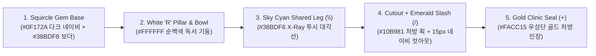

# 💎 리드엑스레이(ReadX-Ray) Pro — 공식 CI 및 UI/UX 테마 킷 마스터 규격서 (v1.0)

<!-- readx-document-context -->
> 작성 당시의 설계·조사·구현 기록입니다. 현재 기능과 운영 상태는 최신 현황을 우선합니다. [문서 목차](../README.md) · [최신 현황](../PROJECT_STATUS.md)


- **확정 CI 모델**: **`Rx-5` (Squircle Gem `℞` — 3-Tone Precision Prescription Emblem)**
- **문서 목적**: `리드엑스레이(ReadX-Ray) Pro`의 브랜드 아이덴티티(심볼 SVG, 로고명 표기법, 슬로건), Dual-Context 컬러 시스템, 학년군별 타이포그래피 스케일, 그리고 React + Tailwind CSS 기반 UI/UX 테마 킷(Theme Kit)을 정의한 공식 디자인 시스템 마스터 문서입니다.
- **연계 문서**: [PRD_문해력_코스웨어_상용화_마스터.md](../PRD_문해력_코스웨어_상용화_마스터.md)

---

## Part 1. 브랜드 코어 아이덴티티 & 공식 네이밍 규격 (Brand Identity)

### 1.1 브랜드 정의 및 조형 철학
> **"Warm Precision (따뜻한 정밀함) & Visual Prescription (눈에 보이는 처방)"**
>
> `리드엑스레이(ReadX-Ray) Pro`는 학습자의 문해력 결손을 감(感)이 아닌 **6차원 X-Ray 데이터로 투명하게 투시**하고, 의학 처방전 기호인 **`℞ (Rx)`**의 권위를 빌려 **선수 결손 징검다리 복습 ➔ Dick & Carey 인지 병목 돌파 ➔ 수능 6대 오답 백신**까지 1:1로 정밀 처방하는 대한민국 표준 수능형 적응형 코스웨어입니다.

### 1.2 공식 브랜드 명칭 표기 체계 (Naming & Logotype Rules)

| 구분 | 공식 표기 (Standard Text) | 사용처 및 조합 원칙 |
| :--- | :--- | :--- |
| **국문 풀네임** | **리드엑스레이 프로** | 공식 문서, 학부모 리포트 타이틀, 안내문, 보도자료 |
| **영문 풀네임** | **ReadX-Ray Pro** | 웹앱 글로벌 헤더, 스플래시 화면, 워드마크 기본형 |
| **클리닉 확장명** | **리드엑스레이 1:1 문해력 진단·처방 클리닉** | 학부모용 정밀 진단표 헤더, 학원/학교 배포용 리포트 |
| **컴팩트 약칭** | **`Rx+ Pro`** / **`ReadX`** | 모바일 헤더, 작은 배지, 파비콘, 앱 아이콘 라벨 |
| **공식 슬로건 (국문)** | *"글의 골격을 꿰뚫어 보는 6차원 X-Ray 진단, 빈틈을 채우는 1:1 Rx 처방"* | 랜딩 히어로, 학부모 리포트 최상단 서브타이틀 |
| **공식 슬로건 (영문)** | *"6D Cognitive X-Ray & Adaptive Rx Clinic for Mastery"* | 영문 서브 카피, 인증 배지 하단 |

### 1.3 워드마크(Logotype) 컬러 분리 공식
워드마크는 **`Read` (독서 본질)** + **`X` (투시 스캔)** + **`-Ray` (처방 광선)** + **`[PRO]` (전문가 인장)**의 4단 구조로 색상을 분리해 조형적 리듬감을 부여합니다.

- **다크 네이비 배경 위 (`#0F172A` 상단 헤더 등)**:
  - `Read`: Pure White (`#FFFFFF`, `font-extrabold`)
  - `X`: Sky Scan Cyan (`#38BDF8`, `font-black`)
  - `-Ray`: Vital Rx Emerald (`#10B981`, `font-extrabold`)
  - `PRO`: Eureka Gold Pill (`bg-[#FACC15] text-[#0F172A] font-black rounded-full px-2 py-0.5 text-xs`)
- **라이트/종이 배경 위 (`#F8FAFC` / `#FCFBF7` 인쇄 리포트 등)**:
  - `Read`: Deep X-Navy (`#0F172A`, `font-extrabold`)
  - `X`: Ocean Scan Blue (`#0284C7`, `font-black`)
  - `-Ray`: Clinic Emerald (`#059669`, `font-extrabold`)
  - `PRO`: Deep Navy Pill (`bg-[#0F172A] text-[#FACC15] font-black rounded-full px-2 py-0.5 text-xs`)

---

## Part 2. 확정 CI 심볼 마크 (`Rx-5 Squircle Gem ℞`) 마스터 규격

### 2.1 `Rx-5` 심볼의 5대 기하학적 조형 원리 (Geometric Anatomy)



1. **정통 `℞ (Rx)` 합자 황금비율**:
   - `R`의 수직 기둥(`x=36`, `y=26..90`)과 상단 둥근 보울(`y=26..58`)이 끝나는 허리 지점(`54, 57`)에서 우하단 대각선(`\`, `54,57 ➔ 100,103`)이 기준선(`y=90`)보다 아래까지 길게 뻗어 내려갑니다.
   - 가로지르는 에메랄드 획(`/`, `100,57 ➔ 54,103`)이 정확히 `R`의 허리 높이(`y=57`)에서 시작해 대각선의 정중앙(`77, 80`)을 수직 대칭으로 통과하므로, **위로 삐져나오는 군더더기 없이 누구나 0.1초 만에 `Rx (℞)`로 인식**합니다.
2. **오버랩 스텐실 컷아웃 (Stencil Cutout Gap)**:
   - 시안 대각선(`\`)과 에메랄드 대각선(`/`)이 교차할 때 `stroke="#0F172A" stroke-width="15"`의 네이비 컷아웃 여백을 두어, 작은 크기에서도 두 획이 뭉개지지 않고 보석처럼 또렷하게 겹쳐 보입니다.
3. **우상단 골드 클리닉 인장 (`+` Seal)**:
   - 우상단 빈 공간(`cx=100, cy=33`)에 황금빛 원형 인장(`#FACC15`)과 네이비 십자(`+`)를 배치하여, 전체 조형의 사각 무게중심을 완벽히 맞추면서 **'단서 포착 + 1:1 클리닉 처방'**의 의미를 직관적으로 완성합니다.

### 2.2 프로덕션 표준 SVG 소스 코드 (Copy-Ready SVG Assets)

#### ① 메인 심볼 마크 단독형 (`Rx-5 Master Symbol` — `140×130`)
```xml
<svg viewBox="0 0 140 130" fill="none" xmlns="http://www.w3.org/2000/svg">
  <!-- 1. Squircle Gem Base -->
  <rect x="14" y="8" width="112" height="112" rx="26" fill="#0F172A" stroke="#38BDF8" stroke-width="2.5" stroke-opacity="0.5"/>
  <!-- 2. R Stem & Bowl in Crisp White -->
  <path d="M36 90V26H58C70 26 78 32.5 78 42C78 51.5 70 58 58 58H36" stroke="#FFFFFF" stroke-width="11" stroke-linecap="round" stroke-linejoin="round"/>
  <!-- 3. Shared Diagonal (\ of x) in Sky Cyan -->
  <path d="M54 57L100 103" stroke="#38BDF8" stroke-width="11" stroke-linecap="round"/>
  <!-- 4. Stencil Cutout & Crossing Slash (/ of x) in Vital Emerald -->
  <path d="M100 57L54 103" stroke="#0F172A" stroke-width="15" stroke-linecap="round"/>
  <path d="M100 57L54 103" stroke="#10B981" stroke-width="11" stroke-linecap="round"/>
  <!-- 5. Gold Clinic Plus Seal -->
  <circle cx="100" cy="33" r="9" fill="#FACC15"/>
  <path d="M100 28.5V37.5M95.5 33H104.5" stroke="#0F172A" stroke-width="2.8" stroke-linecap="round"/>
</svg>
```

#### ② 초소형 파비콘 & 배지 최적화 SVG (`16px ~ 32px Favicon SVG`)
```xml
<svg viewBox="0 0 64 64" fill="none" xmlns="http://www.w3.org/2000/svg">
  <rect x="2" y="2" width="60" height="60" rx="14" fill="#0F172A" stroke="#38BDF8" stroke-width="2"/>
  <path d="M15 44V12H26C32 12 36 15.5 36 20C36 24.5 32 28 26 28H15" stroke="#FFFFFF" stroke-width="6" stroke-linecap="round" stroke-linejoin="round"/>
  <path d="M24 27.5L48 51.5" stroke="#38BDF8" stroke-width="6" stroke-linecap="round"/>
  <path d="M48 27.5L24 51.5" stroke="#0F172A" stroke-width="8.5" stroke-linecap="round"/>
  <path d="M48 27.5L24 51.5" stroke="#10B981" stroke-width="6" stroke-linecap="round"/>
  <circle cx="48" cy="15" r="5" fill="#FACC15"/>
  <path d="M48 12.5V17.5M45.5 15H50.5" stroke="#0F172A" stroke-width="1.8" stroke-linecap="round"/>
</svg>
```

---

## Part 3. Dual-Context 컬러 아키텍처 & 시맨틱 디자인 토큰

`리드엑스레이 Pro`는 **① 데이터를 투시·진단하는 화면(X-Ray Analytics Mode)**과 **② 긴 호흡의 지문을 눈의 피로 없이 읽는 화면(Ergonomic Reading Studio Mode)**의 색온도를 분리하는 **Dual-Context 컬러 아키텍처**를 채택합니다.

### 3.1 Brand Signature 6-Color Palette (`Rx-5` 코어 컬러)

| 토큰명 (Tailwind) | 컬러명 | HEX | RGB | 핵심 용도 및 시각적 역할 |
| :--- | :--- | :---: | :---: | :--- |
| **`rx-navy`** | **Deep X-Navy** | `#0F172A` | `15, 23, 42` | 스퀘어클 로고 베이스, 글로벌 상단 바, 학부모 10초 요약 다크 배너, 본문 잉크 |
| **`rx-blue`** | **Clinic Royal Blue** | `#1D4ED8` | `29, 78, 216` | 주요 CTA 버튼, 활성 탭, 학습 루틴 진행 상태, 신뢰감 있는 클리닉 가이드 |
| **`rx-cyan`** | **X-Ray Scan Cyan** | `#38BDF8`<br>*(Sub `#06B6D4`)* | `56, 189, 248` | 로고 `\` 투시 획, 6차원 진단 스캔 라인, AI 사고구술 연결선, 다크모드 하이라이트 |
| **`rx-emerald`** | **Vital Rx Emerald** | `#10B981`<br>*(Sub `#059669`)* | `16, 185, 129` | 로고 `/` 처방 획, 클리닉 통과, `Mastered(완전 정복)` 배지, 성장 슬로프 상승선 |
| **`rx-gold`** | **Eureka Clinic Gold** | `#FACC15`<br>*(Sub `#F59E0B`)* | `250, 204, 21` | 로고 우상단 `+` 인장, `[PRO]` 배지, 지문 단서 포착(Hot Text), 1차 오답 스포트라이트 |
| **`rx-rose`** | **Critical Alert Rose** | `#F43F5E`<br>*(Sub `#E11D48`)* | `244, 63, 94` | `Critical(긴급 처방)` 하위기능 경보, 인지 병목 급락 구간, 오답 함정(`D1~D6`) 경고 |

### 3.2 Dual-Context Surface Tokens (배경 이원화 토큰)

| 컨텍스트 모드 | 적용 뷰 (Views) | Surface 토큰명 | HEX 코드 | 설계 의도 |
| :--- | :--- | :--- | :---: | :--- |
| **Mode A.<br>X-Ray Analytics**<br>*(진단·대시보드·콘솔)* | • 학생 홈 대시보드<br>• 학부모 6차원 X-Ray 리포트<br>• 교사 학급 히트맵 콘솔 | `surface-analytics`<br>`surface-card`<br>`surface-hero-grad` | `#F8FAFC`<br>`#FFFFFF`<br>`#0F172A ➔ #1E3A8A` | 차트, 히트맵, Before/After 수치의 대비를 극대화하여 **10초 만에 결손 위치 판독** |
| **Mode B.<br>Reading Studio**<br>*(독서·클리닉·모의고사)* | • 일일 루틴 독서 스튜디오<br>• 1:1 약점 처방 클리닉<br>• CBT 실전 수능 모의고사 | `paper-ivory` *(기본)*<br>`paper-sepia` *(선택)*<br>`paper-night` *(다크)* | **`#FCFBF7`**<br>`#F4EFE6`<br>`#1E293B` | 백색 눈부심(Glare)을 줄인 따뜻한 종이 질감으로 **1,000~1,800자 긴 지문 정독 시 눈의 피로 최소화** |

### 3.3 성취도 Triage · 스캐폴딩 · 3색 형광펜 시맨틱 컬러

| 카테고리 | 상태 / 도구명 | 텍스트 / 아이콘 | 보더 / 포인트 | 배경 (Soft Fill) | 적용 규칙 |
| :--- | :--- | :---: | :---: | :---: | :--- |
| **Mastery Triage**<br>*(성취도 3단계)* | 🟢 **Mastered (`80~100`)** | `#047857` | `#10B981` | `#ECFDF5` | 전이 완료 · 실전 모의고사 진입 가능 |
| | 🟡 **Fragile (`51~79`)** | `#B45309` | `#F59E0B` | `#FFFBEB` | 불안정 · Step 2 사고구술 보강 권장 |
| | 🔴 **Critical (`0~50`)** | `#BE123C` | `#F43F5E` | `#FFF1F2` | **1:1 약점 처방 클리닉 즉시 배정 대상** |
| **Progressive Hint**<br>*(3단계 스캐폴딩)* | **Attempt 1 (`Guided`)** | `#0369A1` | `#38BDF8` | `#F0F9FF` | 오답 시 정답 비노출 + 함정 경보 + 본문 단서 노란 스포트라이트(`#FEF08A`) |
| | **Attempt 2 (`Direct`)** | `#92400E` | `#F59E0B` | `#FEF3C7` | 오답 선지 취소선(`line-through`) 소거 + 사고구술 공식 팝업 |
| **Highlighter**<br>*(3색 전략 형광펜)* | 🟨 **중심 문장·화제** | `#1E293B` | `#FACC15` | `#FEF08A` | 문단 중심 문장 및 핵심 화제 마킹 |
| | 🟩 **핵심 단서·정의** | `#1E293B` | `#4ADE80` | `#BBF7D0` | 지시어, 개념 정의, 비례/수치 단서 마킹 |
| | 🟪 **주의·부정·한정어** | `#1E293B` | `#F472B6` | `#FBCFE8` | `~만`, `~제외하고`, 반박 근거 등 함정 방어 마킹 |

### 3.4 🛡️ 수능 6대 매력적 오답 함정(`D1~D6`) 백신 배지 컬러 & 심볼 규격
모든 백신 배지는 `Rx-5`의 스퀘어클/육각 실드 모티프를 계승하며, 각 함정별로 고유 컬러 코드를 부여합니다.

| 코드 | 오답 함정 공식명 | 학생용 백신 도감 별칭 | 전용 컬러 (HEX) | 배지 배경 (Soft) | 심볼 아이콘 모티프 |
| :---: | :--- | :--- | :---: | :---: | :--- |
| **`D1`** | **인과·선후 역전** | *"원인·결과 거꾸로 함정"* | `#F43F5E` (Rose) | `#FFF1F2` | `🔄` 뒤집힌 양방향 화살표 |
| **`D2`** | **과잉 일반화·단정** | *"무조건 100% 뻥튀기 함정"* | `#F97316` (Orange) | `#FFF7ED` | `🎈` 팽창 경고 / 절대어(`항상·모든`) |
| **`D3`** | **비교 기준·속성 교차** | *"A와 B 특징 뒤바꾸기 함정"* | `#EAB308` (Amber) | `#FEFCE8` | `🔀` 엇갈린 X자 속성 스왑 |
| **`D4`** | **조건·한정어 누락/왜곡** | *"단서 조건 몰래 빼기 함정"* | `#8B5CF6` (Violet) | `#F5F3FF` | `🧩` 빠진 조건 퍼즐 조각 |
| **`D5`** | **주체·대상 바꿔치기** | *"누가 했는지 주인공 속이기"* | `#06B6D4` (Cyan) | `#ECFEFF` | `🎭` 교차된 이중 가면 |
| **`D6`** | **본문 외 상식·무관 추론** | *"글에 없는 내 상식 함정"* | `#6366F1` (Indigo) | `#EEF2FF` | `🛸` 지문 궤도를 이탈한 위성 |

---

## Part 4. 타이포그래피 & 학년군별(G1-2 / G3-4 / G5-6) 적응형 스케일 킷

### 4.1 3-Track 폰트 페어링 (Font Stack)
1. **UI · 대시보드 · 문항 발문 (`font-sans`)**:
   - `'Pretendard Variable', 'Pretendard', -apple-system, BlinkMacSystemFont, 'Malgun Gothic', sans-serif`
   - 높은 x-height와 명확한 자소 구분으로 초등 저학년부터 교사 콘솔의 고밀도 테이블까지 완벽 대응.
2. **독서 스튜디오 지문 본문 (`font-serif`)**:
   - `'MaruBuri', 'KoPub Batang', Georgia, 'Batang', serif` *(독서 툴바에서 산세리프↔세리프 실시간 토글 지원)*
   - 긴 호흡의 교과 개념 지문과 KICE 평가원 시험지의 정통 명조 조판 감각을 재현.
3. **데이터 · 점수 · 타이머 · 히트맵 (`tabular-nums`)**:
   - 모든 점수(`SmartScore`), 백분율(`%`), `KReaD 지수`, `남은 시간(00:00)`에는 `font-variant-numeric: tabular-nums`를 강제 적용하여 숫자 변경 시 레이아웃 흔들림을 원천 차단.

### 4.2 학년군별 인체공학 스케일링 매트릭스 (Grade-Adaptive Tokens)

| 디자인 속성 | 🌱 초저 (1~2학년 `G1-G2`) | 🌿 초중 (3~4학년 `G3-G4`) | 🌳 초고 (5~6학년 `G5-G6`) |
| :--- | :--- | :--- | :--- |
| **지문 본문 크기 (`font-size`)** | `20px (1.25rem)` | `18px (1.125rem)` | `16.5px (1.03125rem)` |
| **지문 줄간격 (`line-height`)** | `2.1` (시선 줄 바꿈 이탈 방지) | `1.95` (표준 교과서 행간) | `1.85` (다문단 구조 독해 행간) |
| **지문 자간 (`letter-spacing`)** | `-0.01em` | `-0.015em` | `-0.02em` |
| **문단 최대 너비 (`max-width`)** | `52ch` | `60ch` | `65ch` |
| **문항 선지 수 & 레이아웃** | **3지선다** (큼직한 블록 버튼형) | **4지선다** (표준 카드형) | **5지선다** (KICE 평가원 실전형) |
| **컴포넌트 곡률 (`border-radius`)** | `16px ~ 20px` (`rounded-2xl`) | `12px ~ 16px` (`rounded-xl`) | `10px ~ 12px` (`rounded-lg/xl`) |
| **독서 툴바 기본 ON 옵션** | 🔊 문장별 TTS + `/` 끊어읽기 + 문장번호 | 🔢 문단번호 + 📖 어휘 툴팁 사전 | 🖍️ 3색 형광펜 + 📊 다중매체 탭 |

---

## Part 5. UI/UX 컴포넌트 테마 킷 명세 (Component Theme Kit)

### 5.1 상단 글로벌 네비게이션 바 (`TopGlobalNav`)
- **배경**: `bg-gradient-to-r from-[#0F172A] via-[#132347] to-[#1E3A8A]` + 하단 보더 `border-b border-sky-400/20` + 그림자 `shadow-lg`
- **좌측 브랜드 영역**:
  - `Rx-5` 스퀘어클 심볼(`36×36px`) + `Read` (`text-white`) + `X` (`text-sky-400`) + `-Ray` (`text-emerald-400`) + `[PRO]` (`bg-amber-400 text-slate-950 font-black rounded-full px-2 py-0.5 text-xs`)
- **중앙 학습 모드 탭 (학생 뷰 활성 시)**:
  - `① 🔬 X-Ray 진단` · `② 📖 오늘의 문해력` · `③ 💊 Rx 처방 클리닉` · `④ 📝 실전 수능 CBT`
  - 활성 탭: `bg-amber-400 text-slate-950 font-extrabold shadow-sm` / 비활성 탭: `bg-white/10 text-slate-200 hover:bg-white/20`
- **우측 글로벌 역할 스위처 (`Role Switcher`)**:
  - 캡슐형 세그먼트 컨트롤 (`bg-slate-950/60 p-1 rounded-xl border border-white/10`)
  - `👦 학생 포털` / `👨‍👩‍👧 학부모 X-Ray 리포트` / `👩‍🏫 교사 클래스 콘솔`

### 5.2 Split-Screen 독서 스튜디오 & 우측 ‘📌 나의 단서 보드’
- **레이아웃 비율**: 데스크톱 기준 **좌측 지문 리더 `52%` (고정 스크롤)** ↔ **우측 TEI 워크스페이스 `48%` (단계별 카드 스크롤)**
- **좌측 지문 리더 (`ReadingPane`)**:
  - 상단에 플로팅 **7대 인체공학 독서 툴바** (`bg-white/90 backdrop-blur border-b border-stone-200 sticky top-0 z-10`)
  - 본문 용지: `bg-[#FCFBF7]` (Warm Ivory Paper), 문단 좌측에 `[1문단]` 미니 스카이 태그(`bg-sky-100 text-sky-800 font-bold text-xs px-1.5 py-0.5 rounded`)
  - **1차 오답 스포트라이트 연동 효과**:
    - 우측 문항에서 1차 오답 선택 시, 좌측 지문의 근거 문장으로 `scrollIntoView({ behavior: 'smooth', block: 'center' })` 실행 후 `ring-4 ring-amber-300 bg-amber-100/90 rounded px-1 transition-all duration-500 animate-pulse` 적용.
- **우측 상단 고정 ‘📌 나의 단서 보드’ (`MyClueBoard`)**:
  - Step 1에서 찾은 Hot Text 단서와 Step 2에서 조립한 사고구술 문장이 에메랄드 체크 배지(`✅`)와 함께 요약 고정되어, Step 3 실전 문제를 풀 때 언제든 근거로 참조 가능.

### 5.3 학부모용 ‘10초 핵심 요약 배너’ (`Where · Why · How Hero`)
- 학부모 리포트 최상단에 배치되는 `Rx-5` 테마 다크 네이비 카드 (`bg-[#0F172A] text-white rounded-2xl p-6 border border-sky-500/30`):
  1. **`📍 어디가 부족한가요? (Where — 결손 위치)`**: Rose 포인트 카드 (`border-l-4 border-rose-500 bg-white/5`)
  2. **`🧠 왜·어떻게 틀리나요? (Why — 인지 병목 & 함정)`**: Cyan 포인트 카드 (`border-l-4 border-sky-400 bg-white/5`)
  3. **`💊 어떻게 처방·개선되었나요? (Rx Action & Growth)`**: Emerald 포인트 카드 (`border-l-4 border-emerald-400 bg-white/5`)

---

## Part 6. 프로덕션 코드 세팅 (`CSS Variables` & `tailwind.config.js`)

### 6.1 글로벌 CSS 변수 선언 (`index.css` / `<style>`)
```css
:root {
  /* Rx-5 Brand Core Palette */
  --rx-navy: #0F172A;
  --rx-navy-light: #1E293B;
  --rx-blue: #1D4ED8;
  --rx-blue-soft: #EFF6FF;
  --rx-cyan: #38BDF8;
  --rx-cyan-deep: #06B6D4;
  --rx-emerald: #10B981;
  --rx-emerald-soft: #ECFDF5;
  --rx-gold: #FACC15;
  --rx-amber: #F59E0B;
  --rx-amber-soft: #FFFBEB;
  --rx-rose: #F43F5E;
  --rx-rose-soft: #FFF1F2;

  /* Dual-Context Surfaces */
  --surface-analytics: #F8FAFC;
  --surface-card: #FFFFFF;
  --paper-ivory: #FCFBF7;
  --paper-sepia: #F4EFE6;
  --paper-night: #1E293B;

  /* Strategic 3-Color Highlighters */
  --hl-yellow: #FEF08A;
  --hl-green: #BBF7D0;
  --hl-pink: #FBCFE8;
}

.tabular-nums {
  font-variant-numeric: tabular-nums;
}
```

### 6.2 Tailwind CSS 테마 설정 ([courseware/webapp/tailwind.config.js](../../webapp/tailwind.config.js))
```javascript
/** @type {import('tailwindcss').Config} */
export default {
  content: [
    "./index.html",
    "./src/**/*.{js,ts,jsx,tsx}",
  ],
  theme: {
    extend: {
      fontFamily: {
        sans: ['"Pretendard Variable"', 'Pretendard', '"Malgun Gothic"', '-apple-system', 'BlinkMacSystemFont', 'sans-serif'],
        serif: ['MaruBuri', '"KoPub Batang"', 'Georgia', 'Batang', 'serif'],
      },
      colors: {
        rx: {
          navy: '#0F172A',
          slate: '#1E293B',
          blue: '#1D4ED8',
          cyan: '#38BDF8',
          teal: '#06B6D4',
          emerald: '#10B981',
          gold: '#FACC15',
          amber: '#F59E0B',
          rose: '#F43F5E',
        },
        paper: {
          ivory: '#FCFBF7',
          sepia: '#F4EFE6',
          night: '#1E293B',
        },
        mastery: {
          mastered: { DEFAULT: '#10B981', soft: '#ECFDF5', text: '#047857' },
          fragile: { DEFAULT: '#F59E0B', soft: '#FFFBEB', text: '#B45309' },
          critical: { DEFAULT: '#F43F5E', soft: '#FFF1F2', text: '#BE123C' },
        },
        trap: {
          d1: '#F43F5E', // 인과 역전
          d2: '#F97316', // 과잉 일반화
          d3: '#EAB308', // 비교 속성 교차
          d4: '#8B5CF6', // 조건·한정어 누락
          d5: '#06B6D4', // 주체·대상 교란
          d6: '#6366F1', // 본문 외 상식
        }
      },
      boxShadow: {
        'rx-card': '0 2px 12px -2px rgba(15, 23, 42, 0.06), 0 1px 4px -1px rgba(15, 23, 42, 0.04)',
        'rx-header': '0 4px 20px -2px rgba(15, 23, 42, 0.25)',
        'cue-pulse': '0 0 0 4px rgba(250, 204, 21, 0.45)',
      }
    },
  },
  plugins: [],
}
```
