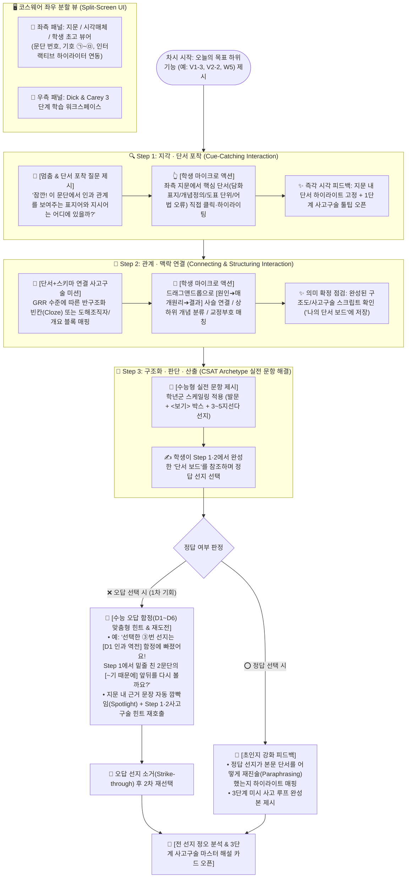

# [Track 3 심층 조사 보고서] 수능(CSAT) 스타일 비문학(독서)·작문 문항의 초등 1~6학년 스케일링 설계 및 코스웨어 아키텍처

<!-- readx-document-context -->
> 작성 당시의 설계·조사·구현 기록입니다. 현재 기능과 운영 상태는 최신 현황을 우선합니다. [문서 목차](../docs/README.md) · [최신 현황](../docs/PROJECT_STATUS.md)


본 보고서는 `research/9_g1_g6_taxonomy_part3_expository.md`(초1~6 설명문 16개 하위기능 × 96개 위계 목표)와 `research/2_question_and_think_aloud_protocol.md`(질문+사고구술 3단계 미시 사고 루프 및 작가의 사고구술 프로토콜)를 한국교육과정평가원(KICE) 대학수학능력시험 국어 영역(독서 & 화법과 작문)의 출제 매뉴얼과 결합하여, **초등 1~6학년 맞춤형 수능형 코스웨어 문항 설계 및 데이터 아키텍처**로 정립한 결과입니다.

---

## Ⅰ. 설명문 16개 하위기능 × Dick & Carey 3단계 × KICE 수능 출제 원리 매핑 분석

### 1. 인지적 과제 분석(Dick & Carey)과 수능 문항 해결 및 사고구술(Track 2)의 구조적 동형성(Isomorphism)
`9_g1_g6_taxonomy_part3_expository.md`에서 정의한 모든 하위기능(V1-1~W5)의 **Dick & Carey 3단계 미시 과제**는 KICE 수능 국어 문항을 풀 때 숙련된 수험생이 거치는 인지 과정 및 `2_question_and_think_aloud_protocol.md`의 **3단계 미시 사고 루프**와 1:1로 대응합니다.

| Dick & Carey 3단계 | 인지적 과제 본질 (`9_expository`) | 사고구술 프로토콜 (`2_protocol`) | 수능(CSAT) 문항 해결 메커니즘 | 코스웨어 학습 루프 구현 |
| :--- | :--- | :--- | :--- | :--- |
| **Step 1**<br>**단서 포착**<br>*(Cue-Catching)* | 텍스트·도표·초고 표면에 명시된 핵심 어휘, 담화표지, 지시어, 수치 단위, 어법 결함 지점을 지각·식별함 | **💭 멈춤 & 단서 포착 질문**<br>*"잠깐! 여기서 왜/무엇이 [특이 표지·단서]로 나타났지? 어디에 밑줄을 쳐야 할까?"* | **발문 조건 및 지문 표지 스캐닝**<br>(`㉠~㉤`, `[A]`, 담화표지, 한정어, 도표 축/단위 포착) | **[Interactive Step 1]**<br>지문 내 핵심 단서 하이라이팅 / 표지어 클릭 / 도표 변인 포착 미션 |
| **Step 2**<br>**관계·맥락 연결**<br>*(Connecting)* | 포착한 단서들을 문장 골격(주·목·서), 상하위 개념 위계, 문단 간 응집망, 도표 추세, 배경지식과 결합함 | **🧠 단서+스키마 연결 사고구술**<br>*"글에 나온 [단서 A]와 [문맥/배경지식 B]를 합쳐 보면, 이것은 [구조화된 의미]를 뜻해."* | **텍스트기반(Textbase) 및 상황모형 구축**<br>(문장 간 인과·대조 매핑, `<보기>` 사례와 본문 원리 일대일 대응) | **[Interactive Step 2]**<br>개념 위계/인과 사슬 드래그앤드롭 / 빈칸 사고구술(Cloze) 완성 미션 |
| **Step 3**<br>**구조화·판단·산출**<br>*(Structuring & Judging)* | 전체 거시구조 도해·요약, 새로운 상황에의 추론적 적용, 신뢰성·적절성 평가 및 작문 산출·퇴고를 수행함 | **✅ 의미 확정 & 초인지 점검**<br>*"결국 핵심은 [한 줄 확정]이야. 앞뒤 흐름이나 기준에 맞는지 확인해 볼까?"* | **선지 정오 판별 및 매력적 오답 소거**<br>(패러프레이징된 정답 선지 선택 및 6대 오답 함정 변별) | **[Interactive Step 3]**<br>수능형 실전 객관식 문항 풀이 + 오답 함정 유형별 맞춤형 사고구술 피드백 |

---

### 2. 수능(KICE) 특유의 매력적 오답(Distractor) 생성 6대 공식 정의
KICE 수능 국어 영역에서 수험생의 변별력을 확보하는 오답 선지는 본문에 없는 엉뚱한 말을 쓰는 것이 아니라, **본문에 있는 핵심 어휘들을 그대로 사용하되 논리적 관계만 미세하게 비트는 방식**으로 설계됩니다. 코스웨어 문항 생성 엔진에 탑재할 **6대 오답 공식(D1~D6)**은 다음과 같습니다.

1. **`[D1] 인과 역전 (Causal Reversal)`**:
   - **공식**: 본문의 `[원인 A ➔ 결과 B]` 관계를 선지에서 `[B로 인해 A가 발생한다]` 또는 `[A가 되기 위해 B가 선행되어야 한다]`로 앞뒤 인과 방향을 뒤집음.
   - **표지 변형**: `~하기 때문에`, `~에 따라`, `~의 결과로`, `~를 유발한다`의 주어·목적어 자리 교체.
2. **`[D2] 선후·단계 왜곡 (Temporal/Sequential Distortion)`**:
   - **공식**: 시간이나 과정 설명(`1단계 A ➔ 2단계 B ➔ 3단계 C`)에서 중간 단계를 생략·역전시키거나, `[동시 발생]`을 `[선후 발생]`으로(혹은 그 반대로) 왜곡함.
   - **표지 변형**: `먼저/다음에`, `~한 직후`, `~하기 전에`, `동시에`의 시간 부사어 조작.
3. **`[D3] 조건·한정어 과장 및 축소 (Quantifier/Condition Overgeneralization)`**:
   - **공식**: 본문의 부분·조건부 진술을 전칭·무조건 진술로 과장하거나, 비례/반비례 조건을 임의로 삭제·첨가함.
   - **표지 변형**: `일부/대부분/경우에 따라` ➔ `모두/항상/반드시/유일하게`로 과장, `A 조건에 한하여`를 `A 조건과 무관하게`로 변형.
4. **`[D4] 개념 속성 교차 치환 (Attribute Cross-Swapping)`**:
   - **공식**: 비교·대조되거나 분류·분석된 두 대상 `X(속성 a, b)`와 `Y(속성 c, d)`에서, `X`의 주어에 `Y`의 핵심 서술어(`c, d`)를 교차 결합하거나, ‘상하위 관계(분류)’와 ‘전체-부분 관계(분석)’를 뒤섞음.
5. **`[D5] 주객·주체 전도 (Subject-Object / Agent Inversion)`**:
   - **공식**: 행위나 작용의 주체(Agent)와 대상(Target)을 바꾸거나, 수혜자와 피해자, 상위 범주와 하위 범주의 방향을 뒤바꿈. (예: `A가 B를 분해한다` ➔ `B가 A를 흡수·분해한다`).
6. **`[D6] 본문 외 상식·주관 함정 및 표면 어휘 짜깁기 (Extratextual & Lexical Patchwork)`**:
   - **공식**: ① 본문에 전혀 언급되지 않았으나 학생의 일상 상식으로는 그럴듯한 내용을 단정적으로 서술하거나(과잉 추론 유도), ② 서로 다른 문단에 있는 무관한 단어 두 개를 하나의 문장으로 억지 결합함.

---

## Ⅱ. 설명문 16개 하위기능별 수능형 문항 원형(Archetype) 16종 상세 명세

### 【영역 1: 사실적 이해 (`V1-1` ~ `V1-4`) — KICE 독서: 사실적 독해】

#### 1. `V1-1` 내용 확인 (대상과 특징·세부 정보 식별)
- **① 수능 문항 유형명**: **[독서-세부 정보 확인형]** (수능 독서 지문 첫 번째 문항 전형: *명시적 사실 및 도표 세부 수치 일치 여부 판별*)
- **② 표준 발문(Stem) 템플릿**:
  - *(긍정형)* `윗글을 읽고 알 수 있는 내용으로 가장 적절한 것은?` / `윗글의 [대상]에 대한 설명으로 적절한 것은?`
  - *(부정형)* `윗글의 내용과 일치하지 않는 것은?` / `윗글을 통해 답을 찾을 수 없는 질문은?`
  - *(`<보기>`/도표 결합형)* `윗글과 <표>(또는 [그림])를 통해 확인할 수 있는 사실로 적절하지 않은 것은?`
- **③ `<보기>` 박스 설계 방식**:
  - 원칙적으로 지문 단독 출제가 기본이나, 4~6학년에서는 지문 내 삽입된 **`<표>`·`<막대/꺾은선그래프>`** 또는 지문 정보를 질문 형태로 바꾼 **`<탐구 질문 카드>`(ㄱ~ㄹ)**를 `<보기>`로 제시하여 본문 명시 여부(Yes/No)를 대조하게 함.
- **④ 정답 선지 구성 공식**:
  - **`[본문 핵심 명제의 동의어 재진술(Paraphrasing) 공식]`**: 본문의 문장 `S(주어) + O(목적어) + V(서술어)`를 그대로 복사하지 않고, 본문에 명시된 어휘를 **유의어·상위어로 1단계 치환**하거나 능동문을 피동문으로 바꾸어 의미가 100% 동치(Equivalence)가 되도록 구성함. (단, 1~2학년은 본문 핵심 낱말 그대로 유지).
- **⑤ 매력적 오답 생성 공식**:
  - 주력 공식: **`[D3] 조건·한정어 과장/축소`** (`약/일부/대부분`을 `모두/항상`으로 변형, 도표 단위 `%`와 `명` 혼동) + **`[D6] 본문 외 미언급 사실 짜깁기`** (질문형 발문에서 본문에 없는 이유·전망을 묻는 선지).

#### 2. `V1-2` 관계 확인 (문단 내 중심-세부, 어휘 위계, 문장 골격, 지시·인과 관계)
- **① 수능 문항 유형명**: **[독서-문맥적 관계 및 개념 위계 파악형]** (*지시어·접속어 기능, 중심-뒷받침 층위, 어휘의 상하/전체-부분 관계 분석*)
- **② 표준 발문(Stem) 템플릿**:
  - *(기호/밑줄형)* `윗글의 ㉠~㉤(지시어/접속어/문장)에 대한 이해로 가장 적절한 것은?`
  - *(개념 관계형)* `윗글에 등장하는 개념들의 관계(포함 관계 / 구성 요소)를 나타낸 것으로 가장 적절한 것은?`
  - *(`<보기>` 결합형)* `<보기>는 [A] 문단의 문장 관계를 분석한 것이다. 빈칸에 들어갈 내용으로 적절한 것은?`
- **③ `<보기>` 박스 설계 방식**:
  - **개념 위계 트리(Tree) / 문단 층위 다이어그램**: 본문에 등장한 핵심 어휘들 사이의 `[상위 개념(종류) ↔ 하위 개념]` vs `[전체 대상 ↔ 부분 구성요소]`를 도식화한 박스, 또는 `[중심문장 ➔ 1차 뒷받침(정의) ➔ 2차 뒷받침(예시)]` 구조도를 `<보기>`로 제시.
- **④ 정답 선지 구성 공식**:
  - **`[지시대상 복원 및 층위 기능 명시 공식]`**: 지시어 `㉠(이것/이러한 특징)`이 가리키는 직전 문장의 필수 성분 골격(주·목·서)을 정확히 풀어서 진술하거나, 세부 문장이 중심문장을 어떻게 뒷받침하는지(구체적 사례 제시 / 개념 정의 / 이유 상술)를 정확히 매칭함.
- **⑤ 매력적 오답 생성 공식**:
  - 주력 공식: **`[D4] 개념 속성 교차 치환`** (종류를 나눈 ‘상하위 관계[분류]’를 부품을 쪼갠 ‘전체-부분 관계[분석]’로 잘못 서술) + **`[D1] 인과 역전`** (접속어 앞뒤의 원인 문장과 결과 문장의 관계를 반대로 기술).

#### 3. `V1-3` 구조 확인 (설명 방법 및 거시적 텍스트 구조 도해)
- **① 수능 문항 유형명**: **[독서-전개 방식(설명 방법) 파악 및 구조 도해형]** (수능 독서 논지 전개 방식 문항 전형)
- **② 표준 발문(Stem) 템플릿**:
  - *(긍정형)* `윗글의 내용 전개 방식(또는 설명 방법)으로 가장 적절한 것은?`
  - *(구간 비교형)* `[A]와 [B]에 사용된 설명 방법으로 가장 적절한 것은?`
  - *(`<보기>` 결합형)* `윗글의 구조를 <보기>와 같이 도해할 때, ㉮~㉰에 들어갈 내용으로 적절하지 않은 것은?`
- **③ `<보기>` 박스 설계 방식**:
  - **6대 설명 구조 맞춤형 도해조직자(Graphic Organizer)**: Meyer(1985)의 6대 설명 구조(**분류 트리, 분석 구조도, 비교·대조 벤다이어그램/매트릭스, 과정 화살표 흐름도, 인과 사슬도, 문제-해결 표**)를 `<보기>`로 제시하고 빈칸(`㉮, ㉯`)을 뚫어 놓음.
- **④ 정답 선지 구성 공식**:
  - **`[설명 대상 + 6대 설명 방법 정의어 + 글의 효과 결합 공식]`**: 단순히 "분류를 사용했다"가 아니라, **"대상을 일정한 기준에 따라 나누어(분류) 각각의 특징을 설명하고 있다"**, **"두 대상의 공통점과 차이점을 견주어(비교·대조) 핵심 원리를 부각하고 있다"**처럼 설명 방법의 개념 정의를 풀어서 진술함.
- **⑤ 매력적 오답 생성 공식**:
  - 주력 공식: **`[D4] 설명 방법 간 교차 혼동`** (`분류[종류 나누기]`와 `분석[구성 요소 쪼개기]` 혼동, `비교[공통점]`와 `대조[차이점]`, `예시`와 `비유`를 교차 치환) + **`[D2] 선후·단계 왜곡`** (시간적 흐름/통시적 변화가 없는데 "시대순으로 변천 과정을 서술하고 있다"는 전형적 수능 오답 선지 배치).

#### 4. `V1-4` 요약 및 주제 확인 (중심 내용 간추리기 & 제목 붙이기)
- **① 수능 문항 유형명**: **[독서-거시 주제·제목 추출 및 문단별 요약형]**
- **② 표준 발문(Stem) 템플릿**:
  - *(제목형)* `윗글의 제목(또는 부제)으로 가장 적절한 것은?`
  - *(요약형)* `윗글의 중심 내용을 문단별로 간추린 것으로 적절하지 않은 것은?`
  - *(`<보기>` 결합형)* `<보기>는 윗글을 읽은 학생이 작성한 요약 노트이다. ㉠~㉤ 중 요약 규칙에 어긋난 것은?`
- **③ `<보기>` 박스 설계 방식**:
  - **처음-가운데-끝 요약 노트 / 편집자 제목 기획안**: 학생이 거시규칙(삭제·일반화·구성)을 적용해 작성한 문단별 핵심 요약 카드나, 신문/잡지에 실을 `[표제 + 부제]` 기획안을 `<보기>`로 제시.
- **④ 정답 선지 구성 공식**:
  - **`[[핵심 대상] + [설명 측면 A·B] 포괄 결합 공식]`**: 세부 예시나 수식어를 모두 걷어내고(삭제 규칙), 하위 사례를 상위 개념어로 묶어(일반화 규칙), 글 전체가 다루는 **`[중심 화제/대상]의 [정의/원리/종류/가치 등 핵심 설명 측면]`**이 모두 포함되도록 구성함.
- **⑤ 매력적 오답 생성 공식**:
  - 주력 공식: **`[D3] 범위의 과소(지엽성) 및 과대(포괄성) 오류`** (① 특정 한 문단의 세부 예시만 제목으로 뽑은 **지엽적 선지**, ② 본문이 다루지 않은 거창한 영역까지 넓힌 **과대 일반화 선지**) + **`[D6] 주관적 주장·감상 혼입`** (객관적 설명문 요약에 "~해야 한다"는 당위나 개인적 감상을 섞음).

---

### 【영역 2: 추론적 이해 (`V2-1` ~ `V2-4`) — KICE 독서: 추론적 독해】

#### 5. `V2-1` 학술 어휘·형태소 및 다의어 문맥 추론
- **① 수능 문항 유형명**: **[독서-어휘의 문맥적 의미 및 사전적 뜻풀이 판별형]** (수능 독서 마지막 어휘 문항 전형)
- **② 표준 발문(Stem) 템플릿**:
  - *(교체형)* `문맥상 ㉠~㉤과 바꿔 쓰기에 가장 적절한 것은?`
  - *(다의어 예문형)* `밑줄 친 ⓐ와 문맥적 의미가 가장 유사하게 쓰인 것은?`
  - *(`<보기>` 결합형)* `<보기>를 참고할 때, 윗글의 ‘[학술 개념어]’의 단어 짜임과 문맥적 의미로 적절한 것은?`
- **③ `<보기>` 박스 설계 방식**:
  - **국어사전 다의어 뜻풀이 항목 / 한자 어근·접사 형태소 카드**: ① 국어사전 표제어 아래 `「1」... 「2」... 「3」...` 뜻풀이와 예문을 제시하거나(3~4학년), ② `[6국04-02]`와 연계하여 한자 어근(`수[水]+용[溶]+성[性]`)이나 접두사·접미사(`비-`, `불-`, `-화`, `-적`)의 조어 원리 설명을 `<보기>`로 제시(5~6학년).
- **④ 정답 선지 구성 공식**:
  - **`[형태소 의미 자질 + 앞뒤 문맥 단서(정의·대조·예시) 정합 공식]`**: 밑줄 친 어휘가 본문에서 맺고 있는 **격관계(무엇이 무엇을 어찌하다)** 및 추상성/구체성 자질이 100% 일치하는 유의어나 예문을 정답으로 배치함.
- **⑤ 매력적 오답 생성 공식**:
  - 주력 공식: **`[D4] 다의어의 중심의미 vs 주변의미(비유적 의미) 교차 함정`** (본문에서는 추상적·문맥적 주변 의미로 쓰였는데 물리적·일상적 중심 의미로 쓰인 예문을 제시) + **`[D5] 반의적 접사/어근 혼동`** (형태가 유사한 동음이의어나 방향이 반대인 어휘, 예: `수축/팽창`, `촉진/억제` 혼동).

#### 6. `V2-2` 문단 간 응집성(거시 지시어) 및 생략된 인과·과정 추론
- **① 수능 문항 유형명**: **[독서-생략된 전제·매개 원리 추론 및 조건 변화 예측형]** (수능 과학·기술·경제 지문의 고난도 추론 문항 전형)
- **② 표준 발문(Stem) 템플릿**:
  - *(거시 지시어 추론형)* `윗글의 ‘[이러한 현상 / 이 과정]’이 가리키는 내용과 그 원리로 가장 적절한 것은?`
  - *(인과 추론형)* `윗글을 바탕으로 추론한 내용으로 가장 적절한 것은?` / `㉠의 이유(까닭)로 가장 적절한 것은?`
  - *(`<보기>` 조건 변화형)* `윗글을 바탕으로 <보기>의 실험(상황) 결과를 예측한 것으로 가장 적절한 것은?`
- **③ `<보기>` 박스 설계 방식**:
  - **변인 조작 가상 상황 / 중간 단계가 비어 있는 메커니즘 카드**: 본문에 설명된 원리(`A ➔ B ➔ C`)에서 특정 조건(`A`의 증가 또는 차단)을 변화시킨 가상 실험·생태계·사회 상황을 `<보기>`로 제시하고 파생 결과를 추론하게 함.
- **④ 정답 선지 구성 공식**:
  - **`[선행 문단 사태 압축 복원 + 생략된 교량 명제(Bridging Proposition) 결합 공식]`**: 문단 첫머리의 거시 지시어가 압축한 앞 문단의 `[원인+과정]`을 복원하고, 본문의 두 명제 사이에 생략된 중간 매개 고리를 논리적 필연성(`A이면 B이고, B이면 C이므로, A이면 C이다`)에 따라 연결함.
- **⑤ 매력적 오답 생성 공식**:
  - 주력 공식: **`[D1] 인과 역전`** (원인과 결과를 거꾸로 추론) + **`[D2] 중간 매개 과정의 비례/반비례 방향 왜곡`** (`A가 커지면 B가 작아지고 C가 커진다`에서 `B`의 증감 방향을 반대로 서술하여 최종 결과 `C`를 왜곡).

#### 7. `V2-3` 텍스트와 시각 매체 자료 간 통합 추론
- **① 수능 문항 유형명**: **[독서/작문-텍스트와 복합 도표·인포그래픽 결합 추론형]** (수능 독서 그래프/다이어그램 적용 문항 및 작문 자료 해석 문항 전형)
- **② 표준 발문(Stem) 템플릿**:
  - *(통합 추론형)* `윗글과 <보기>의 자료(그래프/도식)를 함께 이해한 내용으로 가장 적절한 것은?`
  - *(도표 역해석형)* `윗글을 바탕으로 <보기>의 [그림/그래프]에 나타난 변화를 해석한 것으로 적절하지 않은 것은?`
- **③ `<보기>` 박스 설계 방식**:
  - **복합 통계 도표 / 작동 메커니즘 다이어그램**: ① 본문의 개념 원리가 실제 수치 추세로 나타난 **시계열 꺾은선그래프 + 비중 원그래프 복합 자료**, 또는 ② 과학·기술·생태 구조의 **단면도·흐름도(화살표 `ⓐ, ⓑ` 표시)**를 `<보기>`로 제시.
- **④ 정답 선지 구성 공식**:
  - **`[[도표의 시각적 특징/수치 변화] + [본문의 이론적 원인/원리] 결합 공식]`**: 선지 전반부에는 `<보기>` 도표에서 관찰되는 데이터 변화(예: *"t1 시점 이후 A 수치가 급격히 감소한 것은"*)를 배치하고, 후반부에는 본문의 설명 원리(예: *"윗글에서 설명한 B 억제 작용이 활성화되었기 때문이겠군"*)를 결합함.
- **⑤ 매력적 오답 생성 공식**:
  - 주력 공식: **`[D4] 도표 수치는 맞으나 본문 원리 매칭 오류 (또는 그 반대)`** (선지 앞부분의 그래프 추세 설명은 정확하여 학생이 안심하게 만든 뒤, 뒷부분의 본문 인과 원리를 반대 개념과 연결함) + **`[D3] 상관관계를 인과관계로 과잉 단정`**.

#### 8. `V2-4` 필자의 집필 목적·예상 독자·관점 추론
- **① 수능 문항 유형명**: **[독서-필자의 집필 의도·예상 독자 및 내재된 관점 추론형]**
- **② 표준 발문(Stem) 템플릿**:
  - *(집필 목적형)* `글쓴이가 윗글을 쓴 목적(의도)으로 가장 적절한 것은?`
  - *(예상 독자형)* `윗글에 사용된 어휘와 예시를 고려할 때, 글쓴이가 상정한 예상 독자로 가장 적절한 것은?`
  - *(`<보기>` 관점 비교형)* `윗글의 글쓴이가 <보기>의 대상을 바라보는 관점으로 가장 적절한 것은?`
- **③ `<보기>` 박스 설계 방식**:
  - **독자 프로파일 카드 / 집필 기획 인터뷰**: ① 서로 다른 궁금증과 배경지식 수준을 가진 가상 독자(어린이, 전문가, 정책 담당자 등)의 질문 카드를 제시하거나, ② 필자가 글을 쓰기 전 고민한 ‘집필 노트’를 `<보기>`로 제시.
- **④ 정답 선지 구성 공식**:
  - **`[[텍스트 단서(어휘 수준·예시 소재·강조 구조)] ➔ [수사적 맥락(독자·목적·시각)] 추론 공식]`**: 본문에서 쉬운 일상 비유와 뜻풀이를 반복했다면 *"배경지식이 부족한 독자의 이해를 돕기 위해"*, 특정 측면(예: 생태적 가치)을 집중 설명했다면 *"대상의 생태적 중요성을 환기하기 위해"*로 연결함.
- **⑤ 매력적 오답 생성 공식**:
  - 주력 공식: **`[D6] 장르 목적 혼동 함정`** (설명문인데 논설문의 목적처럼 *"독자의 태도 변화를 강력히 촉구하고 반대 입장을 논박하기 위해"*로 진술) + **`[D5] 설명 초점 왜곡`** (본문에서 부수적으로 언급한 배경 사례를 필자의 주된 집필 목적으로 둔갑시킴).

---

### 【영역 3: 평가적 이해 (`V3-1` ~ `V3-3`) — KICE 독서: 비판적·통합적 독해】
> **핵심 원칙**: 논설문의 논증 타당성 평가와 엄격히 구분하여, **설명문 고유 평가 준거(명료성·도표 정합성 / 정확성·최신성·출처 공신력·서술 객관성·관점 공정성 / 다중 매체 교차 검증)**를 평가함.

#### 9. `V3-1` 설명 방법·표현 및 시각 자료의 적절성 평가
- **① 수능 문항 유형명**: **[독서/작문-설명 전략 및 시각 매체 자료의 적절성 비판·대안 제시형]**
- **② 표준 발문(Stem) 템플릿**:
  - *(설명 방법 평가형)* `윗글에 사용된 설명 방법과 표현의 적절성을 평가한 내용으로 가장 적절한 것은?`
  - *(시각 자료 평가형)* `윗글의 이해를 돕기 위해 추가할 시각 자료의 적절성을 판단한 것으로 적절하지 않은 것은?`
  - *(`<보기>` 결합형)* `<보기>는 윗글에 삽입된 도표에 대한 독자의 점검 의견이다. 타당한 의견을 있는 대로 고른 것은?`
- **③ `<보기>` 박스 설계 방식**:
  - **결함이 포함된 도표/설명문 초안 및 점검 루브릭**: ① 본문은 ‘시간에 따른 변화 추세’를 설명하는데 ‘단순 원그래프’를 잘못 넣었거나 단위·범례가 누락된 시각 자료, 또는 ② 분류 기준이 혼재된 설명 문단을 `<보기>`로 제시하고 문제점과 대안을 평가하게 함.
- **④ 정답 선지 구성 공식**:
  - **`[[평가 준거(분류 기준 일관성 / 표현 명료성 / 도표 정합성)] + [문제점 진단] + [구체적 수정 대안] 공식]`**: 예: *"3문단은 시간의 흐름에 따른 기온 변화를 설명하고 있으므로, 비율을 보여주는 원그래프 대신 추세를 한눈에 보여주는 꺾은선그래프로 바꾸는 것이 적절해."*
- **⑤ 매력적 오답 생성 공식**:
  - 주력 공식: **`[D4] 데이터 성격과 그래프 유형의 오매칭`** (비율 합계가 100%인 구성비 데이터에 꺾은선그래프를 제안하거나, 크기 비교에 부적절한 도표를 적절하다고 평가) + **`[D3] 독자 수준 무시`** (초등학생 독자에게 설명 없이 전문 학술 용어로 바꾸어야 더 명료해진다는 오답).

#### 10. `V3-2` 정보의 정확성·객관성·출처 신뢰성 및 관점 공정성 평가
- **① 수능 문항 유형명**: **[독서/매체-정보의 신뢰성·객관성·공정성 비판적 검증형]** (수능 독서 비판적 읽기 및 매체 신뢰성 평가 문항 전형)
- **② 표준 발문(Stem) 템플릿**:
  - *(단독 평가형)* `윗글에 제시된 정보의 신뢰성과 객관성을 평가한 내용으로 가장 적절한 것은?`
  - *(`<보기>` 준거 적용형)* `<보기>의 ‘설명문 평가 기준’에 따라 윗글(또는 <자료>)을 점검한 결과로 적절하지 않은 것은?`
- **③ `<보기>` 박스 설계 방식**:
  - **4대 신뢰성·객관성 평가 체크리스트 + 문제성 매체 자료**: `<보기>`에 **[① 사실의 정확성·최신성, ② 출처의 공신력(전문성·이해관계 유무), ③ 서술의 객관성(주관적 감정·과장 배제), ④ 관점의 공정성(균형 있는 정보 제시)]** 기준을 제시하거나, 출처가 불분명한 블로그 글·오래된 통계·상업적 편향이 섞인 설명글을 제시함.
- **④ 정답 선지 구성 공식**:
  - **`[[4대 평가 준거 중 1개] + [본문/자료의 구체적 표지(출처·연도·어조)] 연결 판정 공식]`**: 예: *"2문단의 통계 수치는 발표 기관(출처)과 조사 연도가 명시되어 있지 않아 정보의 신뢰성과 최신성을 확인하기 어렵다."* / *"특정 기술의 장점만 나열하고 부작용은 누락하여 관점의 공정성이 부족하다."*
- **⑤ 매력적 오답 생성 공식**:
  - 주력 공식: **`[D5] 평가 준거 간 혼동`** (출처가 누락된 문제를 ‘서술 어조의 주관성’ 문제로 잘못 진단하거나, 개인적 감정 표현 문제를 ‘자료의 최신성’ 문제로 오진단) + **`[D6] 상업적/익명 출처를 공신력 있는 출처로 둔갑`**.

#### 11. `V3-3` 다중 설명 자료 교차 검증 및 지식 재구성
- **① 수능 문항 유형명**: **[독서-(가)+(나) 주제 통합형 다중 지문 교차 검증 및 재구성형]** (수능 독서 `(가)-(나)` 복합 지문 대표 문항)
- **② 표준 발문(Stem) 템플릿**:
  - *(비교·대조형)* `(가)와 (나)를 비교하며 읽은 내용으로 가장 적절한 것은?`
  - *(교차 검증형)* `(가)~(다)의 정보를 교차 검증할 때, 사실로 확정할 수 있는 내용과 추가 확인이 필요한 내용을 바르게 짝지은 것은?`
  - *(`<보기>` 재구성형)* `(가)와 (나)를 통합하여 <보기>와 같이 보고서를 작성할 때, ㉠~㉤에 들어갈 내용으로 적절하지 않은 것은?`
- **③ `<보기>` 박스 설계 방식**:
  - **다중 매체 자료 묶음 (`(가) 인쇄 설명문` + `(나) 통계 인포그래픽` + `(다) 뉴스/백과사전`) 또는 통합 재구성 개요표**: 동일 주제를 다루되 설명 깊이(개괄 vs 심층), 설명 측면(원리 vs 활용), 또는 조사 시점·표본에 따른 수치 차이가 있는 복수의 자료를 제시.
- **④ 정답 선지 구성 공식**:
  - **`[[자료 간 공통/상호보완 정보 통합] + [상충 정보의 원인(시점·범위·출처 공신력) 규명] 공식]`**: 예: *"(가)의 개념 원리와 (나)의 최신 통계 수치를 결합하면 ~을 알 수 있으며, (나)와 (다)의 수치가 다른 까닭은 조사 연도와 조사 대상 범위가 다르기 때문이다."*
- **⑤ 매력적 오답 생성 공식**:
  - 주력 공식: **`[D4] (가)의 정보와 (나)의 정보 출처 교차 뒤섞기`** (`(가)`에만 있는 내용을 `(나)`에서도 공통으로 언급했다고 서술) + **`[D3] 상충 정보를 무조건 오류로 단정하거나 무비판적 통합`**.

---

### 【영역 4: 표현하기 (`W1` ~ `W5`) — KICE 화법과 작문: ‘작문’ 영역 객관식/인터랙티브 구현】

코스웨어에서 서술형 타이핑의 채점 한계를 극복하고 즉각적인 피드백을 제공하기 위해, **`W1~W5`를 수능 ‘화법과 작문(작문 38~45번)’의 5대 대표 문항 원형과 인터랙티브 조작 UI로 결합**하여 설계합니다.

#### 12. `W1` 계획하기 (설명 목적·독자 분석·대상 및 주제 좁히기)
- **① 수능 문항 유형명**: **[작문-작문 상황(독자·목적) 분석 및 글쓰기 계획 점검형]**
- **② 표준 발문(Stem) 템플릿**:
  - *(계획 반영형)* `<보기>는 학생이 글을 쓰기 전에 세운 ‘작문 계획서’이다. 학생의 계획이 초고(또는 개요)에 반영된 양상으로 적절하지 않은 것은?`
  - *(주제 좁히기형)* `예상 독자와 설명 목적을 고려할 때, <보기>의 학생이 최종적으로 좁힌 설명 주제로 가장 적절한 것은?`
- **③ `<보기>` 박스 설계 방식**:
  - **학생의 작문 계획 노트 / 작가의 사고구술(독백) 박스**:
    - `[예상 독자]`: 우리 학교 2학년 동생들 (또는 동학년 친구들)
    - `[설명 목적]`: 갯벌의 종류와 생태적 역할을 정확하고 알기 쉽게 전달함
    - `[주제 좁히기(깔때기)]`: 자연환경 ➔ 바다와 갯벌 ➔ `[ ? ]`
- **④ 정답 선지 구성 공식**:
  - **`[[독자 수준(사전 지식·어휘 난이도)] + [객관적 정보 전달 목적] + [구체적으로 좁혀진 주제] 일치 공식]`**: 예상 독자의 인지 수준에 맞는 설명 범위와 어휘 수준을 계획하고, 광범위한 화제를 `[핵심 대상]+[구체적 설명 측면 2~3가지]`로 좁힌 선지.
- **⑤ 매력적 오답 생성 공식**:
  - 주력 공식: **`[D5] 예상 독자 수준 불일치`** (저학년 독자 대상인데 고난도 전문 학술 용어를 그대로 쓰겠다는 계획) + **`[D6] 설명문 목적 이탈`** (정보 전달이 아닌 설득·주장이나 개인적 감상문 계획 혼입) + **`[D3] 주제의 과대/과소 설정`**.
- **💻 코스웨어 인터랙티브 구현**: **[깔때기(Funnel) 드래그앤드롭 + 독자 맞춤형 카드 선택]** — 학생이 독자 프로파일 카드를 확인한 뒤, 3단계 깔때기 슬롯(`대주제 ➔ 중주제 ➔ 소주제`)에 알맞은 주제 카드를 드래그하여 장착한 후 수능형 점검 문항을 해결함.

#### 13. `W2` 내용 생성하기 (다중 출처 자료 수집·검증·시각자료 기획)
- **① 수능 문항 유형명**: **[작문-수집 자료(통계·매체·인터뷰)의 선별·해석 및 활용 방안형]** (수능 작문 최고 빈출·고배점 유형!)
- **② 표준 발문(Stem) 템플릿**:
  - *(자료 활용형)* `<보기>는 글을 쓰기 위해 수집한 자료이다. 자료를 활용하여 초고를 작성(또는 보완)할 방안으로 가장 적절한 것은?`
  - *(자료 선별형)* `설명 주제와 자료의 신뢰성을 고려할 때, <보기>의 수집 자료 중 글에 활용하기에 적절하지 않은 것은?`
- **③ `<보기>` 박스 설계 방식**:
  - **다중 형태 수집 자료 패키지 (`[자료 1] 공식 통계 도표` + `[자료 2] 백과사전/전문가 인터뷰` + `[자료 3] 출처 미상 블로그 또는 오래된 자료`)**: 각 자료마다 출처 기관과 발표 연도를 명시하고, 일부 자료에는 신뢰성 결함이나 주제 일탈 요소를 심어 둠.
- **④ 정답 선지 구성 공식**:
  - **`[[자료 번호 결합(자료 1 + 자료 2)] + [정확한 수치·내용 해석] + [투입할 문단 위치 및 설명 효과] 공식]`**: 예: *"[자료 1]의 연도별 감소 추세 그래프와 [자료 2]의 원인 설명을 결합하여, 2문단에서 현상의 발생 원인을 뒷받침하는 구체적 근거 자료로 활용한다."*
- **⑤ 매력적 오답 생성 공식**:
  - 주력 공식: **`[D6] 자료에 없는 내용 과잉 해석`** (`[자료 1]`은 현황 수치만 보여주는데 해결 방안의 효과까지 입증한다고 서술) + **`[D4] 두 자료 간 억지 인과 결합`** + **`[D3] 신뢰성/최신성이 결여된 자료(익명 블로그 등)를 객관적 근거로 채택`**.
- **💻 코스웨어 인터랙티브 구현**: **[자료 검증 필터링 바구니 + 그래프 빌더(Chart Picker)]** — 수집된 5장의 자료 카드 중 출처 불분명/주제 일탈 카드를 ‘휴지통’에 버리고, 선택한 수치 데이터를 가장 잘 보여줄 그래프 유형(막대/꺾은선/원)과 단위 라벨을 클릭해 시각 자료를 생성한 뒤 수능형 자료 활용 문항을 해결함.

#### 14. `W3` 내용 조직하기 (6대 설명 구조 선택·처음-가운데-끝 개요·담화표지 배치)
- **① 수능 문항 유형명**: **[작문-개요(Outline)의 구조적 조직 및 수정·보완형]**
- **② 표준 발문(Stem) 템플릿**:
  - *(개요 수정형)* `<보기>의 조언(또는 점검 결과)을 반영하여 [개요]를 수정·보완한 방안으로 가장 적절한 것은?`
  - *(구조·표지 배치형)* `[개요]의 ‘가운데’ 부분에 적용할 설명 방법과 문단 간 이어 주는 말(담화표지)을 바르게 짝지은 것은?`
- **③ `<보기>` 박스 설계 방식**:
  - **‘처음 - 가운데(소제목 1·2·3) - 끝’ 다층 개요표**: 일부 하위 항목이 상위 소제목과 어울리지 않거나(통일성 위배), 순서가 뒤바뀌어 있거나(응집성 위배), 적용할 설명 구조(`분류/분석/비교·대조/인과/과정`)와 시각 자료 삽입 위치가 비어 있는 미완성 개요표 제시.
- **④ 정답 선지 구성 공식**:
  - **`[[개요 위치(가운데-2)] + [통일성/응집성/설명 구조 기준] + [구체적 수정 행동(삭제·이동·교체·추가)] 공식]`**: 예: *"'가운데-2'의 하위 항목 ㉡은 '종류에 따른 분류'라는 상위 항목과 맞지 않으므로 삭제하고, '가운데-3'으로 이동시킨다."*
- **⑤ 매력적 오답 생성 공식**:
  - 주력 공식: **`[D4] 상위 소제목과 하위 세부 항목의 위계 불일치`** (`원인 분석` 문단 아래에 `예방 캠페인 홍보 방안`을 추가하자는 선지) + **`[D2] 과정/인과 순서 역전 배치`** + **`[D4] 분류 기준과 분석 요소의 혼동`**.
- **💻 코스웨어 인터랙티브 구현**: **[다층 개요 보드(Kanban/Tree) 블록 조립]** — ‘처음-가운데-끝’ 개요 슬롯에서 잘못 들어간 항목 블록을 드래그하여 올바른 문단으로 이동시키고, 문단 연결 고리에 알맞은 담화표지(`반면에`, `그 결과`, `일정한 기준에 따라 나누면`) 칩을 끼워 넣은 후 수능형 개요 수정 문항을 해결함.

#### 15. `W4` 집필하기 (중심-뒷받침 위계·학술 어휘 뜻풀이·객관적 어조·시각자료 통합 집필)
- **① 수능 문항 유형명**: **[작문-조건에 맞는 문장/문단 완성 및 초고 집필 전략형]** (수능 작문 조건부 표현 생성 문항 전형)
- **② 표준 발문(Stem) 템플릿**:
  - *(조건부 집필형)* `<보기>의 [작문 조건]을 모두 충족하여 윗글의 [A](중심문장/마지막 문단/도표 설명 문장)에 들어갈 내용을 작성한 것으로 가장 적절한 것은?`
  - *(초고 전략 판별형)* `<보기>의 개요를 바탕으로 초고를 집필할 때, 학생이 사용한 서술 전략으로 적절하지 않은 것은?`
- **③ `<보기>` 박스 설계 방식**:
  - **2~3가지 명시적 `[집필 조건]` 박스**:
    - *조건 ①*: 해당 문단의 **중심문장**을 맨 앞에 두괄식으로 제시할 것 (또는 글 전체의 `[핵심 대상]+[설명 측면]`을 요약할 것).
    - *조건 ②*: 지정된 **설명 방법(예: 비교·대조 또는 정의·예시)**과 **담화표지**를 사용할 것 (또는 학술 개념어의 문맥적 뜻풀이를 포함할 것).
    - *조건 ③*: 주관적 감정 표현을 배제한 **객관적 설명 어조**를 유지하고 **시각 자료 지시문(`<표 1>에서 보듯이`)**을 포함할 것.
- **④ 정답 선지 구성 공식**:
  - **`[조건 ① 충족 여부 × 조건 ② 충족 여부 × 조건 ③ 충족 여부 교차 매트릭스 공식]`**: 정답 선지만이 `<보기>`의 모든 조건(중심-뒷받침 위계 + 지정된 설명 방법/담화표지 + 객관적 어조/도표 지시문)을 100% 충족하도록 설계함.
- **⑤ 매력적 오답 생성 공식**:
  - 주력 공식: **`[부분 조건 누락 매트릭스 공식]`**
    - *오답 1*: 조건 ①, ②는 충족했으나 조건 ③ 위배(주관적 감상·과장 표현 `"너무 놀랍고 아름답다"` 포함).
    - *오답 2*: 조건 ①, ③은 충족했으나 조건 ② 위배(`비교(공통점)` 대신 `대조(차이점)`만 서술하거나 `예시` 대신 `비유` 사용).
    - *오답 3*: 조건 ②, ③은 충족했으나 조건 ① 위배(중심문장이 빠지거나 세부 수치만 나열).
- **💻 코스웨어 인터랙티브 구현**: **[블록 조합형 문단 빌더(Sentence/Paragraph Builder)]** — 중심문장 블록 + 담화표지 블록 + 학술어 뜻풀이 블록 + 도표 지시문 블록을 조립하여 초고의 빈 문단을 완성하고, 조건 체크리스트 불빛(🟢/🔴)이 켜지는 것을 확인한 뒤 수능형 조건부 문장 완성 문항을 해결함.

#### 16. `W5` 고쳐쓰기 (내용 정확성/객관성·조직 응집성·표현 주술/부사어 호응 3단계 퇴고)
- **① 수능 문항 유형명**: **[작문-3수준(내용·조직·표현) 통합 고쳐쓰기(퇴고)형]** (수능 작문 마지막 고쳐쓰기 문항 전형)
- **② 표준 발문(Stem) 템플릿**:
  - *(종합 퇴고형)* `윗글(초고)의 ㉠~㉤을 고쳐 쓰기 위한 방안으로 적절하지 않은 것은?`
  - *(`<보기>` 대조형)* `<보기>는 초고를 고쳐 쓴 [수정본]이다. 고쳐 쓰기 과정에서 반영된 점검 내용으로 가장 적절한 것은?`
- **③ `<보기>` 박스 설계 방식**:
  - **밑줄·기호(`㉠~㉤`)가 표시된 학생의 설명문 초고 + 3단계 퇴고 점검표(또는 교정부호 카드)**:
    - `㉠ (내용 오류)`: 도표 수치와 다르게 적힌 문장 또는 개인적 편견/감정이 섞인 문장 (`V3-2` 연계)
    - `㉡ (조직-통일성 오류)`: 문단의 중심 생각에서 벗어난 엉뚱한 문장
    - `㉢ (조직-응집성 오류)`: 앞뒤 인과·대조 관계에 맞지 않는 접속부사(`그러나` ↔ `따라서`) 또는 잘못된 거시 지시어
    - `㉣ (표현-문법 호응 오류 `[6국04-05]`)`: 주어-서술어 불호응(`"내가 말하고 싶은 특징은 ~하기 때문이다"`), 부사어-서술어 불호응(`"결코 ~이다"`), 또는 잉여 수식어·중의적 표현
    - `㉤ (표기/맞춤법 오류)`: 잘못된 동음이의어·띄어쓰기·문장부호
- **④ 정답 선지 구성 공식**:
  - **`[[오류 기호(㉠~㉤)] + [오류 원인 진단(내용/통일성/접속어/주술 호응)] + [교정부호 및 올바른 수정 문장] 공식]`**: 예: *"㉣은 주어 ‘핵심은’과 서술어 ‘때문이다’가 서로 호응하지 않으므로, 서술어를 ‘~라는 점이다’로 고친다."* / *"㉡은 문단의 중심 내용과 관련이 없어 글의 통일성을 해치므로 삭제(빼기 부호)한다."*
- **⑤ 매력적 오답 생성 공식**:
  - 주력 공식: **`[D5] 오류 진단은 맞으나 수정 결과가 여전히 비문/오류인 함정`**, **`[D4] 멀쩡한 문장을 잘못 진단하여 고치게 하는 함정`** (통일성에 부합하는 필수 예시 문장을 "중심 내용에서 벗어나므로 삭제한다"고 오진단), **`[D1] 접속어를 오히려 문맥과 반대로 수정하라는 함정`**.
- **💻 코스웨어 인터랙티브 구현**: **[인터랙티브 교정부호 에디터(Red-Pen Editor)]** — 학생이 초고 위에서 어색한 문장/단어를 직접 클릭하고 상단 툴바에서 **표준 교정부호(`빼기`, `고치기`, `넣기`, `자리 바꾸기`, `줄 바꿈`)**를 찍어 수정한 뒤, 수능형 5지선다 종합 퇴고 문항을 해결함.

---

## Ⅲ. 초등 1~6학년 학년군별(1~2 / 3~4 / 5~6학년) 수능형 문항 스케일링 기준

수능 국어의 논리적 뼈대(단서 포착 ➔ 문맥 연결 ➔ 선지 정오 판별)는 1학년부터 일관되게 유지하되, **인지 부하(Cognitive Load)와 언어 발달 수준에 맞추어 외형적 스펙(선지 수, 어절 길이, 발문 어휘, `<보기>` 추상도, 오답 공식 난이도)을 3단계 학년군으로 정밀 스케일링**합니다.

### 1. 학년군별 수능형 문항 스케일링 마스터 매트릭스

| 설계 차원 | 🌱 1~2학년군 (초저: 기초 입문기) | 🌿 3~4학년군 (초중: 구조 형성기) | 🌳 5~6학년군 (초고: 수능 완성기) |
| :--- | :--- | :--- | :--- |
| **1. 선지 수 (Options)** | **3지선다** (`①, ②, ③`)<br>*(2학년 후반기 심화 문항만 4지선다 도입)* | **4지선다** (`①, ②, ③, ④`) | **5지선다** (`①, ②, ③, ④, ⑤`)<br>*(실제 KICE 수능과 동일한 5지선다 체제)* |
| **2. 선지 문장 길이**<br>*(어절 및 문장 구조)* | **3~6어절 (단문)**<br>• 수식어 없는 `주어+서술어` 단문 또는 명사구<br>• 예: *"① 토끼는 귀가 깁니다."* | **7~11어절 (기초 복문)**<br>• 1개의 이어진문장 또는 간단한 관형절 포함<br>• 예: *"① 지렁이는 땅속에 공기 구멍을 만들어 식물이 자라는 것을 돕습니다."* | **12~18어절 (다층 복합문)**<br>• `[조건절/원인절] + [핵심 주어-목적어-서술어]` 결합<br>• 예: *"① ㉠은 주변 온도가 낮아질 때 열 손실을 줄여 체온의 항상성을 유지하는 역할을 한다."* |
| **3. 발문(Stem) 어휘 수준** | **일상 의문형 친화 발문**<br>• *"글의 내용과 **같은** 것은 무엇인가요?"*<br>• *"글의 내용과 **다른** 것은 무엇인가요?"*<br>• *"빈칸에 들어갈 **알맞은 말**은 무엇인가요?"*<br>• *"글쓴이가 이 글을 쓴 **까닭**은 무엇인가요?"* | **교과서 표준 평가형 발문**<br>• *"윗글을 읽고 알 수 있는 내용으로 **가장 알맞은** 것은?"*<br>• *"윗글의 중심 내용으로 **알맞지 않은** 것은?"*<br>• *"윗글과 `<보기>`의 그래프를 함께 읽고 나눈 대화로 **알맞은** 것은?"* | **KICE 수능 표준 발문**<br>• *"윗글에 대한 이해로 **가장 적절한** 것은?"*<br>• *"윗글을 바탕으로 `<보기>`를 탐구한 내용으로 **적절하지 않은** 것은?"*<br>• *"문맥상 ㉠~㉤과 바꿔 쓰기에 **가장 적절한** 것은?"* |
| **4. 부정 발문 표기 방식** | **`다르다 / 아닌 것`** (굵은 글씨 + 빨간 밑줄 강조)<br>• 부정 발문 비율 20% 이하로 제한 (인지 혼란 방지) | **`알맞지 않은 것 / 잘못 설명한 것`** (밑줄 강조)<br>• 부정 발문 비율 30~40% 수준 | **`적절하지 않은 것 / 일치하지 않는 것`** (밑줄 강조)<br>• 긍정:부정 발문 비율 60:40 (수능 실제 비율 반영) |
| **5. 지문 및 기호 체계** | • 문장 번호(`①, ②, ③`) 또는 색깔 밑줄(`파란 말, 빨간 말`)<br>• 1~2문단 (3~8문장, 100~250자) | • 원문자 기호(`㉠, ㉡, ㉢`), 문단 번호(`1문단~4문단`)<br>• 2~4문단 (300~600자) | • 다중 기호(`㉠~㉤`, `ⓐ~ⓔ`, `[A]~[B]`, `(가)~(나)`)<br>• 4~8문단 (700~1,200자 이상 복합 지문) |
| **6. `<보기>` 박스 추상도** | **구체적 시각·일상 상황 중심**<br>• 실물 사진, 삽화, 순서 그림 카드, 친숙한 동물/사물 말풍선 카드 | **기초 도표·교과 사례 중심**<br>• 막대/꺾은선그래프, 국어사전 뜻풀이 상자, 처음-가운데-끝 기초 개요표, 친구들의 대화록 | **추상적 원리·다중 매체·복합 조건 중심**<br>• 다중 축 복합 인포그래픽, 변인 조작 실험 상황, 다른 관점의 비교 텍스트, 3수준 퇴고 초고 및 다중 수집 자료 패키지 |
| **7. 정답 선지 재진술 수준** | **어휘 유지 + 어순/조사 미세 변환**<br>• 본문 핵심 낱말을 그대로 유지하되 두 문장을 한 문장으로 합침 | **기초 유의어 치환 + 상위어 일반화**<br>• 본문의 구체적 표현을 교과 기본 어휘나 상위 묶음말로 치환 (`오이·당근 ➔ 채소`) | **한자 학술어 패러프레이징 + 논리 구조 치환**<br>• 본문의 서술을 추상 명사구(`증가함 ➔ 상승 추세`, `막음 ➔ 억제 기제`) 및 역방향 피동/능동 구문으로 고도 치환 |
| **8. 매력적 오답 작동 공식** | • `[D4]` 명백히 다른 대상의 특징 연결<br>• `[D2]` `먼저/다음에` 순서 뒤집기<br>• `[D6]` 상상·느낌 문장 섞기 | • `[D1]` 원인과 결과 앞뒤 바꾸기<br>• `[D3]` `일부`를 `모두`로 과장하기<br>• `[D4]` 비교 대상 A와 B의 특징 교차 치환 | • **6대 오답 공식(`D1~D6`) 전면적·복합적 가동**<br>• 특히 *‘앞절(도표 수치)은 맞고 뒷절(본문 원리)이 틀린 반쪽 진실 선지’* 및 *‘분류 vs 분석 교차 함정’* 집중 배치 |

---

## Ⅳ. 문해력 코스웨어(Courseware) 학습 루프 및 JSON 데이터 스키마 아키텍처

### 1. 코스웨어 표준 4단계 학습 플로우 (Dick & Carey 3단계 + 사고구술 피드백 루프)

학생이 지문을 읽자마자 곧바로 5지선다 수능 문항을 풀게 하면 찍기나 좌절이 발생합니다. 따라서 코스웨어 UI는 하나의 하위기능(예: `5-설명-V2-3` 또는 `6-설명-W5`)을 학습할 때 반드시 **[Step 1 단서 포착 인터랙션] ➔ [Step 2 관계·맥락 연결 인터랙션] ➔ [Step 3 수능형 실전 문항 해결] ➔ [Step 4 오답 함정 진단 & 3단계 사고구술 해설]**의 스캐폴딩 루프로 작동합니다.



---

### 2. 코스웨어 문항 및 학습 루프 통합 JSON 스키마 (`CoursewareItemSchema v2.0`)

기존 `2_question_and_think_aloud_protocol.md`의 `think_aloud` 스키마를 계승·확장하여, **96개 설명문 위계 코드(`1-설명-V1-1` ~ `6-설명-W5`)**, **Dick & Carey 3단계 인터랙션**, **수능 문항 원형(`<보기>`, 정답 공식, 6대 오답 공식 태그)**, 그리고 **선지별 사고구술 피드백**을 완벽히 지원하는 표준 JSON 스키마입니다.

```json
{
  "$schema": "https://antigravity.edu/schemas/expository_csat_courseware_v2.json",
  "item_id": "EXP-G5-V2-3-001",
  "metadata": {
    "grade": 5,
    "grade_band": "G5_G6",
    "genre": "expository",
    "taxonomy_code": "5-설명-V2-3",
    "domain": "V2_추론적이해",
    "subskill_name": "텍스트와 시각 매체 자료 간 통합 추론",
    "subject_integration": {
      "subject": "과학/사회 융합",
      "curriculum_topic": "해양 생태계와 수온 상승에 따른 산호초 백화 현상",
      "keywords": ["백화 현상", "공생 조류", "수온 편차", "군집 회복력"]
    },
    "mager_objectives": {
      "comprehension": "[조건] 본문 텍스트와 2종 이상의 시각 자료가 결합된 4~6문단 설명문이 주어졌을 때, [준거] 본문 원리와 다중 도표 데이터를 교차 결합하여 두 변인 간의 상관관계·경향성 및 실제 적용 사례를 90% 이상 정확히, [행동] 추론하여 판별할 수 있다.",
      "expression": "[조건] 본문과 다중 도표가 포함된 설명문이 주어졌을 때, [준거] [본문 설명 원리] + [도표 A·B의 데이터 추세] ➔ [통합 추론 결론]의 근거를 명시하여 3문장 이상의 통합 해석문을, [행동] 작성할 수 있다."
    },
    "csat_scaling": {
      "option_count": 5,
      "avg_option_ecjeol": 14,
      "stem_polarity": "negative",
      "has_bogi_box": true,
      "difficulty_level": "high"
    }
  },

  "passage_bundle": {
    "title": "바다의 열대우림, 산호초는 왜 하얗게 변할까?",
    "paragraphs": [
      {
        "para_no": 1,
        "text": "열대 바다의 얕은 곳에 사는 산호는 식물처럼 보이지만 실제로는 수많은 작은 동물 개체(폴립)들이 모여서 사는 동물 군집이다. 산호가 화려한 색을 띠고 건강하게 살아갈 수 있는 까닭은 산호의 조직 속에 사는 미세한 식물성 플랑크톤인 ㉠‘공생 조류’ 덕분이다.",
        "markers": [{ "id": "㉠", "target_text": "‘공생 조류’" }]
      },
      {
        "para_no": 2,
        "text": "산호와 공생 조류는 서로 돕는 상리 공생 관계다. 산호는 공생 조류에게 안전한 보금자리와 광합성에 필요한 이산화 탄소를 제공하고, 공생 조류는 광합성을 통해 만든 영양분의 최대 90%를 산호에게 공급한다. 그런데 바닷물의 온도가 평년보다 1~2℃ 이상 높은 상태가 여러 주 동안 지속되면 ㉡이러한 공생 관계가 깨진다. 수온이 너무 높아지면 공생 조류의 광합성 기능에 이상이 생겨 산호의 세포를 손상시키는 독성 산소 물질을 내뿜기 때문이다. 이때 산호는 스스로를 보호하기 위해 공생 조류를 몸 밖으로 내보내는데, 그 결과 산호의 투명한 살갗 아래에 있던 흰색 석회질 골격이 그대로 드러나 하얗게 보이는 ‘백화 현상’이 발생한다.",
        "markers": [{ "id": "㉡", "target_text": "이러한 공생 관계" }],
        "cue_targets": [
          {
            "cue_id": "cue-1",
            "span": "바닷물의 온도가 평년보다 1~2℃ 이상 높은 상태가 여러 주 동안 지속되면",
            "role": "원인 조건"
          },
          {
            "cue_id": "cue-2",
            "span": "독성 산소 물질을 내뿜기 때문",
            "role": "생략되기 쉬운 매개 원리"
          },
          {
            "cue_id": "cue-3",
            "span": "흰색 석회질 골격이 그대로 드러나",
            "role": "백화 현상의 실체"
          }
        ]
      },
      {
        "para_no": 3,
        "text": "백화 현상이 일어났다고 해서 산호가 즉시 죽는 것은 아니다. 단기간 내에 수온이 다시 평년 수준으로 낮아지면 산호는 주변 바닷물에서 새로운 공생 조류를 받아들여 서서히 회복할 수 있다. 그러나 고수온 상태가 장기간 이어지거나 수온 상승 주기가 짧아져 회복할 시간을 얻지 못하면, 영양분을 공급받지 못한 산호는 결국 굶어 죽게 되고 산호초를 삶의 터전으로 삼던 해양 생물 종의 수도 급격히 줄어든다."
      }
    ],
    "media_materials": []
  },

  "learning_loop": {
    "step_1_cue_catching": {
      "dick_and_carey_stage": "Step 1: 단서 포착 (Cue-Catching)",
      "interaction_type": "text_and_chart_highlight",
      "think_aloud_prompt": {
        "step_no": 1,
        "label": "💭 1단계: 멈춤 & 단서 포착 질문",
        "text": "잠깐! 2문단에서 산호가 왜 공생 조류를 몸 밖으로 쫓아내는지(원인), 그리고 <보기> 그래프의 가로축·세로축이 각각 무엇을 나타내는지 핵심 단서에 표시해 볼까?"
      },
      "task_instruction": "2문단에서 수온이 높아질 때 공생 조류가 내뿜는 물질에 밑줄을 긋고, 아래 <보기> 그래프에서 수온 편차가 가장 높았던 해(연도)를 클릭해 보세요.",
      "target_cue_ids": ["cue-2", "bogi-peak-2023"],
      "success_feedback": "정확해요! 수온이 오르면 공생 조류가 '독성 산소 물질'을 내뿜는다는 본문 단서와, 그래프의 수온 편차 최고점(2023년)을 정확히 포착했어요."
    },

    "step_2_connecting": {
      "dick_and_carey_stage": "Step 2: 관계·맥락 연결 (Connecting & Structuring)",
      "interaction_type": "cloze_causal_chain_drag",
      "grr_level": "Level 2 (We Do Cloze)",
      "think_aloud_prompt": {
        "step_no": 2,
        "label": "🧠 2단계: 단서 + 도표 연결 사고구술",
        "text": "본문의 원리와 <보기>의 두 그래프를 연결해 보자! [수온 상승 지속] ➔ [공생 조류가 `[ 독성 산소 물질 ]` 방출] ➔ [산호가 `[ 공생 조류 ]`를 배출하여 백화 현상 발생] ➔ [회복 시간 부족 시 산호 사멸 및 `[ 해양 생물 종의 수 ]` 감소]로 이어지고 있어."
      },
      "sentence_stem": "본문의 [ ______ ] 원리와 <보기> 그래프의 [ ______ ] 추세를 합쳐 보면, [ ______ ]라는 점을 추론할 수 있어.",
      "cloze_blanks": [
        { "blank_id": "b1", "answer": "독성 산소 물질", "distractors": ["이산화 탄소", "석회질 골격"] },
        { "blank_id": "b2", "answer": "공생 조류", "distractors": ["플랑크톤 먹이", "새로운 폴립"] },
        { "blank_id": "b3", "answer": "해양 생물 종의 수", "distractors": ["바닷물의 염분", "수온 편차"] }
      ]
    },

    "step_3_csat_question": {
      "dick_and_carey_stage": "Step 3: 구조화·판단·산출 (수능형 실전 문항 해결)",
      "archetype_code": "CSAT-READ-V2-3",
      "archetype_name": "텍스트와 복합 시각 매체 자료 간 통합 추론형",
      "question_stem": "윗글을 바탕으로 <보기>의 (가), (나)를 이해한 내용으로 적절하지 <u>않은</u> 것은?",
      "bogi_box": {
        "bogi_type": "composite_chart_and_case",
        "title": "<보 기>",
        "description": "다음은 열대 해역 A 지역의 연도별 ‘여름철 평균 수온 편차(평년 대비 상승 폭)’를 나타낸 (가) 그래프와, 같은 기간 A 해역의 ‘건강한 산호 군집 비율 및 서식 어류 종 수’ 변화를 나타낸 (나) 그래프이다.",
        "visual_spec": {
          "chart_a": "꺾은선그래프: 2018년(+0.4℃) ➔ 2019년(+1.8℃, 6주 지속) ➔ 2020년(+0.3℃) ➔ 2021년(+0.4℃) ➔ 2022년(+2.1℃, 8주 지속) ➔ 2023년(+2.4℃, 10주 지속)",
          "chart_b": "복합 막대·꺾은선그래프: 건강한 산호 비율 2018년(85%) ➔ 2019년(45%) ➔ 2020년(65%) ➔ 2021년(75%) ➔ 2022년(30%) ➔ 2023년(12%), 서식 어류 종 수도 2022~2023년 급감"
        }
      },
      "options": [
        {
          "option_no": 1,
          "text": "2019년에 건강한 산호 군집 비율이 급격히 줄어든 것은, 평년보다 높은 수온이 이어지면서 산호 조직 속 공생 조류가 몸 밖으로 배출되었기 때문이겠군.",
          "is_correct": false,
          "choice_role": "true_statement",
          "construction_formula": "[도표 (가)·(나)의 2019년 수치 변화] + [2문단 백화 현상 발생 원인 결합]",
          "think_aloud_explanation": "⭕ **적절한 이해예요!** (가)에서 2019년 수온 편차가 +1.8℃로 6주간 지속되었고, 2문단에서 수온이 1~2℃ 이상 높게 지속되면 산호가 공생 조류를 내보내 백화 현상이 일어난다고 했으므로 (나)의 산호 비율 감소와 정확히 연결돼요."
        },
        {
          "option_no": 2,
          "text": "2019년에 백화 현상을 겪었던 산호 중 일부는 2020년과 2021년에 수온이 평년 수준에 가까워지면서 주변 바닷물로부터 공생 조류를 다시 받아들였겠군.",
          "is_correct": false,
          "choice_role": "true_statement",
          "construction_formula": "[도표 (가)·(나)의 2020~2021년 회복 추세] + [3문단 산호 회복 조건 결합]",
          "think_aloud_explanation": "⭕ **적절한 이해예요!** 3문단에서 '백화 현상이 일어났더라도 수온이 다시 낮아지면 새로운 공생 조류를 받아들여 회복할 수 있다'고 했어요. 2020~2021년 건강한 산호 비율이 45%에서 75%로 다시 높아진 추세와 잘 들어맞아요."
        },
        {
          "option_no": 3,
          "text": "2019년보다 2023년에 건강한 산호 군집 비율이 훨씬 더 낮아진 데에는, 2022년과 2023년에 고수온 현상이 연달아 나타나 산호가 회복할 충분한 시간을 얻지 못한 점도 영향을 미쳤겠군.",
          "is_correct": false,
          "choice_role": "true_statement",
          "construction_formula": "[도표 2022~2023년 연속 고수온 데이터] + [3문단 회복 주기 단축에 따른 사멸 원리 결합]",
          "think_aloud_explanation": "⭕ **적절한 이해예요!** 3문단 마지막 문장의 '수온 상승 주기가 짧아져 회복할 시간을 얻지 못하면 결국 굶어 죽는다'는 원리를 2022~2023년 연속 고수온 데이터에 정확히 적용했어요."
        },
        {
          "option_no": 4,
          "text": "2022년에서 2023년 사이에 A 해역에서 산호가 뿜어낸 독성 산소 물질이 바닷물에 퍼지면서, 산호초에 살던 어류들이 독성에 직접 중독되어 종 수가 급감했겠군.",
          "is_correct": true,
          "choice_role": "target_distractor_in_negative_stem",
          "distractor_formula_code": "D5_AGENT_INVERSION & D1_CAUSAL_DISTORTION",
          "distractor_analysis": "[주객 전도(D5) + 인과 왜곡(D1) 복합 함정]: ① 독성 산소 물질을 내뿜는 주체는 '산호'가 아니라 '공생 조류'이며(주체 전도), ② 어류 종 수가 줄어든 까닭은 독성 물질에 직접 중독되어서가 아니라 '산호가 영양분을 공급받지 못해 죽으면서 삶의 터전(서식지)이 사라졌기 때문'(인과 왜곡)임.",
          "think_aloud_explanation": "🚨 **[정답: 적절하지 않은 선지]** 잠깐! 이 선지에는 수능이 가장 좋아하는 **두 가지 함정**이 숨어 있어요.\n1️⃣ **[D5 주체 전도]**: 2문단에서 수온이 높을 때 독성 산소 물질을 내뿜는 것은 '산호'가 아니라 **'공생 조류'**예요.\n2️⃣ **[D1 인과 왜곡]**: 3문단에서 해양 생물 종 수가 줄어드는 까닭은 독성 물질에 중독되어서가 아니라, **'영양분을 못 받은 산호가 죽어 삶의 터전이 사라졌기 때문'**이에요!"
        },
        {
          "option_no": 5,
          "text": "2023년에 A 해역에서 하얗게 변한 산호들이 관찰되었다면, 이는 산호의 겉모습에 흰색 색소가 새로 만들어진 것이 아니라 투명한 살갗 아래의 석회질 골격이 드러난 것이겠군.",
          "is_correct": false,
          "choice_role": "true_statement",
          "construction_formula": "[2문단 백화 현상의 메커니즘 정의 재진술]",
          "think_aloud_explanation": "⭕ **적절한 이해예요!** 2문단 마지막 문장에서 공생 조류가 빠져나가면 '투명한 살갗 아래에 있던 흰색 석회질 골격이 그대로 드러나 하얗게 보인다'고 명시되어 있어요."
        }
      ],
      "step_3_confirming_think_aloud": {
        "step_no": 3,
        "label": "✅ 3단계: 의미 확정 & 초인지 자기점검 질문",
        "text": "결국 <보기>의 그래프에서 산호와 어류가 급감한 핵심 원인은 '연속된 고수온으로 인해 공생 조류가 배출되고 산호가 회복할 시간 없이 굶어 죽었기 때문'이야! 선지를 고를 때 '누가(주체) 무엇 때문에(원인)' 그렇게 되었는지 본문 문장 골격과 한 번 더 대조해 봤니?"
      }
    }
  }
}
```

---

### 3. 쓰기 영역(`W1~W5`) 전용 인터랙티브 블록 스키마 확장 (`writing_interaction_spec`)
쓰기 문항(`W1~W5`)의 경우, 위 JSON 스키마의 `learning_loop.step_2_connecting` 및 `step_3_csat_question` 내부에 아래의 **5대 작문 인터랙션 모듈**이 플러그인 형태로 결합됩니다.

1. **`W1 (계획하기)` — `audience_and_funnel_module`**:
   - `audience_profile`: `{ "target": "초등 3학년 후배", "prior_knowledge": "낮음", "interest": "실생활 사례" }`
   - `topic_funnel_slots`: `["대분류: 신재생 에너지", "중분류: 태양광 발전", "소분류(정답): 우리 학교 옥상 태양광 패널이 전기를 만드는 과정"]`
2. **`W2 (내용 생성)` — `source_corroboration_and_chart_module`**:
   - `candidate_sources`: 각 자료 카드에 `{ "source_id": "S1", "authority": "high | low", "recency": "2025 | 1998", "relevance": true | false }` 메타데이터 부여 ➔ 학생이 부적절한 자료를 걸러낸 뒤 수능형 ‘자료 활용 방안’ 5지선다 해결.
3. **`W3 (내용 조직)` — `outline_tree_and_discourse_marker_module`**:
   - `outline_nodes`: `처음 - 가운데(1, 2, 3) - 끝` 트리 구조에서 통일성 위배 노드(`is_intruder: true`) 삭제 및 문단 간 접속표지 슬롯 매칭 ➔ 수능형 ‘개요 수정·보완’ 5지선다 해결.
4. **`W4 (집필하기)` — `conditional_drafting_matrix_module`**:
   - `writing_conditions`: `["C1: 중심문장 두괄식 배치", "C2: 분류와 정의 설명 방법 사용", "C3: 객관적 어조 및 <표 1> 지시문 포함"]`
   - 각 오답 선지마다 `"violated_condition": "C1 | C2 | C3"` 태그를 명시하여, 학생이 오답 선택 시 **어떤 작문 조건을 놓쳤는지 체크리스트 UI에서 즉시 하이라이트**함.
5. **`W5 (고쳐쓰기)` — `three_tier_revision_proofreading_module`**:
   - 초고의 밑줄 구간 `㉠~㉤`마다 `"revision_tier": "Tier1_Content(내용·객관성) | Tier2_Organization(통일성·담화표지) | Tier3_Expression(주술/부사어 호응·어휘)"` 및 `"proofreading_symbol": "delete | replace | insert | move | line_break"`를 매핑하여, 교정부호 조작 후 수능형 고쳐쓰기 문항을 해결하도록 작동함.

---

### 💡 종합 요약 및 코스웨어 설계 제언
1. **96개 위계 목표의 100% 수능형 문항화**: 설명문 16개 하위기능(`V1-1~W5`)은 예외 없이 KICE 수능 국어 영역의 **독서 11개 원형 + 작문 5개 원형**과 완벽히 1:1 매핑됩니다.
2. **오답 선지 생성의 알고리즘화**: LLM이나 출제자가 문항을 생성할 때 막연히 오답을 만드는 것이 아니라, **`[D1 인과 역전]`, `[D2 선후 왜곡]`, `[D3 조건·한정어 과장]`, `[D4 속성 교차 치환]`, `[D5 주객 전도]`, `[D6 본문 외 상식/장르 이탈]`**의 6대 공식 태그를 지정하여 생성하면 수능 특유의 날카로운 변별력과 교육적 진단 가치를 동시에 확보할 수 있습니다.
3. **Dick & Carey × 사고구술 기반 코스웨어 UX**: 학생이 `Step 1(단서 클릭) ➔ Step 2(관계 연결·빈칸 사고구술) ➔ Step 3(수능형 문항 풀이) ➔ Step 4(함정 유형 진단 피드백)`를 거치도록 설계함으로써, 단순 문제풀이 앱이 아니라 **숙련된 독자와 필자의 인지 과정을 체득하는 자기주도적 문해력 코스웨어**를 구현할 수 있습니다.