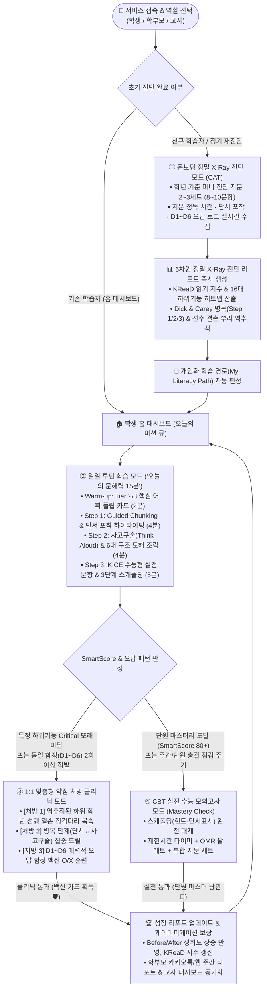
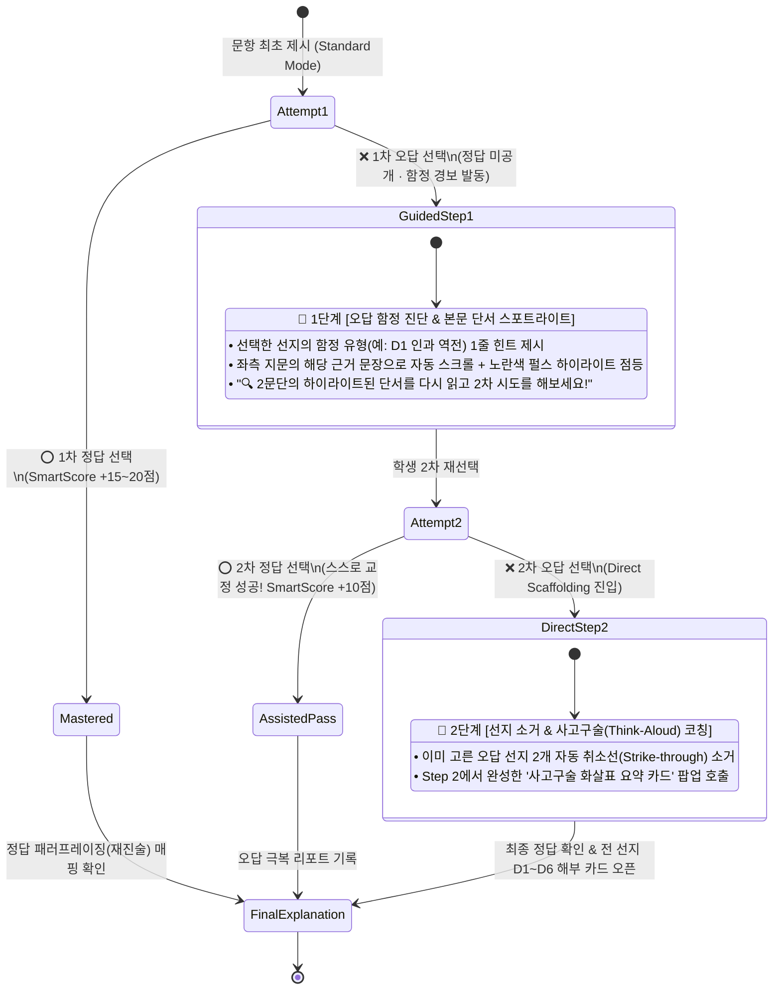

# [Track 4 종합 심층 조사 보고서] 상용 출시 수준(Production-Ready) 문해력 코스웨어 고도화를 위한 글로벌 벤치마킹 · 서비스 여정 · 차세대 TEI 문항 · 대시보드 UI/UX 마스터 리서치

본 문서는 기존 프로토타입(`courseware/output/expository_literacy_courseware.html`)의 핵심 컨셉(**6차원 정밀 X-Ray 진단 ➔ 1:1 맞춤형 처방 클리닉 ➔ KICE 실전 수능 스케일링 루프**)을 그대로 계승하면서, 이를 **실제 상용 출시(Production-Ready) 가능한 에듀테크 제품**으로 고도화하기 위해 조사한 **서비스 여정(User Journey), 차세대 인터랙티브 문항(TEI), 디지털 리더 UI/UX, 다중 역할 대시보드(LAD) 및 디자인 시스템**의 종합 조사 보고서입니다.

---

## Ⅰ. 현재 프로토타입(As-Is) 자산 진단 및 상용 제품(To-Be) 고도화 격차(Gap) 분석

현재 프로토타입은 교육학적·평가학적 설계(96+36 위계, KReaD 지수, Dick & Carey 3단계, KICE 6대 오답 공식 `D1~D6`) 면에서 이미 국내 최고 수준의 콘텐츠 아키텍처를 확보하고 있습니다. 이를 상용 SaaS/웹앱 수준으로 끌어올리기 위한 **As-Is 대비 To-Be 고도화 매트릭스**는 다음과 같습니다.

| 고도화 영역 | 현재 프로토타입 (As-Is) | 상용 출시 수준 제품 (To-Be 고도화 목표) |
| :--- | :--- | :--- |
| **1. 서비스 여정 & 학습 모드** | 단일 화면 내 3탭 스텝퍼(`① 진단 ➔ ② 처방 ➔ ③ 실전 수능`) 수동 전환 및 고정 페르소나 시뮬레이션 | **4대 유기적 학습 모드**로 완결된 사용자 여정 구현:<br>① **온보딩 적응형 진단(CAT)** ➔ ② **오늘의 문해력(일일 루틴 15분)** ➔ ③ **1:1 약점 처방 클리닉(자동 분기)** ➔ ④ **CBT 실전 수능 모의고사(No-Scaffolding)** |
| **2. 진단 및 점수 엔진** | 사전에 입력된 정적 진단 점수 및 단일 문항 선지 클릭 시뮬레이터 | • **실시간 정오답·풀이시간·행동 로그 수집 엔진**<br>• **IXL식 동적 숙련도(`Literacy SmartScore 0~100`)** 및 **실시간 KReaD 추이 업데이트**<br>• **4대 풀이 성향 프로파일링** (*꼼꼼 정독형 / 성급한 추측형[찍기] / 과도한 고민형 / 어휘 막힘형*) |
| **3. 문항 인터랙션 (TEI)** | • 단순 토글형 단서 하이라이트 버튼<br>• 기본 `<select>` 드롭다운 Cloze<br>• O/X 버튼 및 단일 선택 객관식 | **글로벌 평가 표준(NAEP·PISA·SBAC·QTI 3.0) 7대 TEI 인터랙션 엔진**:<br>① **Hot Text** (지문 내 근거 문장/단서 직접 클릭 채점)<br>② **EBSR** (Part A 추론 + Part B 본문 근거 문장 2단계 연동 채점)<br>③ **Guided Chunking (CommonLit식)** (문단별 게이트키퍼 질문 통과 시 다음 문단 블러 해제)<br>④ **Graphic Organizer (Drag & Tap)** (6대 설명 구조 도해조직자 직접 조립)<br>⑤ **Multi-Source Split-Tab** (`(가)` 지문 + `(나)` 인터랙티브 차트/매체 탭 교차 분석)<br>⑥ **In-situ Writing & Revision Editor** (깔때기 주제 좁히기, 불량 자료 휴지통 필터링, 개요 블록 이동, 초고 위 직접 교정부호 퇴고) |
| **4. 오답 스캐폴딩 & 피드백** | 선지 클릭 즉시 하단에 정오답 및 공식 해설 텍스트 일괄 노출 | **Lexia / ITS 방식 3단계 점진적 스캐폴딩 상태 머신(Progressive Hinting)**:<br>• **1차 시도(Standard)**: 자력 풀이<br>• **1차 오답(Guided Blue)**: 정답 미공개 + `[D1~D6 함정 경고]` + **좌측 지문 근거 문장 자동 스크롤 & 스포트라이트 점등**<br>• **2차 오답(Direct Yellow)**: 오답 선지 취소선 소거(Strike-through) + **사고구술(Think-Aloud) 힌트 버블** ➔ 재도전 후 마스터 해설 오픈 |
| **5. 디지털 읽기 환경 (Reader UX)** | 기본 텍스트 박스 + 하단 어휘 칩 나열 | **전문 CBT/전자책 수준의 Split-Screen Reader 7대 도구 모음**:<br>• 목적별 3색 형광펜(`🟡중심문장` / `🟢단서·어휘` / `🩷주의·조건`) & 지우개<br>• 인라인 점선 어휘 클릭 시 **말풍선 사전 팝오버(발음·뜻·유의어·예문)**<br>• 문단/문장 번호 토글, 글자 크기·줄간격·배경 테마(종이/세피아/다크), **포커스 라인 리더(집중 마스킹)**, **의미 단위 끊어 읽기(/)** 및 **TTS 음성 동기화** |
| **6. 대시보드 & 리포트 (LAD)** | 한 화면에 학생·교사·설계자 정보가 모두 섞여 있는 올인원 뷰 | **3대 역할별(Role-Based) 전용 대시보드 분리**:<br>• **학생 포털**: 오늘의 미션 큐, 96+36 별자리 스킬 트리, **D1~D6 오답 함정 백신 도감**, 망각곡선 복습 큐<br>• **학부모 리포트**: **10초 요약 배너(Where·Why·How)**, 동학년 백분위 불릿 차트, 처방 전후(Before/After) 슬로프 차트, **오늘 저녁 5분 식탁 질문 가이드**<br>• **교사/관리자 대시보드**: 학급 전체 16하위기능 히트맵 매트릭스, 위험군(At-Risk/찍기 의심) 자동 분류, **원클릭 맞춤 클리닉 일괄 배정 드로어** |

---

## Ⅱ. 글로벌 & 국내 적응형 문해력 코스웨어 심층 벤치마킹

### 1. 글로벌 에듀테크 4대 벤치마크 핵심 메커니즘

| 서비스명 | 핵심 적응형(Adaptive) 엔진 | 4단계 서비스 여정 (진단 ➔ 경로 ➔ 스캐폴딩/피드백 ➔ 마스터리/리포트) | 우리 제품에 이식할 핵심 UX 패턴 |
| :--- | :--- | :--- | :--- |
| **i-Ready** *(Curriculum Associates)* | **CAT 기반 Diagnostic** + **My Path** 자동 생성 | ① 6대 영역 CAT 진단 ➔ ② 개인별 `My Path` 레슨 시퀀스 배정 ➔ ③ *Intro ➔ Guided ➔ Independent* 루틴 ➔ ④ **Typical Growth**(평균 성장) vs **Stretch Growth**(도전 성장) 이중 지표 리포트 | • 학부모 리포트의 **학년 수준 대비 위치(Below/At/Above Grade Level)** 수평 불릿 차트<br>• **Typical vs Stretch Growth** 예상 성장 곡선 |
| **Lexia Core5 / PowerUp** | **Auto Placement** + **3-Step Instructional Branching** | ① 자동 배치 ➔ ② 주간 유닛 할당 ➔ ③ **3단계 실시간 분기(Standard Green ➔ Guided Blue ➔ Direct Yellow)** ➔ ④ 스캐폴딩 없는 Skill Check 통과 시 마스터리 인정 및 교사 알림(`Lexia Lesson`) | • **오답 시 즉시 진입하는 3단계 스캐폴딩 분기 엔진** (단순 해설 노출 대신 과제를 쪼개어 단서 포착부터 다시 유도) |
| **IXL Language Arts** | **Real-Time Diagnostic** + **SmartScore (0~100)** | ① 실시간 핀포인트 학년 수준 산출 ➔ ② Action Plan 추천 스킬 직결 ➔ ③ 전략+지문 근거 위치 피드백 ➔ ④ **SmartScore(0~100)**: 80점(숙련) ➔ 90점(Challenge Zone) ➔ 100점(완전 정복) | • 찍기를 방지하는 **동적 숙련도 게이지(SmartScore)**: 1차 정답(+15~20), 힌트 후 정답(+8), 오답(-5), 연속 정답 콤보 보너스 |
| **CommonLit 360 & Newsela** | **Guided Reading Mode (GRM)** + **Multi-Leveling** | ① 사전 레벨링 ➔ ② 적정 이독성 지문 매칭 ➔ ③ **문단별 청크(Chunk) 분할 + Gatekeeper 확인 질문 통과 시 다음 문단 블러(Blur) 해제** ➔ ④ 사후 종합 평가 | • 글을 대충 훑고 문제부터 찍는 초등학생의 나쁜 습관을 교정하는 **Guided Reading Mode (문단별 블러 해제 & 단서 포착 미션 연동)** |

### 2. 국내 문해력 서비스 & 공교육 진단 벤치마크 시사점
* **리드포스쿨 (Read for School)**: `① 지문 읽기 ➔ ② 어휘 학습 ➔ ③ 독해 문제 ➔ ④ 제목 짓기 ➔ ⑤ 요약하기 ➔ ⑥ 핵심 문장 찾기`의 **6단계 구조적 독해 마이크로 루프** 및 행동 기반 진단 지표 활용.
* **대교 써밋 국어 / 어휘력**: **KReaD(한국어 이독성 지수)** 기반 텍스트-학습자 매칭 및 오답 발생 시 근본 원인(어휘 vs 문장구조 vs 추론)을 역추적하는 **드릴다운(Drill-down) 알고리즘**.
* **EBS 문해력 진단 & 국가기초학력지원센터(배움이룸터)**: 국내 학부모와 교사에게 가장 설득력 높은 **영역별 밸런스 레이더 차트(내 점수 vs 동학년 평균 vs 상위 10%)** 및 백분위/등급 환산 지표.

---

## Ⅲ. 상용 출시용 End-to-End 서비스 여정(User Journey) 및 4대 학습 모드 아키텍처



### 1. 4대 학습 모드 상세 명세

| 모드 구분 | 진입 조건 (Trigger) | 화면 레이아웃 및 UX 특징 | 스캐폴딩 & 채점 규칙 |
| :--- | :--- | :--- | :--- |
| **① 온보딩/정기 X-Ray 진단 모드** *(Diagnostic CAT)* | • 최초 가입 시 또는 월 1회 정기 진단 시<br>• 데모 체험 시 학년별 페르소나 즉시 로드 지원 | • 불안감을 줄이는 미니멀 진행률 바 UI<br>• 문항별 지문 읽기 시간(Reading Time)과 선지 고민 시간(Response Latency)을 백그라운드 측정하여 **‘찍기(Rapid Guessing)’** 자동 감지 | • **No-Scaffolding**: 정확한 기저선(Baseline) 측정을 위해 힌트 비활성화<br>• 오답 선지에 매핑된 `D1~D6` 함정 코드와 `Step 1/2/3` 실패 지점을 집계해 6차원 X-Ray 프로파일 생성 |
| **② 일일 루틴 학습 모드** *(Daily Routine)* | • 학생 대시보드 최상단 CTA (`"오늘의 문해력 시작 (약 12분)"`) | • **4단계 마이크로 스텝퍼**:<br>  1) **어휘 워밍업**: 지문 내 Tier 2/3 핵심 어휘 3개 카드 학습<br>  2) **Step 1 (단서 포착)**: 문단별 가이드 리딩 + 본문 단서 Hot Text 클릭<br>  3) **Step 2 (관계 연결)**: 6대 구조 그래픽 오거나이저 조립 + 사고구술 빈칸 완성<br>  4) **Step 3 (실전 문항)**: KICE 수능형 문항 풀이 | • **3단계 점진적 스캐폴딩(Standard ➔ Guided ➔ Direct)** 작동<br>• 완료 시 **일일 스트릭(🔥)** 점등 및 **SmartScore** 상승 |
| **③ 1:1 약점 처방 클리닉 모드** *(Prescription Clinic)* | • 진단 결과 `Critical(🔴)` 판정 위계<br>• 일일 학습 중 특정 하위기능/오답 함정 반복 실패 시 자동 분기 | • 기존 프로토타입의 강력한 3단계 처방 구조 계승·고도화:<br>  - **[징검다리 복습]**: 선수 학년 결손 개념 카드 + 미니 퀴즈<br>  - **[병목 돌파 드릴]**: 지문 구조 X-Ray 필터(접속사·지시어 색깔 강조) + 사고구술 조립<br>  - **[오답 백신 드릴]**: 취약 함정(`D1~D6`) 변별 O/X 스피드 퀴즈 | • 클리닉 3단계 모두 80% 이상 통과 시 히트맵 셀이 `🔴 Critical ➔ 🟡 Fragile / 🟢 Mastered`로 실시간 승급 연출<br>• **‘오답 함정 백신 도감’**에 방어 완료 스탬프 획득 |
| **④ 실전 수능 모의고사 모드** *(CBT Mastery Exam)* | • 대단원 완료 시 또는 자유 모의고사 탭 선택 시 | • 실제 평가원/CBT 시험지 스타일 Split-Screen UI<br>• 우측 상단 타이머(ON/OFF 가능), 문항 번호 팔레트, **수능 시험지 전용 흑백/종이 질감 테마** 지원 | • 모든 스캐폴딩(단서 하이라이트, 사전, 힌트) 잠금<br>• 최종 제출 후 **전 문항 3단계 사고구술 해설지 & 오답 공식 분석표** 일괄 오픈 |

---

## Ⅳ. 차세대 인터랙티브 문항 구성 방식 (7대 TEI 메커니즘 & 스캐폴딩 설계)

프로토타입의 **설명문 16개 하위기능(`V1-1~W5`)**과 **Dick & Carey 3단계**를 글로벌 디지털 평가 표준(**NAEP DBA, PISA 2025, SBAC, 1EdTech QTI 3.0**)의 **7대 TEI(Technology-Enhanced Items)** 컴포넌트로 고도화합니다.

### 1. 코스웨어 탑재 7대 핵심 TEI(인터랙티브 문항) 명세

| TEI 유형 코드 | 문항 인터랙션 명칭 | 주요 적용 단계 및 하위기능 | 상세 UI/UX 동작 및 채점 메커니즘 |
| :--- | :--- | :--- | :--- |
| **`TEI-1`**<br>`HOT_TEXT` | **본문 단서 직접 클릭/하이라이팅**<br>*(Selectable Hot Text)* | • **모든 차시 Step 1 (단서 포착)**<br>• `V1-1`(세부 확인), `V1-2`(지시어/중심문장), `W5`(어법 오류 문장 찾기) | • 좌측 지문의 단어·구절·문장 토큰에 마우스 오버 시 미세한 하이라이트 프리뷰 표시<br>• 클릭/탭 시 노란색 형광펜 마킹 + 체크 배지 활성화 (`maxChoices` 개수 제한 지원)<br>• 학생이 눈으로만 읽지 않고 **직접 지문 속 표지어·단서를 찾아 클릭해야 다음 단계로 진행** |
| **`TEI-2`**<br>`EBSR` | **2단계 근거 연동형 선택 문항**<br>*(Evidence-Based Selected Response)* | • **Step 3 실전 문항 (추론·비판)**<br>• `V2-2`(인과 추론), `V2-4`(필자 관점), `V3-2`(신뢰성 평가) | • **Part A**: 추론/평가 결론을 묻는 객관식 문항<br>• **Part B**: *"Part A에서 그렇게 판단한 근거 문장을 윗글에서 고르시오"* (선지형 또는 좌측 지문 Hot Text 연동)<br>• **Gatekeeper 채점**: Part A와 Part B를 모두 맞혀야 완전 정답(찍기 원천 차단) |
| **`TEI-3`**<br>`INLINE_CLOZE` | **사고구술 & 요약 인라인 빈칸 조립**<br>*(Inline Choice / Tap-Cloze)* | • **모든 차시 Step 2 (사고구술 연결)**<br>• `V1-4`(거시규칙 요약), `V2-1`(문맥 어휘 추론) | • 숙련된 독자의 **사고구술(Think-Aloud) 스크립트** 내 핵심 연결 고리를 인라인 드롭다운 또는 **단어 칩 탭-투-플레이스(Tap-to-Place)**로 완성<br>• 완성된 사고구술 카드는 우측 상단 **‘나의 단서 보드’**에 고정되어 Step 3 문제 풀이 시 참조 가능 |
| **`TEI-4`**<br>`GRAPHIC_ORGANIZER` | **6대 설명 구조 도해조직자 빌더**<br>*(Interactive Structure Map)* | • **Step 2 & Step 3 구조 문항**<br>• `V1-2`(분류 vs 분석), `V1-3`(6대 설명 구조 도해), `V2-2`(연쇄 인과 사슬) | • Meyer 6대 설명 구조 맞춤형 템플릿 제공:<br>  ① **분류 트리**(기준별 종류) vs **분석 구조도**(전체-부품)<br>  ② **비교·대조 매트릭스 / 벤다이어그램**<br>  ③ **순서·과정 타임라인** / **인과 사슬 화살표(`A ➔ B ➔ C`)**<br>• 태블릿 오조작 방지를 위해 **Drag & Drop**과 **Tap-to-Select ➔ Tap-to-Slot** 듀얼 조작 100% 지원 |
| **`TEI-5`**<br>`MULTI_SOURCE_TAB` | **다중 매체·복합 도표 교차 분석기**<br>*(Split-Tab & Interactive Chart)* | • `V2-3`(텍스트+시각매체 통합 추론)<br>• `V3-1`(도표 적절성), `V3-3`(`(가)+(나)` 다중 자료 교차 검증) | • 좌측 패널 상단에 **`[📄 (가) 본문 지문]` \| `[📊 (나) 통계 그래프/인포그래픽]` \| `[⚖️ 나란히 비교]`** 탭 제공<br>• SVG/Canvas 기반 인터랙티브 차트 위에서 **특정 연도/막대/변곡점을 직접 클릭**하거나 툴팁으로 수치를 대조하는 액션 지원 |
| **`TEI-6`**<br>`WRITING_WORKBENCH` | **작문 계획·자료 선별·개요·집필 워크벤치**<br>*(Writing Process Modules)* | • `W1`(깔때기 주제 좁히기)<br>• `W2`(불량 자료 휴지통 필터링 & 차트 피커)<br>• `W3`(다층 개요 블록 이동)<br>• `W4`(조건 충족 문단 빌더) | • **`W1`**: 예상 독자 카드 확인 후 `대주제 ➔ 중주제 ➔ 소주제` 깔때기 슬롯 조립<br>• **`W2`**: 수집 자료 중 출처 미상·주제 일탈 카드를 `🗑️ 휴지통`으로 버리고 알맞은 그래프 유형(막대/꺾은선/원) 선택<br>• **`W3`**: `처음-가운데-끝` 개요 보드에서 통일성 위배 항목 삭제 및 담화표지 칩 장착<br>• **`W4`**: 3대 작문 조건(두괄식, 설명방법, 객관적 어조) 실시간 충족 불빛(`🟢/🔴`) 체크기 |
| **`TEI-7`**<br>`RED_PEN_EDITOR` | **인라인 교정부호 퇴고 에디터**<br>*(In-situ Proofreading Editor)* | • `W5`(내용·조직·표현 3단계 퇴고 고쳐쓰기) | • 학생 초고의 밑줄 구간(`㉠~㉤`) 클릭 시 상단 교정부호 팝오버(`빼기`, `고치기`, `넣기`, `자리 바꾸기`, `줄 바꿈`) 노출<br>• 선택 즉시 초고 위에 **빨간펜 교정부호 애니메이션과 수정된 문장**이 실시간 렌더링된 후 수능형 퇴고 문항 해결 |

---

### 2. 오답 선택 시 3단계 점진적 스캐폴딩 (Progressive Hinting) 상태 머신

학생이 Step 3 수능형 실전 문항에서 오답 선지를 클릭했을 때, 바로 정답을 알려주어 학습 기회를 박탈하는 대신 **인지적 도제(Cognitive Apprenticeship) 기반 3단계 피드백 루프**가 작동합니다.



---

## Ⅴ. 디지털 지문 읽기 환경(Split-Screen Reader) 및 학년군별 UI/UX 설계

### 1. 좌측 지문 + 우측 워크스페이스 스플릿 뷰 (Split-View Ergonomics)

```text
+---------------------------------------------------------------------------------------------------+
| [상단 헤더] 🔬 초5 설명문 > V2-3 시각자료 통합 추론   [🖍️형광펜: 🟡중심 🟢단서 🩷주의] [📖사전 ON] |
|                                                       [🔢문단번호] [📏포커스리더] [🔊TTS] [가+ 크기]|
+-------------------------------------------------+-------------------------------------------------+
| [좌측 패널: 지문 & 다중 매체 뷰어 (52% 폭)]     | [우측 패널: 3단계 학습 워크스페이스 (48% 폭)]   |
| [탭: 📄 (가) 산호초 백화 현상 | 📊 (나) 수온 통계]| [진행 바: ✅Step 1 단서 ➔ ✅Step 2 연결 ➔ 🎯Step 3]|
| ----------------------------------------------- | ----------------------------------------------- |
| [1문단] 열대 바다의 얕은 곳에 사는 산호는 식물  | 📌 [고정된 나의 단서 보드 (Step 1·2 요약)]      |
| 처럼 보이지만 실제로는 수많은 작은 동물 개체... |  • 원인: 고수온 지속 ➔ 공생 조류가 [독성 산소]  |
| 산호의 조직 속에 사는 미세한 식물성 플랑크톤인  |  • 결과: 산호가 공생 조류 배출 ➔ [백화 현상]    |
| ㉠'공생 조류'(점선: 클릭시 사전 팝오버) 덕분이다.| ----------------------------------------------- |
|                                                 | [Step 3 실전 수능 문항] (CSAT-READ-V2-3)        |
| [2문단] ... 바닷물의 온도가 평년보다 1~2℃ 이상  | 문항 1. 윗글을 바탕으로 <보기>를 이해한 내용으로|
| 높은 상태가 지속되면 ㉡이러한 공생 관계가 깨진다| 적절하지 않은 것은? (5지선다)                   |
| 🎯[스포트라이트 점등 구간: 수온이 너무 높아지면 |                                                 |
| 공생 조류의 광합성 기능에 이상이 생겨 산호의    | [ ① 2019년에 건강한 산호 군집 비율이 급격히... ]|
| 세포를 손상시키는 독성 산소 물질을 내뿜기 때문] | [ ② 2019년에 백화 현상을 겪었던 산호 중...     ]|
|                                                 | [ ❌④ 산호가 뿜어낸 독성 산소 물질이... (소거) ]|
| +---------------------------------------------+ |   └─ 🚨 [D5 주체 전도 함정!] 2문단 노란색 단서  |
| | 📊 [인터랙티브 차트] 연도별 수온 편차 & 산호 | |      에서 누가 독성 물질을 내뿜는지 다시 봐요!  |
| | (막대 클릭 시 본문 관련 문장과 하이라이트)  | |                                                 |
| +---------------------------------------------+ | [ ⑤ 2023년에 하얗게 변한 산호들이 관찰...      ]|
+-------------------------------------------------+-------------------------------------------------+
```

### 2. 초등 3대 학년군별(초저 1~2 / 초중 3~4 / 초고 5~6) 적응형 UI/UX 스펙트럼

하나의 코드베이스 위에서 선택된 학년(`grade: 1~6`)에 따라 **CSS 변수(폰트 크기, 줄간격, 터치 타겟, 라운딩)와 UI 모드**가 자동으로 스위치되도록 설계합니다.

| UI/UX 설계 차원 | 🌱 초등 저학년 모드 (1~2학년군) | 🌿 초등 중학년 모드 (3~4학년군) | 🌳 초등 고학년 모드 (5~6학년군) |
| :--- | :--- | :--- | :--- |
| **테마 & 비주얼 톤** | **Friendly Explorer Theme**<br>• 따뜻한 파스텔 톤, 둥근 카드(`radius: 20px`), 친근한 캐릭터 AI 코치 말풍선 가이드 | **Structured Discovery Theme**<br>• 명확한 컬러 배지, 깔끔한 워크북 스타일(`radius: 14px`), 도해조직자 중심 레이아웃 | **Academic Studio & CBT Theme**<br>• 모던 인디고·슬레이트 톤(`radius: 10px`), 실제 KICE 수능/CBT 시험지 모드 토글 지원 |
| **지문 타이포그래피** | • 글자 크기 **`20~22px`**, 줄간격 **`2.1`**<br>• **의미 마디 끊어 읽기(/)** 및 **포커스 라인 리더** 기본 추천 | • 글자 크기 **`18px`**, 줄간격 **`1.9`**<br>• 문단 첫 칸 들여쓰기 및 `[1문단]` 배지 기본 표시 | • 글자 크기 **`16~17px`**, 줄간격 **`1.8`**<br>• 고밀도 학술 지문 + 다중 탭(`(가)/(나)`) + 각주·복합 도표 배치 |
| **음성(TTS) 스캐폴딩** | • 지문 전체 싱크로 TTS + **발문·선지 옆 개별 `🔊 읽어주기` 버튼 상시 노출** (해독 미숙으로 인한 오답 방지) | • 지문 문단별 TTS + 어휘 사전 내 발음 듣기 지원 | • 상단 툴바에 보조 접근성 도구로 축약 배치 |
| **선지 및 인터랙션** | • **3지선다** (`①~③`, 단문 4~6어절)<br>• 큰 터치 타겟(`min-height: 56px`)<br>• **Tap-to-Place** 위주 조각 맞추기 | • **4지선다** (`①~④`, 복문 7~11어절)<br>• 터치 타겟(`min-height: 48px`)<br>• **EBSR 2단계 문항** 및 비교표/꺾은선그래프 연동 | • **5지선다** (`①~⑤`, 복합문 12~18어절)<br>• 터치 타겟(`min-height: 44px`)<br>• **다중 매체 교차 검증** 및 **교정부호 퇴고 에디터** |

---

## Ⅵ. 다중 역할 대시보드(학생·학부모·교사) 및 6차원 X-Ray 시각화 설계

상용 제품에서는 상단 역할 전환기(또는 로그인 권한)에 따라 **① 학생 학습 포털**, **② 학부모 진단·성장 리포트**, **③ 교사 클래스 매트릭스**의 3가지 최적화된 대시보드 뷰를 제공합니다.

### 1. 이해관계자별 대시보드 핵심 구성 비교

| 구분 | 👦 학생용 대시보드 (Student Portal) | 👨‍👩‍👧 학부모용 리포트 (Parent X-Ray Report) | 👩‍🏫 교사/원장용 대시보드 (Teacher Console) |
| :--- | :--- | :--- | :--- |
| **핵심 가치 (Value)** | *"오늘 무엇을 풀어야 하는지 명확하고, 내 약점을 고칠수록 레벨과 도감이 채워진다!"* | *"우리 아이가 어디가·왜·어떻게 부족한지 10초 만에 이해되고, 처방 후 성장이 눈으로 보인다!"* | *"우리 반 28명 중 누가 어느 하위기능에서 막혔는지 3초 만에 찾고 원클릭으로 클리닉을 배정한다!"* |
| **핵심 위젯 1** | **오늘의 맞춤 학습 미션 큐 (Hero CTA)**<br>(일일 루틴 + 자동 배정된 약점 클리닉) | **10초 핵심 진단 요약 배너 (Executive Summary)**<br>(`📍어디가[Where]` · `🧠왜[Why]` · `💊어떻게[How]`) | **조기 경보 Triage 바**<br>(`🔴긴급 개입 필요` / `🟠주의·정체` / `⚡찍기 의심` 필터) |
| **핵심 위젯 2** | **KReaD 읽기 지수 성장 게이지 & 스트릭(🔥)**<br>(학년 권장 범위 대비 현재 내 위치) | **6차원 정밀 X-Ray 진단 대시보드**<br>(16하위기능 히트맵 + 어휘/통사 + 6대 구조 + 병목 퍼널) | **학급 전체 하위기능 마스터리 히트맵**<br>(학생 행 × 16대 하위기능 열 매트릭스) |
| **핵심 위젯 3** | **나의 16대 하위기능 스킬 트리 & 히트맵**<br>(마스터 왕관 / 수리 필요 스패너 아이콘 표시) | **처방 전후(Before ➔ After) 클리닉 효과 검증 카드**<br>(예: `V2-3 도표 추론 38점 ➔ 92점 ▲54p`) | **선수 결손 그룹핑 & 일괄 처방 드로어**<br>(동일 결손 학생 다중 선택 ➔ 맞춤 클리닉 일괄 발송) |
| **핵심 위젯 4** | **🛡️ 수능 6대 오답 함정(D1~D6) 백신 도감**<br>(함정 방어 성공 시 브론즈➔실버➔골드 진화) | **🏠 오늘 저녁 5분 식탁 대화 가이드**<br>(아이의 현재 결손 하위기능을 자극하는 부모 발문 팁) | **문항별 선지 선택 분포(Stacked Bar) & 커리큘럼 탐색기**<br>(96+36 전체 위계 매핑 및 수업용 지문/문제지 인쇄 모드) |

### 2. 6차원 정밀 X-Ray 진단 데이터 시각화 컴포넌트 규격

기존 프로토타입의 6차원 X-Ray 데이터를 상용 대시보드 수준으로 격상하기 위한 표준 시각화 컴포넌트 명세입니다.

1. **[차원 ①] 16대 하위기능(`V1-1~W5`) 4×4 마스터리 히트맵 & 3단계 드릴다운**
   - **시맨틱 컬러 토큰 (색각 이상 접근성 아이콘 병기)**:
     - `🟢 Mastered (70~100점)`: Emerald (`#10B981`, 배경 `#ECFDF5`) + 체크 아이콘(`✓`)
     - `🟡 Fragile (51~69점)`: Amber (`#F59E0B`, 배경 `#FFFBEB`) + 주의 물결 아이콘(`◐`)
     - `🔴 Critical (0~50점)`: Coral Rose (`#F43F5E`, 배경 `#FFF1F2`, 2px 강조 보더) + 경고 아이콘(`!`)
   - **드릴다운**: 타일 클릭 시 우측 상세 패널에 **[Mager 수행목표 기준] + [학생 오답 소견] + [연결된 선수 결손 노드] + `[💊 즉시 이 스킬 클리닉 시작]`** 버튼 연동.
2. **[차원 ②·③] 어휘(Tier 1·2·3)·통사 해독력 불릿 바 & Meyer 6대 설명 구조 숙련도 차트**
   - 단순 프로그레스 바 위에 **‘동학년 권장 기준선(Target Marker Line)’**을 수직 핀으로 표시하여, 동학년 평균 대비 부족한 폭(Deficit Gap)을 직관적으로 시각화.
3. **[차원 ④] Dick & Carey 3단계 인지 병목 수평 퍼널 차트 (Cognitive Bottleneck Funnel)**
   - `[Step 1: 지문 단서 포착 (88%)] ➔ [Step 2: 관계·맥락 연결 (42% 🚨-46%p 급락!)] ➔ [Step 3: 수능 선지 판별 (45%)]`
   - 급락 구간(Drop-off Wedge)을 붉은색 하이라이트 배지로 자동 감지하여, *"글자나 단어는 찾지만(Step 1 정상), 두 문장의 인과·구조를 엮는 과정(Step 2)에서 병목이 발생합니다"*라고 명확히 규명.
4. **[차원 ⑤] KICE 수능 6대 매력적 오답 공식(`D1~D6`) 취약도 레이더 & 백신 카드**
   - `D1(인과 역전)`, `D2(선후 왜곡)`, `D3(조건·한정어 과장)`, `D4(속성·분류 교차)`, `D5(주객·준거 전도)`, `D6(본문 외 상식/짜깁기)` 6개 축의 **함정 취약 지수(Vulnerability %)**와 **누적 방어 성공 횟수**를 동시에 표시.
5. **[차원 ⑥] 종적 결손 뿌리 역추적 DAG 트리 (Root-Cause Backtracking Graph)**
   - `[선수 뿌리 결손 (예: 초2 순서·인과 담화표지)] ━━▶ [중간 매개 결손 (예: 초3 중심-뒷받침 관계)] ━━▶ [현재 학년 타깃 결손 (예: 초5 다단계 연쇄 인과 추론)]`
   - 최하위 뿌리 노드에 **`[🔍 Root Cause — 클리닉 1단계 복습 타깃]`** 펄스 배지를 부착하여 처방 클리닉의 정당성과 설득력을 극대화.

---

## Ⅶ. 디자인 시스템 아키텍처 (Dual-Context Theme System)

상용 에듀테크 트렌드에 맞추어 **① 대시보드·리포트 맥락(Analytics Mode)**과 **② 지문 독해·학습 스튜디오 맥락(Reading Studio Mode)**의 시각적 피로도와 목적을 분리한 **Dual-Context 디자인 시스템**을 적용합니다.

| 디자인 토큰 영역 | 📊 Analytics Mode (진단 대시보드 · 학부모/교사 리포트) | 📖 Reading Studio Mode (지문 독해 · 처방 클리닉 · 실전 문항) |
| :--- | :--- | :--- |
| **배경(Surface) 팔레트** | Cool Slate Alabaster (`#F8FAFC`) + Pure White 카드 (`#FFFFFF`) | Warm Ivory Paper (`#FCFBF7` / 세피아 `#F4EFE6`) — 장시간 독해 시 눈부심 방지 |
| **브랜드 & 액센트 컬러** | Deep Trust Navy (`#0F172A`) & Royal Blue (`#1D4ED8`) | Focus Indigo (`#2563EB`) + 하이라이터 파스텔(`#FEF08A`, `#BBF7D0`, `#FECDD3`) |
| **타이포그래피 분리** | • **UI/수치**: `Pretendard Variable` (`font-variant-numeric: tabular-nums` 고정폭 숫자 필수 적용) | • **지문 본문**: `KoPub바탕 / 마루부리(명조)` ↔ `Pretendard(고딕)` 전환 토글 지원<br>• 한 줄 최적 글자 수 `35~48자`(`max-width: 65ch`) 엄수 |
| **반응형 그리드 & 디바이스** | • **PC (1440px+)**: 12컬럼 Master-Detail 레이아웃<br>• **태블릿 (1024px)**: Collapsible 사이드바 + 2단 그리드<br>• **모바일**: 학부모 알림톡 리포트용 1단 버티컬 스토리텔링 카드 | • **데스크톱/태블릿 가로**: 좌측 지문(52%) + 우측 문항 워크스페이스(48%) 고정 Split-Pane (독립 스크롤 및 리사이즈 바 지원) |
