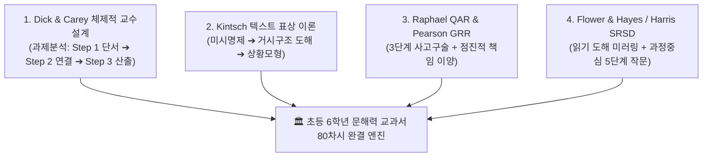
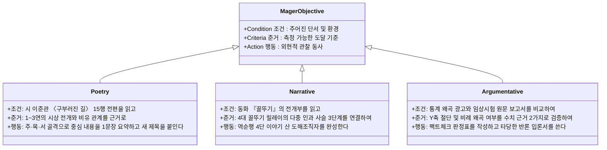
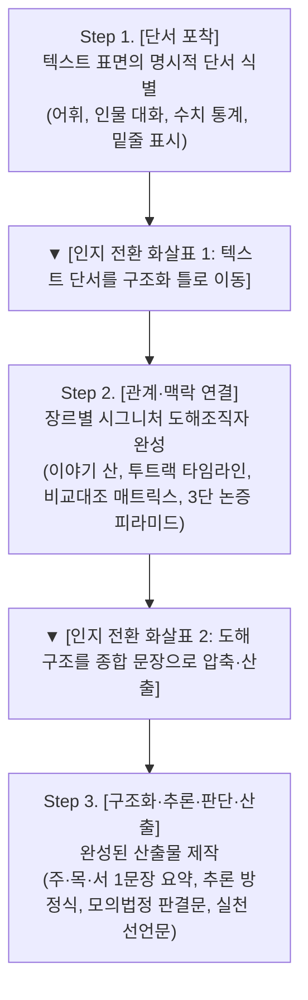
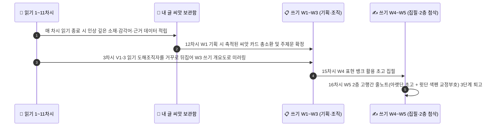

# 📊 01. 초1~6학년 종적·횡적 문해력 위계(516단위) 및 6학년 86개 마스터 위계 해설서

본 문서는 초등 6학년 문해력 교과서 「읽고 생각하고 표현하고」(전 5단원 · 80차시 · 160쪽) 및 교사용 지도서(160쪽)의 최상위 교육공학적 설계 원천인 **초1~6학년 문해력 하위기능 및 목표 위계 마스터(516단위)**와 **6학년 86개 마스터 위계(공통기초 6 + 5대 장르 80)**의 구조를 심층 해설합니다.

---

## 1. 핵심 교육공학 설계 철학: 지문 역변환 제로 원칙 (Zero Reverse-Engineering)

### 1-1. 기존 국어 교과서 및 상용 독해 문제집의 한계 진단
기존의 초등 국어 교과서나 상용 독해 교재들은 대체로 다음과 같은 구조적 한계를 안고 있었습니다.
1. **지문 역변환식 문항 출제**: 특정 지문을 먼저 선정한 뒤 지문에 맞춰 사후적으로 임의의 질문을 만드는 방식으로, 학습자가 어떤 체계적인 인지적 경로(Cognitive Path)를 밟아야 하는지 체계가 부재했습니다.
2. **토막글 중심의 파편적 독해**: 200~400자의 짧은 토막글을 읽고 사지선다형 정답을 고르는 방식에 머물러, 1,000자 이상의 긴 호흡 텍스트를 마주했을 때 정보의 위계를 잡거나 서사의 복선을 추적하는 거시 독해력이 길러지지 않았습니다.
3. **읽기와 쓰기의 단절**: 읽기 단원에서는 읽기만 하고, 쓰기 단원에서는 전혀 다른 글감으로 처음부터 쓰기를 시작하여, 읽기에서 배운 구조와 어휘가 쓰기로 전이되지 못했습니다.
4. **결과 중심 목표 진술**: *"주제를 파악할 수 있다"*, *"인물의 심리를 추론할 수 있다"*처럼 최종 도달점만 제시되어, 학생이 머릿속에서 어떤 단서를 찾아 어떤 단계로 사고해야 하는지 과정을 안내하지 못했습니다.

### 1-2. 본 교과서의 4대 이론적 기틀
본 프로젝트는 이러한 한계를 극복하기 위해 인지심리학 및 독해·작문 교육학의 최고 권위 이론들을 집대성하여 설계되었습니다.

1. **Dick & Carey 체제적 교수설계 (Task Analysis)**: 최종 종결 목표를 학생이 관찰 가능한 4단계 미시 인지 행동(`Level 0 출발점 행동` ➔ `Level 1 단서 포착` ➔ `Level 2 관계/맥락 연결` ➔ `Level 3 구조화/판단/산출`)으로 초세분화했습니다.
2. **Kintsch의 텍스트 표상 및 거시규칙 이론**: 텍스트 표면의 미시 명제들을 4대 거시규칙(**삭제, 선택, 일반화, 재구성**)을 통해 압축하고, 이를 장르별 시그니처 도해조직자로 구조화하도록 설계했습니다.
3. **Raphael의 QAR(Question-Answer Relationship) & 사고구술**: 질문의 위치(바로 거기, 생각하고 찾기, 작가와 나, 내 생각)를 판별하고, **`[💭 질문] ➔ [🧠 단서] ➔ [✅ 확정]`**의 3단계 미시 사고구술 루프를 지면에 내장했습니다.
4. **Flower & Hayes의 인지적 작문 모형 & Harris의 SRSD(자기조절 전략개발)**: 읽을 때 분석한 도해조직자를 그대로 반전시켜 내 글의 건축 설계도로 미러링하고, 2층 고행간 첨삭 줄공책에서 3단계 초인지 퇴고를 수행하도록 구성했습니다.

---

## 2. 초1~6학년 종적 나선형 문해력 발달 조감도 (516개 위계 체계)

초등학교 1학년부터 6학년까지의 문해력 발달 과업을 **516개 세부 위계 단위(1,548개 미시 단계, 1,032개 Mager 수행목표)**로 체계화한 종적 나선형 교육과정 조감도입니다.

| 학년군 | 인지 발달 단계 | 핵심 문해력 과업 (Reading & Writing Milestones) | 장르별 특화 초점 |
| :---: | :--- | :--- | :--- |
| **초등 1~2학년** *(7~8세)* | **해독 및 기초 표상 형성기** *(Decoding & Emergent Literacy)* | • 한글 자모 음가 대응 및 기초 단어 해독 • 문장 부호 식별 및 기본 문장성분(누가/무엇이) 확인 • 1~2문장의 단문으로 생각이나 느낌 표현하기 | • 동시: 말놀이, 흉내 내는 말, 반복 리듬 • 옛이야기: 시간 순서, 인물 행동 • 설명: 사물의 특징과 이름 분류 |
| **초등 3~4학년** *(9~10세)* | **문단 중심내용 및 기초 추론기** *(Paragraph Comprehension & Local Inference)* | • 문단 내 중심문장과 뒷받침문장 구분 • 시간·공간·기초 인과 흐름 파악 • 사전 활용 기본의·다의어 탐색 및 3단 구성(처음-가운데-끝) 단락 글쓰기 | • 시: 감각적 표현과 오감 심상 • 이야기: 인물의 성격과 사건 전개 • 설명: 정의, 예시, 비교 기초 • 의견글: 주장과 이유의 일치 |
| **초등 5학년** *(11세)* | **거시구조 도해 및 심층 추론기** *(Macro-Structural Mapping & Deep Inference)* | • 한자어·복합어 형태소 분석(`[어근+접사]`) • 거시 지시어 역추적 및 Kintsch 거시 요약 • 4단 플롯(발단-전개-절정-결말), 여정-견문-감상 기행문, 6대 설명 구조 도해, Toulmin 3단 논증(주장-이유-근거) | • 시: 비유(직유·은유·의인)와 시상 전개 • 이야기: 내적/외적 갈등, 복선 추적 • 설명: 6대 구조(분류·분석·인과 등) • 논설: 3단 논증 피라미드 |
| **초등 6학년** *(12~13세)* | **비판적 검증 및 지식변환 완성기** *(Critical Evaluation & Knowledge Transformation)* | • 다중 복합어(`[6국04-02]`), 역설·관용어(`[6국04-04]`), 다중 겹문장 주술·부사어 호응(`[6국04-05]`) • 역순행 플롯 해체·재배열, 4인 모의 법정 판결, 이중 성찰 수필, 다중 매체 교차 검증, 숨은 전제(Warrant) 복원, 4대 논리 오류·통계 왜곡 팩트체크 • **읽기 도해 미러링 개요 설계 & 2층 고행간 3단계 과정중심 글쓰기 완성** | **본 교과서의 5대 장르 전 80차시 완결 구현** (시 16 + 이야기 16 + 수필 16 + 설명 16 + 논설 16) |

---

## 3. 딕앤캐리(Dick & Carey) 체제적 교수설계 원리에 따른 Level 0~3 미시 인지 분해

본 교과서의 모든 차시 활동은 딕앤캐리 모형에 따라 학생의 머릿속 인지 흐름을 **외현적 관찰 행동**으로 100% 분해하여 설계되었습니다.

| 미시 인지 층위 | 인지 단계 명칭 | 학생의 머릿속 인지 작용 (Internal Cognition) | 교과서 지면 내 외현적 수행 행동 (Observable Action) |
| :---: | :--- | :--- | :--- |
| **Level 0** | **출발점 행동** *(Entry Behavior)* | 어휘 해독, 문장 기본 성분 인지, 장르 스키마 인출 | 소리 내어 읽기, 본문 훑어보기, 배경지식 떠올리기 |
| **Level 1** | **1단계: 단서 포착** *(Cue Detection)* | 텍스트 표면의 명시적 표지(핵심어, 지시어, 담화표지, 감각어, 인물 대화, 수치 통계) 선택적 주의집중 | **파란 밑줄(경험/사실)**, **빨간 밑줄(생각/주장)**, **동그라미/네모 기호 표기**, **형태소 분리** |
| **Level 2** | **2단계: 관계/맥락 연결** *(Contextual Linking)* | 포착한 단서들을 텍스트 내적 관계(지시·대용, 원인-결과, 원관념-보조관념, 상하위 위계) 또는 외적 맥락(배경지식, 시대적 상황, 평가 준거)과 연결 | **화살표 연결**, **공통점-차이점 매트릭스 채우기**, **장르별 시그니처 도해조직자 작성** |
| **Level 3** | **3단계: 구조화·추론·판단·산출** *(Structuring & Production)* | 연결된 관계망을 거시 구조로 통합 압축(요약), 생략된 전제/심리/의도 도출(추론), 준거 대조 가치 판정(평가), 내 글 초고 및 퇴고(산출) | **주·목·서 골격 1문장 요약문**, **추론 방정식 완성**, **교실 모의 법정 판결문**, **2층 첨삭 줄노트 퇴고** |

---

## 4. Mager 수행목표 3요소(`[조건] + [준거] + [행동]`) 원칙

본 교과서의 모든 차시 목표는 메이거(Mager)의 행동목표 진술 원칙에 따라 **`[조건(Condition)] + [준거(Criteria)] + [도달 행동(Behavior)]`**의 3요소를 완비하고 있습니다.

### 4-1. 메이거 3요소 구성 공식
* **`[조건 (Condition)]`**: 학생에게 주어지는 상황, 텍스트 단서, 도구 (예: *\"진형민 『꼴뚜기』의 3~4장면을 읽고, 담화 지시어와 인물의 대화를 단서로 삼아\"*)
* **`[준거 (Criteria)]`**: 성패를 판단하는 객관적 기준, 횟수, 범위 (예: *\"앞 사건이 뒤 사건을 유발한 인과 관계 2가지 이상을 찾아\"*)
* **`[행동 (Action)]`**: 관찰·측정 가능한 종결 행동 동사 (예: *\"이야기 산 도해조직자에 원인과 결과 화살표로 정리할 수 있다.\"*)

### 4-2. 5대 장르별 Mager 수행목표 대표 명세서

---

## 5. 6학년 86개 마스터 위계 구조 전수 해설

### 5-1. 공통 언어·문법·응집성 기초 6단위 (`G6-COM-A1` ~ `A6`)
별도의 고립된 문법 단원이 아니라, **5대 장르 80차시 지면 전반에 나선형으로 침투 결합**된 6대 기초 언어 기능입니다.

1. **`G6-COM-A1` (형태소·조어 및 단어 관계망)**:
   * 단일어 vs 복합어(합성어 `[어근+어근]`, 파생어 `[접사+어근]`, `[6국04-02]`)의 어근·접사 분해 및 상위어-하위어-동위어 계층망 분석.
   * *장르 적용*: 시의 감각어 어감 분석(`'구불구불', '흙투성이'`), 설명문의 학술 복합어(`'불투수성', '열폭주'`) 뜻 추론.
2. **`G6-COM-A2` (다의어·동음이의어 및 관용표현·속담 문맥 의미)**:
   * 다의어의 기본 의미와 문맥적 확장 의미 비교(`[6국04-03]`), 속담·관용표현의 비유적 함축 의미 추론(`[6국04-04]`).
   * *장르 적용*: 시 〈봄길〉의 '길'·'봄'의 함축 의미, 『꼴뚜기』의 '어물전 망신은 꼴뚜기가 시킨다', 논설문의 '발등에 불이 떨어지다'.
3. **`G6-COM-A3` (문장 필수 성분 및 호응 관계)**:
   * 다중 겹문장에서 수식어를 덜어내고 필수 성분(`주어+목적어+서술어`, `[6국04-05]`) 골격 추출.
   * 주어-서술어 호응, 부사어-서술어 호응(`'결코 ~ 아니다'`, `'비록 ~일지라도'`), 시제 호응 오류 교정.
   * *장르 적용*: 4차시 골격 요약문 작성 및 16차시 퇴고 단계에서 2층 고행간 색펜 교정부호 첨삭.
4. **`G6-COM-A4` (지시·대용 및 담화 응집성)**:
   * 문단 전체 명제를 한 낱말로 압축하여 받는 거시 지시어(`'이러한 현상은'`, `'이 문제는'`, `'그 결과'`) 역추적.
   * *장르 적용*: 설명문(산호 백화현상 인과 사슬), 논설문(주장-이유 연결 담화표지).
5. **`G6-COM-A5` (인과 관계 및 논증의 숨은 전제 Warrant)**:
   * 표면적 인과를 넘어 다단계 연쇄 인과 사슬, 서사 복선(Foreshadowing), 논증의 숨은 전제(Warrant) 복원 및 4대 논리 오류 판별.
   * *장르 적용*: 이야기(오선재-길이찬 갈등 사슬), 논설문(반려동물 의무교육 숨은 전제 복원).
6. **`G6-COM-A6` (중심-세부 위계 및 Kintsch 거시 요약)**:
   * Kintsch의 4대 거시 규칙(삭제, 선택, 일반화, 재구성)을 적용한 다단계 요약 및 다중 매체 정보 교차 통합.
   * *장르 적용*: 설명문(스마트 팜 3종 매체 교차 검증), 논설문(Y축 절단 왜곡 팩트체크).

---

### 5-2. 5대 장르 16대 표준 층위 (16층위 × 5장르 = 80차시) 총괄 매트릭스

| 차시 | 층위 코드 | 대분류 영역 | 16대 표준 인지 층위 명칭 | 인지 과업 및 산출물 | 읽기 ➔ 쓰기 1:1 수평 전이 메커니즘 |
| :---: | :---: | :---: | :--- | :--- | :--- |
| **1차시** | `V1-1` | 사실적 이해 | 내용 확인 (명시적 정보·대상·사실 식별) | 육하원칙 사실 식별, 핵심어·인물·배경·수치 확인 | ➔ `W2(생성)` 내 글의 핵심 글감·소재·대상으로 전이 |
| **2차시** | `V1-2` | 사실적 이해 | 관계 확인 (지시·인과·문장골격·비유) | 지시어 역추적, 문장 필수 성분(주·목·서) 추출, 비유 관계망 | ➔ `W3·W4(조직·집필)` 문장 결합 및 필수 성분 구성 원리로 전이 |
| **3차시** | `V1-3` | 사실적 이해 | 구조 확인 (장르별 텍스트 거시 구조 도해) | **장르 시그니처 도해조직자**(이야기산/타임라인/피라미드) | ➔ `W3(조직)` 읽기 도해를 1:1 미러링하여 내 글 개요도로 재활용 |
| **4차시** | `V1-4` | 사실적 이해 | 요약 및 주제 확인 (골격 요약·새 제목 짓기) | Kintsch 거시규칙 적용 1문장 골격 요약 및 제목 리브랜딩 | ➔ `W1(계획)` 내 글의 핵심 주제문 및 가제 설정 원리로 전이 |
| **5차시** | `V2-1` | 추론적 이해 | 어휘·비유·관용표현·형태소 문맥 추론 | 다의어 사전적 의미 vs 함축 의미, 관용구·오브제 상징 추론 | ➔ `W2·W4(생성·집필)` 참신한 비유·관용어·학술어휘 뱅크로 전이 |
| **6차시** | `V2-2` | 추론적 이해 | 생략된 상황·인과·숨은 전제 추론 | 행간의 내면 갈등 복원, 복선 역추적, **숨은 전제(Warrant)** | ➔ `W3·W4(조직·집필)` 서사 복선·이중 성찰·논증 전제 강화에 적용 |
| **7차시** | `V2-3` | 추론적 이해 | 인물 심리·화자 정서·시각자료 추론 | 비언어적 침묵·집단 방관 심리 추론, 텍스트+도표 교차 추론 | ➔ `W1·W4(계획·집필)` 독자 분석 및 반론 수용·재반박에 적용 |
| **8차시** | `V2-4` | 추론적 이해 | 작가 의도·관점·시점·맥락 추론 | 서술 시점(1인칭/3인칭) 비교, 작가의 삶·시대적 맥락 연결 | ➔ `W1(계획)` 필자의 관점 확립 및 글쓰기 목적 설정으로 전이 |
| **9차시** | `V3-1` | 평가적 이해 | 표현·서술 방식 및 근거 적절성 평가 | Tell vs Show 묘사 비교, 문체 비평, **근거자료 3점 신호등** | ➔ `W2·W5(생성·퇴고)` 생생한 묘사 생성 및 근거 타당성 검증 |
| **10차시** | `V3-2` | 평가적 이해 | 작품 공감·인물선택·논리 타당성 평가 | **4인 교실 모의 법정 판결문**, **4대 논리 오류 판별** | ➔ `W5(퇴고)` 내용 개연성·논리적 일관성 자기 점검 루브릭 |
| **11차시** | `V3-3` | 평가적 이해 | 독립적 읽기 (`You Do`) & 내 삶 연결 | **스캐폴딩 소거 상태 자율 독서**, 통계 왜곡 팩트체크 | ➔ `W1(계획)` 독립 독서 성찰 결과를 내 글의 핵심 논제로 채택 |
| **12차시** | `W1` | 과정중심 쓰기 | 계획하기 (목적·독자·주제·갈래 설정) | 1~11차시 `[🌱 내 글 씨앗 보관함]` 총소환, 주제문 확정 | 읽기에서 모은 씨앗 메모를 글쓰기 기획서로 전환 |
| **13차시** | `W2` | 과정중심 쓰기 | 내용 생성하기 (글감·감각·근거 수집) | 오감 심상, 인물 프로파일, 이중 시선, 3점 검증 자료 수집 | 브레인스토밍 및 신뢰성 있는 근거 자료 뱅크 구축 |
| **14차시** | `W3` | 과정중심 쓰기 | 내용 조직하기 (읽기 도해 미러링 개요 설계) | 3차시(`V1-3`) 읽기 도해조직자를 거꾸로 뒤집은 개요도 | 읽기 구조와 쓰기 구조의 1:1 대칭(Mirroring) 설계 |
| **15차시** | `W4` | 과정중심 쓰기 | 초고 집필하기 (장르별 핵심 표현 전략) | 장르 표현 뱅크(감각어/대화문/객관서술/인용문) 활용 집필 | 초고 작성 시 형식적 부담을 줄이고 내용 표현에 집중 |
| **16차시** | `W5` | 과정중심 쓰기 | 고쳐쓰기 (내용·조직·표현 3단계 퇴고) | **2층 고행간(12mm) 줄노트**에서 색펜 교정부호 첨삭 및 출판 | 내용 통일성, 조직 균형, 문장성분 호응(`[6국04-05]`) 교정 |

---

## 6. 유기적 활동 사슬(Activity Chaining) 표준 3단계 프로토콜

모든 읽기 차시(1~11차시) 우측 활동 지면은 독립된 파편 문항이 아니라, **아래로 흐르는 굵은 인지 화살표(`▼`)**를 통해 앞 단계의 산출물이 다음 단계의 재료가 되는 3단계 유기적 인지 파이프라인으로 설계되었습니다.

1. **`[Step 1. 단서 포착 (Cue Detection)]`**: 본문 좌측 페이지에서 읽은 텍스트 중 목표와 관련된 표면적 단서(어휘, 형태소, 행동, 수치, 접속사)를 찾아 우측 페이지 표에 채우거나 색깔별로 분류합니다.
2. **`[Step 2. 관계·맥락 연결 (Relational Linking)]`**: Step 1에서 찾은 단서들을 장르별 시그니처 도해조직자(이야기 산, 투트랙 타임라인, 비교대조 매트릭스, 논증 피라미드)의 해당 빈칸에 배치하여 관계망을 시각화합니다.
3. **`[Step 3. 구조화·추론·판단·산출 (Structuring / Judging / Producing)]`**: Step 2에서 완성한 도해조직자를 기반으로 잉여 수식어를 덜어내고, 핵심 문장 성분(주·목·서) 골격 요약문, 추론 방정식, 4인 교실 모의 법정 판결문 등의 최종 산출물을 완성합니다.

---

## 7. 읽기 ↔ 쓰기 1:1 수평 전이 메커니즘 (Horizontal Transfer)

본 교과서의 가장 독창적인 시스템은 **읽기 11차시 동안 축적된 인지적 자산이 쓰기 5차시로 물 흐르듯 전이**되는 수평 전이 아키텍처입니다.

1. **`[🌱 내 글 씨앗 보관함 (Writing Seed Dock)]`**: 모든 읽기 차시 하단에 배치된 메모 독(Dock)으로, 오늘 읽은 글에서 마음에 닿은 시어, 갈등 상황, 인상적인 통계, 일상 오브제를 1~2문장으로 즉시 적립합니다.
2. **읽기 도해조직자 1:1 미러링 (Graphic Organizer Mirroring)**: 3차시(`V1-3`)에서 남의 글을 해체할 때 사용한 도해조직자를 14차시(`W3`)에서 그대로 뒤집어 내 글의 건축 설계도로 활용합니다. (분석 도구가 곧 창작 도구가 됨)
3. **2층 고행간 첨삭 줄공책 (Two-Story Editing Studio)**: 15~16차시 글쓰기 스튜디오에는 행간이 12mm로 넓은 특수 2층 줄노트가 인쇄되어 있어, **아랫줄(연필 초고)**을 쓴 뒤 **윗줄(색펜 교정부호 첨삭)**에서 내용·조직·문장성분 호응(`[6국04-05]`)을 3단계 루브릭에 따라 자율 퇴고합니다.
