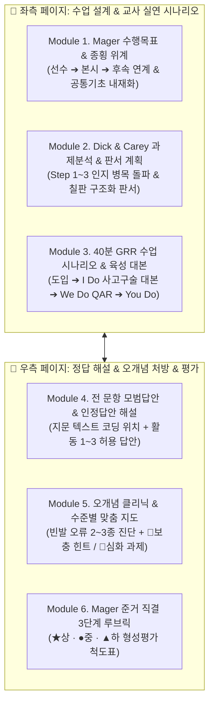

# 👩‍🏫 04. 교사용 지도서(Teacher's Guide) 6대 모듈 활용 매뉴얼 및 40분 수업 운영 모델

<!-- readx-document-context -->
> 작성 당시의 설계·조사·구현 기록입니다. 현재 기능과 운영 상태는 최신 현황을 우선합니다. [문서 목차](../../../docs/README.md) · [최신 현황](../../../docs/PROJECT_STATUS.md)

본 문서는 초등 6학년 문해력 교과서(전 5단원 · 80차시 · 160쪽)와 1:1로 완벽히 대응되는 **「초등 6학년 문해력 교사용 지도서 (전 80차시 · B5 160쪽 펼침면 완결 시스템)」**의 설계 철학, 6대 표준 모듈 아키텍처, 40분 정규 수업 운영 시나리오 및 전자칠판 인터랙티브 정답 오버레이 시스템을 상세히 안내합니다.

---

## 1. 교사용 지도서 개발 철학: 기존 상용 지도서의 한계와 패러다임 전환

### 1-1. 기존 교과서 지도서의 고질적 문제점
현행 초등 국어과 교사용 지도서는 교실 현장에서 다음과 같은 한계로 인해 실질적인 수업 길잡이 역할을 하지 못했습니다.
1. **형식적인 약안(Summary Plan) 나열**: *"학생들과 이야기를 나눈다"*, *"문제를 해결하게 한다"*와 같이 구체적인 교사 발문과 학생의 반응이 결여된 추상적인 진도표에 불과했습니다.
2. **사고 과정이 생략된 단순 정답지**: 우측 지면에 단순 단답형 정답만 기재되어 있어, 학생이 오답을 냈을 때 **어떤 인지적 오개념(Cognitive Misconception)** 때문에 그런 답이 나왔는지 교사가 진단하고 피드백할 수 없었습니다.
3. **사고구술(Think-Aloud) 모델링의 부재**: 국어과 독해·작문 기능은 머릿속에서 일어나는 비가시적 인지 과정이므로, 교사가 이를 교실 칠판 앞에서 어떻게 1인칭 소리 내어 생각하기(Think-Aloud)로 시연해야 하는지 **구체적인 육성 대본**이 전무했습니다.

### 1-2. 본 지도서의 패러다임 전환: 「수업 설계 ➔ 시연 ➔ 피드백 ➔ 평가」 원스톱 지면 구축
본 교사용 지도서는 매 차시 학생용 교과서의 2쪽 펼침면과 완벽히 1:1로 대응되는 **B5 2쪽 펼침면 전용 지도서 지면**으로 설계되었습니다.
* **좌측 페이지**: `Module 1 (Mager 목표·종횡 위계)` + `Module 2 (과제분석·시각적 판서)` + `Module 3 (40분 GRR 육성 사고구술 대본)`
* **우측 페이지**: `Module 4 (전 문항 모범답안·인정답안 해설)` + `Module 5 (오개념 클리닉·수준별 처방)` + `Module 6 (3단계 루브릭 형성평가표)`

---

## 2. 차시별 교사용 지도서 6대 표준 모듈 (6-Module Architecture)

### Module 1. Mager 수행목표 & 종적·횡적 연계 위계
* **이해·표현 Mager 목표 명시**: `[조건] + [준거] + [행동]`의 3요소를 갖춘 관찰 가능한 성취 기준 원문 제시.
* **종적 연계 (Vertical Articulation)**: 5학년 선수 학습(예: 4단 플롯, 사건의 원인과 결과) ➔ 6학년 본 차시(역순행 플롯 해체, 4인 모의 법정 판결) ➔ 중학교 1학년 후속 학습(갈등의 양상과 서술자의 시점)으로 이어지는 나선형 발달 경로 안내.
* **횡적 전이 (Horizontal Transfer)**: 공통 언어·문법 기초(`G6-COM-A1~A6`)가 본 차시 지문 독해 및 쓰기 표현과 어떻게 결합되는지 해설.

### Module 2. Dick & Carey 미시 과제분석 & 시각적 칠판 판서 모형
* **인지 병목(Cognitive Bottleneck) 분석**: 학생이 해당 차시에서 가장 흔히 겪는 사고의 막힘을 `Step 1 단서 포착` ➔ `Step 2 관계 연결` ➔ `Step 3 구조화·산출` 3단계로 분해하여 교사가 사전에 인지적 장애물을 파악하도록 지원.
* **시각적 판서 계획 (Blackboard Framework)**: 분필 또는 전자칠판에 판서할 핵심 도해 구조(좌측: 글의 갈래와 핵심 개념 / 중앙: 장르별 시그니처 도해조직자 / 우측: 요약문 및 오늘 배운 점)를 텍스트 아트로 정밀 레이아웃화.

### Module 3. 40분 GRR 수업 시나리오 & 교사 육성 3단계 사고구술(Think-Aloud) 대본 전문
* **도입 (5분)**: 단원의 본질적 질문(Essential Question) 환기 및 전시 `[🌱 씨앗 보관함]` 메모 소환 발문.
* **I Do (10분, 교사 모델링)**: 교사가 지문의 어느 행에서 멈추어 어떤 손짓과 함께 어떻게 1인칭 내적 독백을 소리 내어 말할지 적힌 **교사 육성 3단계 사고구술(Think-Aloud: 💭질문 ➔ 🧠단서 연결 ➔ ✅의미 확정) 실연 대본 전문**.
* **We Do (10분, 협력 학습)**: 교사와 학생, 또는 짝 간의 **Raphael QAR 발문 4종 ➔ 학생 예상 응답 ➔ 사고 정체 시 힌트 재발문(Scaffolding Prompts)** 대화록.
* **You Do (10분, 자율 독서·쓰기)**: 학생 개별 수행 시 교사의 순회지도 체크포인트 3가지.
* **정리 (5분)**: 학습 원리 일반화 및 교과서 우측 하단 `[🌱 내 글 씨앗 보관함]` 작성 지도.

### Module 4. 전 문항 모범답안 & 인정(허용)답안 판정 범위
* **본문 텍스트 코딩 정답 위치**: 좌측 본문 지문의 파란 밑줄(경험/사실), 빨간 밑줄(생각/주장), 동그라미·네모 표기 위치를 행 번호와 함께 정확히 명시.
* **우측 페이지 Step 1~3 단계별 모범 답안**:
  * Step 1 표 단서 정답
  * Step 2 도해조직자 빈칸 채우기 표준 답안
  * Step 3 요약문, 추론 방정식, 판결문, 퇴고 결과 모범 예시문
* **허용(인정) 답안 범위 및 채점 유의점**: 학생의 표현이 모범 답안과 정확히 일치하지 않더라도 핵심 문장 성분(주·목·서)이나 의미 관계가 충족되었을 때 정답으로 인정하는 구체적인 채점 가이드라인.

### Module 5. 초등 6학년 빈발 오개념 클리닉 & 수준별 맞춤 처방
* **빈발 오개념 2~3종 진단**: 초등 6학년 학생이 해당 차시에서 가장 자주 저지르는 오개념(예: 사실과 주장의 혼동, 인과 관계의 역전, 1인칭과 3인칭 시점의 혼동, 통계 그래프 Y축 절단 미인지)의 인지적 원인을 진단.
* **즉각 교정 처방**: 교사가 교실에서 즉시 적용할 수 있는 1분 원포인트 반문(Counter-questioning) 팁.
* **🔽 미도달 학습자 (Scaffolding Down)**: 단계적 힌트 카드, 문장 틀(Sentence Starter), 어휘 힌트 제공법.
* **🔼 심화 학습자 (Scaffolding Up)**: 다면적 관점 비교, 상반된 비판적 질문 생성 등 확장 과제 제시.

### Module 6. Mager 준거 직결 3단계 형성평가 루브릭
* Mager 수행목표의 `[준거]`를 그대로 평가 척도화한 3단계 형성평가 루브릭:
  * **★ 상 (수행 완수)**: 지문의 핵심 단서 2가지 이상을 모두 찾아 도해조직자를 완성하고 주·목·서 골격으로 정확히 산출함.
  * **● 중 (부분 완수)**: 핵심 단서를 1가지만 찾았거나, 도해조직자는 채웠으나 종합 산출문 작성에 교사의 부분적 도움이 필요함.
  * **▲ 하 (재지도 요망)**: 표면적 단서 포착에 어려움을 겪어 Level 1 단서 찾기 재발문이 필요함.

---

## 3. 40분 정규 수업의 시간 분초별 운영 매뉴얼 (Lesson Timeline)

```mermaid
gantt
    title 초등 6학년 문해력 교과서 40분 정규 수업 타임라인
    dateFormat  mm
    axisFormat  %M분
    section 도입 (5분)
    동기유발 & 단원 질문 소환     :00, 03m
    학습목표 및 활동 흐름 인지     :03, 02m
    section 전개 I (10분 - I Do)
    교사 지문 텍스트 코딩 시연    :05, 05m
    3단계 육성 사고구술 실연       :10, 05m
    section 전개 II (10분 - We Do)
    짝 대화 및 QAR 상호 발문      :15, 05m
    도해조직자 공동 완성          :20, 05m
    section 전개 III (10분 - You Do)
    개별 산출물 완성 (Step 3)     :25, 06m
    교사 순회지도 & 오개념 클리닉  :31, 04m
    section 정리 (5분)
    핵심 원리 일반화 공유         :35, 03m
    내 글 씨앗 보관함 적립        :38, 02m
```

---

## 4. 1,266개 정답 슬롯을 지원하는 원클릭 전자칠판 인터랙티브 오버레이(`.t-ans`)

교사용 지도서의 또 하나의 혁신적인 기능은 **웹 교과서 화면에서 원클릭으로 작동하는 인터랙티브 정답 오버레이 엔진**입니다.

### 4-1. 기술 메커니즘
* 교과서 지면 내 모든 학생 활동 빈칸, 표 셀, 도해조직자 박스, 줄공책, 씨앗 메모란에 숨김 처리된 `모범답안` 태그가 **총 1,266개 슬롯** 전수 삽입되어 있습니다.
* 상단 내비게이션 바의 **`👩‍🏫 교사용 정답·예시답안 겹쳐 보기`** 버튼을 클릭하면, CSS 토글을 통해 모든 빈칸에 빨간펜 손글씨 스타일로 모범 답안이 겹쳐 표시됩니다.

### 4-2. 교실 수업 활용 3단계 모드
1. **모드 1. 학생 자기주도 학습 모드 (Default)**: 모든 빈칸이 깨끗하게 비어 있어 학생이 스스로 책상 위에서 태블릿을 보며 사고하고 적을 수 있는 순수 학습자 모드.
2. **모드 2. 교사 모델링 및 판서 모드 (Teacher Overlay ON)**: 교사가 전자칠판 앞에서 수업을 진행할 때 버튼을 눌러 정답과 사고구술의 완성본을 띄워놓고 판서 및 피드백에 활용하는 모드.
3. **모드 3. 인쇄/PDF 출판 모드 (`@media print`)**: 시험지나 교사용 연구본을 출력할 때 상단 바가 자동으로 사라지고 정규 교과서 규격 그대로 깔끔하게 인쇄되는 모드.

---

## 5. 대표 장르별 교사 육성 사고구술(Think-Aloud) 대본 실례

### 5-1. 1단원 시 5차시 (정호승 〈봄길〉 추론적 이해)
> **교사**: *(지문 1행 '길이 끝나는 곳에서도 / 길이 있다'를 짚으며)*
> \"얘들아, 선생님이 1행을 읽는데 머릿속에 큰 물음표가 생겼어. **💭 [1단계 질문]** '길이 끝났는데 왜 또 길이 있다고 했을까? 앞뒤가 안 맞잖아?'
> 그래서 선생님은 단서를 찾아보았어. **🧠 [2단계 단서 연결]** 여기서 앞의 '길'은 우리가 발로 밟는 시멘트나 흙길을 뜻하지만, 뒤의 '길'은 사람이 살아가는 방법이나 희망을 뜻하는 것 같아. 시인은 '끝나다'라는 말을 절망에 빠진 순간으로 빗댄 거였어.
> 아하! 그렇다면 **✅ [3단계 의미 확정]** 이 구절은 '아무리 큰 절망에 빠져 더 이상 나아갈 수 없을 것 같을 때도, 포기하지 않으면 새로운 희망이 열린다'는 뜻이구나! 선생님이 찾은 단서에 파란 동그라미를 치고, 추론한 뜻을 돋보기 상자에 적어볼게.\"

### 5-2. 2단원 이야기 10차시 (진형민 『꼴뚜기』 4인 교실 모의 법정)
> **교사**: *(칠판에 오선재와 길이찬의 이름이 적힌 양팔 저울 도해를 그리며)*
> \"자, 10차시 법정에 선 오선재의 행동을 평가해 보자. **💭 [1단계 질문]** 선재가 이찬이가 그려준 새끼 오징어를 보고 선생님께 '이찬이가 그려줬어요'라고 고발한 것은 타당했을까?
> **🧠 [2단계 단서 연결]** 변호인의 관점에서 보면, 선재는 이찬이가 선의로 그려준 것이지만 자기가 꼴뚜기가 될까 봐 겁이 났을 거야. 하지만 검사의 관점에서 보면, 친구가 도와준 그림을 찢고 고발한 것은 친구의 믿음을 배신한 행동이지.
> **✅ [3단계 판결 확정]** 판사인 우리들은 양팔 저울의 양쪽 근거를 모두 들어본 뒤, '선재의 두려운 마음은 이해하지만, 친구의 선의를 고발하기 전에 이찬이에게 먼저 고마움과 미안함을 표현했어야 했다'는 대안 행동을 담은 판결문을 완성해야 해.\"
