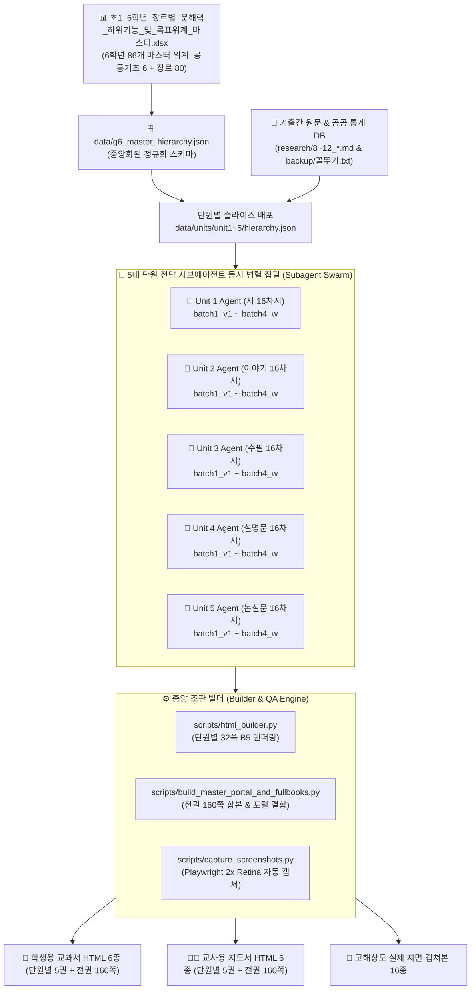

# 🤖 05. 멀티 서브에이전트(Subagent) 병렬 집필·조판 엔지니어링 아키텍처

<!-- readx-document-context -->
> 작성 당시의 설계·조사·구현 기록입니다. 현재 기능과 운영 상태는 최신 현황을 우선합니다. [문서 목차](../../../docs/README.md) · [최신 현황](../../../docs/PROJECT_STATUS.md)

본 문서는 총 80차시(학생용 교과서 160쪽 + 교사용 지도서 160쪽 = 총 320쪽 B5 지면, 약 3.3MB HTML 코드, 1,266개 정답 슬롯) 규모의 방대한 출판 교과서 프로젝트를 **단 한 줄의 지문 축약(`"..."`)이나 스키마 누락 없이 100% 무결성으로 완결**하기 위해 설계된 **Antigravity 멀티 서브에이전트 오케스트레이션 파이프라인**을 설명합니다.

---

## 1. 문제 정의: 생성형 AI 기반 교과서 개발의 3대 기술적 난제

단일 대규모 언어 모델(LLM)을 사용하여 80차시 분량의 교과서와 지도서를 순차적으로 생성하려 할 때 다음과 같은 3가지 치명적인 엔지니어링 병목이 발생합니다.

1. **컨텍스트 윈도우 포화 및 품질 저하 (Context Saturation)**:
   * 80차시 지면에는 7,500자 단편동화 『꼴뚜기』 전문, 수필 원문 10편, 과학 아티클 24편, 공공 통계 및 판례가 모두 수록되어야 합니다. 단일 세션에서 이를 순차 집필하면 컨텍스트 길이가 수십만 토큰에 달해 후반부 단원(설명문, 논설문)에서 지문을 임의로 축약하거나 생략(`"..."`, `[중략]`)하는 치명적 환각이 발생합니다.
2. **복합 스키마의 무결성 붕괴 (Schema Inconsistency)**:
   * 한 차시당 12개 이상의 필수 JSON 키(`lesson_title`, `std_badge`, `student_goal`, `marking_items`, `left_page_body_html`, `activity_1`, `arrow_1_to_2`, `activity_2`, `arrow_2_to_3`, `activity_3`, `writing_seed`, `self_check`, `teacher_guide`)와 수십 개의 `.t-ans` 정답 태그가 정확히 일치해야 합니다. 컨텍스트가 길어지면 일부 키가 누락되거나 HTML 태그가 깨지는 현상이 발생합니다.
3. **작업 소요 시간 및 병렬 확장 한계**:
   * 80차시를 순차적으로 1차시씩 작성하면 수십 시간이 소요되며, 작업 도중 오류가 발생했을 때 전체 프로세스를 롤백해야 하는 위험이 있습니다.

---

## 2. 핵심 엔지니어링 아키텍처: 3-Tier 분할 정복 (Divide-and-Conquer)

본 프로젝트는 이 문제를 해결하기 위해 **「스키마 중앙화 + 5대 장르 에이전트 동시 병렬화 + 단원 내 4-Batch 분할」**의 3단계 계층 구조를 수립했습니다.

### 1단계: 스키마 중앙화 (Schema Centralization)
* 마스터 엑셀의 86개 위계 데이터를 사전 정규화하여 `data/g6_master_hierarchy.json`에 영구 보관했습니다.
* 렌더러(`html_builder.py`)가 메타데이터(차시 제목, 표준 뱃지, Mager 수행목표)를 템플릿에 자동 주입하므로, 집필 에이전트는 불필요한 메타데이터 재생성에 토큰을 낭비하지 않고 **지문 텍스트, 3단계 사고구술, 도해조직자, 지도서 본문**에만 100% 토큰을 집중할 수 있도록 격리했습니다.

### 2단계: 5대 장르 전담 서브에이전트 동시 병렬화 (`define_subagent`)
* Antigravity의 `define_subagent` 도구로 공통 집필 규칙과 스키마 검증 능력을 탑재한 `unit-textbook-author` 에이전트 타입을 정의했습니다.
* `invoke_subagent`를 통해 5개 단원(시, 이야기, 수필, 설명문, 논설문) 전담 에이전트를 동시에 호출하여 독립된 작업 공간과 컨텍스트에서 병렬 작업을 수행했습니다. 이를 통해 전체 프로젝트 작업 시간을 1/5로 단축했습니다.

### 3단계: 단원 내 4-Batch 인지 층위 분할 생성
각 단원 전담 에이전트 내부에서도 16차시를 한 번에 작성하지 않고, 인지 층위별로 4개 파이썬 모듈로 분할하여 독립 집필했습니다.
* **`batch1_v1.py`**: 사실적 이해 4차시 (`V1-1` ~ `V1-4`)
* **`batch2_v2.py`**: 추론적 이해 4차시 (`V2-1` ~ `V2-4`)
* **`batch3_v3.py`**: 평가적 이해 및 독립 읽기 3차시 (`V3-1` ~ `V3-3`)
* **`batch4_w.py`**: 과정중심 글쓰기 5차시 (`W1` ~ `W5`)

이 4-Batch 구조 덕분에 각 차시당 약 2만 바이트 이상의 초고밀도 텍스트 코딩과 지도안 대본이 단 한 줄의 생략이나 품질 저하 없이 완성되었습니다.

---

## 3. 제로 누락 무결성 검증 파이프라인 (Automated QA Pipeline)

생성된 데이터는 렌더링 전후로 3단계 엄격한 검증 관문을 통과했습니다.

1. **스키마 필드 전수 검증**:
   * 각 차시 JSON 객체가 12개 필수 키를 누락 없이 가지고 있는지 검사 (`Missing Key = 0`).
2. **교사용 정답 오버레이(`.t-ans`) 무결성 전수 검수**:
   * 정규표현식 파서를 통해 학생 지면의 모든 기입란에 매칭되는 정답 태그가 있는지 확인하여, **전 80차시 총 1,266개의 인터랙티브 정답 슬롯**을 전수 검증 완료했습니다.
3. **HTML 조판 및 B5 페이지 분할 검증**:
   * `@media print` 룰을 통해 80개 펼침면(총 160쪽)의 페이지 높이가 B5 규격(`182mm × 257mm`)을 초과하여 다음 페이지로 밀려나지 않는지 돔(DOM) 요소 높이를 계산하여 검증했습니다.

---

## 4. Playwright 기반 2x Retina 자동 캡쳐 엔지니어링

교과서의 완성된 비주얼을 기록하고 깃허브 쇼케이스를 구축하기 위해 헤드리스 브라우저 자동화 스크립트(`scripts/capture_screenshots.py`)를 개발했습니다.

* **초고해상도 2x 장치 픽셀 비율 (Device Scale Factor: 2.0)**:
  * 일반 웹 캡쳐(96 DPI)와 달리 4K 고화질 레티나 디스플레이 규격으로 렌더링하여 작은 한글 활자와 12mm 줄노트의 교정부호까지 선명하게 캡쳐.
* **자동 인터랙티브 제어**:
  * 교사용 정답 토글 버튼을 자바스크립트로 클릭하여 `Answer ON` 상태를 캡쳐.
  * 단원별 시그니처 활동(이야기 산, 4인 모의 법정, 투트랙 타임라인, 파르테논 3단 논증, Y축 절단 통계 팩트체크)을 자동으로 스크롤하고 뷰포트를 정밀 조절하여 16종의 완성형 캡쳐본을 자동 추출.

---

## 5. 결론 및 교육공학적 시사점

본 프로젝트의 멀티 에이전트 파이프라인은 단순히 AI에게 교과서 작성을 위임한 것이 아니라, **\"인간 교육공학자의 엄격한 위계 설계(Blueprinting) ➔ 마이크로 과제분석 스키마 주입 ➔ AI 서브에이전트의 병렬 집필 ➔ 엄격한 자동화 QA 검증\"**으로 이어지는 새로운 **인간-AI 협업 출판 엔지니어링 표준 모델**을 제시합니다.
